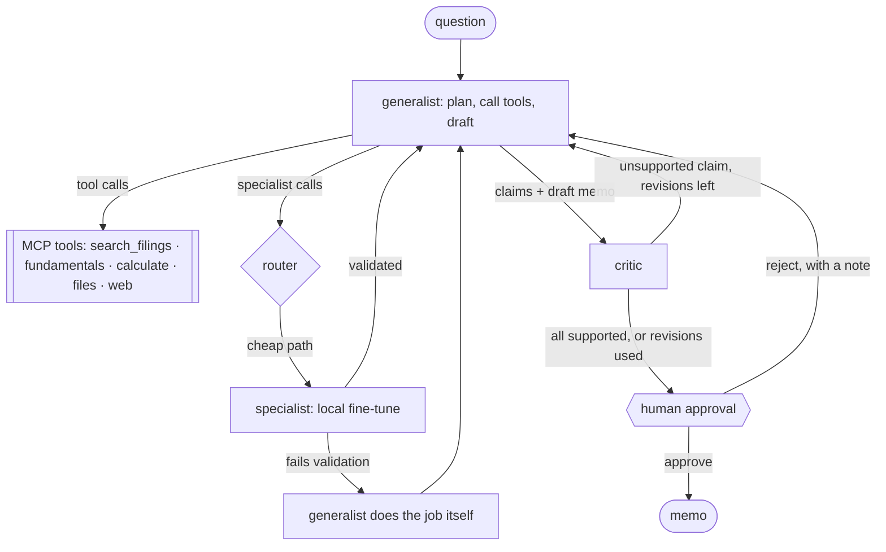

# The finance agent: a generalist with routed specialists

*Milestone `v1.0-capstone`, Fri 2026-10-30. First written 2026-10-08 as a four-agent filings analyst;
rewritten 2026-10-12 around a generalist with specialists, at Vedant's call. Week 6 builds it, Week 7
evaluates and serves it, Week 8 ships it.*

## The idea

One capable, expensive model with the right tools can answer almost any finance question: search
the filings, look up fundamentals, calculate, read and write files, search the web. But many of the
steps inside an answer are narrow and repetitive — pull the figures out of these passages, classify
this section — and a small fine-tuned model can do those at a fraction of the cost, locally.

So the system is a **generalist that orchestrates, specialists that do narrow jobs, and a router
behind each specialist that decides whether the cheap path is good enough** — falling back to the
generalist when it is not. The headline measurement is the trade the router makes: cost against
quality, against a generalist doing everything.

An analyst asks *"Did ITC's dividend payout ratio rise in FY25, and how does it compare with
Reliance's?"* and gets a short memo in which every claim cites the page it came from, every computed
figure shows its inputs, and a critic has checked each claim against its source before a human
approves it.

## Architecture



| Part | Does | Model |
|---|---|---|
| **generalist** | Plans, calls tools and specialists, writes claims and the memo, each claim citing its sources | Sonnet 5 while building, Opus 5 for reported numbers |
| **specialists** | Narrow jobs, each behind a tool: the **report analyst** (`extract_figures`: filing passages → `{metric, value, unit, year}` records). The headline reader was removed on 2026-10-19 (below) | LoRA fine-tunes of Qwen3-4B, served from one GPU endpoint |
| **router** | Per specialist call: try the specialist, validate its output, fall back to the generalist on failure; log both | Code, not a model (a learned router is a Week 7 experiment) |
| **critic** | Checks each claim against exactly the sources it cites: supported, unsupported, or wrong (figure, year, company). Never sees the generalist's reasoning | A different model from the generalist |
| **human gate** | Approves the memo, or rejects it with a note that becomes a constraint | — |

## Tools, over MCP

The generalist gets its tools from **MCP servers through one client adapter** — which is the Week 6
MCP client: a tool it did not write joins the loop like its own, counted, fenced as untrusted when it
returns third-party text, and traced.

Built 2026-10-13 as `mcp_client.connect`: a server's listing becomes the schemas the model is shown,
and its calls go through the same dispatcher type as our own tools. Our own server fences what it
returns, so it is connected unfenced; any other server's text, errors included, is fenced.

| Tool | Server | Status |
|---|---|---|
| `search_filings(query, company, year)` | aigent's MCP server | built (step 1) and served (step 3, 2026-10-13): six filings, scoped by company and financial year |
| `fundamentals(ticker, metric, year)` | aigent's MCP server | built (step 1) and served (step 3): 24 figures, each cited to its page |
| `calculate(expression)` | aigent's MCP server | built (`underhood.tools`) and served (step 3) |
| `read_file`, `write_file` | aigent's MCP server | built, sandboxed |
| `web_search` | Anthropic's server tool | built; **off in evals**, since a web figure has no frozen ground truth |

## Specialists, and how the generalist calls them

**A specialist is prompted by its adapter, never by the generalist.** A fine-tune works only on the
prompt it was trained on — a paraphrase is out of distribution. So the generalist calls a specialist
as a tool with **structured arguments**, and the adapter renders the exact training prompt.

What the generalist sees is a **specialist card** — the tool's description and schema:

| Field | Report analyst: `extract_figures` (since 2026-10-19) |
|---|---|
| good at | the figures a question needs from one company's annual report: metric, value with any named scale applied, unit, financial year |
| arguments | `question` (word for word, as the generalist was asked it), `ticker`, `year` (the financial year the report ends) |
| does | searches that report itself (`search_report`, scoped in code to the ticker and year), calculates scales and percentages, answers |
| returns | `[Figure]`, each with the `chunk_id` of the passage it is printed in; the generalist never reads the passages, the critic does |
| limits | one company's report for one year a call, though a report also states the year before; no arithmetic across figures; a figure the report does not state is left out |

Behind the card, the specialist is a small contract, in code:

| Piece | Report analyst |
|---|---|
| render | `research_messages(question, company, report)` + `search_report` and `calculate` (`extraction.research`) |
| model | **v4**, to be trained on that prompt (step 3 of the 2026-10-19 plan); the served v3 knows only the per-passage prompt |
| validate | parses as `SourcedFigures`; every figure's passage is one its searches returned, and its value is a number that passage prints (`check_call`'s rules), all or nothing |
| fallback | the same job on the generalist: the same prompt, tools and check; an answer that fails it too is an error |
| log | which path answered, the validation failure if any, tokens and latency |

## Serving

The specialists run on a GPU, not the laptop: local serving loads the machine and does not scale.

```
aigent's router ──HTTP, OpenAI format──▶ vLLM endpoint: Qwen3-4B (loaded once)
                                          └─ LoRA: report-analyst
```

- **One endpoint per base model, many adapters per endpoint.** vLLM serves one base per process and
  applies whichever LoRA a request names (multi-LoRA), batching across adapters. Every specialist so far
  is a Qwen3-4B fine-tune, so they share one endpoint. A future specialist on another base is a second
  endpoint; aigent's client table already maps a specialist to a URL and a model name.
- **Scale to zero.** The endpoint is serverless: it starts on the first call and stops when idle, so
  cost follows use. The price is a cold start, which the latency numbers report.
- **Why not MLX:** the Week 4 headline adapter runs only on Apple silicon (MLX targets Metal; cloud
  GPUs are CUDA), and it was trained on a 4-bit base, so the headline reader is retrained with PEFT on
  the shared base instead of converted.

## State

<!-- fmt:off -->
```python
class State(TypedDict):
    question: str
    messages: list[Message]                           # the generalist's loop
    evidence: Annotated[dict[str, Passage], merge]    # by chunk id: a re-search adds, never repeats
    routed: list[Routing]                             # each specialist call: path taken, why, cost
    claims: list[Claim]
    verdicts: dict[str, Verdict]                      # claim id -> supported | unsupported | wrong
    memo: Memo | None
    revisions: int                                    # critic loops used, capped at two
    review: Review | None                             # the human's decision and note
```
<!-- fmt:on -->

The graph runs with a checkpointer, which is what lets it stop at the human gate and resume later.
The output is one validated Pydantic `Memo`: a two-sentence summary, claims each with at least one
citation (a chunk id or a fundamentals key) and the figures behind it, and caveats.

## Failure modes, and what catches each

| Failure | Guard |
|---|---|
| The specialist returns malformed or unfaithful figures | validation in the router; fallback to the generalist, counted |
| The generalist prompts a specialist in its own words | it cannot: the adapter renders the prompt from structured arguments |
| The right figure from the wrong year | `search_filings` scoped by year; every figure carries its year; the critic names year mismatches |
| A claim whose citation does not say what it claims | the critic, per claim |
| A claim with no citation | `Claim.citations` has a minimum of one |
| Arithmetic done in the head | computed values come from `calculate`, with their inputs |
| A critic–generalist loop | revisions capped at two, then the human sees what is still unsupported |
| Instructions planted in a filing or a web page | tool output fenced as untrusted (invariant 28) |
| A run that costs too much | `llm.core`'s free count and per-task ceiling on every call |
| The specialists' endpoint is cold | the call waits for it to start and takes the specialist's answer; a session warms it with one request first |
| The specialists' endpoint cannot be reached, even after that wait and one retry | the task fails and says so: nothing answers in the specialist's place (Vedant, 2026-10-13, while we are learning) |

## Eval plan

**50 tasks with ground truth**, written by hand — single figures, year over year, across companies,
computed from filings and fundamentals, multi-hop, must-decline, and **headline-to-filing** tasks
that start from a pasted headline ("*Tata Motors' Q4 profit falls 51%* — what did its FY25 report
say about the year?"), so one task exercises both specialists — each naming the facts the answer
must hold and the pages they are on. Each specialist is also scored on its own set: the 50
hand-labelled headlines and the 43 hand-labelled figure cases.

**The comparison that is the headline:** the same 50 tasks, three times each to measure noise
first, under

| Arm | Who reads headlines and extracts figures |
|---|---|
| generalist only | the generalist itself |
| routed | the specialists, each falling back on failed validation |

| Metric | How |
|---|---|
| task success, faithfulness | free graders plus the judge, as in Project 2 |
| cost per task, latency | from `llm.core`'s billing and the trace |
| **cost saved by routing** | generalist-only cost per task minus routed cost per task, p50 and total over the 50 |
| **saved per specialist call** | what each specialist call would have cost on the generalist (priced from its tokens at the generalist's rates) minus what it cost — a counterfactual, logged per call |
| **specialist hit rate** | share of specialist calls that passed validation |
| **routing regret** | tasks the routed arm failed that the generalist-only arm passed |
| critic agreement | the critic's verdicts against the judge's |

**A self-hosted specialist is not free per call.** On a GPU billed by the second, a specialist call
costs its share of the endpoint's running time, and an idle endpoint costs nothing only because it
scales to zero — cold starts are the price. So `s` below is measured, not assumed, and the saving is
reported at the request rates the runs actually had.

**Cost saved is not free money.** A specialist call that fails validation costs its own latency
and local compute and then the generalist's call on top, so routing pays only above a break-even hit
rate: with the generalist's cost for the job `g`, the specialist's `s` (near zero locally) and hit rate
`h`, the routed cost is `s + (1 - h)·g` against `g`, so it saves when `h > s / g`, and every point of
hit rate above that is saved money. Latency has the same shape, and a slow local model can lose on
time while winning on money. Both are reported, so the claim is "routing saved X% at Y regret", never
a saving alone.

An iteration counts only if it clears the run-to-run spread. Every paid run is estimated first and
needs its own go-ahead.

## Build order

**Week 6:**

1. ~~The corpus and tools: FY24 reports, `search_filings` scoped by company and year, the
   fundamentals table.~~ Done 2026-10-12 (`analyst.filings`, `analyst.fundamentals`).
2. **Serve the specialists:** retrain the headline reader as a PEFT LoRA on Qwen3-4B and score it
   on the 50 headlines against the Week 4 adapter's 41/50; serve it and the report analyst from one
   vLLM endpoint that scales to zero; check the served outputs match the training-time evals.
3. ~~**The MCP side:** add `search_filings` and `fundamentals` to aigent's MCP server; the MCP client
   adapter that loads a server's tools into the generalist's loop.~~ Done 2026-10-13
   (`mcp_server`, `mcp_client`); wired into the generalist in step 5.
4. **The router and the specialist contract**, for both specialists, with validation and fallback,
   tested against fakes before any model runs. Built 2026-10-13, all against fakes: the contract and both checks
   (`analyst.specialists`), the router (`analyst.router`), the `hostllm` clients priced at the
   served rate, and both specialists wired to models with the warm-up (`analyst.served`). Not yet
   run against the live endpoint.
5. **The graph:** generalist loop, critic, human gate with a checkpointer — stubs first, prompts
   after. Built 2026-10-13 against fakes (`analyst.toolbox`, `analyst.memo`, `analyst.graph`): the
   critic is Opus 5 while building (Vedant's call), and an eval's approver always approves. The
   generalist chooses its specialists from their cards, by a prompt that names none and asks it to
   explain a decision to call none (Vedant, 2026-10-13, after the first live run called none).
6. The 50 tasks, then the first baseline runs. Before them, the plan of 2026-10-14 (below).

**Week 7:** the routed-vs-generalist comparison, the critic iteration, the judge bake-off, a learned
router from the eval logs, HTTP and a container, the CI gate.

**Week 8:** README, diagram, walkthrough, write-up, tag.

## Plan from 2026-10-14

Drawn up after the 20 probe questions (`evals/datasets/analyst-probe.jsonl`) ran in parallel on
vLLM with Sarvam as the generalist: 13 of 19 finished with supported memos. The failures and their
causes are in `LOG.md`.

**Phase 1, robustness** (built 2026-10-14, against fakes):

1. `extract_figures` returns the passages that passed and lists each that failed, with why.
2. A tool call repeating one that failed is refused unrun, with the first failure.
3. A calm generalist never reasons writing the memo.
4. Dropped (Vedant): a reply that reasoned through its whole cap is not asked again; a generalist
   that never calls a specialist gets no extra tries, and its empty answer is a failure.
5. Tool calls a server leaked as text are read back on every OpenAI-wire reply.
6. A memo of no claims stops the run, counted a failure (Vedant: no redraft).
7. The critic's verdict cap is 1024.
8. A read headline carries a `cite_as` and is evidence.
9. The figure check reads `N * 10000000`, `N*1e7` and `(N * 10**7)` as `N * 10**7`.

Also: the analyst's settings moved to `analyst/cfg_analyst.py` (Vedant).

**Phase 2:** the 20 probe questions again, in parallel on vLLM, to measure Phase 1 (target: 18+ of
20 with supported memos).

**Phase 3, step 6:** ground truth for the probe questions, grown to the 50 tasks; correctness,
routing rate, cost and latency, across Sonnet, Haiku and Sarvam as generalists, each with and
without specialists; vLLM's tokens priced from its bench.

**Phase 4:** findings into this file; the commits to `main` by PR; hostllm's docs note that the
capstone runs its specialists on vLLM.

**Parked:** hostllm inference optimisation; the learned router.

## Final results (2026-10-14)

The capstone closes at this revision (Vedant). Generalist Sarvam 105B at medium reasoning, calm once
a specialist has answered; critic Opus 5; specialists on vLLM, four questions at a time, with ap-16
and ap-18 rerun on hostllm after ITC joined the headline directory, ap-16 once more after each
engine got its own figures-answer cap. Over the 20 probe questions:

| Outcome | Questions |
|---|---|
| Every claim supported (16) | ap-02, 03, 05, 06, 07, 08, 09, 10, 11, 12, 13, 15, 16, 17, 19, 20 |
| Most claims supported (3) | ap-04 3/4, ap-14 12/14, ap-18 2/3 |
| No memo (1) | ap-01, its last research turn all reasoning with no specialist called |

**19 of 20 with a supported memo**, from 5 of 11 before Phase 1 and calm thinking. Every refused
claim was the generalist's: a standalone figure called consolidated, a growth rate across a restated
basis, a ratio the sources do not state. The specialists answered most jobs that reached them; the
fallback, and a check that refuses what a passage does not print, caught the rest.

**What it cost:** about $3.55 for the 20 on vLLM, of which the Opus critic is the largest share and
the GPU about $0.47 for 35 minutes. Every run of the day, from the first Haiku pass, is in `LOG.md`
(about $9.90 in all).

**Left open:** the ground-truth eval (step 6), the generalist comparison, and pricing vLLM's tokens;
Modal's 150 s per request, which no setting raises: hostllm's figures answers are capped at 512
tokens to end inside it, and long answers want Modal's spawn-and-poll pattern; a generalist that reasons through its cap with
no specialist to calm it fails, by decision.

## Findings so far

- **A specialist saves money only if the generalist never reads what the specialist reads**
  (2026-10-19). Served prompt tokens cost $0.066/M, about a thirtieth of Sonnet's, but served
  answer tokens cost $26/M, above Sonnet's $10/M. The headline reader read a line the generalist
  had already read and wrote a dozen tokens, so every call cost more than the generalist doing it:
  it was removed (Vedant), and its adapter, rows, prompt and training setup are kept in underhood's
  `finetunes/headline-flavour/` for a later use. `extract_figures` as built reads passages `search_filings` already put in
  the generalist's context ($0.0085 a call against $0.0013 for the same tokens on the generalist, on
  2026-10-14). So since 2026-10-19 (Vedant) the generalist sends the question word for word with
  a ticker and a filing year, and the specialist searches and reads for itself; the generalist
  keeps `search_filings` for when it does the job itself. The card states no price: the generalist
  does not weigh cost to delegate (Vedant); the eval measures what routing saves.

- **A task that is too trivial does not go to the specialist, even when offered and coaxed**
  (2026-10-13, three questions, seven research passes, three drafts of the prompt). Sonnet 5 called
  `extract_figures` once, on a redraft, and its stated reason for not calling it was always that the
  figure "was stated directly and unambiguously in the retrieved passage". A generalist does not
  delegate work it finds trivial, and cost does not enter its choice. The generalist keeps the
  decision (Vedant); the eval reports how often it routes, and its tasks need narrow jobs big enough
  to be worth handing over. The runs are in `LOG.md`.

## Parked, to try later

- **A structure-aware index of the filings** (Vedant, 2026-10-19). Sentence chunking cuts a table
  from its heading, so a chunk can print a number without the scale its table states: in the first
  v4 smoke run the teacher knew Wipro reports in millions but no passage it cited said so, and a Sun
  Pharma table's "(in Million)" sat two chunks before the number. Wipro, Sun Pharma and HDFC state a
  scale once per statement section (15 to 24 of 1,300 to 2,000 chunks name one), Bajaj Auto and Power
  Grid once per table. Extracting tables as tables, labelled with their scale, unit, period columns
  and basis, would fix this at the source, and likely the segment-table and standalone/consolidated
  misreads too. Considered and set aside for now: a second citation for the heading's passage
  (`scale_id`), with a `read_before` tool to fetch the chunks before a table. **Taken up on
  2026-10-20** (Vedant) as approaches 1 to 4 of the literature below: Docling as every
  chunker's parser, and a new chunker, `by_element`.
- **Docling as the parser**, first set aside for pdfplumber (2026-10-20, Vedant: "we can come back
  to it if we dont get good results") and adopted the same day, after pdfplumber's text found 48
  of the retrieval eval's 54 quotes and Docling's 54. Its TableFormer reads merged cells and multi-level headers that rule-based parsers
  miss, and its `DoclingDocument` keeps section hierarchy and captions; it needs torch models at
  load, where pdfplumber is pure Python. pdfplumber was chosen first for leading on table pages in
  a 2026 benchmark (MRR 0.807 against PyPDF2's 0.758, arXiv 2604.12047).
- **From the literature search of 2026-10-20, set aside to try later** (Vedant):
  - *Tables as data*: extract tables into records (rows, period columns, unit, scale, basis) and
    query them as data, after TableRAG's schema and cell retrieval (arXiv 2410.04739) and the
    scale prediction TAT-QA and FinQA call for.
  - *XBRL as a structured source*: Regulation 33 results filed to NSE and BSE in XBRL, standalone
    and consolidated with segment results, and the full statements in MCA's AOC-4 XBRL, every
    value tagged with entity, period and unit; headline figures, not narrative KPIs or notes.
  - *A knowledge graph beside the vectors*: HybridRAG (arXiv 2408.04948), which beat vector and
    graph retrieval alone on Nifty-50 earnings calls.
  - *Retrieval over page images*: ColPali and its ViDoRe benchmark (arXiv 2407.01449), embedding
    page images and skipping text extraction; it would put a vision model in the specialist's loop.

## Open questions

- **Is the specialist good enough to be worth routing to?** v2 passed 28/43 on the old labels; v3's
  numbers are pending. A low hit rate is a result, not a failure: it says when a fine-tune earns its
  place.
- **The critic's model.** A different model from the generalist; which way round is a Week 7
  measurement.
- **More specialists.** Once the contract serves two, a third (section classification, note
  summarisation) is a data and training job, not new plumbing.
