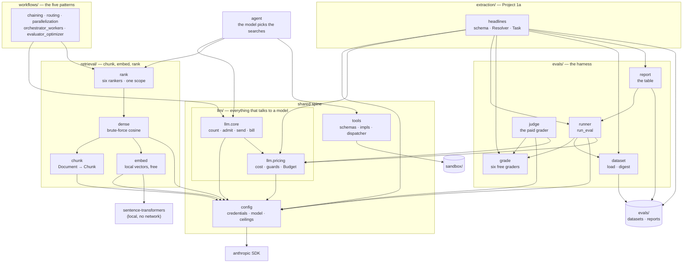

# aigent knowledge graph

A map of this repo for agents: every module, symbol, edge and invariant, what each promises, and the
decisions behind it. It is ~90k tokens, so search and slice it; never read it whole.

## How to read this file

- **A node:** ``grep -n '^#### `llm.core' docs/knowledge-graph.md``, then read from that line to the next
  `####`. Node ids are `module.Symbol` and survive line drift; cite them in notes.
- **Inside a node** the fields come in one order, each one line: `At` (generated `file:line`), `Is`,
  `Contract`, `Invariants`, `Gotchas`, `History`, `Named at` (seams only), `Decided in`. Stop once
  you have what you need: what holds now comes first, the dated story last.
- **History and rejected options stay** so work is not redone. `Decided in` points at the record:
  `LOG.md MM-DD` is the `- MM-DD:` entry there (`grep -n '^- 10-13' LOG.md`), `docs/…` a design doc.
- **Who imports X:** `grep -- '—imports→ X' docs/knowledge-graph.md` (§3, generated).
  **What X imports:** `grep '^X —imports→'`.
- **An invariant:** `grep -n 'Invariant 12:'` (§4). **Open work:** §5.1.
- **Generated parts** — the contents below, every `At:` line and the §3 import edges — are written by
  `uv run python scripts/graph_doc.py --write` and checked in CI and the pre-commit hook. Never edit
  them by hand. The same check fails on a node naming a symbol or path that no longer exists, on a
  §3 layering rule an import breaks, and on fields out of order.
- If the code and this file disagree, trust the code and fix this file in the same commit.

## Contents

<!-- generated:toc (uv run python scripts/graph_doc.py --write) -->
- L528 0. Orientation
- L614 1. Shape of the system
- L684 2. Nodes
  - L688 2.1 Modules
    - L690 `config`
    - L695 `llm.pricing`
    - L702 `llm`
    - L709 `llm.messages`
    - L716 `llm.adapters`
    - L725 `llm.adapters.openai.function_tool`
    - L732 `llm.adapters.cfg_hostllm`
    - L739 `llm.adapters.retry`
    - L748 `llm.core`
    - L757 `guardrails`
    - L765 `errors`
    - L773 `tracing`
    - L780 `transcript`
    - L787 `tools`
    - L795 `report_tools`
    - L802 `mcp_server`
    - L810 `mcp_client`
    - L818 `analyst.specialists`
    - L825 `analyst.cfg_analyst`
    - L832 `analyst.router`
    - L840 `analyst.served`
    - L848 `analyst.toolbox`
    - L855 `analyst.experts`
    - L862 `analyst.memo`
    - L869 `analyst.graph`
    - L877 `analyst.run`
    - L884 `analyst.teach`
    - L891 `tools_config`
    - L898 `analyst`
    - L904 `analyst.filings`
    - L911 `analyst.fundamentals`
    - L919 `facts`
    - L926 `facts.cfg_facts`
    - L932 `facts.xbrl`
    - L940 `facts.nse`
    - L945 `facts.store`
    - L953 `facts.check`
    - L958 `facts.build`
    - L965 `facts.taxonomy`
    - L973 `facts.lookup`
    - L981 `facts.reference`
    - L989 `facts.coverage`
    - L997 `facts.documents`
    - L1005 `facts.crosscheck`
    - L1013 `extraction.figures`
    - L1022 `extraction.research`
    - L1029 `extraction.figure_training`
    - L1037 `extraction.figure_eval`
    - L1044 `extraction.headline_eval`
    - L1051 `extraction.synthetic`
    - L1058 `extraction.baseline`
    - L1066 `extraction.headlines`
    - L1071 `evals.dataset`
    - L1075 `evals.grade`
    - L1082 `evals.judge`
    - L1086 `evals.runner`
    - L1090 `evals.report`
    - L1094 `retrieval.chunk`
    - L1102 `retrieval.embed`
    - L1109 `retrieval.dense`
    - L1116 `retrieval.corpus`
    - L1124 `retrieval.questions`
    - L1128 `retrieval.evaluate`
    - L1135 `retrieval.langchain_rag`
    - L1140 `retrieval.sparse`
    - L1144 `retrieval.fuse`
    - L1148 `retrieval.rerank`
    - L1153 `retrieval.hits`
    - L1158 `retrieval.rank`
    - L1164 `retrieval.keys`
    - L1171 `workflows.reports`
    - L1175 `workflows.{chaining, routing, parallelization, orchestrator_workers, evaluator_optimizer}`
    - L1178 `workflows.orchestrator_workers_graph`
    - L1185 `agent`
    - L1192 `agent_graph`
    - L1199 `agent_adk`
    - L1207 `agent_tasks`
    - L1216 `retrieval.answer`
  - L1221 2.2 Settings (`config`)
    - L1225 `config.MODEL`
    - L1230 `config.JUDGE_MODEL`
    - L1236 `config.SMALL_MODEL`
    - L1243 `config.MAX_USD_PER_REQUEST`
    - L1248 `config.MAX_USD_PER_TURN`
    - L1255 `config.MAX_USD_PER_RUN`
    - L1259 `config.WEB_SEARCH_RESULT_TOKENS`
    - L1266 `config.MAX_USD_PER_EVAL`
    - L1270 `config.MAX_USD_PER_TASK`
    - L1277 `config.DEFAULT_MAX_TOKENS`
    - L1285 `config.MAX_AGENT_TURNS`
    - L1292 `config.MIN_TOKENS_FINAL_ANSWER`
    - L1296 `config.MAX_PARALLEL_CALLS`
    - L1301 `config.EVAL_WORKERS`
    - L1308 `config.BATCH_POLL_SECONDS`
    - L1314 `config.THINKING_WORKFLOW_PARAM`
    - L1320 `config.MAX_PLAN_TASKS`
    - L1325 `config.MAX_GRAPH_STEPS`
    - L1329 `config.MAX_FAILURES_SHOWN`
    - L1333 `config.TRACING`
    - L1338 `config.MAX_TASK_CHARS`
    - L1342 `config.MCP_SERVER_NAME`
    - L1348 `config.MCP_CALL_TIMEOUT_SECONDS`
    - L1354 `analyst.cfg_analyst.SPECIALIST_TRIES`
    - L1360 config.GENERALIST_MODEL and the analyst's other settings (moved)
    - L1365 `config.EMBED_MODEL`
    - L1371 `config.EMBED_LOG_EVERY`
    - L1375 `config.EMBED_SAVE_EVERY`
    - L1381 `config.EMBED_QUERY_PREFIXES`
    - L1388 `config.LOCAL_MODEL_DTYPE`
    - L1395 `config.CHUNK_*`
    - L1400 `config.ELEMENT_*`
    - L1406 `config.HEADING_*`
    - L1409 `config.PASSAGE_MIN_CHARS`
    - L1415 `config.TOP_K`
    - L1419 `config.BM25_K1`
    - L1424 `config.FUSE_DEPTH`
    - L1429 `config.RRF_K`
    - L1435 `config.RERANK_*`
    - L1440 `config.KEY_DEPTH`
    - L1444 `config.SEARCH_METHOD`
    - L1452 `config.FURNITURE_*`
    - L1457 `config.THINKING_EVAL_PARAM`
    - L1465 `config.CACHE_TTL`
    - L1472 `config.FIGURE_LABEL_*`
    - L1478 `config.RESEARCH_*`
    - L1483 `config.SYNTHETIC_*`
    - L1488 `config.BASELINE_*`
    - L1494 `config.PAGE_SEPARATOR`
    - L1498 `config.DOCLING_OCR`
    - L1506 `llm.adapters.anthropic.has_credentials`
    - L1513 `llm.adapters.anthropic.get_client`
    - L1520 `llm.adapters.anthropic.batch_params`
  - L1525 2.3 Cost and budget (`pricing`)
    - L1534 `llm.pricing.Price`
    - L1541 `llm.pricing.PRICES`
    - L1548 `llm.pricing.PRICE_PER_WEB_SEARCH`
    - L1553 `llm.pricing.BATCH_DISCOUNT`
    - L1561 `llm.pricing.cost_usd`
    - L1567 `llm.messages.Usage`
    - L1574 `llm.messages.Failed`
    - L1579 `llm.pricing.usage_cost`
    - L1583 `llm.pricing.describe_usage`
    - L1587 `errors.BudgetExceeded`
    - L1592 `errors.BatchUnfinished`
    - L1600 `llm.pricing.worst_case_usd`
    - L1608 `llm.pricing.affordable_output_tokens`
    - L1613 `llm.pricing.estimate_eval_usd`
    - L1619 `llm.pricing.assert_request_within_budget`
    - L1627 `llm.pricing.Budget`
    - L1635 `llm.pricing.Budget.admit`
    - L1643 `llm.pricing.Budget.held_usd`
    - L1650 `llm.pricing.Budget.tripped`
  - L1655 2.4 The model door (`llm`)
    - L1664 `llm.core.Request`
    - L1671 `llm.core.Llm`
    - L1676 `llm.core.Llm.for_eval`
    - L1682 `llm.core.Llm._traced`
    - L1689 `llm.core.Llm.count`
    - L1694 `llm.core.Llm.create`
    - L1699 `llm.core.Llm.parse`
    - L1706 `llm.core.Llm.stream`
    - L1710 `llm.core.Llm.gather_text`
    - L1715 `llm.core.Llm.batch_records`
    - L1723 `llm.core.Llm._admit`
    - L1730 `llm.core.Rehearsed`
    - L1735 `errors.SpecialistUnreachable`
    - L1742 `errors.StepFailed`
    - L1747 `llm.core.describe`
    - L1752 `llm.messages.is_client_tool`
    - L1757 `llm.core._writes_cache`
    - L1762 `llm.core.Llm.run_tools`
    - L1769 `llm.core.Llm.price`
    - L1776 `llm.core.Llm.turn`
    - L1783 `llm.core.ToolRun`
    - L1788 `llm.core.Llm._last_answer`
    - L1794 `llm.core.Llm._admit_turn`
    - L1798 `llm.core.Llm._held`
    - L1803 `errors.TurnsExhausted`
    - L1808 `llm.core.Dispatch`
    - L1813 `llm.adapters.anthropic._runnable`
  - L1818 2.5 Tools (`tools`, `report_tools`)
    - L1825 `tools.calculate`
    - L1829 `tools.current_time`
    - L1833 `tools.read_file`
    - L1838 `tools.write_file`
    - L1846 `tools_config.SANDBOX`
    - L1851 `tools_config.MAX_WEB_SEARCHES`
    - L1857 `tools.CALCULATOR_TOOL`
    - L1862 `tools.ALL_TOOLS`
    - L1869 `tools.WEB_SEARCH_TOOL`
    - L1876 `tools.execute_tool`
    - L1883 `tools.WRITE_TOOLS`
    - L1889 `report_tools.SEARCH_TOOL`
    - L1894 `report_tools.ReportSearch`
    - L1899 `report_tools.Searched`
  - L1903 2.7 Project 1a (`extraction`)
    - L1905 `extraction.headlines.Extraction`
    - L1911 `extraction.headlines.METRICS`
    - L1918 `extraction.headlines.QUARTERS`
    - L1924 `extraction.headlines.Resolver`
    - L1931 `extraction.headlines.report_unresolved`
    - L1936 `extraction.headlines.load_directory`
    - L1940 `extraction.headlines.Variant`
    - L1945 `extraction.headlines.CACHE_VARIANTS`
    - L1953 `extraction.headlines.THINKING`
    - L1960 `extraction.headlines.measure`
    - L1967 `extraction.headlines.VARIANTS`
    - L1973 `extraction.headlines.extraction_task`
    - L1980 `extraction.headlines.main`
  - L1988 2.8 Retrieval (`retrieval`)
    - L1994 `retrieval.chunk.Document`
    - L1999 `retrieval.chunk.Chunk`
    - L2004 `retrieval.chunk.Inventory`
    - L2010 `retrieval.chunk.squeeze`
    - L2017 `retrieval.chunk.Inventory.containing`
    - L2023 `retrieval.chunk.fixed`
    - L2029 `retrieval.chunk.sentences`
    - L2036 `retrieval.chunk.by_sentence`
    - L2044 `retrieval.chunk.headings`
    - L2049 `retrieval.chunk.by_heading`
    - L2056 `retrieval.chunk.by_element`
    - L2064 `retrieval.embed.Embedder`
    - L2069 `retrieval.embed.query_prefix_of`
    - L2075 `retrieval.embed.LocalEmbedder`
    - L2082 `retrieval.embed.LocalEmbedder.embed_query`
    - L2087 `retrieval.embed.LocalEmbedder.count_truncated`
    - L2092 `retrieval.hits.Hit`
    - L2097 `retrieval.dense.DenseIndex`
    - L2102 `retrieval.dense.DenseIndex.build`
    - L2110 `retrieval.dense.DenseIndex.search`
    - L2115 `retrieval.dense.DenseIndex.build_cached`
    - L2122 `retrieval.dense.store_file`
    - L2129 `retrieval.hits.rank_ids`
    - L2133 `retrieval.corpus.read_pages`
    - L2142 `retrieval.corpus.normalise`
    - L2147 `retrieval.corpus._skeleton`
    - L2152 `retrieval.corpus.strip_furniture`
    - L2160 `retrieval.corpus.to_document`
    - L2166 `retrieval.corpus.load_pdf`
    - L2171 `retrieval.questions.Question`
    - L2176 `retrieval.questions.eligible`
    - L2181 `retrieval.questions.sample_passages`
    - L2186 `retrieval.questions.verify`
    - L2194 `retrieval.questions.generate`
    - L2199 `retrieval.corpus.cache_file`
    - L2205 `retrieval.corpus.load_pdf_cached`
    - L2213 `retrieval.corpus.load_corpus`
    - L2220 `retrieval.evaluate.STRATEGIES`
    - L2227 `retrieval.evaluate.graders`
    - L2232 `retrieval.evaluate.load_cases`
    - L2239 `retrieval.evaluate.label_of`
    - L2246 `retrieval.evaluate.report_of`
    - L2253 `retrieval.evaluate.resolve`
    - L2259 `retrieval.evaluate.retrieval_task`
    - L2266 `retrieval.evaluate.main`
    - L2273 `retrieval.langchain_rag.prepare`
    - L2279 `retrieval.langchain_rag.langchain_task`
    - L2284 `retrieval.sparse.tokenise`
    - L2289 `retrieval.sparse.SparseIndex`
    - L2294 `retrieval.fuse.reciprocal_rank_fusion`
    - L2300 `retrieval.rerank.Reranker`
    - L2305 `retrieval.rerank.LocalReranker`
    - L2312 `retrieval.keys.build_keys`
    - L2317 `retrieval.keys.table_context`
    - L2321 `retrieval.keys.ParentRanker`
    - L2326 `retrieval.keys.keyed_search`
    - L2331 `retrieval.rerank.rerank`
    - L2337 `retrieval.rank.METHODS`
    - L2344 `retrieval.rank.Ranker`
    - L2349 `retrieval.rank.Indexes`
    - L2357 `retrieval.rank.DenseRanker`
    - L2362 `retrieval.rank.HybridRanker`
    - L2366 `retrieval.rank.Reranked`
    - L2371 `retrieval.rank.scoped`
    - L2378 `retrieval.rank.build_ranker`
    - L2383 `retrieval.chunk.context_block`
    - L2390 `retrieval.evaluate.ranker_task`
    - L2397 `retrieval.evaluate.compare_retrieval`
    - L2404 `retrieval.answer.ARMS`
    - L2409 `retrieval.answer.Answer`
    - L2414 `retrieval.answer.answer_task`
    - L2421 `retrieval.answer.graders`
    - L2427 `retrieval.answer.main`
  - L2434 2.9 The workflow patterns (`workflows`)
    - L2442 `workflows.reports.DocId`
    - L2447 `workflows.reports.Search`
    - L2452 `workflows.reports.build_search`
    - L2459 `workflows.chaining`
    - L2465 `workflows.routing`
    - L2470 `workflows.parallelization`
    - L2475 `workflows.orchestrator_workers`
    - L2480 `workflows.evaluator_optimizer`
    - L2485 `workflows.orchestrator_workers_graph.build`
  - L2491 2.10 The first agent (`agent`)
    - L2508 `agent.TOOLS`
    - L2513 `agent.cited`
    - L2518 `agent.WebSources`
    - L2525 `agent.run`
    - L2530 `agent.FINISH`
  - L2534 2.11 The eval harness (`evals`)
    - L2539 `evals.dataset.Case`
    - L2544 `evals.dataset.load_jsonl`
    - L2549 `evals.dataset.digest`
    - L2554 `evals.grade.Outcome`
    - L2559 `evals.grade.Score`
    - L2564 `evals.grade.Grader`
    - L2569 `evals.grade.BatchGrader`
    - L2574 `evals.grade.exact_match`
    - L2579 `evals.grade.regex`
    - L2585 `evals.grade.pydantic_valid`
    - L2589 `evals.grade.field_match`
    - L2594 `evals.grade.flag`
    - L2601 `evals.grade.right_tools`
    - L2608 `evals.grade.resolvable`
    - L2614 `evals.grade.recall_at_k`
    - L2620 `evals.grade.hit_at_k`
    - L2627 `evals.grade.reciprocal_rank`
    - L2632 `evals.judge.LlmJudge`
    - L2639 `evals.judge.Verdict`
    - L2644 `evals.runner.Task`
    - L2649 `evals.runner.RowResult`
    - L2654 `evals.runner.EvalRun`
    - L2659 `evals.runner.run_eval`
    - L2667 `evals.runner.combine`
    - L2673 `evals.report.to_markdown`
    - L2678 `evals.report._metrics_table`
    - L2683 `evals.report._grading_models`
    - L2687 `evals.report.write_report`
  - L2694 2.12 Tests
    - L2696 `tests.llm.test_pricing`
    - L2703 `tests.test_tools`
    - L2710 `tests.llm.test_core`
    - L2717 `tests.conftest.FakeAnthropic`
    - L2723 `tests.workflows.test_<pattern>`
    - L2729 `tests.test_agent`
    - L2734 `tests.test_agent_graph`
    - L2741 `tests.test_agent_adk`
    - L2748 `tests.test_agent_tasks`
    - L2755 `tests.llm.test_batch`
    - L2762 `tests.test_report_tools`
    - L2767 `tests.workflows.test_patterns`
    - L2772 `tests.workflows.test_reports`
    - L2779 `tests.conftest.make_judge`
    - L2784 `tests.conftest.CAPPED`
    - L2791 `tests.test_api_smoke`
    - L2795 `tests.evals.test_dataset`
    - L2800 `tests.evals.test_graders`
    - L2807 `tests.conftest.KeywordReranker`
    - L2812 `tests.conftest.BagOfWordsEmbedder`
    - L2817 `tests.retrieval.test_chunk`
    - L2822 `tests.retrieval.test_corpus`
    - L2829 `tests.retrieval.test_questions`
    - L2835 `tests.retrieval.test_answer`
    - L2840 `tests.retrieval.test_langchain_rag`
    - L2846 `tests.retrieval.test_sparse`
    - L2851 `tests.retrieval.test_fuse`
    - L2857 `tests.retrieval.test_rerank`
    - L2862 `tests.retrieval.test_evaluate`
    - L2869 `tests.retrieval.test_keys`
    - L2876 `tests.retrieval.test_embed`
    - L2883 `tests.retrieval.test_rank`
    - L2888 `tests.retrieval.test_dense`
    - L2896 `tests.evals.test_runner`
    - L2903 `tests.extraction.test_synthetic`
    - L2910 `tests.extraction.test_baseline`
    - L2917 `tests.extraction.test_headlines`
    - L2924 `tests.test_underhood`
    - L2931 `tests.test_mcp_server`
    - L2939 `tests.test_mcp_client`
    - L2947 `tests.analyst.test_specialists`
    - L2954 `tests.analyst.test_router`
    - L2961 `tests.analyst.test_served`
    - L2968 `tests.analyst.test_toolbox`
    - L2975 `tests.analyst.test_fundamentals`
    - L2982 `tests.analyst.test_teach`
    - L2989 `tests.analyst.test_graph`
    - L2996 `tests.test_reference_data`
    - L3004 `tests.evals.test_report`
    - L3009 `tests.test_graph_doc`
    - L3017 `tests.facts`
  - L3024 2.13 Non-code nodes
    - L3026 `sandbox/`
    - L3031 `evals/`
    - L3037 `evals/reference/nse-tickers.json`
    - L3044 `evals/datasets/headlines.jsonl`
    - L3052 `corpus/`
    - L3058 `evals/reference/corpus-manifest.json`
    - L3064 `scripts/fetch-corpus.sh`
    - L3070 `evals/datasets/retrieval.jsonl`
    - L3078 `evals/datasets/retrieval-tables.jsonl`
    - L3086 `evals/datasets/retrieval-paraphrased.jsonl`
    - L3094 `evals/datasets/tasks.jsonl`
    - L3101 `docs/framework-comparison.md`
    - L3106 `docs/tool-runner.md`
    - L3110 `docs/langgraph.md`
    - L3115 `docs/agent-frameworks.md`
    - L3122 `docs/v0.2-agent.md`
    - L3129 `docs/capstone.md`
    - L3136 `docs/facts-db.md`
    - L3142 corpus cache: `corpus/.cache/xbrl/`, `taxonomy/`, `facts.sqlite`
    - L3147 `evals/reference/fundamentals.json`
    - L3154 `evals/reference/table-figures.json`
    - L3161 `docs/context-management.md`
    - L3166 `LOG.md`
    - L3172 `docs/development.md`
    - L3178 `README.md`
    - L3184 `pyproject.toml`
    - L3191 `.env.example`
    - L3195 `CLAUDE.md`
    - L3202 `.githooks/pre-commit`
    - L3209 `scripts/check-knowledge-graph.sh`
    - L3216 `.github/workflows/knowledge-graph.yml`
    - L3221 `scripts/graph_doc.py`
    - L3230 `.github/workflows/checks.yml`
    - L3238 `.github/workflows/main.yml`
    - L3245 `.github/workflows/release.yml`
    - L3253 roadmap
- L3260 3. Edges
  - L3264 Imports (generated)
  - L3809 Layering rules (checked)
  - L3870 Reads and writes
  - L3884 Enforcement and control flow
  - L3937 Tested-by
  - L3973 Environment
- L4001 4. Invariants
    - L4005 Invariant 1: Every paid call is preceded by a free count and the per-request check
    - L4011 Invariant 2: Cost is reported, always
    - L4015 Invariant 3: The assistant turn is echoed back verbatim
    - L4018 Invariant 4: All tool results for one turn go back in ONE user message
    - L4023 Invariant 5: Tool errors are `tool_result` with `is_error: True`, never exceptions
    - L4027 Invariant 6: Both loops are capped
    - L4034 Invariant 7: A file tool resolves before it compares
    - L4040 Invariant 8: One home each for constants, clients, prices and model calls
    - L4047 Invariant 9: Paid tests carry `@pytest.mark.live`
    - L4050 Invariant 10: Types are complete
    - L4053 Invariant 11: An eval survives its own bad rows
    - L4057 Invariant 12: Every dollar an eval spends lands in one budget
    - L4064 Invariant 13: A model is asked to read, never to join
    - L4069 Invariant 14: The harness imports no capability module
    - L4073 Invariant 15: An eval is a measurement, so nothing about it may wobble
    - L4079 Invariant 16: A prompt never quotes its own test set
    - L4086 Invariant 17: A chunk id belongs to one inventory, and the inventory names its strategy
    - L4091 Invariant 18: Retrieval is graded before generation, and it is free
    - L4096 Invariant 19: A page never leaves the page sequence
    - L4101 Invariant 20: A retrieval label must identify one document, not merely appear in one
    - L4107 Invariant 21: The ranking that is measured is the ranking that is used
    - L4113 Invariant 22: A ceiling refuses spending before it happens, not only after
    - L4120 Invariant 23: Every error the package defines lives in `errors`
    - L4125 Invariant 24: A call is shaped by the client it goes to
    - L4131 Invariant 25: A cache is keyed by everything that made its contents, and is asked for, never assumed
    - L4137 Invariant 26: Tracing observes and never steers
    - L4143 Invariant 27: A request is sent again only if it cannot have been billed
    - L4149 Invariant 28: Text someone else wrote reaches the model fenced
    - L4155 Invariant 29: A write runs only where a caller opted in, and never overwrites
    - L4161 Invariant 30: The facts database's XBRL rows are what the filing states, or an issue
- L4167 5. Where the next work attaches
  - L4171 5.1 Open seams
    - L4173 Seam: Facts database — step 2
    - L4179 Seam: Week 6 — LangGraph agent
    - L4183 Seam: Week 5 — async and batch evals
    - L4190 Seam: Week 4 — compaction, when a task outgrows a turn
    - L4196 Seam: Week 3 — measure a pattern
    - L4201 Seam: Week 3 — tool-description experiment (**postponed 2026-09-22**)
    - L4206 Seam: Week 3 — anything that searches the reports
    - L4213 Seam: adding a tool
    - L4217 Seam: adding a grader
  - L4221 5.2 Consumed and superseded seams
    - L4223 Seam: Week 1 — Project 1a
    - L4228 Seam: Week 1 — prompt caching
    - L4234 Seam: superseded — caching as two variants of one eval
    - L4239 Seam: Week 1 — measure the un-saturated eval
    - L4245 Seam: Week 1 — label the backlog
    - L4250 Seam: Week 1 — break things on purpose
    - L4256 Seam: Week 2 — retrieval metrics
    - L4262 Seam: Week 2 — the four modules
    - L4268 Seam: Week 2 — the corpus
    - L4274 Seam: Week 2 — the retrieval dataset
    - L4279 Seam: Week 2 — the measured run
    - L4285 Seam: superseded — questions labelled with a quote
    - L4290 Seam: Week 2 — hybrid and rerank
    - L4296 Seam: Week 2 — answer-level eval
    - L4304 Seam: Week 2 — RAG milestone `v0.1-rag`
    - L4310 Seam: Week 3 — every model call through `llm`
    - L4317 Seam: Week 3 — the five workflow patterns
    - L4323 Seam: Week 3 — orchestrator-workers as a graph
    - L4330 Seam: Week 4 — the toy fine-tune
    - L4336 Seam: Week 3 — answer locally, judge on Anthropic
    - L4342 Seam: Week 3 — context management
    - L4347 Seam: Week 3 — server-side web search
    - L4354 Seam: Week 5 — SDK tool runner
    - L4360 Seam: Week 5 — tracing
    - L4367 Seam: Week 5 — explicit retries
    - L4373 Seam: Week 5 — guardrails
    - L4380 Seam: Week 6 — MCP client
- L4388 Maintenance
<!-- /generated:toc -->

## 0. Orientation

**Verified against commit `569ae4f` plus `relabel`, then Docling as every chunker's parser, the `by_element` chunker, the rupee sign read from its legacy fonts, text inside pictures and Docling's parse cached on its own (commit `7e598a6`), then dropped table captions restored as header rows, footnotes kept with their tables, running headers as page context, section rows carried across a split and section paths from heading numbering (2026-10-20), then 34 table questions in `retrieval-tables.jsonl` scored with the prose set as one, and every eval question searched within its own report (2026-10-21, commit `7d735e4`), then search keys, `bge-large` and `bge-reranker-v2-m3` on 20 candidates for every production search, with each local model loaded at full precision and its query prefix its own (2026-10-21, commit `e55b009`), then progress logged while vectors embed and as eval rows finish (2026-10-21, `a36258e`), then a research job priced by its own turns, the label's multiplier in the research prompt and the teacher's `--only`, then the dense cache as one per-text vector store per embedder (2026-10-21, `a513893`), then `by_element` at 1,000 characters a table piece and a text piece, ending only between rows, sentences or lines (2026-10-22), then the vector store written every 4,096 new texts so a stopped build keeps its progress (2026-10-22, `42a43d8`), then the facts database's step 1: NSE's XBRL results fetched and cached, loaded into SQLite with their stated periods, and checked (2026-10-22, `389d0e1`), then this file rebuilt for agents: one heading per node with its fields in one order, a generated contents, `At:` lines and import edges, and checked layering rules (2026-10-23, `35a8e8e`), then the facts database's step 2: concept labels from NSE's taxonomy packages, a quarter's facts no longer filed under the segment "INR", and `fundamentals` rebuilt over the database with named periods (2026-10-23, `a49a847`), then the coverage eval: each labelled figure held, found and exact, with the table questions' figures written by hand (2026-10-25, `9bf79d6`), then the cross-check's filed documents for HDFC Bank and ICICI Bank: format and text-less pages per document, scans refused, HTML filings read, ICICI Bank's XBRL loaded and offered to `fundamentals`, XBRL facts tiered `xbrl-ai`, `xbrl-pdf` and `xbrl`, the schema migrated, and `fundamentals` showing verified facts only, unverified ones held for `compare_unverified`, then the cross-check's matching, its report and review queue (2026-11-01, landing in this change). Tests pass; pyright and ruff are clean.**

> **The package is organised by capability, not by week.** `week01/` became `extraction/`
> (Project 1a) and `week02/` became `retrieval/`; the test tree mirrors it. Roadmap weeks still
> appear in §5, where they are dates rather than module names.
>
> **Snap and roll, twice a week, both repos as one** (2026-10-07; one joint run since 2026-10-08):
> aigent's `release.yml`, Mon and Thu 00:07 IST. `snap` branches underhood's `main` and then
> aigent's, re-pinned to it on the snap branch only, as `snap-YYYY-MM-DD` (the last eight kept in each); `roll-underhood` and
> `roll-aigent` run each repo's checks on its snap; `stable`, only if both pass, tags both snaps
> `roll-YYYY-MM-DD`, the day they rolled, and moves both `stable` tags. All or nothing. underhood
> has no release workflow of its own. Nothing reaches `main` but a merged PR (both repos'
> rulesets, 2026-10-09).
>
> **underhood is a dependency** (2026-10-07), for its GPU pricing and, since 2026-10-11, the
> tool implementations and guards (`underhood.tools`: `calc`, `files`, `guard`, `config`), so the
> fine-tunes train against the very functions the agents run: a git source. **Fine-tuning lives in
> underhood** (2026-10-12, `CLAUDE.md`): aigent exports labels and the task as JSON, underhood builds
> and trains, aigent grades; every hosted-LLM call stays in aigent. **The mains pair, and
> the snaps pair** (2026-10-08): `main` pins underhood `branch = "main"`, locked by `uv.lock` to the
> last underhood commit the mains CI passed with; a snap branch pins underhood's snap of the same
> date. underhood declares no dependencies, its model stack being in dependency groups only its
> own `uv sync` installs, so aigent gets `config` and `gpu/` and never torch through it. It is the
> seam for starting a GPU session for a local model from aigent.
>
> **Everything that talks to a model lives in `llm/`** (2026-10-07): `core` (the door, which was
> `llm.py`), `messages`, `pricing` and `adapters/`, moved whole with history. `llm/__init__.py`
> imports nothing, since `config` imports `adapters` while `core` imports `config`; callers import
> from the submodules. `config`, `errors` and `tracing` stay top-level.
>
> **The demo code is gone** (2026-10-07): Week 1's five `primitives/` and the `aigent` command
> that ran them, and `workflows.demo`, the per-question command line the patterns and agents
> shared, with every `main`/`show` that ran through it. The patterns and agents remain as tested
> functions; agents run through `agent_tasks`. Their recorded results stay in `LOG.md`.

> **Week 3 opened with the five workflow patterns** from "Building effective agents", in
> `workflows/`: chaining, routing, parallelization, orchestrator-workers, evaluator-optimizer,
> each under 100 lines, each over the Project 1 corpus, every call through `llm`. Written and
> tested for free against the fake client, then run live for about $0.55 (2026-09-22). Three of
> five answers were honest declines on retrieval misses: search, not the models, is the bottleneck.

> **The first agent runs on the SDK's tool runner** (`agent`, through `llm.core.run_tools`). The runner
> keeps the echo, one-message and error-result rules, but by default it has no turn cap, no
> pre-flight and no budget, and running out of turns looks like finishing. `run_tools` counts and
> admits every turn before it is sent, and raises at the cap. Read against the source in
> `docs/tool-runner.md`.

> **Retrieval runs end to end**: chunk → embed → rank → grade → report. Written by hand against
> tests that were written first, the same arrangement as the `underhood` repo (Track B).
>
> **The corpus is real and ingested.** Three Indian annual reports — 1,148 pages, 4.2M characters
> raw — load through `retrieval.corpus` into three `Document`s of 4,040,587 characters. The 3.8%
> that ingestion removes is running headers and page numbers. The question set is 54 questions
> labelled with verified quotes, 19/16/19 across the three reports.
>
> **The result that outranks every number below it (2026-09-20).** The same six retrieval arms were
> run over two question sets that differ *only* in wording — same corpus, same chunks, same 54
> quotes, same labels — and they recommend **opposite systems**. On questions authored from the
> passages, `bm25+rerank` wins at hit@5 0.907 and fusion is worse than BM25 alone. On paraphrased
> questions, BM25 falls from best to worst (0.889 → 0.315, below dense), and fusion becomes the best
> base. **An eval whose questions were written while looking at the passages will recommend the
> wrong retriever.** Treat any single retrieval table here as conditional on its question style.
>
> **Both halves are measured.** Generation, 2026-09-19, all 54 cases for $1.342: closed-book
> `correct` 5/54 against RAG's 42/54, and closed-book **answered 10 and was right 5** where RAG was
> right 42 of 43 answered. Retrieval, `retrieval.evaluate`, 2026-09-18, three strategies, $0.00: hit@5 **0.635 / 0.630 / 0.685**, recall@5 0.619 / 0.583 / 0.608, MRR 0.471 / 0.511 / 0.452
> for `fixed` / `fixed+overlap` / `by_sentence`. **Three metrics, three different winners**, and
> the spread is inside what 54 questions can resolve — a four-case gap on 54 paired rows cannot
> reach p<0.05 by a sign test even if every discordant row falls the same way. The honest reading
> is that these three strategies are not distinguishable on this dataset, which is a finding about
> the dataset's size as much as about the chunkers. Quote the number with the metric and the
> strategy, or do not quote it.

If the code has moved since, trust the code and update this file (see [Maintenance](#maintenance)).

- Package root: `src/aigent/` (uv build backend, `src` layout, Python 3.12+)
- Entry points: `python -m aigent.<pkg>.<mod>` for the paid runs; no console script
- Everything paid goes through two modules: `config.py` builds the client, `llm/pricing.py` prices the
  call and guards the spend. Nothing else does either.

---

---

## 1. Shape of the system



Reading order for a newcomer: `config.py` → `llm/pricing.py` → `tools.py` → `llm/core.py`. The rest are
variations on a call through it. For the harness, read `evals/grade.py` first — the vocabulary explains
the runner, not the other way round.

Note which way the arrows do *not* run: `evals` imports no capability module. The harness measures whatever it is handed.

---

## 2. Nodes

Stable IDs are `module.Symbol`. Cite them in future notes; they survive line drift.

### 2.1 Modules

#### `config`
- **At:** `src/aigent/config.py`
- **Is:** module. **Every tunable constant except the tool pair's and each client's**: credentials, model selection, spending ceilings, output caps, loop caps.
- **Contract:** The only module that constructs a client. Holds no arithmetic.

#### `llm.pricing`
- **At:** `src/aigent/llm/pricing.py`
- **Is:** module. Token prices, cost arithmetic, and the two budget guards that enforce `config`'s ceilings.
- **Contract:** The only module that knows a price — **including a local model's**, priced at what an hour of this machine costs over the tokens an hour buys, so a local run reads as cheap rather than as free and every guard keeps working. That hour is **its electricity alone** (~25 W at ₹8/kWh, $0.0021). It prices a `llm.messages.Usage` and imports no provider SDK.
- **History:** 2026-09-23: local models priced; since 2026-09-23 it prices a `llm.messages.Usage`. **Since 2026-09-29 that hour is its electricity alone**: the machine is owned either way, and amortising it had priced a local 4B above Sarvam's hosted 105B.
- **Decided in:** LOG.md 09-23, 09-29

#### `llm`
- **At:** `src/aigent/llm/__init__.py`
- **Is:** package. The package for everything that talks to a model.
- **Gotchas:** Its `__init__` imports nothing, by necessity: `config` imports `llm.adapters`, and `llm.core` imports `config`, so a re-export there would be a circular import.
- **History:** 2026-10-07: created.
- **Decided in:** LOG.md 10-07

#### `llm.messages`
- **At:** `src/aigent/llm/messages.py`
- **Is:** module. **The neutral types**: `Msg`, `Block`, `Tool`, `Cache`, `Thinking`, `OutputConfig`, `Usage`, `Reply`, `Parsed`. What a request carries and a reply returns, in this repo's own types, so no caller names a provider's.
- **Contract:** The shapes mirror Anthropic's, the richer of the two wires; the OpenAI adapter flattens what it can and refuses what it cannot. Imports only pydantic, so anything may import it.
- **History:** 2026-09-23: created.
- **Decided in:** LOG.md 09-23

#### `llm.adapters`
- **At:** `src/aigent/llm/adapters/__init__.py`
- **Is:** package. **The clients we can talk to, and the wire each speaks** — the only place an SDK is imported. A *client* is a named endpoint (`anthropic` today, a local `mlx_lm.server` next); an *adapter* is the class that speaks its wire.
- **Contract:** `CLIENTS` maps a client name to its settings (from its own `cfg_<name>.py`), `WIRES` maps a wire name to the class that speaks it, and `build(client, sdk)` makes an adapter over a vendor client if handed one, raising on an unknown name rather than defaulting — guessing would send a request somewhere nobody asked for. **Many clients may share one adapter** (anything OpenAI-compatible speaks one wire) but a client maps to exactly one, so the name is enough to pick it. `Adapter` is the protocol `llm` calls — `count`, `send`, `parse`, `streamed`, `tools` — with `Streamed` and `ToolSession` for the two that return something to drive. `llm.adapters.anthropic.Anthropic` holds one SDK client, built on first use so an import needs no credentials, and converts both ways (`usage_of`, `reply_of`). Its `ToolSession` is the wire half of a tool-using conversation — iterate turns, run the tools, send a last answer with the same tools so the cache still holds — while `llm` admits and bills each turn. `Streaming` exposes neutral text and a final `Reply`, plus `raw` for the one demo that is about Anthropic's own events. Two wires so far: `anthropic`, and `openai` for anything serving `/v1/chat/completions` — the local `mlx_lm.server`, vLLM later, OpenAI itself. A new client is a `cfg_<name>.py` and a row in `CLIENTS`; a new *wire* is a class and a row in `WIRES`. `llm.adapters.client.Client` is the shape of those settings: name, wire, three models, an optional `base_url`, and `max_tokens` overrides by call-site key. `Client` also has `api_key_env` (the variable holding its key; the wire raises if it is unset, and a local server still gets a placeholder), `tokenizer` (the Hugging Face repo that counts for a served id that is not one, always loaded with `trust_remote_code=False`), `constrains_schema` (the server enforces a record's JSON Schema, sent as `response_format`; `sarvam` only), and `extra_body` (provider fields such as `reasoning_effort`, which `sarvam` sends as null: reasoning is billed as output, and `low` spent a whole 2048-token cap on it). **A client's `judge_client` names the client that grades it** (`llm.adapters.judge_of(client)`, else the client itself; `sarvam` names `anthropic`). `Llm` stays one client and knows nothing of judging: code that grades builds its own `Llm` on the judge's client, whose cfg supplies the judge model, its caps and its adapter. `retrieval.answer` defaults `--judge-client` to `judge_of(--client)`; `LlmJudge.client` is the client the judge runs on. **Timeout and connection reuse are the client's** (`timeout`, `keepalive_seconds`): a hosted API gets 180s, a local server 1800s because it may be loading or downloading weights inside the first request, and both drop idle connections after 30s. **A client's `template_kwargs` ride with every request and into its token count**, which is how `enable_thinking: False` reaches Qwen3's hybrid models: thought is billed against the output cap, so a record would never be reached. **Credentials live here too**: `llm.adapters.anthropic.get_client` / `has_credentials` — building a client is the wire's business, which is also what lets `config` read the active client's settings without a cycle.
- **Invariants:** **A record is asked for by naming its keys, never by sending a JSON Schema**: a model handed a schema answers *with* the schema. `record_in` still unwraps an echoed schema's `properties` rather than discarding a right answer in a wrong envelope. **`reply_of` drops unset fields.** Every local client carries `enable_thinking: False`, including those whose own model ignores it, because the judge is reached through the *task's* client.
- **Gotchas:** The OpenAI wire counts through the served model's own tokenizer, and **asks it for `return_dict=False`**: transformers v5 otherwise answers with a `BatchEncoding`, whose length is its field count, so every prompt counted 2 and passed every ceiling until a live call showed it. The SDKs default to a 600-second read and minutes of keepalive, which let one dead socket stall an eval for three hours on 2026-09-24 with the process idle on an established connection carrying no traffic. **The server keeps one model resident** and swaps on request, so a comparison runs a client's prompts together and throws away the first call, which pays for the load. The API returns `server_tool_use.caller: null` and refuses it when the block is echoed back, which broke every web-searching task in Project 2's first full run (hence `reply_of` dropping unset fields). Sarvam's documented levels are `low`, `high` and `max`, medium being the default when the field is omitted. The cap is sent as `max_tokens`, which Sarvam documents and `mlx_lm.server` also reads.
- **History:** 2026-09-23: created, with the `openai` wire. Six clients (2026-09-23): `anthropic`, and five served by one local `mlx_lm.server` — `local` (Qwen3-4B at 4-bit), `local-4b-6bit`, `local-4b-8bit`, `local-4b-bf16` and `local-8b-4bit`. They are one file, `cfg_local.py`, because they differ only in which weights answer. A Qwen2.5-7B was served here until 2026-09-23 and was dropped: it lost 16 of 54 rows writing prose where a JSON object was asked for, and it had been the judge — the job that failure makes it worst at. **Credentials moved here too** (2026-09-23): they were `config`'s. 2026-09-24: keys not schemas — Qwen3-8B parsed 0 of 12 replies that way against 12 of 12 when the fields were described, and the echo cost 27 of 54 rows in a judged run. 2026-09-28: `reply_of` drops unset fields. **Two more for the toy fine-tune** (2026-09-28): `local-1.7b` (Qwen3-1.7B at 4-bit) and `local-1.7b-toy`, the same weights with underhood's adapter; since 2026-09-29 one client per projection set, reading `TOY_DIR / "adapter-<set>"`: `local-1.7b-toy` (q and v) and `local-1.7b-toy-all` (all seven). A client's `adapter` rides in the request body as `adapters`, which `mlx_lm.server` 0.31.3 reads per request, so one server answers as both — swapping weights between them, so each client's rows run together. **A hosted OpenAI-compatible client** (2026-09-29): `sarvam`, in `cfg_sarvam.py`, serves `sarvam-105b` from `api.sarvam.ai`, and is graded by Sonnet 5 on the `anthropic` client; `Client` gained `api_key_env`, `tokenizer`, `constrains_schema` (since Sarvam prompted alone answered in prose or tags, 2026-09-29) and `extra_body`. **`sarvam-thinking`** (2026-10-14, Vedant's ask, to see whether a capstone generalist on Sarvam does better reasoning) is `sarvam` sending no `reasoning_effort`, so Sarvam reasons at its default, medium, which its documented enum (`low`, `high`, `max`) does not list (`high` on 10-14's second run, then medium at Vedant's ask), and `THOUGHT`, 16384-token caps for the four sites a generalist sends (`TOOL_LOOP`, `MEMO`, `HEADLINE`, `RESEARCH_TURN`, the last `FIGURE_ANSWER` until 2026-10-19); both Sarvam clients retry a refusal (429 or 5xx) up to six times with waits growing to 60 s (2026-10-14, so four questions at once outlast a rate limit; the default three retries span seconds).
- **Decided in:** LOG.md 09-23, 09-24, 09-28, 09-29, 10-14, 10-19

#### `llm.adapters.openai.function_tool`
- **At:** `src/aigent/llm/adapters/openai.py:177`
- **Is:** function, and the tool-call half of the OpenAI wire. **The OpenAI wire sends and reads one tool turn**: `SUPPORTS` has `tools`, so `Llm.turn` and `Llm.create` take a request with client tools on this wire.
- **Contract:** `function_tool` re-shapes a tool as `{type: function, function: {name, description, parameters}}`, which for `CALCULATOR_TOOL` is exactly `extraction.figures.TOOL`, the shape the fine-tune was trained on; `send` sends them and `count` templates them. `reply_of` returns each call as a `tool_use` block (`id`, `name`, `input`; arguments that are not a JSON object arrive as `{}`), after a text block only when there is text. Going back, an assistant turn's `tool_use` blocks ride on its message as `tool_calls` with JSON-string arguments, and each `tool_result` block becomes its own `tool` message. **`ToolSession` loops it here**: this SDK has no runner, so the session sends each turn, runs the turn's calls once through `dispatch` and feeds them back as one message, up to its turn cap, with `Llm.run_tools` admitting and billing each turn as on the Anthropic wire. Text sent in the same message as tool results, as a last-answer instruction is, follows them as a `user` turn rather than being dropped. A reasoning server's `reasoning_content` comes back as a leading `thinking` block (shown in traces, never sent back, since only text blocks are carried). `count` hands the chat template each call's arguments as a mapping, which Sarvam's template requires and Qwen's accepts (its counts are unchanged); the wire still sends them as JSON. A provider's own tool (`web_search`) is still refused, and `parse` sends no tools. Every reply `send` returns passes through `salvaged`, which reads a complete tool call the server leaked into the text as markup (`_LEAKS`, one row per format: Sarvam's and Kimi's `<|tool_call_begin|>functions.NAME:N<|tool_call_argument_begin|>{…}<|tool_call_end|>`, Qwen's and Hermes' `<tool_call>{…}</tool_call>`) back into a `tool_use` block marked `salvaged`, only for a tool the request offered, only with JSON-object arguments, never on a reply already calling tools; usage untouched.
- **History:** 2026-10-13: tool turns, for the capstone's report analyst, whose fine-tune calls `calculate` (`SUPPORTS` gained `tools`). 2026-10-14: `ToolSession` loops here, so a generalist on this wire can run the capstone's graph. **Phase 1 of 2026-10-14:** `salvaged`. Tested in `tests/llm/test_openai_wire.py`, every guard mutation-checked.
- **Decided in:** LOG.md 10-13, 10-14

#### `llm.adapters.cfg_hostllm`
- **At:** `src/aigent/llm/adapters/cfg_hostllm.py`
- **Is:** module. **The specialist hostllm serves, as clients**: `hostllm-analyst` (model `report-analyst`) on the Modal endpoint over the OpenAI wire, and `vllm-analyst`, the same adapter on the app's vLLM endpoint.
- **Contract:** **`Client.priced_as`** names the `PRICES` row a client's own model bills at, where the engine's rate is not the model's: `adapters.client.priced_as(request, client)` is that row for the client's model and the model itself for any other a request names; `llm.core` admits, caps and bills by it, and traces the model sent. `timeout` is `COLD_START_TIMEOUT` (180 s: a request outlasts a cold start, measured at 34–110 s), the tokenizer that counts is the base's (`Qwen/Qwen3-4B`), graded on `anthropic`. Three secrets from the environment: `HOSTLLM_API_KEY`, and Modal's proxy token as the headers `Modal-Key` and `Modal-Secret` from `HOSTLLM_MODAL_KEY` and `HOSTLLM_MODAL_SECRET`, through **`Client.headers_env`** (header → variable, new on `Client`), which `adapters.openai` sends as default headers and refuses to start without. **Priced in `llm.pricing.PRICES` at `underhood.gpu.pricing.SERVED`**, hostllm's own measured rate ($0.066 / $26.07 per million), so a specialist call is admitted, billed and traced like any other.
- **History:** 2026-10-13: created. 2026-10-19: `Client.priced_as`. `hostllm-headline` and `vllm-headline` went with the headline reader (2026-10-19, Vedant: it saved nothing).
- **Decided in:** LOG.md 10-13, 10-19

#### `llm.adapters.retry`
- **At:** `src/aigent/llm/adapters/retry.py`
- **Is:** module. **The one retry layer.** `RetryingTransport` wraps each wire's HTTP transport, so every request either SDK sends is covered: plain calls, parses, counts, streams and each turn of the SDK's tool runner, which `llm` cannot reach.
- **Contract:** `http_client(...)` builds the httpx client both wires use, and follows redirects. **Retried:** 429, 500, 502, 503, 504, 529, and a connection refused or never made. **Never:** a timeout or a dropped response, since the server may have finished and billed it, and the budget sees one bill per call. `x-should-retry` from the server overrides the status. **Wait:** the server's `retry-after` (seconds or HTTP date) if it sent one, giving up if it asks for more than the cap; otherwise full jitter, a uniform draw under `base * 2**(attempt-1)` and the cap. Each retry is logged on `aigent.retry`. Settings are the client's: `Client.retries` 3, `retry_base_seconds` 1.0, `retry_max_seconds` 30.0.
- **Invariants:** Both SDK clients are built with `max_retries=0`.
- **Gotchas:** The Anthropic SDK had silently retried twice, timeouts included. Modal answers a request still running after 150 s, such as one waiting out vLLM's cold start, with a 303 to poll for its result — hence the redirects.
- **History:** 2026-10-06: created. 2026-10-14: `http_client` follows redirects.
- **Decided in:** LOG.md 10-06, 10-14

#### `llm.core`
- **At:** `src/aigent/llm/core.py`
- **Is:** module. **The one door to a model**: every request is counted, admitted against a budget, sent, billed and traced.
- **Contract:** Every call shape the repo uses — plain, structured, streamed, tool-using, concurrent — has a method here, and every call in the package goes through it. A caller never names an adapter: `Llm(client)` takes a **client name**, defaulting to `config.CLIENT`, and builds the adapter behind `_adapter`. `Llm.client` gives that name back and `Llm.sdk` hands the vendor client on, so an eval and its graders share one connection — the eval seams (`answer_task`, `extraction_task`, `graders`, `LlmJudge`) thread both. **It also refuses what a wire cannot do**: `_asks_for` reads the capabilities a request needs — cache, thinking, effort, tools, web_search — against the adapter's `supports`, and raises `Unsupported` before counting or sending.
- **Invariants:** **It imports no SDK**: the wire lives in `adapters`, including the tool runner and streaming, so what remains here is policy — counting, ceilings, holds, billing, the trace, concurrency. A test fails on any module but an adapter calling `client.messages` itself (invariant 8).
- **Gotchas:** A wire that silently dropped a cache marker or a schema would answer anyway, differently and for a different price, which is the one failure a budget guard cannot catch — hence `Unsupported`.
- **History:** 2026-09-21: created. 2026-09-23: imports no SDK; refuses what a wire cannot do.
- **Decided in:** LOG.md 09-21, 09-23

#### `guardrails`
- **At:** `src/aigent/guardrails.py`
- **Is:** module. **Three guards around Project 2's agent.**
- **Contract:** **In:** `check_task` trims a task and raises `errors.GuardrailTripped` on one that is empty, over `config.MAX_TASK_CHARS`, carries control characters or contains a credential, before anything is counted or sent. `redact(value)` (from `underhood.tools.guard`, with `SECRETS`, `REDACTED` and `UNTRUSTED_NOTE`, re-exported here) replaces every credential-shaped string with `[redacted credential]` through any nesting of dicts and lists; `tracing.masked` hands it to Langfuse as the client's `mask`, so no observation's input, output or metadata leaves with a key in it. **Through:** the fence itself is `tools.fence` (`underhood.tools.guard.fence`), applied by `tools.execute_tool` to `tools.UNTRUSTED_TOOLS` (`read_file`), so every caller of the dispatcher gets it: all three agent builds and the MCP server. `UNTRUSTED_NOTE`, appended to `agent.SYSTEM`, tells the model fenced text and web pages are data, never instructions. **Out:** `check_answer(text, found)` validates a Pydantic `Answer` with one field per rule, so every broken rule reports: the text is non-empty and under `config.MAX_ANSWER_CHARS`, every `DOC#nnnn` it cites **inside square brackets** (`cited`) was retrieved in this run, an id merely mentioned not counting, and nothing in it is shaped like a credential (Anthropic, Langfuse and OpenAI keys, AWS key ids, private-key headers). `shown` withholds an answer only for a credential; the rest is flagged.
- **Gotchas:** Web search results arrive server-side and cannot be fenced; the note covers them. **The note changed `agent.SYSTEM`**, so runs after 2026-10-06 are not prompt-identical with the 19/25 headline.
- **History:** 2026-10-06: created. Since 2026-10-11 `redact` and its constants are re-exported from `underhood.tools.guard`.
- **Decided in:** LOG.md 10-06, 10-11

#### `errors`
- **At:** `src/aigent/errors.py`
- **Is:** module. **Every error the package defines**: `BudgetExceeded`, `DatasetError`, `StepFailed`, `TurnsExhausted`, and `GuardrailTripped`.
- **Contract:** Imports nothing, so any module can raise one without an import cycle.
- **Invariants:** Reuse one before adding another (invariant 23).
- **History:** 2026-09-22: created. `GuardrailTripped` (2026-10-06).
- **Decided in:** LOG.md 09-22, 10-06

#### `tracing`
- **At:** `src/aigent/tracing.py`
- **Is:** module. **Every eval row, model call, tool call and grade as one nested tree in Langfuse.** The only module that imports the Langfuse SDK (v4, OpenTelemetry underneath).
- **Contract:** `Tracer` is the protocol (`observe(name, kind, inputs=, metadata=, tags=, session=)` → an `Observation` with `finish`, `bill`, `score`); `LangfuseTracer` speaks it, `Silent` is the no-op, and `tracer()` picks one on first use: Langfuse only when both `LANGFUSE_PUBLIC_KEY` and `LANGFUSE_SECRET_KEY` are set and `config.TRACING` is not `off`. `traced_tools(dispatch, kinds)` records each tool call as a `tool` observation, or the kind `kinds` names. **Cost on a generation is `pricing`'s figure, sent as `cost_details`**, not Langfuse's own table, so web searches and local models are priced as everywhere else. Follows Langfuse's best practices (fetched 2026-10-06): names are fixed operations with the detail in metadata, each node has its most specific type, grades are trace scores rather than tags. `using(tracer)` sets a tracer for one context only, through a `ContextVar` that `tracer()` reads first, so questions run at once each write their own transcript.
- **History:** 2026-10-06: created. `using(tracer)` (2026-10-14).
- **Decided in:** LOG.md 10-06, 10-14

#### `transcript`
- **At:** `src/aigent/transcript.py`
- **Is:** module. **A run written step by step to Markdown as it happens.**
- **Contract:** `FileTracer(path)` is a `tracing.Tracer`, so it sees exactly what Langfuse would, through `tracing.use`: each observation a heading nested by depth (a `ContextVar`, so a raise unwinds it), a model call with its metadata, the system prompt the first time it is seen, the newest message's text ("Told"), then its thinking, text and tool calls, stop reason and bill; a tool call with its input and its result or error; what raised. Every write is flushed, so the file can be read while the run goes on.
- **History:** 2026-10-14, Vedant's ask: "write the runs step by step to files I can read". Tested in `tests/test_transcript.py`.
- **Decided in:** LOG.md 10-14

#### `tools`
- **At:** `src/aigent/tools.py`
- **Is:** module. The agents' tool schemas + a name→function dispatcher over the **shared implementations in `underhood.tools`**: `calculate` and `fence` re-exported, `read_file`/`write_file` thin wrappers defaulting `sandbox` to `tools_config.SANDBOX`, `current_time` still local.
- **Contract:** **The dispatcher fences**: `execute_tool` returns a `read_file` result inside `fence`'s `<untrusted>` element, so no caller can forget to (invariant 28). **And it gates writes**: a `WRITE_TOOLS` name (`write_file`) runs only for a caller passing `writes=True`, which only `mcp_server` does, because the agents dispatch whatever name the model sends (invariant 29). `sandbox=` reaches both file tools, so a caller can point them elsewhere.
- **Invariants:** Imports nothing from this package except `tools_config` (checked: §3 rules). 28, 29.
- **History:** 2026-10-06: the dispatcher fences. 2026-10-08: it gates writes. 2026-10-11: implementations moved to `underhood.tools`.
- **Decided in:** LOG.md 10-06, 10-08, 10-11

#### `report_tools`
- **At:** `src/aigent/report_tools.py`
- **Is:** module. **Tools over the annual reports**: `search_reports`'s schema, what runs it, and the record of each search.
- **Contract:** The home for any tool that needs the rest of the package, which is exactly what `tools` must not import. Imports `tracing.Kind` for `TOOL_KINDS`: `search_reports` is a retriever.
- **History:** 2026-09-22: moved out of `agent` so the agent holds only its choice of tools and its loop.
- **Decided in:** LOG.md 09-22

#### `mcp_server`
- **At:** `src/aigent/mcp_server.py`
- **Is:** module. **The capstone's toolbox, seven tools, as an MCP server** on the `mcp` SDK 2.x (`MCPServer`, which was `FastMCP` in 1.x), over stdio: `uv run python -m aigent.mcp_server`. `search_reports`, `read_file`, `write_file`, `search_filings`, `fundamentals`, `compare_unverified`, `calculate`; `build_server(search, filing_search, sandbox=SANDBOX, lookup=None)`.
- **Contract:** `search_filings` (`analyst.filings.FilingSearch`, company and year defaulting to `all`, a year taken as text or a number, its query through `guardrails.check_task`, passages fenced), `fundamentals` (`analyst.fundamentals.FundamentalsTool` over the facts database, its `what` through `guardrails.check_task`, its lookups logged under `mcp-<time>-<pid>` as `aigent-reports`, or over the `lookup` passed), `compare_unverified` (the same `FundamentalsTool`'s `compare`, so a session's held entries are its own, `how` through `guardrails.check_task`) and `calculate` (through `tools.execute_tool`). **Their arguments are enumerated** (`filings.Company`, `filings.Year`, `fundamentals.Company`, `FinancialYear`, `lookup.Period`, `Basis`, written-out `Literal`s a test holds to the in-process tools' lists), so a client's model is shown the allowed values and the SDK refuses any other before the tool runs. A tool's `Error: ` reply is raised as `ToolError` by `_answered`. `LazyFilings` builds the six-filing search on the first call, once, and **refuses a scope it does not hold before building**. `search_reports` registers over `report_tools.ReportSearch` with `SEARCH_TOOL`'s description, `report` defaulting to `all`, its query through `guardrails.check_task`; the two file tools go through `tools.execute_tool(..., sandbox=, writes=True)` with `READ_FILE_TOOL`'s and `WRITE_FILE_TOOL`'s descriptions, so a read arrives **fenced** and a write is **create-only**, and carry MCP annotations (`read_only_hint` true for the read, false for the write, `destructive_hint` false). Every refusal is raised as the SDK's `ToolError`, **the only exception whose text reaches the client**, with the dispatcher's `Error: ` stripped since the SDK prefixes its own. `LazySearch` builds the real search on the first call, under a lock and once, so the server starts before the models load (first search ~19 s). `current_time` stays out.
- **Gotchas:** The SDK claims fd 1 for the protocol and diverts stray stdout to stderr, so search setup's prints cannot corrupt it.
- **History:** **The reports' search and the sandbox's files as an MCP server** (2026-10-07; files 2026-10-08). **Three tools.** `search_reports` is the one capability no client has; `read_file` and `write_file` were added on 2026-10-08 at Vedant's request, though a client like Claude Code has its own, so the server is a complete toolbox over aigent's sandbox; `build_server(search, sandbox=SANDBOX)`. **Since 2026-10-13 six tools, the capstone's toolbox** (step 3): `search_filings`, `fundamentals` and `calculate` joined the three; `calculate` stayed out until 2026-10-13. `fundamentals` over the facts database (2026-10-23).
- **Decided in:** LOG.md 10-07, 10-08, 10-13

#### `mcp_client`
- **At:** `src/aigent/mcp_client.py`
- **Is:** module. **An MCP server's tools in the agent's loop** (the Week 6 MCP client).
- **Contract:** `connect(server, only=None, fenced=True, timeout=, max_chars=)` is a context manager yielding `Served(tools, dispatch)`: `tools` are the server's listing as `ToolParam`s (name, description, `input_schema`), `dispatch` is an `llm.Dispatch`, so `llm.run_tools`, `tracing.traced_tools` and `agent_graph` take a served tool like our own. `server` is an in-process `MCPServer`, `StdioServerParameters` or a URL; `OWN_SERVER` launches `aigent.mcp_server` over stdio. **A call never raises**: a refusal comes back as the server's error text with `is_error`, a timeout or dead server as `Error: <tool> failed: …`, a tool outside `only` as `Error: <tool> is not available here` without reaching the server. **Text is cut at `config.MCP_MAX_RESULT_CHARS` then fenced** with `tools.fence`, errors included, unless `fenced=False`, which is for our own server because it fences what it returns (invariant 28) and a second fence would escape the first. `only` naming a tool the server lacks is a `ValueError` at connect. **An exception raised inside the block comes out as itself**, not as the session's `ExceptionGroup`, so a caller's `except BudgetExceeded` still works.
- **Gotchas:** **The SDK is async and the loop is not**: the session lives on an `anyio` blocking portal's thread for as long as the block runs.
- **History:** 2026-10-13, capstone step 3: created.
- **Decided in:** LOG.md 10-13

#### `analyst.specialists`
- **At:** `src/aigent/analyst/specialists.py`
- **Is:** module. **The specialists' contract, the passages a job reads, and the report analyst's check.**
- **Contract:** `Specialist(name, ask, fallback, check)` is a narrow job two models can do: `ask` puts it to the fine-tune and raises `errors.SpecialistUnreachable` if it cannot, `fallback` puts it to the generalist, `check` turns either reply (`Told`: text, usd, tokens, the calculate calls made, and **`read`, the `Passage`s its searches returned**) into the answer or raises `Invalid`. `Passage` and `passages_in` live here (moved from `analyst.toolbox`, which re-exports them). **`FigureJob(question, ticker, year)`**: the question as the generalist was asked it, and the one report to search. **`check_figures`**, all or nothing: `SourcedFigures` whose every figure names a passage the job's own searches returned, whose `basis`, when a segment, is printed in that passage, and whose value passes `underhood.tooldata.labels.check_call` against *that* passage, as printed or through one of the reply's calls; it returns **`Found(figures, passages)`**, the passages being only those cited. An empty list passes: a figure left out is the eval's to catch, not the check's. `canonical(call)` turns `N * 10000000`, `N*1e7` and `(N * 10**7)` into `N * 10**7` before `check_figures` reads a call. It accepts nothing the cited passage does not print. **Money a passage scales must come through its scaling call**: a value with a currency given as printed is refused when its passage has a scale heading, "(₹ in crore)", "(USD Million)", "(Amount in ₹ crore)", or a scale word right after the number, "1,250 crore"; per-share metrics, a number printed per share or each, a zero and anything without a currency are exempt.
- **History:** 2026-10-13, capstone step 4: created; `check_figures` all or nothing (Vedant, 2026-10-13). The job redesigned 2026-10-19, Vedant; the segment `basis` check (2026-10-19). `canonical` (2026-10-14, Vedant's call). **Since 2026-10-20 (Vedant, in underhood's `check_call`) the scaling rule**: it was allowed while chunks lost their tables' headings; `by_element`'s label puts the scale in every table chunk. On v3's labels it refuses 16 more of the 804 call-less money labels, every one an amount v3 left unscaled.
- **Decided in:** LOG.md 10-13, 10-14, 10-19, 10-20

#### `analyst.cfg_analyst`
- **At:** `src/aigent/analyst/cfg_analyst.py`
- **Is:** module. **The analyst's settings**, split from `config` by concern: `GENERALIST_MODEL`, `GENERALIST_THINKING`, `GENERALIST_CALM`, `CRITIC_MODEL`, `MAX_CRITIC_REVISIONS`, `SPECIALIST_TRIES`, `SPECIALIST_TOOL_TURNS`, the run's `MAX_USD_ANALYST_*`, `ANALYST_SERVED_TOOLS` and `ANALYST_WORKERS`, and `MAX_TOKENS`, its own caps (`MEMO` 2048, `VERDICT` 1024), which `config.DEFAULT_MAX_TOKENS` no longer holds.
- **Contract:** `max_tokens(site, client)` reads the client's cap, then the analyst's, then the shared default.
- **History:** 2026-10-14, split at Vedant's ask. `VERDICT` raised from 512 when a verdict was cut off. Tested in `tests/analyst/test_cfg_analyst.py`.
- **Decided in:** LOG.md 10-14

#### `analyst.router`
- **At:** `src/aigent/analyst/router.py`
- **Is:** module. **The router that runs a specialist's contract.**
- **Contract:** `Router(price, generalist_only=False, clock=)` called with a `Specialist` and a job returns the specialist's answer if it passes its check; else the generalist's, held to the same check; an answer that fails there too raises `Invalid`. **An unreachable specialist fails the task and the generalist is not asked.** `generalist_only` is the eval's other arm. Every call appends a `Routing` to `routed`: the path used (None when neither passed), why the specialist's answer was not, each path's cost, the specialist's tokens priced at the generalist's rates by `price` (the counterfactual `docs/capstone.md` reports), and seconds.
- **Invariants:** Imports the contract from `analyst.specialists`, never the reverse.
- **History:** 2026-10-13, step 4: created. Unreachable fails the task (Vedant, 2026-10-13: a serving problem must not pass for a generalist call while we are learning).
- **Decided in:** LOG.md 10-13 · `docs/capstone.md`

#### `analyst.served`
- **At:** `src/aigent/analyst/served.py`
- **Is:** module. **The report analyst wired to models, and the warm-up.**
- **Contract:** `report_analyst(small, big, search, model)` returns a `Specialist` whose `ask` runs on `small` (an `Llm` on a `hostllm-*` client) and whose `fallback` runs the same job on `big`, the generalist, asked as `model` (`cfg_analyst.GENERALIST_MODEL` by default; None for its client's own). **Each job is the prompt the adapter is trained on**: `extraction.research.research_messages(question, company, report(year))` with `REPORT_SEARCH_TOOL` and `CALCULATOR_TOOL`, looped with `Llm.turn` for at most `cfg_analyst.SPECIALIST_TOOL_TURNS`. **A `search_report` call is run as the served `search_filings` (`search`, the MCP dispatch) scoped to the job's ticker and year, whatever scope the model asks for**, and its passages are kept in `Told.read`; `calculate` runs through `tools.execute_tool`; **any other tool is refused**. A model still working after its turns returns no text, which its check refuses. `report(year)` names the report by the years its financial year spans (`Annual report 2024-25`). **A job's `Told.usd` is the price of its own turns** (`Llm.price`): what the `Llm` billed over every turn of that job. **`reaching`** sends a job again when the endpoint does not answer (`adapters.openai.UNREACHABLE`: no connection, a timeout, a 5xx) and raises `errors.SpecialistUnreachable` after `SPECIALIST_TRIES`; it lives here because the HTTP layer never retries a timeout. Any other refusal, such as a 401, is raised as it is. **`warm_up(small)`** asks the endpoint for one token through `reaching`, so a session waits out the cold start before its first job. Each engine caps a turn of the loop for itself, the call site `RESEARCH_TURN`: `hostllm-analyst` at `RESEARCH_TURN_HOSTLLM`, 512, so a turn written at ~4-8 tokens a second ends inside Modal's 150 s per request, and `vllm-analyst` at `RESEARCH_TURN_VLLM`, 1024; the generalist's fallback takes `cfg_analyst.MAX_TOKENS["RESEARCH_TURN"]`, 1024. **The loop is public for the teacher too**: `opening(job, names)` is the first user turn, `turn_request(messages, cap, model, cache)` one turn's request, and `research(llm, search, model, names=COMPANIES, cache=None)` the loop, keeping every turn in `Told.conversation` (the training trajectory) and marking each turn for a prompt cache when given one; `report_analyst` builds both sides from it. Timeouts are per engine: 180 s and 600 s, each its cold start.
- **Gotchas:** **The served v3 adapter was trained on the old per-passage prompt, so the specialist path waits on v4** (step 3 of the 2026-10-19 plan).
- **History:** 2026-10-13, step 4: created; `warm_up` (Vedant, 2026-10-13). The headline reader removed and the job redesigned 2026-10-19. The call site was `FIGURE_ANSWER` until 2026-10-19, now the per-passage task's alone; the fallback took the shared default's 256 before. **Since 2026-10-19 the loop is public for the teacher too.** `Told.usd` by `Llm.price` (2026-10-21): it was `spent_usd` before and after, which on an `Llm` the teacher's eight workers share counted every worker's spending; the 10-19 run's 317 rows record $60.24 between them against the $7.2468 the run spent.
- **Decided in:** LOG.md 10-13, 10-19, 10-21

#### `analyst.toolbox`
- **At:** `src/aigent/analyst/toolbox.py`
- **Is:** module. **The generalist's tools in one place.** `Toolbox(served_tools, served, route, experts)` is an `llm.Dispatch`: `tools` is a server's listing (from `mcp_client.connect`) plus each expert's card.
- **Contract:** **It names no specialist**: an `Expert` is a card and an `answer(arguments, evidence, route)` that turns a call into the tool's result, adds the passages its answer cites to `evidence` (a `MutableMapping`), raising `specialists.Invalid` for arguments it cannot use, and `analyst.experts` lists them. **The generalist decides to call a specialist as a tool; the router decides which model answers.** A `search_filings` result is read back by `passages_in` (the `<passage id source>` elements `retrieval.chunk.context_block` writes) into `evidence`, by id, and each fact of a `fundamentals` answer is kept there too under its `cite_as`, so the critic can read what a claim rests on, the passages a specialist read for itself included. An `Invalid`, from bad arguments or an answer neither model gets past its check, is an `Error:` result; **`errors.SpecialistUnreachable` is not caught, so it fails the task.** Two tools sharing a name is a `ValueError` at construction. Any other tool goes straight to the server. A call that repeats one that failed, same name and same arguments (sorted keys), is refused unrun with the first failure in `failed`, so a generalist that sends the same call again learns that it already failed.
- **History:** 2026-10-13, capstone step 5: created; names no specialist (Vedant, 2026-10-13). `evidence` a `MutableMapping` since 2026-10-19. Repeat refusal (2026-10-14, after probe ap-06 sent one 13 times).
- **Decided in:** LOG.md 10-13, 10-14, 10-19

#### `analyst.experts`
- **At:** `src/aigent/analyst/experts.py`
- **Is:** module. **The list of specialists the generalist is offered.** There is one, the figures expert.
- **Contract:** A card's description is the generalist's whole knowledge of it, in one shape: `Specialist for …`, `Use it …`, `Limits: …`; it states no price. **`EXTRACT_FIGURES_TOOL` (`question`, `ticker`, `year`)**: the question word for word, the company and the financial year the report ends, enumerated from `filings.COMPANIES` and `YEARS`, so the generalist never reads the passages; the specialist searches that report itself. `figures_expert(specialist)` refuses a blank question, a company or year not filed, makes one `FigureJob`, and returns `{"figures": [...]}` each with its `chunk_id`, adding the cited passages to the evidence. **`BUILDERS`** maps the `hostllm-*` client that serves each fine-tune to how its expert is built from that client's `Llm`, the generalist, the served tools' dispatch and the model, sorted by client; `experts(big, served, small=Llm, model=GENERALIST_MODEL)` builds them all, each falling back to `big` asked as `model`. **Adding a specialist is its card, its `…_expert` and a `BUILDERS` row**: neither the toolbox, the graph nor the research prompt names one.
- **History:** 2026-10-13, split from the toolbox at Vedant's ask so a new one is easy to add. Since 2026-10-19 there is one: the headline reader was removed at Vedant's call, since a headline is a dozen answer tokens and the served answer rate ($26/M) is above the generalist's. No price on a card (Vedant, 2026-10-19: the generalist does not weigh cost to delegate). `EXTRACT_FIGURES_TOOL` (2026-10-19, Vedant).
- **Decided in:** LOG.md 10-13, 10-19

#### `analyst.memo`
- **At:** `src/aigent/analyst/memo.py`
- **Is:** module. What the graph produces and judges: `Claim(id, text, citations)` with **at least one citation**, a passage id or a fundamentals `cite_as` (`FACT:ITC:2025:consolidated:year:RevenueFromOperations`); `Memo(summary, claims, caveats)`; `Judged(verdict, reason)`, the critic's `supported`, `unsupported` or `wrong`; `Review(approved, note)`, a person's decision.
- **Contract:** Field descriptions are the prompts.
- **History:** 2026-10-13: created.
- **Decided in:** LOG.md 10-13

#### `analyst.graph`
- **At:** `src/aigent/analyst/graph.py`
- **Is:** module. **The capstone's graph, on LangGraph**: `research → write → criticise → (revise → research)* → gate → END or research`. Needs the `graph` dependency group.
- **Contract:** **`research`** is one `Llm.run_tools` conversation over a `Toolbox` (traced), on the `model` and `thinking` that `build` and `run` are given (`GENERALIST_MODEL` and `GENERALIST_THINKING` by default; None for the client's own model, and for no thinking), with a cache marker only where `Llm.supports` has `cache`, so a generalist on the OpenAI wire runs the same graph; its `TOOL_LOOP` and `MEMO` caps are its own client's (`max_tokens(site, spec(generalist.client))`), so a reasoning client's raised caps reach it, seeded by `_brief`: the question, and on a redraft the memo so far, each refused claim with the critic's reason and the sources it was judged on, and every reviewer note. **`RESEARCH` names no specialist**: it tells the generalist that some tools are specialists, to read what each is for and hand work to the most applicable one, breaking a task into several calls if needed, and to end its answer with a `Specialists:` line naming each one it called, or explaining, specialist by specialist, a decision to call none. What a specialist is for lives in its tool description, which opens `Specialist for …`, then `Use it …` and `Limits: …`; a test holds the prompt free of their names. The explanation is read from `Analysed.draft`, and `WRITE` keeps it out of the memo. The draft is **every turn's text of the pass**, not the last turn's. It ends in a prose draft citing ids, or stops the run when there is no room even to answer. **`write`** has the generalist turn that draft into a `Memo` (`Llm.parse`); one that cannot be read stops the run, as does an empty draft. `WRITE` spells out the memo's keys and a claim's fields. A memo of no claims stops the run ("the memo has no claims"), counted a failure rather than approved. **`criticise`** asks `config.CRITIC_MODEL` about each claim with **only the claim and the text of what it cites**, never the draft or the question; a claim citing an id the run never retrieved is `unsupported` without a call, as is one the critic returns no verdict on. A memo with a refused claim goes back through `revise` at most `config.MAX_CRITIC_REVISIONS` times, then to the gate with what is still refused. **`gate`**: with an `approve` callable (evals pass `always_approve`) it is asked; without one the node `interrupt`s with the memo and verdicts and waits to be resumed with `{approved, note}`, which needs a checkpointer. A rejection's note joins `notes`, a constraint on every later research pass, and does not count as a revision. `begin` puts the question through `guardrails.check_task`; `run` is one question with no one at the gate; `analysed` reads a state into `Analysed` (memo, verdicts, review, revisions, the router's `routed`, why it stopped). State holds no `Reply`, so a checkpointer can save it. **`calm`**: once a specialist has answered (a routing on the `specialist` path), every later research turn, through `run_tools(rethink=…)`, and the memo are sent with `GENERALIST_CALM`, disabled thinking, which the OpenAI wire sends as `reasoning_effort: null`. A calm generalist never reasons writing the memo, specialist or not. Its settings come from `analyst.cfg_analyst`, the critic's cap from its own client through it.
- **Gotchas:** The Anthropic runner refuses `rethink`, since its turns keep the thinking they started with; `analyst.run` makes a generalist calm only on the OpenAI wire. Sarvam caps reasoning only through `reasoning_effort`. The OpenAI wire's schema instruction names `claims` only as an array of `Claim`s, hence `WRITE` spelling the keys out.
- **History:** 2026-10-13, step 5: created; run only against fakes at first. `RESEARCH` names no specialist (Vedant, 2026-10-13, so a new one needs only its card); the `Specialists:` line is the third draft: a plain request to explain was ignored on two live runs. Second draft: on the first live run the generalist read every figure itself and never called `extract_figures`. That the generalist makes this choice, rather than code or a fine-tuned router, is his call too, as is keeping the explanation a line of prompt with no machinery behind it. Every turn's text: on a live run the cited answer came a turn before a one-line close, the writer was handed only the close, and a memo with no claims reached the gate. Model and thinking defaults (2026-10-14). Empty draft stops the run (2026-10-14: Sarvam once ended research on a turn with no text, and the gate approved an empty memo). `WRITE` spells out keys (2026-10-14): Sarvam wrote no readable memo on any of three questions. No claims is a failure (2026-10-14, Vedant's call: no redraft). **`calm`** (2026-10-14, Vedant's call after five Sarvam memos each spent 16,384 tokens reasoning and wrote nothing). Since 2026-10-19 (Vedant) it no longer says a specialist costs a fraction of what the generalist does: the generalist is not asked to weigh cost. `RESEARCH` says fundamentals returns figures in a company's results filings exactly, where it had said "the headline figures it holds" (2026-10-23).
- **Decided in:** LOG.md 10-13, 10-14, 10-19, 10-23

#### `analyst.run`
- **At:** `src/aigent/analyst/run.py`
- **Is:** module. **`python -m aigent.analyst.run`: questions through the graph, live, a transcript each.**
- **Contract:** `--generalist client[:model]` (default `anthropic:claude-sonnet-5`), `--thinking adaptive|off|N`, `--question` (repeatable; default `QUESTIONS`, the three asked since 10-13), `--questions` (a JSONL of `id` and `question`, read by `load_questions`, each transcript named by its id; `PROBE`, `evals/datasets/analyst-probe.jsonl`, is twenty so the specialists have real work: segment tables, two years at once, market headlines; sorted by id and registered in `tests/test_reference_data.py`), `--out` (default `RUNS_DIR`, `runs/analyst/`, git-ignored because transcripts quote filings). **Estimates and exits without `--yes`**: prints the worst case, every ceiling a run holds (`MAX_USD_ANALYST_GENERALIST` and `_CRITIC` a question, `_SPECIALIST` a run per specialist), and sends nothing, not even the warm-up. With `--yes`: warms the specialists, serves `ANALYST_SERVED_TOOLS` from our own MCP server, and per question builds fresh budgets, a `Toolbox` and `experts(…, model=…)`, then `analyse` writes the header, every step through a `transcript.FileTracer` and the `result` (outcome, each claim's verdict and reason, caveats, every routing, spend), tracing it with `tracing.using`, so the tracer is this question's alone. **Questions run `--workers` at a time** (`ANALYST_WORKERS`, 4) through `in_parallel`: a thread each, results in question order, and what a question raised kept in its place, so one failure does not stop the others. Specialist `Llm`s are shared across questions; the MCP session takes concurrent calls. Each question has its own specialist budgets, so the worst case is every question's three ceilings and two specialists'. Refuses an unknown client, a non-numeric budget and an unpriced model. **`--specialists hostllm|vllm`** picks the engine through `served_by`: `vllm-analyst` in `cfg_hostllm` is the `hostllm-analyst` client pointed at the same Modal app's vLLM endpoint (`VLLM_BASE_URL`; same adapter names, keys and proxy auth), waiting up to `VLLM_COLD_START_TIMEOUT` (600 s; its cold start measured 183 to 349 s). Each engine bills at its own measured rate: `vllm-analyst` has `priced_as="report-analyst@vllm"`, hostllm's `VLLM_SERVED` ($3.70/M answer, its bench's 60 tok/s with four in flight).
- **History:** 2026-10-14: created; the live runs before it were scratchpad scripts. `PROBE` written on 2026-10-14. Workers (2026-10-14, at Vedant's ask, so the specialists' GPU is shared rather than idle between one question's jobs). **`--specialists`** (2026-10-14, Vedant's call, for continuous batching under parallel questions). Per-question specialist budgets (2026-10-14: one shared $0.30 per specialist ran out at the thirteenth question); specialist budgets were shared across questions before. Since 2026-10-19 each engine bills at its own rate, where `vllm-analyst` billed at hostllm's one-at-a-time $26.07/M before. Tested in `tests/analyst/test_run.py`.
- **Decided in:** LOG.md 10-13, 10-14, 10-19

#### `analyst.teach`
- **At:** `src/aigent/analyst/teach.py`
- **Is:** module. **v4's training trajectories.** The teacher (`config.RESEARCH_TEACHER_MODEL`, Sonnet 5) runs `served.research`, the report analyst's own loop, over the nine held-out training reports, on the v3 questions in `corpus/training/figure-answers.jsonl`.
- **Contract:** `load_asked`: those with at least one labelled figure; each `Asked`'s job is its chunk's report, `BAJAJ-AUTO-FY24` → ticker `BAJAJ-AUTO`, 2024. `select(asked, n, seed)` draws evenly across reports in a seeded order, so a larger draw keeps a smaller one's questions. `training_search` indexes the training reports as `filings` indexes the six (`keyed_search("training", …)`), and `report_search` serves `search_filings` over them one report a call, refusing any other report, year or tool as data. **The teacher writes each figure's `call` and code makes it, as v3's teacher did**: it searches with `search_report` alone (`TEACHER_TOOLS`), told by `TEACHER_NOTE` to give every figure its call, and `worked` turns its answer into the specialist's trajectory, its searches, one calculate turn running every call (each must give its figure's value) and the answer without the calls, refusing more turns than `SPECIALIST_TOOL_TURNS`. **A call the teacher leaves out is worked out** by `inferred_call`: the printed number over 100, or times a scale its passage names, whichever `check_call` accepts. `worked` also sets a named metric's description to null unless it is `change`. **A trajectory is kept only if it is worked, passes `check_figures`, `undescribed` finds every description to its rule (an other figure's not empty and at most `RESEARCH_DESCRIPTION_WORDS`, 10, in the teacher's own words, where the per-passage task's is a verbatim five-word quote; a named one's null or `change`) and `missed` finds no labelled figure absent**: `found_as` matches the number only, its value and year (any year for a label with none), or for a label written as printed (no call) the value at a named scale's power of ten (`SCALE_POWERS`), since v3's chunk may not have shown the heading the teacher's passage does: the omission check the live router cannot make. **How to file the number, its metric, unit and description, is the teacher's**; `check_figures` still polices value, sign and scale. Labels are kept as `Labelled`, with their calls. **v3's labels are read in the current vocabulary**: `relabelled` turns an `other` label whose description `RELABEL` matches into tax, receivables, equity or assets, money only but for the tax rate, so the label check compares like with like. **`select` draws `RESEARCH_TEACH_NAMED_SHARE` (0.8) of its questions from those asking for a named metric (`named`) and the rest from `other`**, a part too small for its share made up by the other; of the 2,443 labelled questions, 1,053 are named. **`RESEARCH_TEACH_PAIRED_SHARE` (0.33) of a draw are paired**: `_paired` joins a named question to another company's, in a random order, the job and labels the first's, no question used twice, so v4 learns to answer only its own company's part. Multi-year questions need no making: 1,140 of the pool already ask for two years or more. `mix` counts a draw's kinds and prints them in the dry run: for 200, 107 named, 27 other, 66 paired, 105 over two years or more, 32 both (Vedant expected ~15% both). `teach` writes one row a question (figures, kept, why, usd, the conversation); `write_rows` sorts them by chunk and question. **`relabel` sets a rounded label and its figure to the actual value, free**: where a missed label and a teacher figure are one number at different precision (`rounds_to`, the less precise carrying at least `ROUNDED_FIGURES`, 3, significant figures), both take the more precise one if a passage the teacher's searches returned prints it (the figure then citing that passage, a `correction` on the row), else the teacher's, which its passage prints; every change is recorded on the row (`relabelled`, `corrections`), the teacher's own turns kept as they were, and `regrade` applies the corrections. **`regrade` judges saved rows again by the rules as they are, free**, from each row's `taught` turns (the teacher's own, before `worked`), so a rule change is measured without a call. **`python -m aigent.analyst.teach run` estimates and exits unless `--yes`** (the first turn counted for free, `estimate` from `RESEARCH_TYPICAL_TURNS`, `RESEARCH_TYPICAL_OUTPUT` and the measured `SEARCH_RESULT_TOKENS`), runs `RESEARCH_TEACH_WORKERS` at a time under `MAX_USD_RESEARCH_TEACH`, caches each turn (`RESEARCH_TEACH_CACHE`), and **skips the questions its file already holds**. **`run --only FILE`** runs just the drawn questions FILE's rows name by chunk_id and question (`only`), refusing one not drawn, for re-running chosen questions into their own `--out`. `export` writes the kept trajectories as the served model reads them, on the OpenAI wire with the system prompt first, and `task()` (the system prompt and both tools as a chat template takes them) for underhood.
- **History:** 2026-10-19, step 3 of the plan of that day: created; teacher model: Vedant chose Opus, then Sonnet to control cost. `training_search` on `keyed_search` since 2026-10-21. Code makes the calls (2026-10-19, after the first smoke run kept 5 of 20, six of the drops a teacher that skipped `calculate` mid-loop). `inferred_call`: the second smoke run's teacher wrote no calls at all, following the prompt's JSON form. Description words, Vedant 2026-10-19. Filing is the teacher's (Vedant, 2026-10-19: a v3 label filing a total payout as `dividend`, against our per-share rule, was dropping a right answer). Named share and paired share, Vedant. `relabel` (Vedant, 2026-10-20): it relabelled 6 rows of the first full run, the volumes, an EPS, an ROE and Wipro's paid-up capital, the last correcting the teacher's ₹20,944 million to the ₹20,944,272,098 its passage prints. `regrade`: the 20-question smoke run went from 5 to 10 kept on regrading, and to 13 once labels were matched by number. Skipping held questions means the 20-question smoke run counts toward the 200 (Vedant: 200 first, more only if v4 earns it). **`run --only FILE`** (2026-10-21). Tested in `tests/analyst/test_teach.py`.
- **Decided in:** LOG.md 10-19, 10-20, 10-21

#### `tools_config`
- **At:** `src/aigent/tools_config.py`
- **Is:** module. The constants only aigent's side of the tools needs: `SANDBOX` and `MAX_WEB_SEARCHES`.
- **Invariants:** Imports nothing internal at all (checked: §3 rules).
- **History:** The file caps and `MAX_EXPONENT` moved to `underhood.tools.config` (2026-10-11).
- **Decided in:** LOG.md 10-11

#### `analyst`
- **At:** `src/aigent/analyst/__init__.py`
- **Is:** package. **The capstone, the filings analyst**: its corpus and tools — `filings` and `fundamentals` — then the graph, agents and human gate.
- **History:** 2026-10-12, Week 6 step 1 of `docs/capstone.md`: created with only `filings` and `fundamentals`; "the graph, agents and human gate come next" (they came 2026-10-13).
- **Decided in:** LOG.md 10-12, 10-13 · `docs/capstone.md`

#### `analyst.filings`
- **At:** `src/aigent/analyst/filings.py`
- **Is:** module. **The capstone's search**: `FILINGS`, all six reports in the manifest (FY24 and FY25 for each company), indexed once by `build_filings_search` and searched by `keyed_search` (`SEARCH_METHOD` over keys, index name `filings`).
- **Contract:** Scoped by `scope(company, year)` — one company or all, the financial year a report ends (`year_of`: FY25 is 2025) or all — so an FY25 question cannot pull an FY24 passage unless it asks; an unknown company or year raises. `SEARCH_FILINGS_TOOL` (`search_filings`) is strict, offering exactly the companies and years there are; `FilingSearch` records each search and returns the passages **fenced as untrusted**, a bad scope as an error message.
- **History:** 2026-10-12: created. On `keyed_search` since 2026-10-21.
- **Decided in:** LOG.md 10-12, 10-21

#### `analyst.fundamentals`
- **At:** `src/aigent/analyst/fundamentals.py`
- **Is:** module. **The capstone's `fundamentals` and `compare_unverified` tools, over the facts database**: `FundamentalsTool(lookup)` answers `company`, `year`, `what`, `period`, `basis`, `segment` with the **verified** facts (`CHECKED_TIERS`) among up to `FACTS_LOOKUP_K` from `facts.lookup.Lookup`, as JSON `{"facts": [...], "lookup_id", "unverified_held"}`, each fact with its `cite_as`, filed label, value, unit, period, basis, segment, tier and source; with a `note` sending the agent to work the figure out and compare when none is verified. `compare(arguments)` is `compare_unverified`.
- **Contract:** Refuses, as an `Error:` message and before any lookup, a company not in `FACTS_TICKERS`, a year not in `FACTS_YEARS` or not a number, an empty `what`, a period not in `PERIODS`, a basis not in `BASES`, a segment that is not a name; a lookup's `NotFound` is an `Error:` message too; never raises. **Unverified facts are never shown by `fundamentals`**: they are held per lookup in `held` (`L1`, `L2`, … per session), so nothing is queried twice, and `looked_up` records only verified `cite_as`. **`compare_unverified` answers only once the agent passes its own figure** (`my_value`, a number, never a boolean) and `how` it got it, for a `lookup_id` held this session, each refused as an `Error:` otherwise; it returns the held entries, each with `agrees` (`agrees`: within `COMPARE_AGREE_SHARE`, half a percent, of the larger figure), **and no `cite_as`, so none can become evidence** (`analyst.toolbox` keeps only `fundamentals`' facts). `FUNDAMENTALS_TOOL`'s description is the generalist's whole knowledge of it: plain words in `what`, check the filed label, balances as at the period's end, and dividends per share, notes and anything outside the results format are not here, so search the filings. `Company` and `FinancialYear` are the written-out `Literal`s the MCP server serves; a test holds them to `FACTS_TICKERS` and `FACTS_YEARS`.
- **Gotchas:** A figure not filed in XBRL still returns its nearest labels (asked for "dividend per share", it returns "Adjustments for dividend income"), so the label in each answer is what tells the generalist it missed.
- **History:** 2026-10-12: created over the frozen 24-figure table (revenue, profit, EPS and dividend per share for ITC, Reliance and Tata Motors, FY24-FY25), cited `ITC:2025:dividend` to a PDF page. 2026-10-23: rebuilt over the facts database (step 2 of `docs/facts-db.md`); the frozen table moved to `facts.reference` as the build's check. 2026-11-01: verified facts only, unverified held for `compare_unverified` (Vedant: only trusted tiers may be quoted; the agent works a figure out blind before it sees an unverified one).
- **Decided in:** LOG.md 10-12, 10-23, 10-31 · `docs/facts-db.md`

#### `facts`
- **At:** `src/aigent/facts/__init__.py`
- **Is:** package. **The facts database**: every reported number stored once in SQLite with its source and tier, looked up by `analyst.fundamentals`. So far the XBRL half: `python -m aigent.facts build [--offline]` fetches, loads, labels and checks, and `python -m aigent.facts coverage` scores what it holds; free, no model calls.
- **Contract:** Imports nothing from `analyst` (checked: §3 rules); `analyst.fundamentals` and `mcp_server` import it.
- **History:** 2026-10-22, step 1 of `docs/facts-db.md`: created, importing `analyst.fundamentals` for the check's reference table. 2026-10-23, step 2: labels from NSE's taxonomy, the lookup, and the reference table moved in as `facts.reference`.
- **Decided in:** LOG.md 10-22, 10-23 · `docs/facts-db.md`

#### `facts.cfg_facts`
- **At:** `src/aigent/facts/cfg_facts.py`
- **Is:** module. The facts database's settings, split from `config` by concern: `FACTS_TICKERS` (the eight in both corpora, and ICICI Bank since 2026-10-31), `FACTS_YEARS` (2024-2026), `NSE_SYMBOLS` (`TATAMOTORS` files as `TMPV`), `VERIFY_TICKERS` (the cross-check's companies, HDFC Bank and ICICI Bank; a test holds them inside `FACTS_TICKERS`), the two listing URLs, `NSE_PAGE_SIZE`, the browser `NSE_USER_AGENT`, `NSE_REQUEST_INTERVAL_S` (1 s), `XBRL_SKIP_CONTEXTS` (related-party transactions), `FUNDAMENTALS_CONCEPTS` (revenue, profit, eps; dividend per share is not filed), `FILING_SUMS` (total, needed terms, terms counted as 0 when not filed), `TAXONOMY_PACKAGES` and the lookup's `FACTS_MATCH_METHOD` (`hybrid`), `FACTS_MATCH_DEPTH` (20), `FACTS_LOOKUP_K` (5) and `COMPARE_AGREE_SHARE` (0.5%); the coverage eval's `COVERAGE_DEFINITIONS` (each frozen metric's fuller words), `COVERAGE_RESULTS_METRICS`, `COVERAGE_FOUND_AT` (1 and k), `COVERAGE_MAX_ROUNDING` (1%) and `COVERAGE_TEACHER_UNITS`; the cross-check documents' `VERIFY_MIN_TEXT_CHARS` (200) and `VERIFY_MAX_TEXT_LESS_SHARE` (10%); the cross-check's `CROSSCHECK_LABEL_MIN` and `CROSSCHECK_DIFFER_LABEL_MIN` (0.6), `CROSSCHECK_DISTINCT_DIGITS` (5), `CROSSCHECK_SAMPLE` (30) and `CROSSCHECK_SEED`, `CROSSCHECK_SCALES`, `CROSSCHECK_SYNONYMS` and `CROSSCHECK_EXCLUSIVE`.
- **Invariants:** `TAXONOMY_PACKAGES` is a sequence, not sorted: where packages label a concept differently the earliest wins (SEBI Ind AS 2025, SEBI banking 2025, BSE Ind AS 2020, BSE banking 2019).
- **History:** Taxonomy and lookup settings (2026-10-23); coverage settings (2026-10-25); cross-check document settings (2026-10-31).

#### `facts.xbrl`
- **At:** `src/aigent/facts/xbrl.py`
- **Is:** module. **One NSE results filing in XBRL → `Parsed(facts, skipped, issues)`**, for both the 2020 BSE taxonomy (to Dec 2024) and SEBI's 2025 integrated filing. Standard-library XML; no network.
- **Contract:** A `Fact` is concept, period kind, start (None for an instant), end, segment, value in base units, unit, decimals (None for INF). **Periods come from what the filing states** (`DateOfStart/EndOfReportingPeriod` on `OneD`/`FourD`); a context id's `One`/`Four` picks its column, and a context with no column (the integrated `D_…`) is read from its own dates only when every stated column's dates hold. **A segment belongs to a dimensional context only**: its `Description…` text, else its member; a context with no member has none. Description and name facts are text even when filed with a unit (HDFC Bank). Out-of-scope contexts are counted, not loaded; a period it cannot settle, a value not a number, a missing context and one fact filed with two values are issues (the first value kept). `label_of` turns an element name into words, the label until the taxonomy's replaces it.
- **Gotchas:** The 2020 taxonomy dates a year-to-date context with the quarter, hence stated periods. The 2020 taxonomy's cash-flow cash (`_OPENING_CLOSING`) is filed twice in one duration: opening first (the day before the period), closing second. The quarter column `OneD` carries text facts of its own, `DescriptionOfPresentationCurrency` in every filing and `DescriptionOfSingleSegment` in some.
- **History:** 2026-10-22: created. 2026-10-23: a context with no member had taken any `Description…` text as its segment, so every quarter-alone fact (`OneD`) was filed under the segment "INR", its currency: 8,753 facts invisible to an unsegmented lookup. Step 1's checks compared only full years, and the trimmed test fixture held no currency text, so neither caught it; the lookup's first quarter query did.
- **Decided in:** LOG.md 10-22, 10-23

#### `facts.nse`
- **At:** `src/aigent/facts/nse.py`
- **Is:** module. **NSE's listings and the XBRL cache.**
- **Contract:** `list_filings(get, ticker, years)` reads the old quarterly results listing (to Dec 2024) and the integrated one (Mar 2025 on, paged until `totalCount`), keeps consolidated and standalone results rows with an `.xml` (governance rows have no basis), and **the latest broadcast per quarter and basis**, so a revision wins. `fetch` keeps a file under `corpus/.cache/xbrl/<TICKER>-<quarter end>-<C|S>.xml` with URL, SHA-256 and broadcast in `manifest.json`, **never refetching** a name held from the same URL; a new URL is a revision and replaces it. `write_manifest` sorts by name and field. `polite_get` spaces requests by `NSE_REQUEST_INTERVAL_S`, a failed one included, with a browser user agent (the API answers that, no cookie); urllib is used only through it.

#### `facts.store`
- **At:** `src/aigent/facts/store.py`
- **Is:** module. **The SQLite schema and the build's writes**, `corpus/.cache/facts.sqlite` in WAL mode. Tables `filings`, `facts`, `derived_from`, `concepts`, `concept_labels` (each concept's other labels), `lookups` as in the design; `TIERS` (nine), `XBRL_TIERS` (`xbrl-ai` as loaded and unconfirmed, `xbrl-pdf` its filed document agreeing, `xbrl` a person's check) and `CHECKED_TIERS`, **the trusted tiers, the only ones the agent may quote**: `xbrl-pdf`, `xbrl`, `pdf-cell`, `pdf-read`, `derived`.
- **Contract:** `sync_xbrl_facts` makes a filing's XBRL rows equal what was loaded: a new fact is `xbrl-ai`, **an unchanged fact keeps its row id and its tier**, a changed value is updated, re-attributed (`written_by`, `written_at`, `run_id`) **and `xbrl-ai` again** (`verified_by`, `verified_at` cleared), a fact no longer loaded is deleted; `connect` creates the schema and, below `SCHEMA_VERSION` (`PRAGMA user_version`, 3), rebuilds `facts` under the current constraints with every row and id kept and an old `xbrl` row given its tier by its check (none `xbrl-ai`, a document alone `xbrl-pdf`, a person `xbrl`) (`_rebuild_facts`, foreign keys off while it runs); new concepts go into `concepts` with their split element name. `apply_labels(conn, labels)` puts each XBRL concept's standard label onto it and its facts, replaces its `concept_labels`, and returns the concepts no package labels.
- **Invariants:** **The schema refuses** an instant with a start, a duration without one, an unknown tier or basis, a checked tier with no `verified_by`, an `-ai` tier marked checked, and a `verified_by` without a `verified_at` or the reverse. **A tier is checked exactly when it names its checker**: `xbrl-pdf` carries `pdf:<document>`, `xbrl` a person's name, or `pdf:<document>+<name>` for a sampled agreement re-checked; every `-ai` tier carries none; a filing holds an `xbrl` fact once (partial unique index).
- **History:** `concept_labels` and `apply_labels` (2026-10-23). XBRL rows checkable, the schema versioned and migrated (2026-10-31, Vedant: XBRL rows carry who verified them); `xbrl-ai` and `xbrl-pdf` (2026-11-01, Vedant).
- **Decided in:** LOG.md 10-23, 10-31

#### `facts.check`
- **At:** `src/aigent/facts/check.py`
- **Is:** module. The build's checks.
- **Contract:** `check_fundamentals` finds each frozen fundamental as the consolidated, unsegmented year in **that year's own March filing** and calls it equal within `tolerance` (half the last filed digit per value, INF as 2 dp), `differs`, `missing`, or `not in xbrl` (dividend). `check_sums` tests each filing's `FILING_SUMS` per period over unsegmented facts, only where every needed term is filed.

#### `facts.build`
- **At:** `src/aigent/facts/build.py`
- **Is:** module, with `__main__.py` (`facts.__main__`: `build`, `coverage`, and `crosscheck [--write]`, which records agreements only with `--write`). `build(conn, xbrl_dir, get, tickers, years, writer, now, fundamentals, taxonomy_dir, packages) → Report`.
- **Contract:** Fetch unless `get` is None (manifest saved after each company), then load every manifest entry in scope in one transaction, refusing a file not on disk, whose SHA-256 is not the manifest's, or unreadable; then `label_all`: fetch the taxonomy packages not cached (unless `get` is None) and label every concept from them; then the fundamentals check. A failed listing or download is reported and the rest build. **A taxonomy package that cannot be fetched or read is reported and nothing is relabelled**, so a partial set never overrides a label; an offline build with no packages cached says so. `__main__` writes `corpus/.cache/facts-build-report.json`, with `written_by` = `xbrl-loader@<commit>` and `run_id` = `build-<time>`.
- **History:** 2026-10-22: created. Labelling (2026-10-23): the first run labelled all 281 concepts, 159 aliases.
- **Decided in:** LOG.md 10-22, 10-23

#### `facts.taxonomy`
- **At:** `src/aigent/facts/taxonomy.py`
- **Is:** module. **NSE's XBRL taxonomy packages, for the words each concept is labelled with.** `fetch_packages` keeps each under `corpus/.cache/taxonomy/<name>.zip` with URL, SHA-256 and fetch time in a sorted `manifest.json`, never refetching a package held from the same URL; `labels_in` reads every label linkbase in a zip without unpacking it; `merged` makes one `Labels(standard, aliases)` per concept; `load_labels` reads the cached packages in priority order.
- **Contract:** The first package in order with a standard label for a concept gives it; every other label of any role (terse, total, net, negated…) in any package is an alias, the standard one excepted. A concept no package labels with a standard label gets no entry. `load_labels` refuses a package not cached or whose SHA-256 is not the manifest's. Labels are keyed by element name, so bank and non-bank packages merge into one set.
- **Gotchas:** A loc's fragment is `prefix_Element`; prefixes hold hyphens, never underscores, so it is split at the first `_`. SEBI's 2026-01-31 taxonomy, which 16 of the 192 filings use, is not published as a package (only the Excel filing tool is); every concept those filings use is labelled by the 2025 packages. The Ind AS and Banking packages both hold a `core/` folder with different label files, so they are read separately, never unpacked into one place.
- **History:** 2026-10-23: created (Vedant: "lets just do it right the first time", over measuring split names first). All 281 concepts labelled; 53 differ between packages only in punctuation ("Borrowings, current" / "Borrowings current"); element names' typos are spelled right in their labels ("Itmes" → "items").
- **Decided in:** LOG.md 10-23 · `docs/facts-db.md`

#### `facts.lookup`
- **At:** `src/aigent/facts/lookup.py`
- **Is:** module. **Looking facts up.** `Lookup(db, index, run_id, asked_by)` called with company, year, `what`, basis, period and segment returns up to `FACTS_LOOKUP_K` `Found` facts or raises `NotFound`, logging every call in `lookups`.
- **Contract:** `Period` is `year`, `Q1`-`Q4`, `H1`, `9M`; `span(year, period)` is its first and last day in the financial year ending in March of `year` (Q1 2025 is April to June 2024). `what` is ranked against every concept's text (`concept_texts`: its standard label, then its aliases) by a `ConceptIndex`, the retrieval stack's `FACTS_MATCH_METHOD` ranker over an `Inventory` of one `Chunk` per concept, built once per `Lookup` under a lock, its vectors cached. `find` then fetches, for each ranked concept in order, the one fact for exactly that company, basis, segment and period — a duration from the period's first to last day, an instant at its last day — and keeps the first `k`. **Every tier is found, a checked one first, then this run's own, then any other**; which of them the agent sees is `analyst.fundamentals`' call; a period filed twice is answered from the earliest filing, as originally reported. `segment_of` names the segment as filed: the same words in any case, else the one segment holding them; several or none is `NotFound` listing what is filed. `cite_as` is `FACT:{ticker}:{year}:{basis}:{period}:{concept}[:{segment}]`; `source` names the filing's period and URL. Nothing found is `NotFound` naming the three closest labels. A database not built is `NotFound`, and is not created. `concept_index(embedder)` is how `Lookup` builds its index, the local embedder by default.
- **Gotchas:** Many concepts are filed only year to date: profit attributable to owners has H1, 9M and year but no quarter alone in the 2020 taxonomy's filings, so a Q2 or Q3 question finds nothing for it and answers with the next concept ranked. `found` in `lookups` means a fact came back, not that it was the figure meant.
- **History:** 2026-10-23: created (Vedant chose named periods, the enum, over year-and-quarter only and explicit dates).
- **Decided in:** LOG.md 10-23 · `docs/facts-db.md`

#### `facts.reference`
- **At:** `src/aigent/facts/reference.py`
- **Is:** module. **The frozen fundamentals**: `evals/reference/fundamentals.json` loaded as `Fundamental`s keyed (ticker, year, metric) — revenue from operations, profit attributable to the parent's owners, basic EPS and the year's dividend per share, consolidated, each year from its own report as originally reported, in full rupees — every one with the `doc_id` and PDF page it is printed on.
- **Contract:** `load_fundamentals` reads the table; `facts.check` checks the database against it.
- **Gotchas:** `tests.facts.test_reference` checks every printed number is on its cited page, run wherever the filings are fetched.
- **History:** 2026-10-23: moved from `analyst.fundamentals`, unchanged, when the tool moved onto the database.
- **Decided in:** LOG.md 10-12, 10-23

#### `facts.coverage`
- **At:** `src/aigent/facts/coverage.py`
- **Is:** module. **The coverage eval**: of each labelled figure, held in the database, found by `Lookup` at rank 1 and in the top `FACTS_LOOKUP_K`, and exact. `python -m aigent.facts coverage` scores every source and writes `evals/reports/coverage-<time>.md` with a `.rows.jsonl` beside it. Free: the local embedder only.
- **Contract:** Four sources: `fundamentals` (`facts.reference`, matched by `FUNDAMENTALS_CONCEPTS`, consolidated and unsegmented; dividend per share has none, so is never held), `tables` (`evals/reference/table-figures.json` over `retrieval-tables.jsonl`), `teacher-results` and `teacher-other` (`corpus/training/figure-answers.jsonl`: a named metric, rupees, FY24-FY26, a precision read from its `call`, a repeat counted once). Every label not scored is a `Left` with its reason, reported. **By value** a figure is held by facts in one of its `units`, rounded by at most `COVERAGE_MAX_ROUNDING` of it, equal within both roundings with the sign ignored; by concept, the sign counts. Every tier, as `find`: the eval measures matching, not trust; each concept from its earliest filing. Each figure is asked `asked` and `word`, with the basis and segment of the fact holding it, so found measures `what` alone. Found and exact are out of the held; exact is measured by concept only (by value, found is exact). **`evaluate` deletes every `lookups` row of its `run_id`, even when a figure fails.**
- **Gotchas:** Reliance and Tata Motors file their ratios divided by 100 and HDFC Bank its consolidated ratios as 0.0, so those table figures are not held; the eval is right, the data is not.
- **History:** 2026-10-25: created (Vedant: the fundamentals as headline, both phrasings, found by concept for them and by value for the rest). The first run matched across units (a 3.03 ratio held by a rupee fact rounded to a lakh), hence `units` and the rounding floor.
- **Decided in:** LOG.md 10-25 · `docs/facts-db.md`

#### `facts.documents`
- **At:** `src/aigent/facts/documents.py`
- **Is:** module. **The filed documents the XBRL cross-check reads against**, under `corpus/verify/` (outside both the retrieval corpus and `corpus/training/`): `results/<TICKER>-<quarter end>.pdf|.htm` and `annual/<TICKER>-FY<yy>.pdf`, listed in a sorted `manifest.json` with URL, SHA-256, fetch time, `source` (`nse` or `sec-6k`), and the fields `flag_documents` sets: `format` (`pdf`/`html`), `pages` and `text_less_pages`.
- **Contract:** `text_less_pages` counts a page text-less below `VERIFY_MIN_TEXT_CHARS` characters in its text layer; `is_scan` is more than `VERIFY_MAX_TEXT_LESS_SHARE` of a PDF's pages text-less. `load_verify_document(name)` reads an entry by its recorded format: a PDF through `retrieval.corpus.load_pdf_cached` (the corpus's parse and cache, OCR off), an HTML filing through Docling's HTML reader and `html_elements` (one page, body items in reading order, tables by `table_rows`), not cached. **It refuses** a name not in the manifest, an entry not flagged, and a scan.
- **Gotchas:** HTML has no pages, so `retrieval.corpus.elements_of`, which places every item by its PDF page, drops all of it; hence `html_elements`. Annual reports carry a few text-less pages (covers, photos, the AGM notice), never in the statements: at most 16 of 585.
- **History:** 2026-10-31: created. 9 of HDFC Bank's 12 NSE results PDFs FY24-FY26 and 16 pages of ICICI Bank's Sep-2024 are scans; OCR was tried (RapidOCR, read cleanly) and dropped for the same filings' text on SEC EDGAR, filed as 6-K exhibits for the banks' ADRs.
- **Decided in:** LOG.md 10-31 · `docs/facts-db.md`

#### `facts.crosscheck`
- **At:** `src/aigent/facts/crosscheck.py`
- **Is:** module. **The XBRL cross-check**: each XBRL fact of `VERIFY_TICKERS` against its quarter's results document (`facts.documents`), `python -m aigent.facts crosscheck [--write]`, free. `crosscheck(conn, tickers)` → a `Checked` per fact, `agree`, `differ` or `unmatched`; `apply` makes each agreeing `xbrl-ai` fact `xbrl-pdf`; `review_sample` and `write_report` write `evals/reports/crosscheck-<time>.md` and its `.rows.jsonl`, the review queue being every fact not agreed and a seeded sample of `CROSSCHECK_SAMPLE` agreements.
- **Contract:** `sheets(document)` reads each table with figures: **basis** the last "standalone"/"consolidated" in the text since the table before (else the one before's), **scale** the last "in crore"/"in lac"/"in million" there or in its header lines (else the one before's, else `document_scale`, the document's most stated), each **column's period** from its header (`column_periods`: a date in its own cells or under a group heading; its length from its own cells first, "Q2-2026", "H1", "FY", then the heading's, "Quarter ended", "Nine months", "As at" for 0), and each number (`number`: Indian grouping, a decimal comma, points misread for separators, a bracket alone negative, `..` and dashes a zero; text, dates and two numbers in a cell none). A row with one number per dated column is read by order, since rows sit a column off their header; else by its own column; a first-cell serial is no figure. **`check_fact` agrees only** on a cell of the fact's basis (or none stated) and period (an instant: any column ending that day; a duration: the same length, or the only column ending that day when no length is stated), equal **to the last printed digit** at the table's scale (per share and pure unscaled, a percentage /100; a percentage never for rupees; no scale, no agreement), and its row carrying the label (`label_share` ≥ `CROSSCHECK_LABEL_MIN`, abbreviations in `CROSSCHECK_SYNONYMS` read in full, a row naming only the other of a `CROSSCHECK_EXCLUSIVE` pair scored 0) or the figure distinctive alone (`CROSSCHECK_DISTINCT_DIGITS` significant digits). Else `differ` on the best-labelled cell there at `CROSSCHECK_DIFFER_LABEL_MIN`, else `unmatched`. `apply` never touches a fact a person checked or one already `xbrl-pdf`, and records the document, printed figure and page. Each document is read once.
- **Gotchas:** XBRL's own `decimals` is not a tolerance: ICICI Bank files `-7` (a crore) for figures exact to a lakh, and taking it would let a zero agree with anything under half a crore. "lac" occurs inside words ("place"), hence the "in …" form. ICICI Bank's scale line prints after its first table, hence the document fallback. ICICI Bank's results PDFs carry a text layer that was itself OCR'd ("11.GG5.G9", "Bonkinq").
- **History:** 2026-11-01: created (Vedant: policy (b); `xbrl-ai` agreeing becomes `xbrl-pdf`, the rest go to a person with a sample of agreements). First run 3,523 of 6,784 agreeing; a sample of 50 agreements audited by hand found one false (a 4-digit figure matched by value alone) and the diluted-EPS-on-basic-row case, hence 5 digits, 0.6, the exclusive pairs and printed precision only; final 4,144.
- **Decided in:** LOG.md 11-01 · `docs/facts-db.md`

#### `extraction.figures`
- **At:** `src/aigent/extraction/figures.py`
- **Is:** module. **The per-passage figures task: schema, prompt and grader**, the v1-v3 fine-tunes' task and the source of `Figure`'s rules, which `extraction.research` reuses for the capstone's `extract_figures`.
- **Contract:** **`Figure` is `{metric, value, unit, year, description}`, and its field descriptions are the prompt** (as in Project 1a), so a rule lives in exactly one place. **`metric`** is one of `METRICS`, a closed vocabulary whose order breaks ties — the first that fits — so the order is the data: margin, roe, roce, roa, eps, dividend, ebitda, profit, tax, revenue, cash_flow, capex, debt, receivables, equity, assets, market_share, volume, customers, employees, other. Tax is a period's income tax expense or the effective tax rate, never a tax asset or liability; equity is an amount, never a share of capital. Margin is any percentage of revenue; roe, roce and roa the returns on equity, capital employed and assets; eps and dividend are per share; debt is what the company owes, not the loans it makes. **A change in a named metric keeps that metric, described `CHANGE`** ('change'), as a rate or an amount, negative for a fall. `RATE_METRICS` (margin, the three returns, tax for the effective rate, market_share) are the metrics a percentage may carry besides a change. **`value`** is the number in full with any scale the passage names applied — beside the number or in a heading within the passage, never one assumed from elsewhere — and a percentage as a fraction; negative when printed so (a minus or parentheses) or for a falling change, else a fall in words stays positive; always a plain number, never an expression. **`unit`** is a currency code from `CURRENCIES` or null; money with no currency shown is INR, the report being Indian, and an exchange rate beside a subsidiary's amounts is not their currency. **`year`** is the Indian financial year as the year it ends, read from the report named in `<source>` for anything stated as current or 'during the year' ('previous year' the one before); null only for cumulative, till-date or since-inception totals, durations, fixed terms and specifications, and years that only name something. **`description`**: for `other`, a few words copied verbatim that name the thing, even when the figure is its change; for a named metric, `CHANGE` or nothing. **`TOOL_RULE`: the model does no arithmetic** — every named scale and every percentage goes through `calculate` (aigent's `CALCULATOR_TOOL`, re-shaped as `TOOL` for Hugging Face chat templates), whose result is copied into `value`. `SYSTEM` is the rule plus every field's description; `figure_messages(passage, source, wanted)` builds the one prompt the labelling, the training rows, the eval and the tool all share. `Labelled` adds the teacher's `call`, the expression behind a value. `parse_figures` reads the first JSON object of a free-text reply, for a model with no schema enforcement. **`figures_match`** passes a case only when every expected figure is found once — same metric, value (to float precision), `unit_key` (so Rs, ₹ and INR agree; anything else kept as given so it cannot pass for null) and year — nothing extra is returned, and every description obeys `_described` (verbatim in the passage when `case.input` carries it); `parts` splits the three, `value` is the recall. **The test set** is `evals/datasets/figures.jsonl` (`DATASET`): 43 cases, 47 figures, the numeric half of `retrieval.jsonl` over ITC, Reliance and Tata Motors, labelled by hand and kept to the current rules. Training passages come only from `corpus/training/`; checking labels and turning them into conversations is underhood's (`underhood.tooldata`). `figure-adjudications.jsonl` beside the test set records 89 of v2's census disagreements adjudicated by hand — 41 label right, 28 model right, 17 neither, 3 both — 19 of them with a written `answer` that `figure_training.export` applies.
- **Invariants:** **No example in the prompt may come from the test set** (invariant 15): a test fails on any four-word run or three-plus-digit number shared with a case's source quote, years exempt.
- **Gotchas:** The rupee may print as C, E, H, I, J, K or ` because the reports' rupee fonts store the sign under a letter. Rendered through Qwen3's template the calls become `<tool_call>`/`<tool_response>` blocks, with thinking off.
- **History:** 2026-10-10: created; `TOOL_RULE` (Vedant, 2026-10-10, over copy-then-compute). 2026-10-12: roe, roce and roa added; the change rule (Vedant, 2026-10-12); the year rule (Vedant, 2026-10-12); label checking moved to underhood since 2026-10-12. **`tax`, `receivables`, `equity` and `assets` were added on 2026-10-19** (Vedant asked for the 20 most common named metrics; which four was a finance call, from the families v3's `other` labels fell into most: assets 87 questions, equity with share capital 58, receivables 46, tax 41; share counts, 53, stay `other` as rarely what an analyst asks); tax a rate metric since 2026-10-19. Reused by `extraction.research` since 2026-10-19.
- **Decided in:** LOG.md 10-10, 10-12, 10-19

#### `extraction.research`
- **At:** `src/aigent/extraction/research.py`
- **Is:** module. **The capstone's `extract_figures` task: one question, one company's report for one financial year, answered with the figures it needs, found by searching that report.**
- **Contract:** `REPORT_SEARCH_TOOL` (`search_report`, a query only: the scope is the job's, set in code), `SourcedFigure` (`Figure` with its own `description` rule, a few words, ten at most, the model's own, plus **`basis`**, `consolidated`, `standalone` (`BASES`), a segment's name from the passage or null, and the `chunk_id` it is printed in) and `SourcedFigures`, whose field descriptions are the prompt as in `extraction.figures`. **`SYSTEM`** has three short parts from what the project's runs taught: *searching* (the turns the loop allows, queries in the report's words naming the statement or table, search again until every year asked is printed, answer nothing rather than guess), *reading* (answer only for the company and report named, as a paired question asks about two; the basis the question names, else consolidated; a table's column is a year only when its heading says so, after the 10-13 segment-table misread; return the figures a ratio rests on, never the ratio), and *answering*, then `figures.TOOL_RULE` and every field's description, ~1,400 tokens; `research_messages(question, company, report)` builds the one prompt the served tool and v4's training rows share; `parse_sourced` reads the first JSON object of a reply. **The prompt reads a passage's label**: an amount in a passage is in the scale its label names, `= ×` and the multiplier, so '1,250' under '(₹ in crore) = ×10000000' is `calculate('1250 * 10000000')`, which `canonical` reads as `1250 * 10**7`.
- **History:** The `extract_figures` task since 2026-10-19 (Vedant); basis added 2026-10-19, Vedant. **`SYSTEM` rewritten 2026-10-19 before any money was spent on it.** Label reading (2026-10-21, the Week 7 plan).
- **Decided in:** LOG.md 10-13, 10-19, 10-21

#### `extraction.figure_training`
- **At:** `src/aigent/extraction/figure_training.py`
- **Is:** module. **The figure fine-tune's labels, made by Claude through `llm`.**
- **Contract:** `select` takes, per training report, a seeded sample of `by_sentence` chunks naming a core metric beside a figure, then stating a scaled figure, then a plain one; a chunk whose only numbers are years states nothing. `ask` sends `QUESTION_SYSTEM` (up to `FIGURE_LABEL_QUESTIONS` analyst questions per chunk) and writes `corpus/training/figure-questions.jsonl`. **`answer` gives the teacher exactly the student's prompt** — `figure_messages`' system and user turn, on `FIGURE_LABEL_MODEL` (Vedant's call) — under the `Taught` schema (`Labelled`'s fields, only the `call` rule described, the rest being in the system prompt), and writes `figure-answers.jsonl`. It goes in `FIGURE_ANSWER_SLICE`s, each admitted under the ceiling, and **warms the cache with one ordinary call first**; the TTL is the 5-minute `CACHE_PARAM`, renewed by each read. `--only FILE` relabels just the (chunk_id, question) pairs FILE lists — underhood's `dropped.jsonl` — merging them into the answers in their order, a failed relabel keeping its old answer. Both commands dry-run by default and price their batch; `--yes` sends it. **`export`** hands underhood its input: the answers, each hand-written `answer` in `figure-adjudications.jsonl` swapped in for its (chunk_id, question), and `task()` — the system prompt, the user turn as a `{source}`/`{passage}`/`{wanted}` template derived from `figure_messages` itself, the tool, `METRICS`, `RATE_METRICS` and `CHANGE` — written as `answers.jsonl` and `task.json` into underhood's data directory.
- **Gotchas:** A batch starts all its requests at once and none can read a cache another is still writing — hence the warming call.
- **History:** 2026-10-10: created. Validating, augmenting, building and splitting are underhood's `underhood-tool-data` (moved 2026-10-12; its build reproduced the previous data byte for byte).
- **Decided in:** LOG.md 10-10, 10-12

#### `extraction.figure_eval`
- **At:** `src/aigent/extraction/figure_eval.py`
- **Is:** module. **Grading the figure fine-tune**, model-free on this side: underhood answers, aigent grades. CLI: `export`, `grade`, `rows`, `census`.
- **Contract:** `export` writes each `figures.jsonl` case as the fine-tune's own prompt (`figure_messages`, `TOOL`) with its passage and label, for `underhood-tool-eval`. `grade` scores the predictions it writes back (`{id, final, calls, error}`) through `figures_match`, plus valid JSON and tool use — called when needed, and when not, by `needs_call`; a missing prediction is a failed case. **`faults`** names every way a prediction departs from its case: no call when needed, a needless call, percentage not converted, wrong scale (a power of ten out), unit not a currency, the wrong currency, metric, year added / dropped / wrong, description, missed, extra, an expression in the JSON, invalid JSON — matching each expected figure first exactly, then by the same value, by ×100, then by a power of ten. **`census`** counts them and writes each case's faults beside the predictions (`.faults.jsonl`). **`from_conversations`** turns training-format conversations into eval rows, carrying the label's own calls — so `needs_call` judges by them, not by which numbers happen to be printed — and, given the hand-labelled pairs, marking augmented copies; held-out and training data can then be censused like the test set.
- **History:** 2026-10-11: created. `faults` (2026-10-12).
- **Decided in:** LOG.md 10-11, 10-12

#### `extraction.headline_eval`
- **At:** `src/aigent/extraction/headline_eval.py`
- **Is:** module. **Grading a headline reader answered elsewhere**, model-free on this side, for the capstone's 4B PEFT reader. CLI: `export`, `grade --name`.
- **Contract:** `export` writes each labelled `headlines.jsonl` case as `{id, messages}`: the zero-shot request on the local wire, exactly a `synthetic` training row less its reply, for `underhood-tool-eval`. `grade` replays the predictions it writes back (`{id, final, error}`) through `replay_task`, which reads each reply with `record_in` and resolves the ticker as `extraction_task` does, into `run_eval` with Project 1a's graders and report — so the score sits beside Week 4's 41/50. A missing, failed or unreadable reply is an error row. `Outcome.usage` is None: nothing bills.
- **History:** 2026-10-13: created.
- **Decided in:** LOG.md 10-13

#### `extraction.synthetic`
- **At:** `src/aigent/extraction/synthetic.py`
- **Is:** module. **The toy fine-tune's training set**: 200 headlines built from sixteen templates, each applying one rule the field descriptions state, so every label is exact by construction.
- **Contract:** Rendered through the local wire as `extraction_task` would send them, and written as `mlx_lm` chat rows for underhood to train on. Free and offline.
- **History:** 2026-09-28: created.
- **Decided in:** LOG.md 09-28

#### `extraction.baseline`
- **At:** `src/aigent/extraction/baseline.py`
- **Is:** module. **Project 1a's classical baseline**: TF-IDF over word 1–2-grams into `LogisticRegressionCV`, predicting `direction` alone, graded by `run_eval` + `field_match(("direction",))` so its report sits beside the LLMs'. Free and offline, seconds.
- **Contract:** Three arms: `majority` (the commonest label among the *other* cases, the floor), `synthetic` (fitted once on `synthetic_training()`, the fine-tune's own 180-row train split, so the two are taught the same headlines), and `leave_one_out` (each case answered by a fit on the other 49). **C is chosen by cross-validation on each training set alone**, never by the test score. `top_terms` prints the n-grams each label leans on. `Outcome.usage` is None, so the runner bills nothing.
- **Gotchas:** At sklearn's default C=1 the 49-row fits answered "up" to every case.
- **History:** 2026-09-30: created. Measured 26 / 38 / 30 of 50 (`headlines-20260930-0603.md`).
- **Decided in:** LOG.md 09-30

#### `extraction.headlines`
- **At:** `src/aigent/extraction/headlines.py`
- **Is:** module. **Project 1a**: the extraction schema, two system-prompt variants, the `Task` that wraps `llm.messages.parse`, the `Resolver` that turns a company mention into a ticker, and the `main` that runs the eval.
- **History:** The harness's first paying customer.

#### `evals.dataset`
- **At:** `src/aigent/evals/dataset.py`
- **Is:** module. `Case`, the strict JSONL loader, the dataset digest.

#### `evals.grade`
- **At:** `src/aigent/evals/grade.py`
- **Is:** module. `Outcome`, `Score`, `Grader`, and the twelve graders that cost nothing — five over text, four over a labelled quote and a ranked list of chunk ids, and one over a boolean the task reported about itself.
- **Contract:** `excludes`: none of `expected["excludes"]` may appear in the answer, for a phrase only a hijacked answer would say; `includes`: all of `expected["includes"]` must, for a true figure an attack tried to replace. **`unparsed(stop_reason, text)`** is the error both record-parsing evals give a reply no record could be read from, carrying its first `config.UNPARSED_PREVIEW_CHARS` (200) characters.
- **History:** 2026-10-06: `excludes` and `includes`. `unparsed` (2026-09-29): Sarvam's first samples failed every RAG row with no trace of what it had written.
- **Decided in:** LOG.md 09-29, 10-06

#### `evals.judge`
- **At:** `src/aigent/evals/judge.py`
- **Is:** module. `LlmJudge`: the fifth grader, the only one that spends.

#### `evals.runner`
- **At:** `src/aigent/evals/runner.py`
- **Is:** module. `run_eval`: iterate, bill, grade, survive.

#### `evals.report`
- **At:** `src/aigent/evals/report.py`
- **Is:** module. Four Markdown tables and the file they are written to.

#### `retrieval.chunk`
- **At:** `src/aigent/retrieval/chunk.py`
- **Is:** module. `Document` (with the `Table`s and `Heading`s the parser found, each a span of its text; a `Table` keeps its cells row by row and its `header_rows`), `Chunk`, `Inventory`, and the five splitters: fixed, fixed-with-overlap, by sentence, by heading, and **by element**.
- **Contract:** `Inventory.containing` resolves a labelled quote to the ids that hold it.
- **Invariants:** Imports `config` and nothing else internal (checked: §3 rules).
- **History:** **By element** (2026-10-20).
- **Decided in:** LOG.md 10-20

#### `retrieval.embed`
- **At:** `src/aigent/retrieval/embed.py`
- **Is:** module. The `Embedder` protocol and `LocalEmbedder`, `sentence-transformers` on MPS, loaded at `LOCAL_MODEL_DTYPE` with the query prefix `query_prefix_of` gives.
- **Contract:** The one part of aigent that thinks with someone else's weights, and the only capability module that spends nothing at all.
- **History:** Dtype and per-model prefix (2026-10-21).
- **Decided in:** LOG.md 10-21

#### `retrieval.dense`
- **At:** `src/aigent/retrieval/dense.py`
- **Is:** module. `DenseIndex`: ids, a normalised matrix, and brute-force cosine search. No approximate index, no database, exact answers.
- **Contract:** **Keeps a copy on disk**: `build_cached` stores the vectors in `corpus/.cache/`, keyed by everything that produced them, so an inventory embedded once is read back in 0.01s rather than embedded again in 48s. **Vectors are cached per text**: one store per embedder, `vectors-{model}-{key}.npz`, keyed by each text's hash, shared by every index, so an index embeds only text no index has embedded before (a vector depends on its text alone: batched against one at a time on 64 chunks, cosine ≥ 0.9999999).
- **History:** Disk copy (2026-09-28). Per-text vectors (2026-10-21).
- **Decided in:** LOG.md 09-28, 10-21

#### `retrieval.corpus`
- **At:** `src/aigent/retrieval/corpus.py`
- **Is:** module. Annual report PDFs into `Document`s: **Docling per page**, its text, headings and tables in reading order, normalised, furniture stripped from text but never from a heading or a table, joined while recording page offsets and each table's and heading's span (`assembled`). Plus the opt-in disk cache, which stores the tables and headings too.
- **Contract:** The only module that touches the parser. Docling labels page headers and footers as furniture, which `iterate_items` leaves out.
- **Gotchas:** Editing its parse-step code forces a full re-parse (~92 minutes).
- **History:** Docling since 2026-10-20, Vedant; it was `pypdf`. **Why Docling** (2026-10-20, measured on the three eval reports, free): the retrieval labels' quotes found in the text, pypdf 54/54 with tables scattered a cell a line, pdfplumber's plain text 14/54 (it reads a printed line straight across two columns), pdfminer's layout analysis with pdfplumber's table finder 48/54 (columns merged into one flow on side-by-side profiles, and the finder took Bajaj's page frames for tables and missed its borderless statements), **Docling 54/54** rendered by us, with 1,364 tables read as grids with their header rows; about 1.3 s a page with OCR off on the Mac's GPU.
- **Decided in:** LOG.md 10-20

#### `retrieval.questions`
- **At:** `src/aigent/retrieval/questions.py`
- **Is:** module. The question set's generator and, more importantly, its gate: `verify` is what a label must survive whether a model wrote it or a person did.

#### `retrieval.evaluate`
- **At:** `src/aigent/retrieval/evaluate.py`
- **Is:** module. **Project 1's eval**: one question set, four chunking strategies, four numbers each.
- **Contract:** The set is two files, `DATASETS` (prose questions and table questions), loaded and scored as one so a run prints one number per column. The capability module that imports the harness — the retrieval twin of `extraction.headlines`, and free where that one spends.
- **History:** Table questions since 2026-10-21 (Vedant: separate files for bookkeeping, one number).
- **Decided in:** LOG.md 10-21

#### `retrieval.langchain_rag`
- **At:** `src/aigent/retrieval/langchain_rag.py`
- **Is:** module. **The framework comparison**: the same pipeline in LangChain, scored by the same harness.
- **Invariants:** Its packages are in the non-default `compare` dependency group and imported inside functions, so the core package never depends on the framework it is measured against.

#### `retrieval.sparse`
- **At:** `src/aigent/retrieval/sparse.py`
- **Is:** module. `SparseIndex`: BM25 as an inverted index over the same `Inventory` the dense index holds. The lexical half of hybrid retrieval, written out rather than imported.

#### `retrieval.fuse`
- **At:** `src/aigent/retrieval/fuse.py`
- **Is:** module. Reciprocal rank fusion: several rankings of the same ids into one, using ranks because the scores are not commensurable.

#### `retrieval.rerank`
- **At:** `src/aigent/retrieval/rerank.py`
- **Is:** module. A `Reranker` protocol and a local cross-encoder.
- **Contract:** The expensive second stage: reads query and passage *together*, so it cannot be precomputed and never runs over the corpus.

#### `retrieval.hits`
- **At:** `src/aigent/retrieval/hits.py`
- **Is:** module. `Hit` and `rank_ids`: what every index, ranker, fusion and reranker returns.
- **Invariants:** Its own module so none of them imports another to get the type.

#### `retrieval.rank`
- **At:** `src/aigent/retrieval/rank.py`
- **Is:** module. **The rankers.** `build_ranker(method, indexes)` turns any of the six method names into a `Ranker`, whose one method is `rank(query, k, doc_id=)`.
- **Contract:** `DenseRanker` and `SparseRanker` each wrap one index; `HybridRanker` holds the two and fuses them; `Reranked` wraps any of the three. The indexes are built once in `Indexes` and shared.
- **Invariants:** The eval ranks through these and so does anything else (invariant 21).

#### `retrieval.keys`
- **At:** `src/aigent/retrieval/keys.py`
- **Is:** module. **Search keys and the keyed search.** Every `by_element` chunk is indexed under several short texts that point back to it: its own text, one key per labelled table row (section path, basis, row label, column years; **no figures**), one per table piece listing its rows, and one per sentence of a text chunk of two or more.
- **Contract:** `keyed_search(name, documents, cache=)` builds the chunks, the keys and their `Indexes`, ranks keys by `SEARCH_METHOD`'s base read to `KEY_DEPTH`, returns each chunk once at its best key (`ParentRanker`), and has the reranker read whole chunks. Every production search uses it, under its own index name.
- **History:** 2026-10-21, Vedant: created; no figures in keys (Vedant: "the numbers dont have a place there"). **Measured 2026-10-21 on the 88 questions, `bge-large` + `bge-reranker-v2-m3`, each in its own report:** chunks only hit@5 0.909 (tables 0.82); with row and table keys 0.909 (0.85); with sentence keys too 0.920 (0.85), MRR 0.743 → 0.764; before reranking 0.761 → 0.841, tables 0.59 → 0.74. The stronger the reranker, the less the keys add (MiniLM on the full index 0.818, `bge-reranker-base` 0.886).
- **Decided in:** LOG.md 10-21

#### `workflows.reports`
- **At:** `src/aigent/workflows/reports.py`
- **Is:** module. `DocId`, `REPORTS`, `CATALOGUE`, and the `Search` protocol the patterns take — so a pattern test hands in a fake search and never builds an index.

#### `workflows.{chaining, routing, parallelization, orchestrator_workers, evaluator_optimizer}`
- **Is:** modules `src/aigent/workflows/*.py`. The five patterns, one module each, each under 100 lines — a test holds them to it. See §2.9.

#### `workflows.orchestrator_workers_graph`
- **At:** `src/aigent/workflows/orchestrator_workers_graph.py`
- **Is:** module. **Orchestrator-workers rebuilt as a LangGraph graph**, for Week 3's comparison. It needs the `graph` group.
- **Contract:** It uses the same prompts, schema and calls as `orchestrator_workers`, only the control flow differs, and it passes the same tests. See §2.9 and `docs/langgraph.md`.
- **History:** 2026-09-22: created.
- **Decided in:** LOG.md 09-22 · `docs/langgraph.md`

#### `agent`
- **At:** `src/aigent/agent.py`
- **Is:** module. **The first agent**: `report_tools.SEARCH_TOOL` beside `tools.ALL_TOOLS`, looped on the SDK's tool runner through `llm.core.run_tools`. See §2.10.
- **Contract:** Shares the patterns' `Search`; runs through `agent_tasks`. `SYSTEM`, shared by all three builds, asks for the site and date beside every web figure, a rate for a conversion included.
- **History:** 2026-09-22: created. Site and date (2026-09-28): structured citations alone left the prose unsourced. `agent.QUESTIONS`, three: a judgement across all three reports (rural demand), one figure (Reliance's FY25 dividend per share) that wants a scoped search, and one the reports cannot hold (Reliance's share price since its results) that wants the web — went with the demo code on 2026-10-07 (`9a878af`).
- **Decided in:** LOG.md 09-22, 09-28, 10-07

#### `agent_graph`
- **At:** `src/aigent/agent_graph.py`
- **Is:** module. **Project 2's agent as a LangGraph graph**: `agent`'s prompt, tools and `FINISH`, with a `model` node sending each turn through `Llm.turn`, a `tools` node answering every call in one user message (failures as `is_error`), and a turn the cap or the budget refuses sent as `Llm.last_turn`. Needs the `graph` group.
- **Contract:** Records every tool called, the API's `web_search` included, in order: the trajectory Project 2 grades. `pause_turn` resends.
- **History:** 2026-09-28: created.
- **Decided in:** LOG.md 09-28

#### `agent_adk`
- **At:** `src/aigent/agent_adk.py`
- **Is:** module. **Project 2's agent on Google's ADK**: ADK's runner drives the loop, and `ThroughLlm`, ADK's `BaseLlm` extension point, sends every turn through `Llm.turn`, so the per-turn and per-task ceilings and the last answer hold. Needs the `adk` group.
- **Contract:** A turn's search is followed inside the turn (`pause_turn` resent) and only text, thinking and tool calls go back into ADK's history; the trajectory is recorded from the raw turns. **Every assistant turn goes back to the API as it came** (`_as_sent`), in order, every reply of a paused search included.
- **Gotchas:** **ADK's Anthropic converter raises on server-side search blocks**, hence following the search inside the turn. ADK holds each turn without its search blocks and redacts its thinking, and a web search's result can open the turn after its call — hence `_as_sent`. Tools are plain functions, so **ADK derives each schema from a signature and docstring** rather than taking ours, and a tool error comes back as ordinary text with no `is_error`.
- **History:** 2026-09-28: created. `_as_sent` first found as: the API refuses a latest turn whose thinking has moved, which trimming the search blocks did on every web task needing a second turn in the first full run. **CrewAI could not be tried**: every version pins `openai<3`, `pydantic<2.13` and `anthropic~=0.73`, all below this repo's, so it cannot share the environment at all.
- **Decided in:** LOG.md 09-28

#### `agent_tasks`
- **At:** `src/aigent/agent_tasks.py`
- **Is:** module. **Project 2's eval**: the 25 tasks through `agent_graph`, each in a fresh `Llm` under `MAX_USD_PER_TASK` and billed as one row (its calls summed), graded by `right_tools`, `tool_order`, `flag("finished")` and an `LlmJudge` against the task's `reference`.
- **Contract:** **Dry run by default**: the worst case is the per-task ceiling times the tasks plus judging, and `--limit` sets the run's ceiling, since a full run's worst case ($12.66 on Sonnet) is far above `MAX_USD_PER_EVAL`. `--agent sdk|langgraph|adk` picks the build (the SDK runner's `agent.run` reports its tools in order), each imported only when chosen; `--model` picks the agent's model, `--judge-model` the judge's, and **a model asked to judge its own answers is refused**, as is a model `llm.pricing.PRICES` does not know, before the estimate, which would otherwise price it at $0.00. The rubric ends with **today's date**. `--sample N` spreads a smoke run across the set. `--only pt-015,pt-016` runs named tasks. A task that raises still reports what it had spent. **Every run saves its answers** (`save_rows`, a `.rows.jsonl` beside the report: output, trajectory, usage, sorted by id), and `--regrade <file>` grades them again through `replayed` with the agent's usage dropped, so only the judge spends and a label or rubric fix never costs a new run; its dry run prices the answers saved, not the whole set. **The judge reads `judged_text`**: the answer, then `Web sources cited: <urls>` from `Traced.sources`, since a page cited through the API's structured citations lives beside the text, not in it. Saved rows record `sources`. **`--workers N`** runs N tasks at once, for a fresh run and a re-grade alike; each task already has its own `Llm` and ceiling, so only the run's shared budget, judge and search needed guarding. **`--batch-judge`** judges every answer in one batch once all have run, for a fresh run and a re-grade alike; the dry run prices the judging at half, and a set graded free is refused it. It prints each batch's id as it is submitted (`_show_batch_ids`), so an interrupted run can still be collected.
- **Invariants:** Imports `tracing`: each task is an `agent` observation.
- **Gotchas:** Rows saved before `sources` have none, so a re-grade cannot add them.
- **History:** 2026-09-28: created. Unpriced model refused: a live run named `claude-opus-5-5` so, and `llm` refused its judge only at send time. Today's date (2026-09-28): a judge trained earlier otherwise read a web answer's current date and rate as invented. Spend reported on a raise, since the first full run lost four rows' spending that way. Saved answers and `--regrade` (2026-09-28). `judged_text`: every build's web answers had been judged unsourced for lack of it. **`--workers N`** (2026-10-07). **`--batch-judge`** (2026-10-07).
- **Decided in:** LOG.md 09-28, 10-07

#### `retrieval.answer`
- **At:** `src/aigent/retrieval/answer.py`
- **Is:** module. **Project 1's generation half**: answer the question set from retrieved passages, closed-book against RAG.
- **Contract:** The first part of Week 2 that spends, and the reason the rest of `retrieval` staying free matters — the two numbers stay separable.

### 2.2 Settings (`config`)

Values, plus the one function that turns them into a client. No arithmetic lives here.

#### `config.MODEL`
- **At:** `src/aigent/config.py:25`
- **Is:** constant. What aigent thinks with. `AIGENT_MODEL` env override, else `DEFAULT_MODEL` = `claude-opus-5`.
- **Invariants:** Every module imports this; none hardcodes a model.

#### `config.JUDGE_MODEL`
- **At:** `src/aigent/config.py:26`
- **Is:** constant. What grades an eval. `AIGENT_JUDGE_MODEL` env override, else `DEFAULT_JUDGE_MODEL` = `claude-sonnet-5`.
- **Invariants:** **Deliberately not `MODEL`**: a model grading its own output favours it, and applying a rubric is easier than the task being graded.
- **Gotchas:** Raise it when the rubric is hard — a judge weaker than the task cannot see the failures that matter.

#### `config.SMALL_MODEL`
- **At:** `src/aigent/config.py:27`
- **Is:** constant. Where `workflows.routing` sends a lookup, and what its router runs on. `AIGENT_SMALL_MODEL`, else `DEFAULT_SMALL_MODEL` = `claude-haiku-4-5`.
- **Contract:** The one place a cheaper model does the work on purpose rather than grading it — sending easy questions to a small model is the routing pattern's canonical use, kept to see the difference. Must appear in `llm.pricing.PRICES`; `test_pricing` pins it with the other two defaults.
- **History:** Decided 2026-09-22.
- **Decided in:** LOG.md 09-22

#### `config.MAX_USD_PER_REQUEST`
- **At:** `src/aigent/config.py:34`
- **Is:** constant. Default `0.25`, env `AIGENT_MAX_USD_PER_REQUEST`.
- **Contract:** Enforced in `pricing`, not here.

#### `config.MAX_USD_PER_TURN`
- **At:** `src/aigent/config.py:35`
- **Is:** constant. Default `0.60`, env `AIGENT_MAX_USD_PER_TURN`. The per-request ceiling for a turn of `llm.core.run_tools`, in place of `MAX_USD_PER_REQUEST`.
- **Contract:** A turn resends the whole conversation, so a working agent outgrows a single call's ceiling long before its run budget. With web search offered, a turn reserves the 4,096-token output cap and three searches' allowance, which leaves about 44,800 input tokens at the cache-write price.
- **History:** 2026-09-22: created. Was `0.40` until web search; at $0.40 a cap of 3 would have left about 12,800.
- **Decided in:** LOG.md 09-22

#### `config.MAX_USD_PER_RUN`
- **At:** `src/aigent/config.py:36`
- **Is:** constant. Default `1.00`, env `AIGENT_MAX_USD_PER_RUN`.

#### `config.WEB_SEARCH_RESULT_TOKENS`
- **At:** `src/aigent/config.py:40`
- **Is:** constant. `10_000` per web search.
- **Contract:** The API adds a search's results as input during the call, where the free count cannot see them, so the worst case prices this allowance instead. The rereads the server-side loop makes within a turn are cached, so they cost little and are not in it.
- **History:** 2026-09-22: created. **Measured for direct search**: two searches wrote about 20,000 new tokens, and the next turn's context had grown by about 9,000 a search.
- **Decided in:** LOG.md 09-22

#### `config.MAX_USD_PER_EVAL`
- **At:** `src/aigent/config.py:37`
- **Is:** constant. Default `2.00`, env `AIGENT_MAX_USD_PER_EVAL`. One eval over a whole dataset.

#### `config.MAX_USD_PER_TASK`
- **At:** `src/aigent/config.py:38`
- **Is:** constant. Default `0.50`, env `AIGENT_MAX_USD_PER_TASK`. One Project 2 task's budget: the agent's whole conversation on one task, so a runaway task cannot eat the run.
- **Contract:** It is also what bounds a task in the dry run's worst case.
- **History:** 2026-09-28: created.
- **Decided in:** LOG.md 09-28

#### `config.DEFAULT_MAX_TOKENS`
- **At:** `src/aigent/config.py:49`
- **Is:** table + constants (`DEFAULT_MAX_TOKENS` / `MAX_TOKENS_*`). **One table of output caps, and the names derived from it.**
- **Contract:** `max_tokens(site)` returns the active client's override or the shared default, and each `MAX_TOKENS_*` constant is resolved from it at import, so call sites import a number as they always did. **A call sent on a client picked at run time names that client**: `max_tokens(site, client)` answers for it, where each constant was resolved at import for the configured one. `retrieval.answer`'s task and `LlmJudge` both ask this way, so `--client local` answers under the local 512 rather than Anthropic's 256. `tests/test_config.py` holds the table and the names in step, and checks an override wins while the rest are inherited. One output cap per call site: `FIRST_CALL` 1024, `STREAMING` 4096, `EXTRACT` 2048, **`HEADLINE` 128**, `TOOL_LOOP` 4096, `CHAT` 4096, `JUDGE` 512, `QUESTION` 512, **`ANSWER` 256**, and eleven for the workflows, grouped by pattern — `FACTS` 1024 and `NOTE` 384 (chaining), `ROUTE` 128 and `ROUTED` 768, `SECTION` 384 and `VOTE` 256, `PLAN` 512, `WORKER` 384 and `SYNTHESIS` 768, `DRAFT` 384 and `CRITIQUE` 256. Each module imports its own under the local alias `MAX_TOKENS`. Side by side they show which calls are the expensive ones — invisible when each number sits alone in its module.
- **Gotchas:** `HEADLINE` is the worked example of why the cap is sized per call site rather than set generously: `estimate_eval_usd` prices the full cap, so Project 1a's worst case is $3.19 at `EXTRACT`'s 2048 and $0.64 at 384. Same run, same real spend; only the guard's verdict changes. **Extended thinking** is billed as output and charged against the cap.
- **History:** 2026-09-23: created. `HEADLINE` started at 256, clipped one row in 60 on the first live run (2026-09-11), went to 384, and still clipped two rows in 50 — the other edge of the same knife. The cause was not the record: it was extended thinking, spending 200-280 tokens before the answer began. With `THINKING_EVAL` off the record is ~45 tokens and 128 is three times what it needs. The old comment claimed 384 sized "a five-field record"; it never did. Tuned against actual runs rather than guessed — three of them. Three were raised after the first live run (2026-09-22): the fact extractor used 740 of 768, an analysis answer hit 384, and a reviewer's one-sentence verdict was cut off at 128 — which is also what found the unbilled-reply bug in `llm`. `JUDGE` was 256 until 2026-09-28, when Opus reasoned past it and returned no verdict on two of Project 2's rows. Per-client `max_tokens(site, client)` (2026-09-28): the 09-24 scratch runs answered under 256 without knowing it — harmlessly, since all 45 of their failed rows ended on `stop` and none reached the cap.
- **Decided in:** LOG.md 09-11, 09-22, 09-23, 09-24, 09-28

#### `config.MAX_AGENT_TURNS`
- **At:** `src/aigent/config.py:118`
- **Is:** constant. `25`. The tool loop's iteration cap.
- **Contract:** **A backstop, not the policy**: every turn is admitted against the budget before it is sent, so the budget decides how long a run lasts. At the ~4–5k tokens a search adds, `MAX_USD_PER_TURN` ends a search near turn 11; the cap binds only on a loop of turns too cheap for the budget to stop soon.
- **History:** Was `8` until 2026-09-22. At 8 it was the cap that ended the third live run, with the ceiling far off.
- **Decided in:** LOG.md 09-22

#### `config.MIN_TOKENS_FINAL_ANSWER`
- **At:** `src/aigent/config.py:119`
- **Is:** constant. `1024`. The least output `llm.core.run_tools` will send a last answer with; below it, the refusal that ended the searching stands.

#### `config.MAX_PARALLEL_CALLS`
- **At:** `src/aigent/config.py:122`
- **Is:** constant. `4`. How many calls one `Llm.gather_*` batch keeps in flight.
- **Contract:** Admission covers the whole batch regardless, so this bounds concurrency and rate-limit pressure, not spend.

#### `config.EVAL_WORKERS`
- **At:** `src/aigent/config.py:123`
- **Is:** constant. `1`, the default for `run_eval(workers=)` and `agent_tasks --workers`.
- **Contract:** Serial unless asked: above 1, `run_eval` requires `worst_usd`, the one admission that rows in flight cannot race past. Concurrency changes the wall clock, not the bill.
- **History:** 2026-10-07: created.
- **Decided in:** LOG.md 10-07

#### `config.BATCH_POLL_SECONDS`
- **At:** `src/aigent/config.py:126`
- **Is:** constants `BATCH_POLL_SECONDS` / `BATCH_WAIT_SECONDS`: `30` and 24 hours. How often `Llm.collect_batch` checks a submitted batch, and how long it waits before raising `BatchUnfinished`.
- **Contract:** The wait is the API's own window, so a batch is waited for as long as it can run.
- **Gotchas:** Tests replace `llm.core._sleep`/`llm.core._now` rather than wait.

#### `config.THINKING_WORKFLOW_PARAM`
- **At:** `src/aigent/config.py:130`
- **Is:** constant. `{"type": "disabled"}`, stated on every workflow `Request`.
- **Contract:** A workflow splits the work into small, fully specified calls, which is where thinking adds least, and off keeps output inside caps a few hundred tokens wide.
- **Gotchas:** On Opus 5 thinking-off is accepted at effort `high` or below, the default, and can leak thinking tags into text — watch for that in the live runs. **Not for a tool-using agent**: with thinking off, Opus 5 can write a tool call into its visible text, where it never runs.

#### `config.MAX_PLAN_TASKS`
- **At:** `src/aigent/config.py:133`
- **Is:** constants `MAX_PLAN_TASKS` / `MAX_REFINE_ROUNDS`: `4` and `3`. The two loops a model controls in the workflows — how many workers an orchestrator spawns, how many drafts an evaluator sends back — capped in code for the reason `MAX_AGENT_TURNS` is.
- **Invariants:** `MAX_PLAN_TASKS` is stated in the planner's prompt and **enforced by slicing, not by the schema**: a `maxItems` the structured-output grammar may not honour is a promise, a slice is a guarantee.

#### `config.MAX_GRAPH_STEPS`
- **At:** `src/aigent/config.py:135`
- **Is:** constant. `10`, the `recursion_limit` the LangGraph rebuild runs at, in place of LangGraph's default of 10,007 supersteps. The graph takes four.

#### `config.MAX_FAILURES_SHOWN`
- **At:** `src/aigent/config.py:138`
- **Is:** constant. `10`. Default truncation for an eval report's failure list.

#### `config.TRACING`
- **At:** `src/aigent/config.py:144`
- **Is:** constants `TRACING` / `TRACE_ENVIRONMENT`: `AIGENT_TRACING` (`auto`, or `off` to stop tracing with the keys still set) and `AIGENT_TRACE_ENVIRONMENT` (`development`), the environment Langfuse files traces under.
- **Gotchas:** The keys and host are Langfuse's own variables, read by its SDK.

#### `config.MAX_TASK_CHARS`
- **At:** `src/aigent/config.py:151`
- **Is:** constants `MAX_TASK_CHARS` / `MAX_ANSWER_CHARS`: `4000` and `8000`: the longest task `guardrails.check_task` takes and the longest answer `check_answer` passes, in characters.

#### `config.MCP_SERVER_NAME`
- **At:** `src/aigent/config.py:157`
- **Is:** constant. `aigent-reports`, what an MCP client lists the server as.
- **History:** 2026-10-07: created.
- **Decided in:** LOG.md 10-07

#### `config.MCP_CALL_TIMEOUT_SECONDS`
- **At:** `src/aigent/config.py:159`
- **Is:** constants `MCP_CALL_TIMEOUT_SECONDS` / `MCP_MAX_RESULT_CHARS`: `mcp_client.connect`'s defaults: 120 s for one tool call, since our server's first search loads its models, and 20 000 characters of a result before it reaches a model.
- **History:** 2026-10-13: created.
- **Decided in:** LOG.md 10-13

#### `analyst.cfg_analyst.SPECIALIST_TRIES`
- **At:** `src/aigent/analyst/cfg_analyst.py:20`
- **Is:** constants `SPECIALIST_TRIES` / `SPECIALIST_TOOL_TURNS`: 2 and 6: how many times `analyst.served.reaching` sends a job the endpoint drops before the task fails, and the most turns the report analyst's loop takes.
- **History:** 2026-10-13: created; turns 3 → 6 on 2026-10-19 when the report analyst began searching for itself: two searches, two calculate turns, the answer, one spare.
- **Decided in:** LOG.md 10-13, 10-19

#### config.GENERALIST_MODEL and the analyst's other settings (moved)
- **Is:** constants in `analyst/cfg_analyst.py`, no longer in `config`.
- **History:** Moved out of `config` on 2026-10-14 into `analyst.cfg_analyst`, which see.
- **Decided in:** LOG.md 10-14

#### `config.EMBED_MODEL`
- **At:** `src/aigent/config.py:167`
- **Is:** constant. `BAAI/bge-large-en-v1.5` — 1024 dimensions, 512 tokens, 335M parameters, runs on MPS, free.
- **History:** Since 2026-10-21 (Vedant; `bge-small-en-v1.5` before). **Screened 2026-10-21 on the 88 questions, `by_element`, each in its own report, hybrid hit@5:** `bge-small` 0.636 (tables 0.47), `bge-large` 0.773 (0.62), `gte-modernbert-base` 0.602 (0.47; its half-precision load checked against full: cosine ≥ 0.9994, same top 5s), `Qwen3-Embedding-0.6B` 0.773 (0.68, prose 0.83, 2.5× slower to embed). Only models that run no downloaded code were screened.
- **Decided in:** LOG.md 10-21

#### `config.EMBED_LOG_EVERY`
- **At:** `src/aigent/config.py:169`
- **Is:** constant. 1,024: texts `DenseIndex.build` embeds between progress lines.

#### `config.EMBED_SAVE_EVERY`
- **At:** `src/aigent/config.py:170`
- **Is:** constant. 4,096: texts `DenseIndex.build_cached` embeds between writes of its store, about three minutes of `bge-large` on the Mac; a stopped build loses at most the batch in progress.
- **History:** 2026-10-22, Vedant: a run stopped at 91% on 10-21 had saved nothing.
- **Decided in:** LOG.md 10-21, 10-22

#### `config.EMBED_QUERY_PREFIXES`
- **At:** `src/aigent/config.py:174`
- **Is:** dict. The query prefix of each model that does not declare one in its `prompts`, from its card, keyed by model; `""` for one that wants none.
- **Invariants:** **A model on neither is refused** (`query_prefix_of`).
- **Gotchas:** A query embedded without its prefix, or with another model's, still ranks plausibly, just worse, with nothing to say so.
- **History:** `EMBED_QUERY_PREFIX` used to be every undeclared model's fallback and so handed BGE's instruction to any other model.

#### `config.LOCAL_MODEL_DTYPE`
- **At:** `src/aigent/config.py:181`
- **Is:** constant. `float32`: what the local embedder and reranker load at, **whatever their files declare**.
- **Gotchas:** `transformers` loads a checkpoint at its declared precision: Qwen3-Embedding declares bfloat16, whose normalised vectors missed unit length by ~0.3% and were refused by `DenseIndex`; gte-modernbert declares float16, which passed that check unnoticed.
- **History:** 2026-10-21: created.
- **Decided in:** LOG.md 10-21

#### `config.CHUNK_*`
- **Is:** constants. `CHARS` 1200, `OVERLAP_CHARS` 200, `OVERLAP_SENTENCES` 1, `MAX_CHARS` 2000, `MIN_CHARS` 80.
- **Contract:** `MIN_CHARS` is the floor below which a fragment is dropped rather than embedded.
- **Invariants:** **In characters, not tokens**: the tokenizer belongs to the embedding model, and a chunker that imports one cannot be pointed at another.

#### `config.ELEMENT_*`
- **Is:** constants. `TABLE_CHARS` 1000, `TEXT_CHARS` 1000: `by_element`'s budgets for a table piece and a text piece.
- **Contract:** A piece ends only between rows, sentences or, inside a sentence over budget, lines; a row or line longer than the budget stays whole.
- **History:** 2026-10-22, Vedant: "splitting should not be in the middle of a row" and text "<= 1000 chars but never split sentences". Down from 2,000 and 1,200; see `by_element`'s row for what it measured.
- **Decided in:** LOG.md 10-22

#### `config.HEADING_*`
- **Is:** constants. What `by_heading` accepts as a heading in text whose markup extraction destroyed: `MAX_CHARS` 80, `MAX_WORDS` 12, `MIN_CAPITAL_RATIO` 0.6.

#### `config.PASSAGE_MIN_CHARS`
- **At:** `src/aigent/config.py:200`
- **Is:** constants `PASSAGE_MIN_CHARS` / `PASSAGE_MIN_ALPHA`: `400` and `0.85`, what `retrieval.questions.eligible` asks of a passage before it is worth a question.
- **History:** Lived in `questions.py` until 2026-10-07.
- **Decided in:** LOG.md 10-07

#### `config.TOP_K`
- **At:** `src/aigent/config.py:204`
- **Is:** constant. `5`. How many chunks a retriever returns, and therefore how many an answer can cite.

#### `config.BM25_K1`
- **At:** `src/aigent/config.py:211`
- **Is:** constants `BM25_K1` / `BM25_B`: `1.5` and `0.75`, where the literature settled. `K1` is where term frequency saturates, `B` how hard a long chunk is penalised.
- **Invariants:** Not tuned here — tuning them on the eval set is how you overfit a retriever to 54 questions.

#### `config.FUSE_DEPTH`
- **At:** `src/aigent/config.py:216`
- **Is:** constant. `100`. How deep each ranker's list goes into fusion.
- **Contract:** Fusing the whole corpus adds runtime and tail noise; cutting at `TOP_K` would throw away the rank-20-lexically, rank-4-densely chunk that fusion exists to promote.

#### `config.RRF_K`
- **At:** `src/aigent/config.py:221`
- **Is:** constant. `60`. **The constant that decides what fusion means.**
- **Contract:** At 0, rank 1 scores 1.0 against rank 2's 0.5, so whichever ranker shouted first wins. At 60 the two are 1/61 and 1/62, so agreement across rankers outweighs a single first place.
- **History:** Measured consequence: on the original question set that property *cost* four rows, because BM25 had them at rank 1 and dense had them nowhere.

#### `config.RERANK_*`
- **Is:** constants. `MODEL` `BAAI/bge-reranker-v2-m3` (568M, reads 8,192 tokens, so a long table whole), `CANDIDATES` 20, `BATCH` 32.
- **History:** Since 2026-10-21 (Vedant). **Screened 2026-10-21 on `bge-large`'s hybrid shortlist, 88 questions:** MiniLM-L6 hit@5 0.807 (tables 0.71), `bge-reranker-base` 0.864 (0.82), `bge-reranker-v2-m3` 0.898 (0.85), `gte-reranker-modernbert-base` 0.830 (0.74). **20 candidates scored the same as 30** on the keyed search (0.920 hit@5, MRR 0.766 against 0.764) at 3.6 s a search on the Mac. On 2026-09-20, with MiniLM, 30 → 100 had hurt `dense+rerank`: a small cross-encoder given more candidates promotes more plausible wrong chunks.
- **Decided in:** LOG.md 09-20, 10-21

#### `config.KEY_DEPTH`
- **At:** `src/aigent/config.py:233`
- **Is:** constant. 400: how many keys a keyed search reads from each of its rankers, enough to reach `RERANK_CANDIDATES` distinct chunks when one chunk owns many keys.

#### `config.SEARCH_METHOD`
- **At:** `src/aigent/config.py:230`
- **Is:** constant. `hybrid+rerank`, the method to rank with outside the eval, and the method `keyed_search` ranks the keys by.
- **Contract:** A test holds it to `METHODS`.
- **Invariants:** **Chosen on the paraphrased set, not the original**: a caller's queries are written by a user or a model, never from the passages. The banner's finding, applied.
- **History:** On questions not written from the passages `hybrid+rerank` was the best of six (hit@5 0.481 against `bm25+rerank`'s 0.426), where on the original set it came second. Since 2026-10-21 it ranks the keys.
- **Decided in:** LOG.md 10-21

#### `config.FURNITURE_*`
- **Is:** constants. What `strip_furniture` calls a running header: `MIN_PAGES` 4, `EDGE_LINES` 2, `RATIO` 0.2.
- **Contract:** The two knobs that matter are not the ratio: **digits must be masked** before counting (a header carries the page number, so it never repeats verbatim — ITC's is on 163 of 412 pages and on none of them twice), and only lines at the **edge** of a page are candidates (`(Rs. in crore)` repeats on 86 ITC pages mid-table and is content).
- **History:** Tuned against the real corpus rather than guessed — at 0.2 over edge lines it removes 1.1% of ITC's lines and 1.7% of Reliance's, and exactly the right ones.

#### `config.THINKING_EVAL_PARAM`
- **At:** `src/aigent/config.py:107`
- **Is:** constant. `THINKING_EVAL` in the shape the wire wants it.
- **Contract:** Built **once** so two call sites cannot disagree about whether thinking is on; `extraction.headlines`, `retrieval.questions` and `retrieval.answer` all read it.
- **Gotchas:** Turning it on means raising the output cap at every site that sends it.
- **History:** `extraction.headlines` had a local ternary until 09-18.
- **Decided in:** LOG.md 09-18

#### `config.CACHE_TTL`
- **At:** `src/aigent/config.py:112`
- **Is:** constants `CACHE_TTL` / `CACHE_PARAM`: `"5m"`, and the marker every caching call site sends (`agent`, `agent_graph`, `agent_adk`, `extraction.headlines`), built once as `THINKING_EVAL_PARAM` is.
- **Contract:** **Five minutes by default, deliberately**: our runs send a cached prefix seconds apart, so each hit renews the entry and the 1-hour cache's dearer write (2× input, not 1.25×) buys nothing. It pays off once requests sharing a prefix are spread past five minutes — a big batch — and one extra hit covers it (0.75× extra once, against 1.15× saved per write it prevents). The 5-minute marker carries no `ttl`, so the wire is unchanged; `tests.test_config` holds the default.
- **History:** 2026-10-07: created.
- **Decided in:** LOG.md 10-07

#### `config.FIGURE_LABEL_*`
- **Is:** constants `FIGURE_LABEL_*` / `FIGURE_ANSWER_*` / `MAX_USD_FIGURE_LABELS`. The figure fine-tune's labels: 60 core, 50 scaled and 30 plain chunks per training report, 3 questions per chunk, seed 0, `claude-sonnet-5`, answers sent in slices of 300 with the system prompt cached for five minutes (`FIGURE_ANSWER_CACHE` is `CACHE_PARAM`), and a $9.00 ceiling per run. `MAX_TOKENS_FIGURE_QUESTIONS` 256 and `MAX_TOKENS_FIGURE_ANSWER` 256.
- **Gotchas:** The validation split and augmentation settings are underhood's (`TOOL_DATA_*`).
- **History:** 2026-10-10: created; the chunk counts doubled from the first plan. Answers averaged 90 tokens in the smoke run.
- **Decided in:** LOG.md 10-10

#### `config.RESEARCH_*`
- **Is:** constants `RESEARCH_*` / `MAX_USD_RESEARCH_TEACH` / `SEARCH_RESULT_TOKENS`. v4's trajectories: the teacher `claude-sonnet-5`, 310 questions (seed 0; ~200 kept at the smoke run's 13 of 20), a third of them about two companies, and 80% of the rest named metrics, 8 at a time, a $12 ceiling, each turn cached; and the estimate's shape, a typical trajectory of 4 turns writing 220 tokens each, and a search result of 1,500 tokens (five passages of ~295 Qwen tokens, measured over the six filings).
- **History:** 2026-10-19: created. The dry run of 2026-10-19 counted the first turn at 2,137 tokens: $0.93 typical for 20 questions, $9.31 for 200, uncached.
- **Decided in:** LOG.md 10-19

#### `config.SYNTHETIC_*`
- **Is:** constants. The toy fine-tune's set: `HEADLINES` 200, `VALID_FRACTION` 0.1, `SEED` 0, and `CLIENT` `local-1.7b`, whose wire the rows are rendered for.
- **History:** 2026-09-28: created.
- **Decided in:** LOG.md 09-28

#### `config.BASELINE_*`
- **Is:** constants. The classical baseline: `NGRAMS` (1, 2), `CS` the grid 0.01–1000 that `LogisticRegressionCV` picks from, `CV_FOLDS` 5 (stratified; `flat` has three real rows, fewer than the folds, and that warning is silenced in `fit`), `MAX_ITER` 1000, `TOP_TERMS` 5.
- **Gotchas:** The grid goes in through `set_params`, because pyright types sklearn's untyped parameters from their defaults (`Cs=10` reads as `int`).
- **History:** 2026-09-30: created.
- **Decided in:** LOG.md 09-30

#### `config.PAGE_SEPARATOR`
- **At:** `src/aigent/config.py:243`
- **Is:** constant. `\n\n`. What joins two pages into one document text, so a page break reads as a paragraph break to every splitter.

#### `config.DOCLING_OCR`
- **At:** `src/aigent/config.py:246`
- **Is:** constants `DOCLING_OCR` / `DOCLING_DEVICE`, and `PDF_RUPEE_KEYS`. Docling's settings: OCR off, the reports carrying a text layer; the device `auto`, Docling's pick of what the machine has, MPS here and CPU in CI.
- **Contract:** Both feed the cache fingerprint, with Docling's version. **`PDF_RUPEE_KEYS`**: the fonts that draw ₹ on a keyboard key, by family, and the keys each draws it on — `` ` `` for `Rupee`, `RupeeForadian` and `IndianRupee`, `CDEHIJKL` for `ITFRupee` — every one seen before an amount across the 15 reports, and also fingerprinted.
- **Gotchas:** With OCR on, 17 s a page against 0.9 to 1.3 s off. Foradian is a full font: TATAMOTORS-FY25 sets chart labels and digits in it, ITC-FY24 its nil dashes, HDFCBANK-FY24 a printed "R 23,768", so nothing beyond the listed keys maps.
- **History:** 2026-10-20: created; **`PDF_RUPEE_KEYS`** (2026-10-20).
- **Decided in:** LOG.md 10-20

#### `llm.adapters.anthropic.has_credentials`
- **At:** `src/aigent/llm/adapters/anthropic.py:421`
- **Is:** function. `ANTHROPIC_API_KEY` or `ANTHROPIC_AUTH_TOKEN` env, or `~/.config/anthropic` (the `ant` CLI profile).
- **Contract:** Used to skip tests, not only to fail fast.
- **History:** `config`'s until 2026-09-23.
- **Decided in:** LOG.md 09-23

#### `llm.adapters.anthropic.get_client`
- **At:** `src/aigent/llm/adapters/anthropic.py:428`
- **Is:** function. Built with its client's `timeout` and `keepalive_seconds`.
- **Contract:** Raises `SystemExit` with both setup paths when unauthenticated. Adds `anthropic-workspace-id` header only when `ANTHROPIC_WORKSPACE_ID` is set — needed for org-level keys, harmless to omit for workspace-scoped ones.
- **History:** `config`'s until 2026-09-23, and since 2026-09-24 built with its client's timeout.
- **Decided in:** LOG.md 09-23, 09-24

#### `llm.adapters.anthropic.batch_params`
- **At:** `src/aigent/llm/adapters/anthropic.py:138`
- **Is:** functions `batch_params` / `batch_result`. One `Request` as a batch carries it — `create`'s parameters with the schema in `output_config.format` exactly as `parse` sends it, any `effort` kept beside it, and unset fields left out — and one result back as a `Parsed` with `usage.batched` set, or a `Failed` (`errored: <type>: <message>`, `expired`, `canceled`).
- **Contract:** The record is read with the SDK's own `parse_response`. `Anthropic.submit` / `poll` / `collect` are the wire half; `"batch"` is in its `SUPPORTS`, and the OpenAI wire refuses all three.

### 2.3 Cost and budget (`pricing`)

The only module that knows a price. Two guards at two scales: `assert_request_within_budget` refuses
one call whose worst case is over the per-request ceiling (`llm` applies it to every call before
sending), `Budget` reacts after the call that crosses a ceiling — the only honest moment, since
what a call cost is not knowable until it is done. **`Budget.admit` closes the gap between them**
(2026-09-21): what a call *could* cost is knowable before sending, so a budget refuses any call whose
worst case would carry it past its ceiling, and the run never crosses it at all.

#### `llm.pricing.Price`
- **At:** `src/aigent/llm/pricing.py:22`
- **Is:** frozen dataclass. USD per million tokens.
- **Contract:** `cache_write` = input × 1.25, `cache_read` = input × 0.10, as properties — not stored fields — unless `cached_input` sets the provider's own cache-read price. `cache_write_1h` = input × 2.0, the 1-hour cache's write; reads cost the same for either lifetime.
- **History:** `cached_input` (2026-09-29, for Sarvam's 0.375×). `cache_write_1h` (2026-10-07).
- **Decided in:** LOG.md 09-29, 10-07

#### `llm.pricing.PRICES`
- **At:** `src/aigent/llm/pricing.py:44`
- **Is:** dict. `claude-opus-5` 5/25, `claude-sonnet-5` 2/10, `claude-haiku-4-5` 1/5, `claude-fable-5-1` 10/50, `sarvam-105b` 0.31/0.77 with 0.12 cached (converted from rupees at ₹95.5), and the local models at their electricity alone: a 4-bit Qwen3-4B is 0.0014/0.015. The served specialist is priced from hostllm's measurements, through `underhood.gpu.pricing`: `report-analyst` at `SERVED` (0.066/26.07, our engine one request at a time) and `report-analyst@vllm` at `VLLM_SERVED` (0.066/3.70, vLLM four at a time), the row `cfg_hostllm.VLLM_ANALYST.priced_as` names.
- **Invariants:** A row a client's `priced_as` names must exist, as a model's must. Both of `config`'s default models must appear here.
- **History:** Sarvam and electricity-only local prices (2026-09-29). `report-analyst@vllm` (2026-10-19).
- **Decided in:** LOG.md 09-29, 10-19

#### `llm.pricing.PRICE_PER_WEB_SEARCH`
- **At:** `src/aigent/llm/pricing.py:63`
- **Is:** constant. `$0.01`: $10 per 1,000 searches, on top of the tokens their results add.
- **Contract:** A search that errors is not billed.

#### `llm.pricing.BATCH_DISCOUNT`
- **At:** `src/aigent/llm/pricing.py:66`
- **Is:** constant. `0.5`, what the Message Batches API charges per token as a share of the list price.
- **Contract:** Applied by `cost_usd(batched=True)` to input, output, cache writes and reads alike; **web-search fees stay whole**, the conservative reading.
- **Gotchas:** Lives here, not in `config`: it is a price, and `pricing` is the only module that knows one.
- **History:** 2026-10-07: created.
- **Decided in:** LOG.md 10-07

#### `llm.pricing.cost_usd`
- **At:** `src/aigent/llm/pricing.py:69`
- **Is:** function. Prices one request across four token classes, plus its web searches.
- **Contract:** **An unknown model costs `0.0`, it does not raise** — that stays true for display, but **no call on an unpriced model is admitted**: `assert_request_within_budget` refuses it.
- **Gotchas:** A typo in `AIGENT_MODEL` silently reports free.

#### `llm.messages.Usage`
- **At:** `src/aigent/llm/messages.py:66`
- **Is:** dataclass. What `pricing` reads: the four token counts plus `web_searches`, filled in by each adapter — `llm.adapters.anthropic.usage_of` counts `server_tool_use` there, so `pricing` imports no SDK.
- **Contract:** **`batched`** marks a call sent through the Message Batches API; `usage_cost` reads it, so every budget, trace, report and `describe_usage` line prices a batched call at half without a second code path. **`cache_write_1h_tokens`** is the share of `cache_write_tokens` written at the 1-hour price, read by `llm.adapters.anthropic.usage_of` from the reply's `cache_creation` split; `agent_tasks.total` sums it with the rest. `llm.messages.CacheTtl` (`"5m"` / `"1h"`) types `Cache.ttl`.
- **History:** Since 2026-09-23, in place of `llm.pricing.LlmUsage` (`Usage \| BetaUsage`) and `llm.pricing.web_searches`. **`batched`** (2026-10-07). **`cache_write_1h_tokens`** (2026-10-07).
- **Decided in:** LOG.md 09-23, 10-07

#### `llm.messages.Failed`
- **At:** `src/aigent/llm/messages.py:102`
- **Is:** dataclasses `Failed` / `BatchStatus`. A batched request that produced no reply — errored, expired or canceled — and why. And where a batch has got to: `ended`, then `processing`, `succeeded`, and `failed` (errored + expired + canceled).
- **Contract:** A `Failed` is never billed, since the API bills none of them.

#### `llm.pricing.usage_cost`
- **At:** `src/aigent/llm/pricing.py:95`
- **Is:** function. `cost_usd` applied to a `llm.messages.Usage`, searches included; `None` cache fields coerce to 0.

#### `llm.pricing.describe_usage`
- **At:** `src/aigent/llm/pricing.py:108`
- **Is:** function. One paste-into-`LOG.md` line. The house format for reporting a call; `web_searches=` appears only when a call searched.

#### `errors.BudgetExceeded`
- **At:** `src/aigent/errors.py:11`
- **Is:** exception. `RuntimeError`.
- **Contract:** Message always names the amount and the env var to turn.

#### `errors.BatchUnfinished`
- **At:** `src/aigent/errors.py:7`
- **Is:** exception. A submitted batch that could not be collected — the wait ran out, or reading its results failed.
- **Contract:** Its message names the batch id, and **its hold is kept**: the requests may still be billed, so the money stays out of the budget until `collect_batch` picks it up.
- **Invariants:** `errors.py` is in alphabetical order, a rule stated in its docstring and held by `tests.test_reference_data`.
- **History:** 2026-10-07: created.
- **Decided in:** LOG.md 10-07

#### `llm.pricing.worst_case_usd`
- **At:** `src/aigent/llm/pricing.py:121`
- **Is:** function. Input at input price + **the full `max_tokens`** at output price.
- **Contract:** Thinking counts against `max_tokens`, so this really is a ceiling. With `cached=True` the input is priced at the **cache-write** rate instead (1.25×): a request that may write the cache can miss, and a miss writes its whole prefix. With `web_searches=n`, each adds its fee and `WEB_SEARCH_RESULT_TOKENS` of results as input. `cache_ttl="1h"` prices a cached call's input at the 1-hour write; `affordable_output_tokens`, `estimate_eval_usd` and `assert_request_within_budget` take it too.
- **Gotchas:** Web searches are **the one part of any worst case that is an estimate rather than a bound**, since results arrive mid-call. `Budget` still bills the real figure after.
- **History:** `cache_ttl` (2026-10-07).
- **Decided in:** LOG.md 10-07

#### `llm.pricing.affordable_output_tokens`
- **At:** `src/aigent/llm/pricing.py:148`
- **Is:** function. The largest `max_tokens` whose worst case, with a given input, stays within a limit — one token short of exact, so float rounding cannot carry it over.
- **Contract:** `0` when the input alone is over, or the model has no price. What sizes `llm.core.run_tools`' last answer.

#### `llm.pricing.estimate_eval_usd`
- **At:** `src/aigent/llm/pricing.py:168`
- **Is:** function. Worst case for a whole run: cases × calls-per-case × `worst_case_usd`.
- **Contract:** The per-request check cannot see this coming — no single row of an eval is expensive. Takes `cached_tokens`: a prefix behind a breakpoint is written once at a 25% premium and read thereafter at a tenth of input price, so a cached run is priced as one write plus n-1 reads. Without that the estimator would refuse a cached run for costing what the uncached one costs — blocking the experiment on the arithmetic it exists to check.
- **Gotchas:** Note the sign flips at n=1: caching a single row costs *more* than not caching it, because you pay the write premium and never read it back, which makes `--sample 1` the one place the wiring cannot be smoke-tested.

#### `llm.pricing.assert_request_within_budget`
- **At:** `src/aigent/llm/pricing.py:201`
- **Is:** function. Pure, no network. Returns worst case or raises.
- **Contract:** `cached` passes through to `worst_case_usd`, and `scope` (`request` or `turn`) names the ceiling and the env var in the message, as `Budget.scope` does. `llm` calls it on every request after the free count. **Refuses a model with no price.**
- **Gotchas:** A real model missing from `PRICES` counts without error, costs $0.00 by the arithmetic, and so would be admitted by every ceiling and billed as free — `claude-opus-4-8` did exactly that when probed.
- **History:** Unpriced refusal (2026-09-21).
- **Decided in:** LOG.md 09-21

#### `llm.pricing.Budget`
- **At:** `src/aigent/llm/pricing.py:246`
- **Is:** mutable dataclass. Per-run accumulator, billed two ways.
- **Contract:** **Safe to share between threads**: `charge`, `admit` and `release` each hold the budget's own lock, so concurrent eval rows bill one total. `charge()` returns the increment and **records** the overrun in `tripped`; `add()` is `charge()` plus a raise, which is what an interactive run wants. Both bill before they trip, so `spent_usd` always includes the crossing call. `scope` (`"run"` \| `"eval"`) only shapes the message, but it is what makes it name the right env var.
- **Gotchas:** Under CPython 3.12's GIL the unlocked race does not reproduce, so no test can show it; the lock is there by construction and for free-threaded builds.
- **History:** The lock (2026-10-07).
- **Decided in:** LOG.md 10-07

#### `llm.pricing.Budget.admit`
- **At:** `src/aigent/llm/pricing.py:282`
- **Is:** method. Refuses, **before anything is sent**, spending whose worst case — input plus the full `max_tokens` — would carry the budget past its ceiling, **counting every call still in flight** (`held_usd`).
- **Contract:** With `hold=True` it keeps the worst case held until `release`; `llm` holds every call it admits, while a run-level pre-check (`run_eval`, the question generator) only checks, since the calls inside the run are each admitted again. Bills nothing and records nothing; `charge` still bills the actual cost when a call returns. Deliberately does not set `tripped`: a refused chat turn can be retried after `/reset` shrinks the history, and a sticky flag would end that session on its next successful turn.
- **Gotchas:** **The cost of the guarantee is stopping early**: the worst case assumes the whole output cap, so a $1.00 tool-loop run refuses its next call at about $0.90 spent, since a 4,096-token cap is ~$0.10 of Opus output, even when the call would cost a cent.
- **History:** Counting calls in flight (2026-09-22).
- **Decided in:** LOG.md 09-22

#### `llm.pricing.Budget.held_usd`
- **At:** `src/aigent/llm/pricing.py:257`
- **Is:** field, method (`held_usd` / `release`). The worst cases of calls admitted and not yet billed, and the way to let one go.
- **Contract:** `release` never takes the hold below zero.
- **Gotchas:** **Why it exists**: a framework that runs nodes in parallel admits each call alone, and without it two calls could each fit the ceiling and together cross it — LangGraph runs a step's tasks all at once (`docs/langgraph.md`).
- **Decided in:** `docs/langgraph.md`

#### `llm.pricing.Budget.tripped`
- **At:** `src/aigent/llm/pricing.py:256`
- **Is:** field. The overrun message, or `None`.
- **Gotchas:** An **attribute** rather than a flag in a caller's closure: a type checker cannot see a nested function reassign a captured name, so it narrows such a flag to `None` and marks the stop branch unreachable — and unreachable code is never type-checked, which is the real cost.

### 2.4 The model door (`llm`)

The one door to a model, and since 2026-09-23 it holds no wire of its own: `adapters` own the wire
formats, `config` builds the client and `pricing` knows the prices; this is where they meet a
request. Every public method runs the same steps in the same order:
count (free, schema included) → check the per-request ceiling → admit against the budget → send
→ bill and trace. A method that returns a judgement (`text`, `record`) bills *before* it judges,
so a refused or truncated call still shows in the trace and the total.

#### `llm.core.Request`
- **At:** `src/aigent/llm/core.py:76`
- **Is:** frozen dataclass. One call exactly as it will be sent: `messages`, `max_tokens`, and optionally `system` (a string or cacheable blocks), `model`, `tools` (ours or server tools), `thinking`, `output_config`, `cache_control`.
- **Contract:** `cache_control` is **automatic caching**: a top-level marker the API places on the last cacheable block and moves forward as a conversation grows. Every send path forwards it — `parse` through `extra_body`, since the SDK's `llm.messages.parse` has no parameter for it though the API takes it. Unset fields are `None` and never reach the wire, so the model's own default applies. **`model` is `None` by default** and means "whichever model the client this is sent on serves": `Llm._bound` fills it in from the client's settings before counting, sending or billing, and `llm.adapters.client.model_of` does the same for an adapter driven directly. Naming one overrides it, which is how the routing workflow reaches for a smaller model on the same client. `step` names the call in the trace and is never sent. `Request.ask` builds the common single-turn shape.
- **History:** Automatic caching (2026-09-22). `model` `None` by default (2026-09-23): it defaulted to `config.MODEL` until a live call to the local server asked it for `claude-opus-5` — the configured client's model, not the one being talked to.
- **Decided in:** LOG.md 09-22, 09-23

#### `llm.core.Llm`
- **At:** `src/aigent/llm/core.py:143`
- **Is:** class. One client (built on first use), one `Budget`, one trace.
- **Contract:** The budget defaults to one run's ceiling; pass one to scope it (`scope="eval"`) or to share it.

#### `llm.core.Llm.for_eval`
- **At:** `src/aigent/llm/core.py:172`
- **Is:** classmethod. An `Llm` for an eval's task or grader.
- **Contract:** Every call counted and checked against the per-request ceiling, but no run ceiling of its own, because the runner admits and bills the whole run (invariant 12).
- **Gotchas:** Without it each task's `Llm` would carry its own $1.00 run ceiling and start refusing partway through a run the runner had already admitted.

#### `llm.core.Llm._traced`
- **At:** `src/aigent/llm/core.py:598`
- **Is:** method. **One `generation` around every send**: `_create`, `_parse`, `stream`, each turn of `run_tools` and its last answer.
- **Contract:** Named by the step before its colon (`agent:3` → `agent`, `agent:3 answer` → `agent-answer`), with the full step, client and `max_tokens` in metadata. Input is the system prompt as a first message plus the messages sent; output is every block, thinking and tool calls included. `_bill` hands the same usage and dollars the budget charged to the observation, so the trace and Langfuse cannot disagree. `_fan_out` runs each call in a copy of the caller's context, so a batch's generations nest under whatever sent it.
- **History:** 2026-10-06: created.
- **Decided in:** LOG.md 10-06

#### `llm.core.Llm.count`
- **At:** `src/aigent/llm/core.py:205`
- **Is:** method. The free count of what a request would send, schema included.
- **Contract:** Bills nothing and traces nothing, which is what dry runs use.

#### `llm.core.Llm.create`
- **At:** `src/aigent/llm/core.py:210`
- **Is:** methods `create` / `text`.
- **Contract:** `create` returns the whole `Message` and judges nothing — a tool loop reads `stop_reason` and the `tool_use` blocks itself, and a turn that stops to use a tool is not a failure. `text` returns the text and raises `StepFailed` on a refusal or a truncation.

#### `llm.core.Llm.parse`
- **At:** `src/aigent/llm/core.py:222`
- **Is:** methods `parse` / `record`.
- **Contract:** `parse` returns the whole `ParsedMessage`, whose `parsed_output` is `None` when the output did not validate — an eval task wants that, to record the miss as a row. **That includes a reply the SDK could not read**: `_parse` catches it and bills the call at its worst case, which is exact for a cut-off reply — all of `max_tokens` out, the counted input in. `record` returns the record or raises `StepFailed` — a workflow step cannot go on without it.
- **Gotchas:** The SDK validates structured output as it reads, so a record cut off at `max_tokens` raises before its usage is returned.
- **History:** The first live workflow run lost a paid call that way, before `_parse` caught it.

#### `llm.core.Llm.stream`
- **At:** `src/aigent/llm/core.py:236`
- **Is:** context manager. Admitted before the stream opens, billed from the final message after it closes; nothing is billed while text is still arriving.

#### `llm.core.Llm.gather_text`
- **At:** `src/aigent/llm/core.py:247`
- **Is:** methods `gather_text` / `gather_records`. The only concurrency: every request of a batch at once, results in request order.
- **Contract:** **The whole batch is admitted before any of it is sent** — calls in flight cannot be recalled, so admitting call by call lets a batch that cannot finish start anyway. Two methods rather than one with an optional schema, so a batch of records cannot be priced without the schema it sends. Local models never run inside one.

#### `llm.core.Llm.batch_records`
- **At:** `src/aigent/llm/core.py:261`
- **Is:** methods `batch_records` / `collect_batch`. **The Batch API**: every request for one record type as one Message Batch, at half price.
- **Contract:** `batch_records` admits the whole batch at the **batch** worst case (`_admit(batched=True, capability="batch")`, so a wire without batches is refused before anything is counted), submits, then `collect_batch` polls every `BATCH_POLL_SECONDS` until it ends and bills and traces each result as its own generation, in request order — results come back in any order and are matched by position (`_batch_id`). A `Failed` result is traced with its reason and never billed; a reply that does not validate is billed with `parsed=None`, from real usage rather than a worst case. A failed submit lets the hold go; a batch that cannot be collected raises `BatchUnfinished` and keeps it. `collect_batch` alone resumes a batch by id, in a new process if need be, billing without a hold.
- **Gotchas:** **Same quality as a single call, not the same output**: the same model and parameters, but a different sample, as two live runs are — so a batched and a live run are not a controlled comparison.
- **History:** 2026-10-07: created.
- **Decided in:** LOG.md 10-07

#### `llm.core.Llm._admit`
- **At:** `src/aigent/llm/core.py:473`
- **Is:** method. The shared front half: count each request, check it against the per-request ceiling (or the one `limit_usd` and `scope` name), sum the worst cases, `Budget.admit` the sum **and hold it**, returning what it held.
- **Contract:** Every send path holds through `_held`, a context manager that lets go when the block ends, billed or failed; `run_tools` holds each turn from its admission until that turn is billed, with a `finally` for the rest. A request that `_writes_cache` is priced at the cache-write rate for the lifetime it asks for (`_cache_ttl`): **the 1-hour cache is admitted at its 2× write**, and a request mixing lifetimes at the dearer one. **Web search is priced at its cap** through `_web_searches`, which also refuses, before the count, a web search with no `max_uses` and any server tool pricing does not model. On a rehearsal, raises `Rehearsed` at the first request instead.
- **History:** 1-hour cache admitted since 2026-10-07. Until then it was refused outright, because nothing priced it.
- **Decided in:** LOG.md 10-07

#### `llm.core.Rehearsed`
- **At:** `src/aigent/llm/core.py:133`
- **Is:** exception. A dry run: raised in place of the first call with its real token count and worst case, so a caller gets a dry run without code of its own.
- **Gotchas:** Counts only the first call, since later inputs depend on earlier outputs — which is why a dry run quotes the ceiling beside it.

#### `errors.SpecialistUnreachable`
- **At:** `src/aigent/errors.py:23`
- **Is:** exception. A specialist's endpoint did not answer, even after the wait a cold start is given.
- **Contract:** `analyst.router.Router` logs it and lets it fail the task.
- **History:** 2026-10-13: created.
- **Decided in:** LOG.md 10-13

#### `errors.StepFailed`
- **At:** `src/aigent/errors.py:27`
- **Is:** exception. A call that came back refused, truncated or unparseable.
- **Contract:** Always about a call that happened and was billed.

#### `llm.core.describe`
- **At:** `src/aigent/llm/core.py:683`
- **Is:** function. The trace as a table: step, model, tokens and dollars per call, then the total.
- **Contract:** **`in` is every input token, cached or not, and `cached` is how many were read from the cache** — the API's `input_tokens` alone is only the uncached remainder, which would make a cached turn look nearly free of input. `web` is the searches a call ran.

#### `llm.messages.is_client_tool`
- **At:** `src/aigent/llm/messages.py:60`
- **Is:** functions `llm.messages.is_client_tool` / `llm.core._web_searches`. Which tools we run (no `type`, or `custom`), and the most web searches a request can run: the sum of its search tools' `max_uses`.
- **Contract:** Refuses a search with no `max_uses` and any other server tool, since either would leave the worst case unbounded.

#### `llm.core._writes_cache`
- **At:** `src/aigent/llm/core.py:637`
- **Is:** functions `_writes_cache` / `_cache_markers`. Whether a request can write the cache, and the markers that say so: `cache_control` set, or a system block carrying a marker (as `extraction.headlines`' cached variants do).
- **Contract:** Decides the worst-case price in `_admit` and the bill for an unreadable reply.

#### `llm.core.Llm.run_tools`
- **At:** `src/aigent/llm/core.py:322`
- **Is:** method. **An agent loop on the SDK's `beta.messages.tool_runner`, with every turn admitted before it is sent.** Returns a `ToolRun`.
- **Contract:** The first request is counted and admitted before the runner exists. Each yielded turn is billed as `step:N`. Inside the yield, `generate_tool_call_response()` runs that turn's tools — the runner caches the result and does not run them again — and the next request, history plus results, is counted and admitted, so a turn the budget cannot afford is never sent. Returns the first turn that does not stop for a tool. `max_turns` is always passed (default `MAX_AGENT_TURNS`); running out raises `errors.TurnsExhausted`, where the runner alone would end silently. Refuses a request with no tools. **A turn's tools run before the next turn is admitted**, since their results are what it sends; every tool here is free, so nothing is spent early. **Every turn is held to `MAX_USD_PER_TURN`**, not the per-request ceiling. **With `finish`**, a conversation about to run out — the next turn refused by either ceiling, or the next turn the last under the cap — gets one last turn instead of a stop: see `_last_answer`. **Server tools go to the runner unwrapped**: the runner puts its own tools on the wire first and raw ones after, and `_last_answer` sends that same list so its request still matches. `pause_turn` is already followed. `docs/tool-runner.md` is the source read behind it.
- **History:** 2026-09-22: created, with `finish` (2026-09-22) and unwrapped server tools (2026-09-22).
- **Decided in:** LOG.md 09-22 · `docs/tool-runner.md`

#### `llm.core.Llm.price`
- **At:** `src/aigent/llm/core.py:196`
- **Is:** method. What one call, `request` with `usage`, costs at this client's price, **without billing it**.
- **Contract:** A caller sharing one `Llm` across threads prices its own calls by this: `spent_usd` is everyone's.
- **History:** 2026-10-21: created.
- **Decided in:** LOG.md 10-21

#### `llm.core.Llm.turn`
- **At:** `src/aigent/llm/core.py:392`
- **Is:** methods `turn` / `last_turn`. **A tool conversation the caller drives itself**, for Project 2's framework agents, which own their loop as LangGraph does.
- **Contract:** `turn` holds one turn to `MAX_USD_PER_TURN` as `run_tools` holds its own, then sends and bills it; it refuses a request with no tools. `last_turn` is `run_tools`' last answer for such a loop: `finish` after the tool results, the cap cut to what the per-turn ceiling and the budget afford, and the given `stop` raised when that is under `MIN_TOKENS_FINAL_ANSWER` or the model asks for tools again. Both share `_answer_request` with `run_tools`, so the two loops cannot size a last answer differently.
- **History:** 2026-09-28: created.
- **Decided in:** LOG.md 09-28

#### `llm.core.ToolRun`
- **At:** `src/aigent/llm/core.py:118`
- **Is:** frozen dataclass. `message`, the last turn; `cut_short`, why it was told to answer before it was done, or `None`; and `turns`, every message the run received, the last answer included.
- **Gotchas:** A web search's citations land in the turn that searched, often turns before the answer, so anything reading sources has to read them all.

#### `llm.core.Llm._last_answer`
- **At:** `src/aigent/llm/core.py:419`
- **Is:** methods `_last_answer` / `_answer_request`. The next request as a last answer, built and sized by `_answer_request`: `finish` appended as a text block after the tool results, and `max_tokens` cut to what the per-turn ceiling and the run's remaining budget still afford.
- **Contract:** Below `MIN_TOKENS_FINAL_ANSWER` it raises the refusal instead. **Sent directly, not through the runner**, with the runner's own tool dicts, so the request differs from the turns before it only in its messages and cap, and the cache holds. A last turn that asks for tools anyway raises the refusal.
- **Gotchas:** Taking the runner's history over with `append_messages` clears its cached tool results, and it then runs the turn's tools a second time. Not `tool_choice: none` either, which would invalidate the messages cache and re-write the whole conversation at 1.25×.

#### `llm.core.Llm._admit_turn`
- **At:** `src/aigent/llm/core.py:412`
- **Is:** method. Admits the next tool turn against the per-turn ceiling and returns what it holds, or the `BudgetExceeded` that refused it.

#### `llm.core.Llm._held`
- **At:** `src/aigent/llm/core.py:511`
- **Is:** methods `_held` / `_release`. Hold a batch's worst case for the length of a block that sends and bills it, and let it go however the block ends.
- **Gotchas:** A hold that outlived its call would shrink every later ceiling.

#### `errors.TurnsExhausted`
- **At:** `src/aigent/errors.py:31`
- **Is:** exception. `RuntimeError`: still asking for tools at the cap.
- **Gotchas:** The runner's own `until_done()` returns the last message instead, which can be a `tool_use` turn whose tools never ran — an agent that stopped mid-task looking finished.

#### `llm.core.Dispatch`
- **At:** `src/aigent/llm/core.py:128`
- **Is:** type alias. `(name, arguments) -> (content, is_error)`, the shape `tools.execute_tool` already has, so it passes straight in.
- **Contract:** A caller with a tool of its own wraps it, as `agent.run` does for `search_reports`.

#### `llm.adapters.anthropic._runnable`
- **At:** `src/aigent/llm/adapters/anthropic.py:186`
- **Is:** function. One `ToolParam` plus the dispatcher as the runner's `BetaFunctionTool`, keeping the hand-written schema, description and `strict` rather than deriving them from a docstring.
- **Contract:** An `is_error` result is raised as `ToolError`, which the runner returns as `is_error: true` with the content intact (invariant 5). It takes `**arguments: object`, so the runner's argument validation — which drops the reason — accepts anything, and `execute_tool` names a bad argument itself.

### 2.5 Tools (`tools`, `report_tools`)

Two modules on one seam. `tools` imports nothing from this package, so it lifts into another
framework by copying two files. `report_tools` holds the tools that cannot: they need a ranker and
the reports. A new tool goes in `tools` if it can stand alone, and in `report_tools` if not — never
the other way round, which would cost `tools` its independence.

#### `tools.calculate`
- **At:** `src/aigent/tools.py:15`
- **Is:** re-exports `tools.calculate` / `tools.fence`: `underhood.tools.calc.calculate` (AST-walked `+ - * / ** %`, unary ±; `**` capped at `underhood.tools.config.MAX_EXPONENT` = 1000, `/` and `%` at zero refused, an overflow a `ValueError`) and `underhood.tools.guard.fence`.

#### `tools.current_time`
- **At:** `src/aigent/tools.py:24`
- **Is:** function. ISO-8601 UTC, second precision.

#### `tools.read_file`
- **At:** `src/aigent/tools.py:29`
- **Is:** function. `underhood.tools.files.read_file` with `sandbox` defaulting to `tools_config.SANDBOX`, so tests and `mcp_server` can pass their own.
- **Contract:** Truncates at `underhood.tools.config.MAX_FILE_READ_CHARS` (20 000) with an appended marker.

#### `tools.write_file`
- **At:** `src/aigent/tools.py:34`
- **Is:** function. Wraps `underhood.tools.files.write_file` (sandbox check, ≤ `MAX_FILE_WRITE_CHARS` = 20 000), same default. Sandboxed **create-only** write.
- **Contract:** The sandbox check through `_in_sandbox`, missing parents made, the file opened with mode `"x"` so an existing one is refused atomically, never overwritten. Over `MAX_FILE_WRITE_CHARS` is refused before anything is touched; an `OSError` becomes `Could not write <path>: <reason>`, without the absolute path.
- **Gotchas:** The sandbox holds the tracked injection and task fixtures, which an overwrite would quietly corrupt.
- **History:** 2026-10-08: created.
- **Decided in:** LOG.md 10-08

#### `tools_config.SANDBOX`
- **At:** `src/aigent/tools_config.py:14`
- **Is:** constant. `<repo root>/sandbox` via `parents[2]`.
- **Gotchas:** **Depends on the file staying two levels under the repo root** — moving the module to another depth breaks the path silently.

#### `tools_config.MAX_WEB_SEARCHES`
- **At:** `src/aigent/tools_config.py:17`
- **Is:** constant. `3`, the `max_uses` on `tools.WEB_SEARCH_TOOL`: web searches per request.
- **Contract:** The cap is what lets a search be priced at all; `llm` refuses a search without one.
- **History:** The probes ran at 2, then 5; a direct run at 5 used 2.

#### `tools.CALCULATOR_TOOL`
- **At:** `src/aigent/tools.py:39`
- **Is:** `ToolParam`s `CALCULATOR_TOOL` / `TIME_TOOL` / `READ_FILE_TOOL` / `WRITE_FILE_TOOL`.
- **Contract:** All four are `strict: True` with `additionalProperties: False`. Descriptions are written as prompts ("use this instead of computing in your head").

#### `tools.ALL_TOOLS`
- **At:** `src/aigent/tools.py:119`
- **Is:** list. The tools we run ourselves, handed to the API.
- **Contract:** **`WRITE_FILE_TOOL` is not in it**: it is served over MCP only, so the agent's tool list, and the evals measured on it, are unchanged. Adding one = impl + schema + `ALL_TOOLS` entry + `execute_tool` branch. Four edits, no registry. **`WEB_SEARCH_TOOL` is deliberately not in it**: a loop opts in where its budget can hold a search.
- **History:** `WRITE_FILE_TOOL` kept out (2026-10-08).
- **Decided in:** LOG.md 10-08

#### `tools.WEB_SEARCH_TOOL`
- **At:** `src/aigent/tools.py:174`
- **Is:** server tool. `web_search_20260318`, `max_uses` `MAX_WEB_SEARCHES`, **`allowed_callers: ["direct"]`**.
- **Contract:** The API runs it, so it has a schema and no implementation or `execute_tool` branch, and `tools` still imports nothing internal.
- **History:** **Direct, not dynamic filtering, chosen by four live runs on one question (2026-09-22, LOG)**: dynamic filtering adds about 3,300 tokens to every request's tool definitions; with `response_inclusion: excluded` it returned no page link at all; with `full` it returned 51 pages, cited none, cost half as much again, and ran 7 searches against a cap of 5. Direct cost $0.250, cited 6 pages beside the claims they support, and kept to its cap.
- **Decided in:** LOG.md 09-22

#### `tools.execute_tool`
- **At:** `src/aigent/tools.py:128`
- **Is:** function. Dispatch by name → `(content, is_error)`.
- **Contract:** Type-checks each argument, catches every `Exception`, and returns unknown names as errors. **Never raises.** Keywords: `sandbox=` for both file tools, and `writes=`, without which a `WRITE_TOOLS` name is refused as not available.
- **History:** Keywords (2026-10-08).
- **Decided in:** LOG.md 10-08

#### `tools.WRITE_TOOLS`
- **At:** `src/aigent/tools.py:125`
- **Is:** frozenset. Tools that change the sandbox (`write_file`), run only for a caller passing `writes=True`. The write-side twin of `UNTRUSTED_TOOLS`.
- **History:** 2026-10-08: created.
- **Decided in:** LOG.md 10-08

#### `report_tools.SEARCH_TOOL`
- **At:** `src/aigent/report_tools.py:17`
- **Is:** `ToolParam`. `search_reports(query, report)`, strict, both required, `report` an enum of the three doc ids plus `all`.
- **Contract:** The description says different words find different passages, since retrieval misses were what the workflows' live run found.

#### `report_tools.ReportSearch`
- **At:** `src/aigent/report_tools.py:53`
- **Is:** dataclass. `search_reports` over one `Search`.
- **Contract:** Called with a tool call's arguments, it searches one report or all, records a `Searched`, and returns `chunk.context_block` — every passage tagged with the id to cite — or a one-line no-match message. Its `searches` is the run's record of what was asked and found.

#### `report_tools.Searched`
- **At:** `src/aigent/report_tools.py:44`
- **Is:** frozen dataclass. One call: `query`, `report`, and the passage ids `found`.

### 2.7 Project 1a (`extraction`)

#### `extraction.headlines.Extraction`
- **At:** `src/aigent/extraction/headlines.py:48`
- **Is:** pydantic model. What the **model** returns: `company` — the mention **copied verbatim** from the headline, not canonicalised — plus `metric`, `quarter`, `direction`, `change_pct`.
- **Contract:** What gets **graded** is `FIELDS`: `ticker` and the last four, because the task resolves the ticker in code before handing back the outcome. The labelling conventions live in the **field descriptions**, which the model sees. They are: copy the mention; the Indian fiscal calendar, where a bare month is a month and not a quarter; a level or a basis-point move leaves `change_pct` null, but a growth **rate** is itself a change, and its direction is the sign of the growth rather than whether the rate rose or fell; a share price move is the market's number and never the metric. `company` is **nullable** — a headline naming a sector or an index has no company to extract, and `null` is an answer rather than a miss; `extraction_task` skips the lookup entirely for it, so nothing lands in `unresolved`.
- **Invariants:** A convention stated only in the few-shot examples would punish `zero_shot` for failing to guess it — a test asserts each one appears in both arms. The descriptions are **prompt, not documentation**, so they are written short: 1,773 characters for five fields, against 2,530 when every rule was first written out longhand. Rationale that a reader would want and the model would not belongs here in the graph.

#### `extraction.headlines.METRICS`
- **At:** `src/aigent/extraction/headlines.py:42`
- **Is:** tuple. A **total order** over the metric vocabulary, most preferred first.
- **Contract:** The rule, stated in the `metric` description: the earliest-ranked metric **among those whose percentage change the headline states**, else the earliest among those the headline mentions at all, else — for two that still tie — the one mentioned first. The last two members close the vocabulary: `other` is a company metric the six named ones do not cover (a narrower or domain-specific line — GMV, provisions, volumes, new business premium), and `none` is a headline that reports no metric at all. Both rank last, so they can never outrank a named metric. One clarification is load-bearing — a forward-looking statement about a metric is `guidance`, not that metric, or the mechanical rule reads "cuts revenue guidance" as cueing `revenue` and flips `hl-003` and `hl-023` to a label no reader would write.
- **Invariants:** The order is the data: never sort it.
- **Gotchas:** A headline routinely names two ("narrows Q1 loss; revenue up 63%"); without a tie-break the label is a coin flip the model has no way to call, and the miss reads as a model failure when it is a spec failure. **Placeholder**: the order is asserted, not researched.

#### `extraction.headlines.QUARTERS`
- **At:** `src/aigent/extraction/headlines.py:44`
- **Is:** constants `QUARTERS` / `DIRECTIONS`. The other two closed vocabularies, written out as `Extraction`'s descriptions give them to the model.
- **History:** 2026-10-13: created. `analyst.specialists.check_headline` read them until the headline reader was removed (2026-10-19).
- **Decided in:** LOG.md 10-13, 10-19

#### `extraction.headlines.Resolver`
- **At:** `src/aigent/extraction/headlines.py:125`
- **Is:** class. Company mention → NSE ticker, through the directory.
- **Contract:** Indexes the ticker, the registered name and every alias under `_key` (casefold, strip punctuation and a `Ltd`/`Limited` suffix), then looks up **exactly**: never fuzzily, because a lookup that matches approximately is wrong in the same quiet way a guess is. A miss returns `None` and is counted in `unresolved`. A parametrized test proves the composed property over every row that names a company: copy the spelling the headline writes, resolve it, land on the label. `ticker` is therefore right **by construction** whenever `company` is, and the eval measures identification rather than symbol recall.
- **Gotchas:** **The one silent failure:** a company whose name contains another company's — `Tech Mahindra` holds `Mahindra`, which is `M&M`; `SBI Cards` holds `SBI`, which is `SBIN`; `Kotak Mahindra Bank` holds `Mahindra` too — where a truncated mention resolves to a real but wrong company and the resolver reports success. Those rows carry the `name-contains-name` tag, and a test derives the set rather than trusting it, so the tag stays accurate as the directory grows.
- **History:** `dict.get` is free and cannot hallucinate `HEROMOTOCORP` for `HEROMOTOCO`, and 22 of the 48 rows that name a company spell it as something other than its symbol — so 46% of that field's difficulty leaves the model's job entirely.

#### `extraction.headlines.report_unresolved`
- **At:** `src/aigent/extraction/headlines.py:360`
- **Is:** function. The actionable half of a failed lookup: the mentions to add to the directory, with counts.
- **Contract:** **The failure mode of a lookup is a to-do list; the failure mode of a guess is a plausible wrong symbol.**

#### `extraction.headlines.load_directory`
- **At:** `src/aigent/extraction/headlines.py:105`
- **Is:** function. Reads `evals/reference/nse-tickers.json` into `{ticker: {name, aliases}}`. Reference data, not settings.

#### `extraction.headlines.Variant`
- **At:** `src/aigent/extraction/headlines.py:185`
- **Is:** dataclass. One arm of an eval: the system prompt, plus whether it travels behind a cache breakpoint.
- **Contract:** The two axes are deliberately independent — prompt *content* changes what the model answers, a breakpoint changes only what the answer costs — so each table is readable only while the other axis is held fixed. `as_sent` returns a bare string uncached and the block form with `cache_control` when cached; a test asserts the breakpoint actually reaches the wire, because a `Variant` that built the block and dropped it would look identical to every test that only checks prompt text.

#### `extraction.headlines.CACHE_VARIANTS`
- **At:** `src/aigent/extraction/headlines.py:203`
- **Is:** constant. The caching ablation: one prompt, breakpoint off then on.
- **Contract:** Scores must come out identical — the cache is a serving detail, not a different request — so a gap between these two arms is a bug in the wiring rather than a finding.
- **Gotchas:** The saving is mostly the **`output_format` schema**, 1,148 tokens against `FEW_SHOT`'s 567: neither system prompt reaches the 1,024-token minimum cacheable prefix on its own, so this works only because the schema carries it over the line.
- **History:** Verified before the first paid run that the arms are independent: a request with no `cache_control` reported `cache_read=0` against a cache written seconds earlier, so the baseline is not silently subsidised. **Measured 2026-09-12** (`headlines-20260912-0346.md`): $0.00991/row uncached against $0.00238 cached, **76% cheaper**, with both arms failing the same two rows with the same two answers — the agreement is the result, not the saving. 1,715 of 1,754 tokens sit behind the breakpoint, and the prefix stayed warm across the whole interleaved run.
- **Decided in:** LOG.md 09-12

#### `extraction.headlines.THINKING`
- **At:** `src/aigent/extraction/headlines.py:181`
- **Is:** constant. Extended thinking, **off** for eval runs (`config.THINKING_EVAL`).
- **Contract:** **Claude 5 deprecated `temperature` and `top_p`** (both 400 on Opus 5 and Sonnet 5; only Haiku 4.5 still accepts them), so this is the only determinism control the API still offers. Turning it back on means raising `MAX_TOKENS_HEADLINE`, which is now sized for the record alone. Off is the default: a stable instrument is worth more than 4% here, and the 50/50 it replaced was unrepeatable.
- **Gotchas:** **The subsidiary rule in `Extraction.company` is thinking-dependent** — it asks for a fact rather than a copy, and that is the step thinking was doing.
- **History:** Not a micro-optimisation: thinking is billed as output *and* counts against `max_tokens`, and it was the single cause of three separate symptoms — one row of a 50-row eval answering correctly on one run and wrongly on the next, two rows clipped mid-record because thinking spent the budget before the answer, and a cost outlier at 3× the median row. Three identical calls returned 192, 88 and 203 output tokens with thinking on, and 42, 42, 42 with it off. **It is not a free win.** Thinking on scored 50/50 and off scores 48/50, for 56% more per cached row: `hl-031` loses the subsidiary rule (the model returns `Reliance Jio` verbatim and the resolver files a to-do, exactly as invariant 13 promises) and `hl-043` returns `other`.

#### `extraction.headlines.measure`
- **At:** `src/aigent/extraction/headlines.py:261`
- **Is:** function. The real input-token count for one row, from `Llm.count` on the `Llm`'s own client and cap, and how much of it a breakpoint would cover.
- **Contract:** Counting is not billed, so there was never a reason to guess.
- **History:** 2026-09-28: on the `Llm`'s own client. Replaced `_rough_input_tokens`, which was `len(system) // 4 + 40` and never saw `output_format` — and the schema is the largest fixed part of every request here, 1,148 tokens against `ZERO_SHOT`'s 54. Every pre-flight estimate Project 1a printed ran ~37% low.
- **Decided in:** LOG.md 09-28

#### `extraction.headlines.VARIANTS`
- **At:** `src/aigent/extraction/headlines.py:199`
- **Is:** constant. `zero_shot`, then `few_shot` = `ZERO_SHOT` + six worked examples and two lines on the two that read backwards.
- **Contract:** Each arm differs from the one before it by exactly one thing, which is what makes the per-field table read as an ablation rather than a scatter; a test pins the prefix relationship so the ladder cannot quietly break.
- **History:** It was six examples plus a 680-character paragraph restating the field descriptions in prose, which made the arm a *third* thing — the same instructions, said twice, plus examples — and left the ablation unable to say which half paid. **The answer, once the arms differed only by the examples: they paid nothing.** Identical scores and identical failures on all 50 rows, for 26% more per row. Worth knowing before reaching for few-shot as a default — the rules were already in the field descriptions, and repeating them as records added no signal.

#### `extraction.headlines.extraction_task`
- **At:** `src/aigent/extraction/headlines.py:215`
- **Is:** function. Returns a `Task`. Notable call shape: `Llm.parse`, `max_tokens=128`.
- **Contract:** **Its model and output cap are its client's own** (invariant 24). Builds each call with `headline_request`, which counting and `extraction.synthetic` build with too, so all three see one request. Sends through `Llm.for_eval`, whose client is built on first use so importing the module costs nothing, resolves the ticker, and turns `parsed_output is None` into `Outcome(error=…)` **with** its usage — the call still happened, so the row still bills. Resolution lives here rather than in the harness, so `run_eval` needs no concept of post-processing.
- **History:** 2026-09-28: it pinned both model and cap at import until the toy fine-tune pointed it at a local model.
- **Decided in:** LOG.md 09-28

#### `extraction.headlines.main`
- **At:** `src/aigent/extraction/headlines.py:308`
- **Is:** function. `--client` names who answers, as in `retrieval.answer`.
- **Contract:** Prints the worst case (priced per arm, not averaged), the labelled/skipped split and the directory size, then **stops unless `--yes`**. `--sample N` runs N cases taken *evenly across* the dataset rather than the first N — the rows are roughly in the order they were written, so the front is the easy end and a smoke run off it cannot fail.
- **Gotchas:** Not in `cli.MODES`: a menu number that spends forty cents on a stray keystroke is a different kind of thing from a demo.
- **History:** `--client` (2026-09-28).
- **Decided in:** LOG.md 09-28

### 2.8 Retrieval (`retrieval`)

Written by hand in Week 2, and green: 58 tests across `test_chunk`, `test_store` (now `test_dense`) and `test_corpus`.
Nothing here calls the Anthropic API, which is why every number it produces can be re-measured as
often as the question is worth asking.

#### `retrieval.chunk.Document`
- **At:** `src/aigent/retrieval/chunk.py:70`
- **Is:** frozen dataclass. `doc_id`, `text`, `source`, `page_starts`.
- **Contract:** `page_of(offset)` turns a character offset back into a 1-indexed page by bisect, which is what lets a retrieved passage be cited rather than only quoted.

#### `retrieval.chunk.Chunk`
- **At:** `src/aigent/retrieval/chunk.py:88`
- **Is:** frozen dataclass. `id`, `text`, `doc_id`, `ordinal`, `start`, `page`, `heading`.
- **Contract:** `citation` renders `doc · p.N · heading`.

#### `retrieval.chunk.Inventory`
- **At:** `src/aigent/retrieval/chunk.py:111`
- **Is:** frozen dataclass. Every chunk of every document under **one** strategy, plus `by_id`.
- **Contract:** All three splitters must drop fragments under `CHUNK_MIN_CHARS` (a marooned heading, a surviving page number) and number the survivors contiguously — so a heading has to travel with its span rather than its ordinal, or one dropped fragment shifts every heading after it by one. `build` refuses two documents sharing a `doc_id`.
- **Gotchas:** `name` is load-bearing: ids are positional, so two inventories built by different splitters use the same ids for different text. Two documents sharing a `doc_id` would collide: `by_id` would keep whichever came last, and every label naming one would resolve to the wrong text with nothing raised. Same shape as the `setdefault` near-miss in the ticker directory a week earlier.

#### `retrieval.chunk.squeeze`
- **At:** `src/aigent/retrieval/chunk.py:42`
- **Is:** function. The comparison two texts meet in: whitespace collapsed, case folded, curly quotes and dashes folded to ASCII, and **whitespace before punctuation closed up**.
- **Contract:** Leniency is safe *here* and nowhere else — it is the matching function, not the text a citation shows.
- **History:** Public since 2026-09-18, when `questions.verify` became a second caller. Each rule answers a real corpus artefact: a hand-typed label writes `ITC's` where the PDF holds `ITC’s`, and extraction leaves `lawyers .` and `52 %` on 10% of passages.
- **Decided in:** LOG.md 09-18

#### `retrieval.chunk.Inventory.containing`
- **At:** `src/aigent/retrieval/chunk.py:147`
- **Is:** method. A labelled quote → the ids that hold it, whitespace-, typography- and case-insensitively.
- **Contract:** `squeeze` folds curly quotes and dashes to ASCII before comparing, because a label is typed by hand and a PDF is not: the corpus holds `ITC’s` and `—`, a label holds `ITC's` and `-`, and without the fold a correct label silently resolves to nothing. An empty list is a finding, not a bug — the quote straddles a boundary, so no single chunk can answer, and the strategy has capped its own recall before the embedder runs.
- **Invariants:** **This is how a label survives a re-chunk** and the Week 2 instance of invariant 13: the dataset names the sentence that answers the question, code resolves it to ids in *this* inventory, and the model is never asked where the answer lives.

#### `retrieval.chunk.fixed`
- **At:** `src/aigent/retrieval/chunk.py:176`
- **Is:** factory. A sliding window, stepping `size - overlap`.
- **Contract:** `overlap=0` is the plain split; the roadmap's "fixed with overlap" is the same function with a second number.
- **Invariants:** **Does not snap to word boundaries, on purpose**: it is the baseline the other three are measured against, and a baseline quietly improved flatters everything compared to it.

#### `retrieval.chunk.sentences`
- **At:** `src/aigent/retrieval/chunk.py:254`
- **Is:** function. Sentence spans by regex with an abbreviation guard.
- **Contract:** **Only `_ABBREVIATION_LOOKBACK` (64) characters before a break are examined.** `_ABBREVIATIONS` is annual-report specific — `Rs.` and `Cr.` open every other line of one, and breaking on them shears a figure off its unit. Single initials (`J. K. Sharma`) are guarded too.
- **Gotchas:** Not a parser and does not pretend to be; that is an argument for measuring it against the others, not for importing one.
- **History:** Slicing the whole prefix to read one word made this quadratic and cost 46.9s on this corpus against 0.05s now — it was the single most expensive thing in the pipeline, more than parsing 1,148 PDF pages, and it looked like a caching problem until it was profiled.

#### `retrieval.chunk.by_sentence`
- **At:** `src/aigent/retrieval/chunk.py:274`
- **Is:** factory. Packs whole sentences to `max_chars`, stepping back `overlap_sentences`.
- **Contract:** No chunk ends mid-clause, which is what makes a passage quotable. **A span holding no sentence break is cut on the character budget** (`emit_capped`). **`whole_sentences=True`** (`by_element` only) splits such a span at its line breaks instead, packing whole lines to the budget and keeping a line past it whole: in Docling's text a line ends a paragraph or list item, and the spans it is for are lists and address blocks without a full stop (193 of 60,417 sentences over 1,000 characters across 12 reports, up to 5,347), whose longest line is 2,086 characters, under the embedder's 512 tokens.
- **Gotchas:** The embedder reads 512 tokens, so text past that is not indexed while its chunk goes on claiming to contain it — an uncut mega-chunk is not a fairer comparison, it is a chunk that lies.
- **History:** `emit_capped` (2026-09-18), reversing the earlier rule that such a span became one chunk however long it ran. The earlier rule was argued from the comparison with `fixed` and was wrong about the corpus: financial tables carry almost no sentence-ending punctuation, so 172 chunks came out over 2,000 characters holding 11.5% of the corpus, the largest of them 14,947 characters with seven breaks in it. Cutting took truncated chunks from 185 to 47 and recall@5 from 0.581 to 0.609. **`whole_sentences=True`** (2026-10-22).
- **Decided in:** LOG.md 09-18, 10-22

#### `retrieval.chunk.headings`
- **At:** `src/aigent/retrieval/chunk.py:400`
- **Is:** function. Heading detection over text whose markup extraction destroyed.
- **Contract:** Three signals: short, does not end like a sentence, and either numbered or mostly capitalised.

#### `retrieval.chunk.by_heading`
- **At:** `src/aigent/retrieval/chunk.py:416`
- **Is:** factory. One chunk per section, sub-split by sentence when a section runs long; every piece keeps its heading.
- **Contract:** **Degrades to `by_sentence` when no headings are found**, which is the honest behaviour — a structural splitter cannot find structure that ingestion destroyed, and a plausible chunk count would hide a broken ingest.
- **History:** **Kept but not run as an eval variant, decided 2026-09-18.** It is dominated on both axes: 85.3% of sentences survive it against `by_sentence`'s 100%, while it produces the most chunks of any strategy (7,506, averaging 538 characters) — the signature of heading detection firing on kerning damage (`ST ANDALONE FINANCIAL ST A TEMENTS`) and fragmenting sections. Worth improving later, not worth a column now.
- **Decided in:** LOG.md 09-18

#### `retrieval.chunk.by_element`
- **At:** `src/aigent/retrieval/chunk.py:594`
- **Is:** factory. **A chunk starts at every heading and every table the parser found.** Budgets `ELEMENT_TABLE_CHARS` 1,000 and `ELEMENT_TEXT_CHARS` 1,000.
- **Contract:** Text runs pack by whole sentence up to `ELEMENT_TEXT_CHARS` (`by_sentence(whole_sentences=True)`), each piece keeping its section heading (a heading alone, with its table next, is no chunk). A table is one chunk opened by `table_label`, `[Table · {doc} p.{page} · {section} · {basis} · {scale} · columns: {years}]`: the scale copied verbatim from its top rows or its section above and followed by the multiplier it names as a plain number (`(H In Crore) = ×10000000`, `multiplier_of`, "lakh crore" read before "crore"), so the model copies the multiplier rather than converting a word, and not as a power of ten, so a scale that is none can be added as a row; `check_call` still reads only powers of ten; the phrase stays, for its exceptions such as "except per share data" and because `check_call` reads the scale as a word. The basis is the last `consolidated`/`standalone` its section names, nothing made up when none is stated. Failing its top rows and its section, the scale is any its page states. **A text chunk opens with a line too** (`text_label`), `[{doc} p.{page} · {section} · {scale} = ×{multiplier}]`, when a scale stated above it in its section or on its page governs its amounts and it names none itself (no "in crore" phrase, no scale word after a number); 2,173 of 14,127 text chunks over the training reports. `_SCALE` reads a currency sign (₹, Rs, INR, US$, $) then the scale word, inside brackets, an amount between them not a scale. **The scale is copied tidy**: a bracketed phrase with "in" to its closing bracket, exceptions kept ("(C in millions, except per share data)", "(Amount in ₹ crore)"), a bracketed currency and scale ("(₹ crore)"), or an unbracketed "₹ in Million" / "In Crore" ending at its word, so a label no longer carries a header row's stray digits and dates ("025 ₹ in Million As at March 31, 2024"). Past `ELEMENT_TABLE_CHARS` a table splits at rows (a rendered row is one line; a row past the budget stays whole in its own piece), every piece repeating the label, the column-header rows and **the section row it continues under** (rows Docling marks `row_section`, such as "Quoted:", kept as `Table.sections`; one matched by its first cell, so a row with figures is never repeated). **The basis falls back to the page's running header** (`Document.running`: Docling's `page_header` furniture and the lines stripped as furniture, such as "Notes to standalone financial statements … (Contd.)"); text labels carry the basis too. **Labels name the section path** (`section_path`): Docling gives every heading level 1, so depth comes from numbering — lettered (`a)`) and roman (`ii.`) subsections nest under a numbered note ("16. Segment reporting › a) Treasury › i. Digital banking"), `i`/`v`/`x` read as a letter after `h`/`u`/`w`, and any other heading starts afresh. The label is what lets a scaled figure be checked against its own chunk (`underhood.tooldata.labels.check_call` reads the scale there); underhood's `check_call` reads the `= ×N` (`_MULTIPLIER`).
- **Gotchas:** Docling's reading order can put a page's "(C in millions …)" line after the table, hence the whole-page lookup. The median citation barely moves with smaller budgets: most chunks were already under the budget, so citing a row needs a unit inside the chunk.
- **History:** 2026-10-20, Vedant, approaches 2 to 4 of the literature: element chunking, whole tables split only at rows, a context line. Multiplier as a plain number: Vedant, 2026-10-20. **Measured 2026-10-20 on the 47 figures v4's first full teacher run dropped for an unproven scale**: provable from one chunk under pypdf `by_sentence` 18, Docling `by_sentence` 32, `by_element` with table labels 34, with text labels 37, with the whole-page lookup 39; of the 8 left, 4 are the teacher's wrong scale or arithmetic, rightly refused, 1 a dash read as 0, and 3 with no scale the labels read: Wipro's two AOC-1 forms, whose only scale is the footnote "Value is less than One Million Rupees" at the form's end, and an HDFC segment table whose page does say `(₹ crore)`, which `_SCALE` missed for want of "in" (HDFC writes it so about 105 times a report); `_SCALE` reads it since 2026-10-20. Tidy scale (2026-10-20, later): over the nine training reports 5,271 chunks name a multiplier, 49 more than before; none of them is blind to `check_call`'s unscaled-money check, where 1,008 were. Inheriting a scale from the section before was examined and not taken: for the AOC-1 tables the nearest is the Notes', a different section, right only by coincidence. Hybrid + rerank retrieval unchanged by the labels (hit@5 0.889, recall@5 0.881, MRR 0.745). Section rows carried (2026-10-20). Running-header basis: on BAJAJ-AUTO-FY25 table labels with a basis rose from 29 to 166 of 265, on HDFCBANK-FY24 from 78 to 84 of 398, whose running headers name sections, not a basis. Section path: a first version that also nested unnumbered headings and treated "Notes to …" and the auditor's report as parts gave wrong parents throughout (a never-closing auditor's report over the notes, "Notes to Investments" over notes 42 and 43, prose's numbered points adopting headings), so it was narrowed. The 44 v4 trajectories dropped on 2026-10-19 for a scale their chunk did not name were what labels fix. **Budgets 1,000 and 1,000 since 2026-10-22** (Vedant, the first step toward citing a row or a sentence, not a whole table; was 2,000 for tables and 1,200 for text). Measured on the 88 questions, keyed search, each in its own report: tables at 1,000 alone left hit@5 at 0.920 and cut a search's top 5 from a median 1,693 Qwen3 tokens (90th 3,091) to 1,432 (2,190) and the largest cited chunk from 1,130 to 753; tables at 600 lost a table question (0.909) for a 90th of 1,615 and a largest of 442. Both at 1,000: hit@5 0.909, recall@5 0.903, MRR 0.760, tables 29/34, prose 51/54; median 1,352 tokens a search (90th 2,197), cited chunk median 220, max 753; 7,712 chunks, 34,416 keys. The prose question lost, `rq-003`, cites the same unchanged chunk, now 6th behind smaller pieces of the ITCMAARS prose.
- **Decided in:** LOG.md 10-19, 10-20, 10-22

#### `retrieval.embed.Embedder`
- **At:** `src/aigent/retrieval/embed.py:21`
- **Is:** Protocol. `name`, `dimensions`, `embed_documents`, `embed_query`.
- **Contract:** A protocol so a test can hand the dense index a deterministic fake without importing torch, and so a hosted provider drops in later as a second column in the same table.

#### `retrieval.embed.query_prefix_of`
- **At:** `src/aigent/retrieval/embed.py:35`
- **Is:** function. The prefix a model's queries take: the one it declares, else `EMBED_QUERY_PREFIXES`'s, else a ValueError naming the model.
- **History:** 2026-10-21: created.
- **Decided in:** LOG.md 10-21

#### `retrieval.embed.LocalEmbedder`
- **At:** `src/aigent/retrieval/embed.py:47`
- **Is:** class. `sentence-transformers` on MPS when available, else CPU. Returns L2-normalised float32.
- **Contract:** Heavy imports are **deferred into `__init__`** — importing torch costs seconds, and no test of the chunker or the harness should pay that. Weights load at `LOCAL_MODEL_DTYPE`.
- **History:** Dtype (2026-10-21).
- **Decided in:** LOG.md 10-21

#### `retrieval.embed.LocalEmbedder.embed_query`
- **At:** `src/aigent/retrieval/embed.py:83`
- **Is:** method. Prefixes the model's own query prefix (`query_prefix_of`); `embed_documents` does not.
- **Gotchas:** The asymmetry is the model's training, not a preference.

#### `retrieval.embed.LocalEmbedder.count_truncated`
- **At:** `src/aigent/retrieval/embed.py:89`
- **Is:** method. How many chunks the 512-token limit actually cut.
- **Gotchas:** Text past the limit is not down-weighted or summarised — it is **not read**, while the chunk goes on claiming to contain it. Run it once over a new inventory; a chunking strategy whose recall looks bad should be checked here before it is blamed.

#### `retrieval.hits.Hit`
- **At:** `src/aigent/retrieval/hits.py:10`
- **Is:** frozen dataclass. `chunk_id`, `score`.
- **Gotchas:** **What the score means is the ranker's own** — cosine, BM25, a fused rank, a cross-encoder logit — so scores compare only within one ranking.

#### `retrieval.dense.DenseIndex`
- **At:** `src/aigent/retrieval/dense.py:111`
- **Is:** frozen dataclass. Ids and a normalised matrix, aligned row for row.
- **Contract:** Holds no chunks — `Inventory` does — so the two rebuild independently.

#### `retrieval.dense.DenseIndex.build`
- **At:** `src/aigent/retrieval/dense.py:122`
- **Is:** classmethod.
- **Contract:** Refuses two shapes rather than trusting them: a vector count that does not match the inventory (a misalignment returns real ids attached to another chunk's vector — every score plausible, every citation wrong, nothing raised), and un-normalised rows, which would make cosine wrong by a different factor per chunk. Both checks live in `_checked`, which `load` goes through too. **Embeds `EMBED_LOG_EVERY` (1,024) texts at a time, logging each slice** to `aigent.retrieval.dense` (count, percent, model, elapsed), since a first build with `bge-large` runs tens of minutes.
- **Gotchas:** The slicing lives here, not in `embed_documents`, whose source is part of the cache key.
- **History:** Slice logging (2026-10-21).
- **Decided in:** LOG.md 10-21

#### `retrieval.dense.DenseIndex.search`
- **At:** `src/aigent/retrieval/dense.py:183`
- **Is:** method. `matrix @ query`, then a **stable** sort.
- **Contract:** Ties break by position in the inventory: arbitrary, but not free to wobble between two identical runs — the same rule that turned thinking off for evals, applied to the one place NumPy would otherwise decide it.

#### `retrieval.dense.DenseIndex.build_cached`
- **At:** `src/aigent/retrieval/dense.py:132`
- **Is:** classmethod. `build`, embedding only the texts the embedder's store lacks.
- **Contract:** Logs how many texts it reused and how many it embeds, **writes the store every `EMBED_SAVE_EVERY` new texts and at the end** (`embedded`'s `save` callback, each write whole through `.partial`, so a stopped build keeps every batch it saved and the next embeds only the rest), and serves each row by its text's key, so order, duplicates and other indexes' texts cannot misalign it. A missing or damaged store is started afresh, never raised on.
- **History:** Per-text store (2026-10-21; a whole-index file per inventory before, so one changed chunk re-embedded all of them and two indexes holding the same report each embedded it). Periodic writes (2026-10-22).
- **Decided in:** LOG.md 10-21, 10-22

#### `retrieval.dense.store_file`
- **At:** `src/aigent/retrieval/dense.py:71`
- **Is:** functions `store_file` / `text_key` / `read_store` / `write_store`. The store is `vectors-{model}-{key}.npz`, the key a hash of the embedder's name, dimensions and **the source of its `embed_documents`**, so another model or an edit to how a passage is embedded opens a new store.
- **Contract:** `write_store` writes it whole or not at all and deletes that model's older versions. A text's key is its SHA-256 (32 hex digits; a test holds 5,000 near-identical texts to 5,000 keys). `read_store` refuses keys and rows that disagree and a key held twice.
- **History:** On 2026-10-21 the eval's two whole-index caches were moved in after each text was proven identical by recomputing the old file's hash: 39,031 vectors became 29,623, chunks being their own keys.
- **Decided in:** LOG.md 10-21

#### `retrieval.hits.rank_ids`
- **At:** `src/aigent/retrieval/hits.py:18`
- **Is:** function. Hits → the ranked list of ids the retrieval graders read.

#### `retrieval.corpus.read_pages`
- **At:** `src/aigent/retrieval/corpus.py:401`
- **Is:** function. Raw extracted text, one string per page: each page's `Element`s joined, a table one row a line. `read_elements` is the pages as elements.
- **Contract:** `convert` is **the only function that touches the parser**, handed the PDF through `rupees_decoded`: each font `config.PDF_RUPEE_KEYS` names gets a ToUnicode reading its keys as ₹ — an existing map edited entry by entry (`_rupee_entries`, only entries already reading as a key), a WinAnsi font without one given a map built from its encoding and `/Differences` (`_simple_font_map`), any other encoding untouched — in memory, the path passed on unchanged when no font needed it. **Every font a page's resources reach, form XObjects included** (`_fonts_of`). **Then `captions_restored`**: with `generate_parsed_pages` on, Docling's own printed lines are kept, and each line inside a table's box, in none of its cells and level with or above its first row (`_stray_caption`), becomes a caption *of that table* (`table.captions`), not loose text; one already its caption is not added again. `elements_of` prints a table's captions (Docling's own, such as "Table 6: Standalone Profit and Loss Statement", and the restored) as its first rows, counted as header rows, and its footnotes as its last rows (`_notes`; `_captions` is the parse step's own copy, kept apart so rendering can change without re-parsing), so they ride in its chunk, repeat on every split and are read for its scale. Then a `DocumentConverter` built once (`_converter`, OCR `DOCLING_OCR` off, device `DOCLING_DEVICE`); `elements_of` turns a `DoclingDocument` into elements, text, heading (`SectionHeaderItem`, `TitleItem`) or table, text drawn inside a picture included (`traverse_pictures`: ITC's "6.50 per share (Interim)" dividend sits in one), a page with nothing on it kept as an empty page (invariant 19); `table_rows` gives a cell spanning columns once, in its first; `header_rows` counts the leading rows Docling marked as column headers.
- **Invariants:** Tests run on a fake converter over `DoclingDocument`s built in code (`tests/retrieval/conftest.py`), so CI never downloads Docling's models.
- **Gotchas:** Every report sets ₹ in a legacy font that draws it on a keyboard key, so the text layer said `` ` ``, `C`, `H`… and no parser could read ₹ — hence `rupees_decoded`. WIPRO-FY25 draws its statements' "(C in millions …)" from XObjects holding 8 ITFRupee font objects no page lists, which a page-level walk left as "C" 273 times. Docling's table model often draws a table's box around its caption and scale line, and its cell matching drops what falls in no cell — "(₹ crore)" over an HDFC investments table, column-group headers such as "Gross block" — hence `captions_restored`.
- **History:** `rupees_decoded` (2026-10-20). Measured over the 15 reports by pypdf text before and after: about 19,000 characters changed, every one a listed key to ₹. `_fonts_of` (2026-10-20): an exhaustive audit of every run in a rupee font over the 15 reports, and of the text for stand-ins, found nothing else (HDFC's three "C"s and one Sun Pharma backtick in Lato are printed as such). After the fix the other 14 reports decode to identical text. `captions_restored` (2026-10-20): on BAJAJ-AUTO-FY24: 29 lines restored, rendered ₹ 415 → 422 of pypdf's 426; the rest are "(₹" pieces dropped from inside a header cell whose scale words survive, which every label on those pages still reads as ×10000000. `traverse_pictures` (2026-10-20).
- **Decided in:** LOG.md 10-20

#### `retrieval.corpus.normalise`
- **At:** `src/aigent/retrieval/corpus.py:406`
- **Is:** function. One page, cleaned of what extraction did to it and nothing else: NFKC (ligatures, thin and non-breaking spaces, `CO₂`→`CO2`), tabs to spaces, runs of spaces collapsed, a word hyphenated across a line break rejoined, blank-line runs collapsed.
- **Invariants:** **It deliberately does not fold curly quotes or dashes** — those are what the document says, not an artefact, so they stay in the citation and `_squeeze` handles them at match time.

#### `retrieval.corpus._skeleton`
- **At:** `src/aigent/retrieval/corpus.py:420`
- **Is:** function. A line with its digits masked.
- **Contract:** Small, and the reason the furniture rule works at all: `\d+` collapses a run to one `#`, so two printings of one header match and page 9 matches page 147.

#### `retrieval.corpus.strip_furniture`
- **At:** `src/aigent/retrieval/corpus.py:455`
- **Is:** function. Running headers, footers and page numbers, by repetition among **edge lines with digits masked**.
- **Contract:** Candidacy is decided at the edges — `(Rs. in crore)` repeats on 86 ITC pages mid-table and is content — but a skeleton that qualifies is then removed wherever it appears, since extraction sometimes drops a footer mid-stream. Counted over a **set per page**, so a header printed twice on one page is one page, not two. A page that was nothing but furniture stays, empty: dropping it would renumber every citation after it. **`furniture` finds the lines and `assembled` strips them from text elements only.**
- **Gotchas:** Known cost — Reliance's `CONSOLIDATED FINANCIAL STATEMENTS` runs on 52 pages and goes with them, so `by_heading` loses that section label. With Docling a statement page opens with its heading and its table's scale row, `(H In Crore)`, the very edge lines that repeat on a hundred Bajaj pages, so stripping them from tables would delete every scale.
- **History:** Measured on the corpus: 326 lines out of ITC, 434 out of Reliance, 1,778 out of Tata Motors. **Since 2026-10-20** text elements only.
- **Decided in:** LOG.md 10-20

#### `retrieval.corpus.to_document`
- **At:** `src/aigent/retrieval/corpus.py:468`
- **Is:** function. Joins pages with `PAGE_SEPARATOR`, recording the offset each starts at.
- **Invariants:** `page_starts` must be built **while joining the normalised pages**.
- **Gotchas:** Computed from the raw ones it is wrong by however much normalisation removed, which shows up as citations drifting a page late in long documents and as nothing at all in a short test.

#### `retrieval.corpus.load_pdf`
- **At:** `src/aigent/retrieval/corpus.py:550`
- **Is:** function. `read_elements`, then `assembled`: normalise each element, strip furniture from text, join, record the spans.
- **Gotchas:** `doc_id` defaults to the filename stem, so renaming a file renames every chunk in it.

#### `retrieval.questions.Question`
- **At:** `src/aigent/retrieval/questions.py:59`
- **Is:** Pydantic model. `usable`, `question`, `quote`, `topic` — one generated question before checking.
- **Contract:** `usable` lets a passage be declined rather than forced into a bad question.

#### `retrieval.questions.eligible`
- **At:** `src/aigent/retrieval/questions.py:84`
- **Is:** function. ≥400 characters and ≥85% letters.
- **Contract:** A question about a financial table is a question about formatting. 3,483 of 4,593 sentence chunks qualify.

#### `retrieval.questions.sample_passages`
- **At:** `src/aigent/retrieval/questions.py:92`
- **Is:** function. `n` eligible passages **evenly spaced, never random**.
- **Invariants:** A question set that moves between runs cannot be compared with the score it produced last time, and a random sample lands mostly in whichever report is longest.

#### `retrieval.questions.verify`
- **At:** `src/aigent/retrieval/questions.py:115`
- **Is:** function. **The gate.**
- **Contract:** A quote has to be findable in its own document through `squeeze`, be 25+ characters, not appear inside its own question, and **appear in no other document in the corpus**. Used whether the question came from the API or from a person, which is the point — the shipped dataset was hand-authored and would have been caught.
- **Gotchas:** A paraphrase caught here would otherwise resolve to no chunk under every strategy and read as N retrieval failures when retrieval was never asked a fair question.
- **History:** The uniqueness check was added 2026-09-18 after `rq-054` was found labelled with `KPMG Assurance and Consulting Services LLP` — true of Tata Motors, and equally true of ITC, whom KPMG also signs. It resolved to 21 chunks across two documents, so the retriever was marked wrong for returning a chunk that held the quote. The first three checks all ask whether the quote is *in* the document; none of them asked whether it was *of* it.
- **Decided in:** LOG.md 09-18

#### `retrieval.questions.generate`
- **At:** `src/aigent/retrieval/questions.py:139`
- **Is:** function. The paid path, one call per passage, through the `Llm` that `main` builds with a real eval budget — so each call is admitted on top of the whole-run check.
- **Gotchas:** **Unused by the shipped dataset**, which was authored by hand (see the dataset node); kept as the reproducible regeneration route and covered by its own tests.

#### `retrieval.corpus.cache_file`
- **At:** `src/aigent/retrieval/corpus.py:632`
- **Is:** function. Where a PDF's extracted text is kept, named `{doc_id}-{pdf digest}-{ingest fingerprint}`.
- **Contract:** **Both halves are load-bearing.** The bytes catch a company republishing a report; the fingerprint — a hash of `read_pages`, `normalise`, `_skeleton`, `strip_furniture`, `to_document` and the constants they read — catches an edit to the ingestion code. There is no version number to remember to bump.
- **Gotchas:** A filename-keyed or bytes-only cache would serve text the current code never produced, and would do it silently.

#### `retrieval.corpus.load_pdf_cached`
- **At:** `src/aigent/retrieval/corpus.py:642`
- **Is:** function. `load_pdf` memoised on disk in `corpus/.cache/` (git-ignored). Reached only through `load_corpus(cache=True)`, never by default.
- **Contract:** Written to a `.partial` and moved into place, so an interrupted run leaves nothing readable behind; a corrupt or truncated entry is deleted and re-parsed rather than raised on; superseded entries for the same document are swept. **Two layers**: beneath the rendered document, `parse_cached` keeps Docling's own reading of the PDF (`{doc}.{digest}-{parse fingerprint}.docling`, Docling's JSON) keyed by `_PARSE_FINGERPRINT` alone — the converter, `rupees_decoded` and its helpers, Docling's version, `DOCLING_OCR`, `PDF_RUPEE_KEYS` — so a change to rendering (`elements_of` down to `assembled`) re-renders from the kept parse in seconds rather than re-parsing for hours; `_INGEST_FINGERPRINT` hashes the parse fingerprint with the rendering code. Same `.partial`, truncation and sweep rules for both layers.
- **Gotchas:** **Cold 27.8s, warm 0.04s** (pypdf; Docling's cold parse is about 8 minutes a report on MPS).
- **History:** **Two layers since 2026-10-20.**
- **Decided in:** LOG.md 10-20

#### `retrieval.corpus.load_corpus`
- **At:** `src/aigent/retrieval/corpus.py:705`
- **Is:** function. Every PDF directly in a directory, in filename order.
- **Contract:** **Directly, not recursively**: the fine-tune's training reports live in `corpus/training/` (`TRAINING_DIR`), listed in `evals/reference/training-manifest.json` (`TRAINING_MANIFEST`), so they never enter retrieval, `search_reports` or an eval; a test fails if a report in that folder is loaded. **`cache=False` by default, opt-in only**: reading the PDFs is always correct, while a cache is correct until it is not, and a stale hit is wrong *quietly* — the one failure mode the keying works hard to prevent but cannot rule out. 28 seconds is a price worth paying unless a caller has a reason, and then the caller says so at the call site where it can be seen. A test pins the default, so it cannot drift back. **Raises on an empty directory** rather than returning nothing — an empty corpus scores zero recall on every question and reads exactly like a bad retriever. **`doc_ids`** loads exactly the reports named and raises on one that is missing, so a typo cannot shrink the corpus; every published eval passes `FY25_REPORTS` (`ITC-FY25`, `RELIANCE-FY25`, `TATAMOTORS-FY25`), and only the capstone reads all six.
- **History:** Not recursive (2026-10-10). Opt-in cache (decided 2026-09-18). **`doc_ids`** (2026-10-12), since the FY24 reports joined `corpus/`.
- **Decided in:** LOG.md 09-18, 10-10, 10-12

#### `retrieval.evaluate.STRATEGIES`
- **At:** `src/aigent/retrieval/evaluate.py:67`
- **Is:** dict. The four columns of the table: `fixed`, `fixed+overlap`, `by_sentence`, `by_element`.
- **Contract:** `by_heading` is implemented and deliberately not a column — see its own row. Adding another is a line here, because `combine` merges whatever runs it is given.
- **History:** `by_element` (2026-10-20).
- **Decided in:** LOG.md 10-20

#### `retrieval.evaluate.graders`
- **At:** `src/aigent/retrieval/evaluate.py:78`
- **Is:** function. The four questions asked of every row, widest first: did the label survive chunking, did anything relevant come back, how much of it, and how far down.
- **Contract:** Ordered so the table reads as a funnel rather than as four unrelated columns.

#### `retrieval.evaluate.load_cases`
- **At:** `src/aigent/retrieval/evaluate.py:92`
- **Is:** function. Every file in `DATASETS` (or `--dataset a b …`) as one list of cases, file order kept.
- **Contract:** An id two files share is a `DatasetError`, since a report row is keyed by id.
- **History:** 2026-10-21: created.
- **Decided in:** LOG.md 10-21

#### `retrieval.evaluate.label_of`
- **At:** `src/aigent/retrieval/evaluate.py:105`
- **Is:** function. The name and digest a report records: one file's own, unchanged from before, or the names joined with `+` and a digest of the files' digests.
- **Contract:** An edit to either file moves it and `combine` still sees one dataset across strategies.
- **History:** 2026-10-21: created.
- **Decided in:** LOG.md 10-21

#### `retrieval.evaluate.report_of`
- **At:** `src/aigent/retrieval/evaluate.py:113`
- **Is:** function. **The one report a case is searched in**: the tag naming one of `FY25_REPORTS`, None for none or several.
- **Contract:** Both tasks rank within it through `rank.scoped`, the analyst's own scoping, and turn a None into an error row rather than search every report.
- **History:** 2026-10-21, Vedant: before this the eval searched all three reports at once while the analyst never does, so an ITC question lost to Tata Motors passages.
- **Decided in:** LOG.md 10-21

#### `retrieval.evaluate.resolve`
- **At:** `src/aigent/retrieval/evaluate.py:123`
- **Is:** function. Each case's quote → the chunk ids holding it **in this inventory**, run once per strategy.
- **Contract:** An empty list is kept, never dropped — dropping it would raise every other strategy's mean by deleting exactly the rows it failed.
- **Invariants:** This is invariant 17 in practice, and the reason the eval is three runs merged rather than one run with three tasks: the label itself differs per strategy.

#### `retrieval.evaluate.retrieval_task`
- **At:** `src/aigent/retrieval/evaluate.py:144`
- **Is:** function. Ranks within the case's report (`report_of`), so it takes the inventory to scope by.
- **Contract:** Embeds nothing: the query vectors are computed once for all three strategies, so a variant's score cannot move because its questions were embedded on a different pass. Returns `Outcome(usage=None)`, the free-task path the harness was built to allow.
- **History:** Scoped (2026-10-21).
- **Decided in:** LOG.md 10-21

#### `retrieval.evaluate.main`
- **At:** `src/aigent/retrieval/evaluate.py:317`
- **Is:** function. The whole run: load, embed once, then per strategy build, resolve, score.
- **Contract:** Prints `count_truncated` per inventory beside the chunk count — a strategy whose recall looks bad is checked there before the embedder is blamed. **Spends nothing and takes no `--yes`**, which is the one entry point in this repo that needs neither. `--cache` reuses each strategy's vectors as well as the PDF text.
- **History:** `--cache` vectors (2026-09-28).
- **Decided in:** LOG.md 09-28

#### `retrieval.langchain_rag.prepare`
- **At:** `src/aigent/retrieval/langchain_rag.py:80`
- **Is:** function. Stamps each chunk's id into `metadata` **and** builds our `Inventory` from it, in one pass.
- **Contract:** Both sides of the comparison need the same key for different reasons. The `Inventory` is what a labelled quote resolves against (invariant 17); the metadata is what a retrieved chunk is recognised by. Also renumbers pages from 1, where LangChain's loader 0-indexes them.
- **Gotchas:** **A LangChain `Document` has no identity** and `InMemoryVectorStore` hands back reconstructed objects, so `id(chunk)` matches nothing, silently — a full run reporting 0.000 on every metric with nothing raised. Computing the id twice is that same failure from the other direction: labels and retrieved ids would come from separate formulas, and nothing downstream distinguishes that from a retriever that simply missed.

#### `retrieval.langchain_rag.langchain_task`
- **At:** `src/aigent/retrieval/langchain_rag.py:128`
- **Is:** function. Reads ids back out of metadata.
- **Contract:** **Errors rather than skipping** when a chunk carries none: dropping it is exactly what turned a broken adapter into a clean-looking report of zeros.

#### `retrieval.sparse.tokenise`
- **At:** `src/aigent/retrieval/sparse.py:29`
- **Is:** function. Lowercased words and numbers, with `34,000` and `52.3` surviving as one token — splitting them hands the digits back to the same blur BM25 exists to fix.
- **Contract:** No stemming, no stopword list: `idf` already discounts a term that appears everywhere, which is what a stopword list approximates.

#### `retrieval.sparse.SparseIndex`
- **At:** `src/aigent/retrieval/sparse.py:39`
- **Is:** frozen dataclass. An inverted index over an `Inventory`: `postings` maps a term to the rows holding it, so scoring touches only chunks sharing a term.
- **Contract:** Ids are the inventory's ids, which is what makes a hit here fusable with a `DenseIndex` hit (invariant 17). `score` returns a **sparse dict on purpose** — an absent row is *no match*, distinguishable from *matched badly* without a threshold, and `search` therefore drops zero-scorers rather than padding out to k. The `+1` in the idf keeps a term present in every chunk at a small positive weight; without it, a chunk would rank higher for **not** containing a query word.

#### `retrieval.fuse.reciprocal_rank_fusion`
- **At:** `src/aigent/retrieval/fuse.py:19`
- **Is:** function. Ranks only, never scores.
- **Contract:** Cosine lives in [-1, 1] and BM25 is unbounded and corpus-dependent, so averaging them is meaningless and normalising them is a per-corpus tuning problem. Ties break by first appearance so two identical runs cannot disagree — the same rule `DenseIndex.search` follows.
- **Gotchas:** The fused number is a position, not a similarity; do not read it as one.

#### `retrieval.rerank.Reranker`
- **At:** `src/aigent/retrieval/rerank.py:25`
- **Is:** Protocol. `name` and `scores(query, passages)`.
- **Contract:** A protocol for the reason `Embedder` is one: a test substitutes a fake ordering without importing torch.

#### `retrieval.rerank.LocalReranker`
- **At:** `src/aigent/retrieval/rerank.py:37`
- **Is:** class. A `sentence-transformers` CrossEncoder, heavy imports deferred into `__init__`, weights at `LOCAL_MODEL_DTYPE`.
- **Gotchas:** Returns unbounded logits — not probabilities, not comparable across models; only their order within one call means anything.
- **History:** Dtype (2026-10-21).
- **Decided in:** LOG.md 10-21

#### `retrieval.keys.build_keys`
- **At:** `src/aigent/retrieval/keys.py:100`
- **Is:** function. The keys of an inventory's chunks, with each key's parent and kind (`Keyed`).
- **Contract:** A row key points at the piece of a split table that prints it, else the first piece; a row whose label is a placeholder (`row_label`: no cell of words with two letters) gets none. Key ids are `{doc}#k{n}`, the inventory `{name}-keys`.

#### `retrieval.keys.table_context`
- **At:** `src/aigent/retrieval/keys.py:49`
- **Is:** function. A table label's section path and basis: report and page, scale (`chunk.scale_of`) and column years dropped.

#### `retrieval.keys.ParentRanker`
- **At:** `src/aigent/retrieval/keys.py:172`
- **Is:** dataclass. Wraps a ranker over keys: reads `KEY_DEPTH` of them, returns each parent chunk once at its best key's place and score.
- **Contract:** A table with five matching rows scores as its best row.

#### `retrieval.keys.keyed_search`
- **At:** `src/aigent/retrieval/keys.py:192`
- **Is:** function. Chunks by element, builds keys and `Indexes` over them (cached as `{name}-keys`), and composes `SEARCH_METHOD`: its base over keys in a `ParentRanker`, then `Reranked` over the **chunks** when the method ends `+rerank`.
- **Contract:** Returns the chunk inventory and the ranker.

#### `retrieval.rerank.rerank`
- **At:** `src/aigent/retrieval/rerank.py:74`
- **Is:** function. Reorder candidates and keep k.
- **Contract:** Takes the candidate *texts* rather than an `Inventory`, so the module stays testable against plain strings. Ties break by the first stage's order, so the cheap ranker settles what the expensive one is indifferent about.
- **Invariants:** **It cannot retrieve**: a chunk outside the candidate set cannot be reordered into it, so this moves MRR and precision and moves recall only as far as `RERANK_CANDIDATES` does. A test asserts exactly that.

#### `retrieval.rank.METHODS`
- **At:** `src/aigent/retrieval/rank.py:25`
- **Is:** tuple. The six retrieval arms: three bases (`dense`, `bm25`, `hybrid`) each with and without `+rerank`.
- **Contract:** A grid rather than a list, so the table separates what **reach** buys from what **ordering** buys. All six rank one `by_sentence` inventory, so they share labels and are six tasks of **one** run — unlike the chunking strategies, which disagree about the labels and need `combine`.
- **History:** Lived in `evaluate` until 2026-09-21.
- **Decided in:** LOG.md 09-21

#### `retrieval.rank.Ranker`
- **At:** `src/aigent/retrieval/rank.py:38`
- **Is:** Protocol. One method: `rank(query, k, *, doc_id=None) -> list[Hit]`.
- **Contract:** A protocol, as `Embedder` and `Reranker` are, because the rankers share an interface and no code.

#### `retrieval.rank.Indexes`
- **At:** `src/aigent/retrieval/rank.py:45`
- **Is:** frozen dataclass. The inventory, the embedder, the `DenseIndex` and the `SparseIndex`, built once and handed to every ranker.
- **Contract:** `cache=True` takes the dense half from `DenseIndex.build_cached`; off by default, as the corpus cache is, and `agent_tasks` and `retrieval.evaluate` pass their `--cache` through.
- **Gotchas:** Embedding the corpus is the slow part — **~65s** on the M4 — so building it per ranker would cost the eval six times over.
- **History:** `--cache` passed through (2026-09-28).
- **Decided in:** LOG.md 09-28

#### `retrieval.rank.DenseRanker`
- **At:** `src/aigent/retrieval/rank.py:79`
- **Is:** frozen dataclasses `DenseRanker` / `SparseRanker`. One index each.
- **Gotchas:** `DenseRanker` embeds the query itself, which means the eval's four dense-based methods each embed a question the eval used to embed once; identical vectors, a few seconds, and the rerun proved it.

#### `retrieval.rank.HybridRanker`
- **At:** `src/aigent/retrieval/rank.py:102`
- **Is:** frozen dataclass. Holds a dense and a sparse ranker, reads each to `FUSE_DEPTH` rather than to `k`, and fuses by reciprocal rank — dense first, since fusion breaks ties by first appearance.

#### `retrieval.rank.Reranked`
- **At:** `src/aigent/retrieval/rank.py:121`
- **Is:** frozen dataclass. Wraps **any** ranker: takes its best `candidates`, has the cross-encoder reorder them, keeps `k`.
- **Contract:** This is what makes `+rerank` a suffix on any base rather than three more kinds of ranker. The base decides what is reachable; the reranker only decides order within it.

#### `retrieval.rank.scoped`
- **At:** `src/aigent/retrieval/rank.py:65`
- **Is:** function. **A scope ranks every chunk, then drops the other reports** — rather than filtering the global top k, which returns nothing for a report that ranks low overall and reads as "the report does not say".
- **Contract:** Exact rather than approximate, because a matrix-vector product and a BM25 pass over 5,193 chunks are cheap. Idf stays corpus-wide under a scope. Without a scope it is exactly the ranking the eval measured, and a test pins that. A scope (`Scope`) is one report, a set of them (the capstone's 'ITC, both years') or None for all.
- **History:** Sets of reports since 2026-10-12.
- **Decided in:** LOG.md 10-12

#### `retrieval.rank.build_ranker`
- **At:** `src/aigent/retrieval/rank.py:138`
- **Is:** function. Method name → ranker.
- **Contract:** `"bm25+rerank"` is `Reranked(SparseRanker(...))`, `"hybrid"` is `HybridRanker(DenseRanker(...), SparseRanker(...))`, and a test asserts all six compositions as written-out strings. A `+rerank` method loads the local cross-encoder unless handed one; the eval hands one, so it loads once.

#### `retrieval.chunk.context_block`
- **At:** `src/aigent/retrieval/chunk.py:158`
- **Is:** function. The passages, one XML element each, tagged with the chunk id the model must cite it by.
- **Contract:** One element per passage rather than a concatenated blob: a citation that names no passage cannot be checked against the label, and an unfalsifiable citation is worse than none because it reads as evidence.
- **History:** Moved from `retrieval.answer` on 2026-09-21, and lives beside `Chunk.citation`, which it prints.
- **Decided in:** LOG.md 09-21

#### `retrieval.evaluate.ranker_task`
- **At:** `src/aigent/retrieval/evaluate.py:167`
- **Is:** function. One arm: the question through one `Ranker`. Passes the case's report as `doc_id` (`report_of`).
- **Contract:** The six rankers are built once in `compare_retrieval` from one `Indexes`, so they rank identical chunks and share one set of labels.
- **History:** Scoped (2026-10-21).
- **Decided in:** LOG.md 10-21

#### `retrieval.evaluate.compare_retrieval`
- **At:** `src/aigent/retrieval/evaluate.py:270`
- **Is:** function. The six methods over `METHOD_STRATEGY`'s inventory (`by_element`) and, as a seventh arm `keys+{SEARCH_METHOD}`, the keyed search production runs, over the same chunks, embedder and reranker, so the eval scores the search that is used (invariant 21).
- **Contract:** Both comparisons print a line per row as it finishes (`progress`), and `main` shows `aigent.retrieval`'s INFO log, so a long run is never silent.
- **History:** `by_element` since 2026-10-21. Progress (Vedant, 2026-10-21: "waiting blindly is stupid"). **Measured 2026-10-21 (`e55b009`), 88 questions, each in its own report, `bge-large` + `bge-reranker-v2-m3`, 63 minutes, half of it embedding:** hit@5 dense 0.625, dense+rerank 0.807, bm25 0.705, bm25+rerank 0.852, hybrid 0.773, hybrid+rerank 0.886, **keys+hybrid+rerank 0.920** (recall@5 0.918, MRR 0.766).
- **Decided in:** LOG.md 10-21

#### `retrieval.answer.ARMS`
- **At:** `src/aigent/retrieval/answer.py:93`
- **Is:** dict. `closed_book` and `rag` over the identical questions.
- **Contract:** The gap between the two columns is what retrieval bought, which no single-arm number can state — an absolute RAG score conflates what the retriever found with what the model already knew about three large Indian companies.

#### `retrieval.answer.Answer`
- **At:** `src/aigent/retrieval/answer.py:77`
- **Is:** Pydantic model. `answered`, `answer`, `cited`.
- **Contract:** `answered` is a field rather than an empty string because declining and failing are different outcomes that an empty answer would merge. `cited` is what makes the citation checkable.

#### `retrieval.answer.answer_task`
- **At:** `src/aigent/retrieval/answer.py:107`
- **Is:** function. Retrieves (in the `rag` arm), prompts, and parses through `Llm.for_eval`.
- **Contract:** Sets `Outcome.raw` to the answer text alone, so `LlmJudge` grades the fact against the reference and never sees the chunk ids — those are a hint at best and noise at worst in a correctness judgement. Query vectors are computed once outside the task, so a row's score cannot move because its question was embedded on a different pass. **Its `model` and the judge's default to None**, meaning "whatever this client serves" — resolved from `llm.adapters.spec(client)` rather than from `config.MODEL`, which names the *configured* client's model and is wrong the moment an eval is pointed at a local server. **Its output cap follows the same rule**: `max_tokens("ANSWER", its client)`, never the import-time constant.
- **History:** `model` None (2026-09-23): a live run found this sending `claude-opus-5` to `mlx_lm.server`. Output cap per client (2026-09-28).
- **Decided in:** LOG.md 09-23, 09-28

#### `retrieval.answer.graders`
- **At:** `src/aigent/retrieval/answer.py:168`
- **Is:** function. Two free, one paid, read as a funnel: did it answer, did it cite a passage that holds the answer, was the answer right.
- **Contract:** `answered` is `flag` and is what keeps an abstention distinguishable from a confabulation — `correct` fails both. `cites_relevant` is `hit_at_k` pointed at the **cited** ids rather than the retrieved ones, so a citation is checked against the label rather than trusted; it costs nothing, which is the whole argument for reusing the grader rather than asking the judge. `correct` is the judge against the labelled quote.
- **History:** `cites_relevant` measured 0.667 against the retriever's own hit@5 of 0.685 — the model cites what it was given.

#### `retrieval.answer.main`
- **At:** `src/aigent/retrieval/answer.py:241`
- **Is:** function. **Dry run by default**, `--yes` to send.
- **Contract:** `--client` names who answers and `--judge-client` who grades (default: the answering client), each through its own `Llm`, which counts that client's half of the run, so every model, cap and price printed or admitted is read off the client that will serve it. `--cache` reuses PDF text and chunk vectors: a dry run of 23s warm against 76s cold.
- **History:** Per-client counting (2026-09-28). **This retired the scratch harness** behind the 09-24 comparison, which embedded the corpus again for every model, kept a cache keyed on ids alone, and recorded no dataset digest — every report it wrote reads `unrecorded` where the digest belongs.
- **Decided in:** LOG.md 09-24, 09-28

### 2.9 The workflow patterns (`workflows`)

Week 3, from Anthropic's "Building effective agents". A workflow is code that fixes the path and
calls a model at set points; an agent lets the model choose the path. All five run over the
Project 1 corpus, and each is one function, `run(llm, search, question)`, returning a small result
the demo prints — nothing about a pattern needs a class. Every call is an `llm.core.Request` stating
`THINKING_WORKFLOW_PARAM`, sent through one `Llm` with a workflow budget.

#### `workflows.reports.DocId`
- **At:** `src/aigent/workflows/reports.py:14`
- **Is:** Literal. The three doc ids as a type, so a schema field of it holds the model to a real report.
- **Invariants:** Hand-written; `tests.workflows.test_patterns` holds it to the manifest.

#### `workflows.reports.Search`
- **At:** `src/aigent/workflows/reports.py:23`
- **Is:** Protocol. `(query, /, *, doc_id=None) -> list[Chunk]`.
- **Contract:** `demo.build_search` made the real one from a ranker (now `build_search`); tests hand in `FakeSearch`.

#### `workflows.reports.build_search`
- **At:** `src/aigent/workflows/reports.py:29`
- **Is:** function. `keyed_search("reports", …)` over the three FY25 reports, returning passages rather than hits.
- **Contract:** **One search at a time**: a lock around `rank`, since torch on MPS is not safe across threads; searches take milliseconds against seconds per model call, so concurrent rows lose nothing to it.
- **History:** On `keyed_search` since 2026-10-21; by sentence and `build_ranker` before. The lock (2026-10-07).
- **Decided in:** LOG.md 10-07, 10-21

#### `workflows.chaining`
- **At:** `src/aigent/workflows/chaining.py`
- **Is:** module. extract (`Llm.record` → `Facts`) → **gate** (code) → write (`Llm.text`).
- **Contract:** The gate keeps a fact only if its quote, squeezed, is in the passage it cites and runs to at least `_MIN_QUOTE_WORDS` (3) words. **Nothing survives, nothing is written**: the second call is never paid for.
- **Invariants:** Invariant 13 in a new place — the model reads, code checks. The gate imports `retrieval.chunk.squeeze`, so it compares the way a label resolves.

#### `workflows.routing`
- **At:** `src/aigent/workflows/routing.py`
- **Is:** module. route (`Llm.record` → `Route`, on `SMALL_MODEL`) → handler.
- **Contract:** `lookup` goes to `SMALL_MODEL`, `analysis` to `MODEL`, `out_of_scope` is declined in code with no second call. The route's `report` scopes the search.

#### `workflows.parallelization`
- **At:** `src/aigent/workflows/parallelization.py`
- **Is:** module. Both forms in one run.
- **Contract:** **Sectioning**: one call per report through `Llm.gather_text`, each on its own scoped passages, joined in code. **Voting**: three reviewers (`figures`, `attribution`, `grounding`) through `Llm.gather_records`, each checking one thing about the joined answer, and **each a veto**. Each batch is admitted whole before any call is sent.

#### `workflows.orchestrator_workers`
- **At:** `src/aigent/workflows/orchestrator_workers.py`
- **Is:** module. plan (`Llm.record` → `Plan`) → workers (`Llm.gather_text`, each on its own search) → synthesise. **The one to rebuild as a LangGraph graph.**
- **Contract:** What separates it from sectioning is who decides the split: here it is data the model wrote. Code caps it at `MAX_PLAN_TASKS` by slicing, and an empty plan ends the run with no further calls. Search runs on the calling thread, since the local models are not shared across threads.

#### `workflows.evaluator_optimizer`
- **At:** `src/aigent/workflows/evaluator_optimizer.py`
- **Is:** module. draft (`MODEL`) → evaluate (`Llm.record` → `Critique`, on **`JUDGE_MODEL`**) → redraft with the last draft and its problems, until a pass or `MAX_REFINE_ROUNDS`.
- **Invariants:** The evaluator is a different model from the drafter for the reason the eval's judge is.

#### `workflows.orchestrator_workers_graph.build`
- **At:** `src/aigent/workflows/orchestrator_workers_graph.py:53`
- **Is:** functions `build` / `run`. `build(llm, search)` compiles `plan` → `gather` → `work` × n → `synthesise`; `run` invokes it at `recursion_limit` `MAX_GRAPH_STEPS`.
- **Contract:** `gather` runs the searches one at a time before the fan-out, and `findings` carries a reducer and each worker's number, to restore plan order.
- **Gotchas:** **One behaviour differs from the plain build**: its workers are admitted one at a time as their tasks start, not as one batch, so a batch that cannot fit is partly sent before the refusal. Holds keep the ceiling true.

### 2.10 The first agent (`agent`)

The contrast to §2.9: the model chooses which searches to run and when it has enough. One function,
`run(llm, search, question)`, on `llm.core.run_tools`. It uses the
same `Search` as the patterns, under a run budget (`MAX_USD_PER_RUN`). **Thinking
stays on** (`adaptive`): with it off, Opus 5 can write a tool call as plain text, which ends the loop
looking like an answer. **The conversation is cached** (`cache_control`), because an agent resends
everything before each turn: the first live run's seven turns grew from 1,118 to 29,464 input
tokens and cost $0.626, turn 7 fourteen times turn 1. The catch is the ceiling: a cached turn is
admitted at the cache-write price, so the $0.25 per-request ceiling now binds at about 23,600
input tokens with a 4,096-token output cap, down from about 29,500. **Caching lowers the bill,
not the ceiling.** A run a guard stops returns what it searched instead of raising, so a stopped
run still shows its evidence, and the demo moves on to the next question. **Two follow-ups**
(2026-09-22): turns are held to `MAX_USD_PER_TURN` ($0.60) rather than the per-request ceiling, and
a run out of turns or budget is told to answer from what it has (`FINISH`) rather than stopping
empty-handed. It comes back with no answer only when not even `MIN_TOKENS_FINAL_ANSWER` fits.

#### `agent.TOOLS`
- **At:** `src/aigent/agent.py:41`
- **Is:** list. `report_tools.SEARCH_TOOL`, `tools.ALL_TOOLS` for per-share arithmetic, and `tools.WEB_SEARCH_TOOL` last, for what the reports cannot hold.
- **Gotchas:** Offering search costs every turn its worst case: three capped searches add about $0.22 at the cache-write price, which is why the per-turn ceiling went to $0.60. The demo's three questions share one $1.00 run budget, so the third may get only a last answer; raise `--limit` to run them all.

#### `agent.cited`
- **At:** `src/aigent/agent.py:104`
- **Is:** function. The URLs of every `web_search_result_location` citation on text blocks, once each, in order.
- **Contract:** Shared by `_web_sources`, `agent_graph.run` and `agent_adk.run` (over `ThroughLlm._sent`), so the three builds report the same `Traced.sources`.

#### `agent.WebSources`
- **At:** `src/aigent/agent.py:51`
- **Is:** dataclass, function (`WebSources` / `_web_sources`). What a run's web searches left in **every** turn: the pages cited, the other pages returned, and how many searches ran, from usage.
- **Contract:** `show` prints them after the answer, or says plainly that searches ran and no links came back.
- **History:** The first version read the final message only; the live probe answered two turns after it searched, so it listed nothing (LOG, 2026-09-22).
- **Decided in:** LOG.md 09-22

#### `agent.run`
- **At:** `src/aigent/agent.py:73`
- **Is:** function. Routes `search_reports` to a `report_tools.ReportSearch` over the `Search`, and any other tool to `tools.execute_tool`.
- **Contract:** Returns `Answered(answer, searches, turns, stopped, web)`: `searches` is the `ReportSearch`'s record, `web` the `WebSources`, and `turns` how many calls the trace grew by. `stopped` is `ToolRun.cut_short` when the run answered early. **`BudgetExceeded` and `TurnsExhausted` are caught here**, for a run with no room left even to answer: `answer` is `None`, `stopped` says why, and what was searched survives.

#### `agent.FINISH`
- **At:** `src/aigent/agent.py:36`
- **Is:** constant. The last turn's instruction: no more tools, answer from the passages you have, cite them, say what you could not check.

### 2.11 The eval harness (`evals`)

Built Week 1. The shape is the point: the harness never assumes the thing under test is a model
call, which is what lets Week 2 hand it a retrieval function that spends nothing.

#### `evals.dataset.Case`
- **At:** `src/aigent/evals/dataset.py:20`
- **Is:** Pydantic model. `id`, `input`, `expected`, `tags`.
- **Contract:** **`extra="forbid"`** — a mistyped `expcted` is refused rather than silently labelling nothing. `input`/`expected` are objects, not strings, so the same row shape carries a per-field label now and a list of chunk ids in Week 2.

#### `evals.dataset.load_jsonl`
- **At:** `src/aigent/evals/dataset.py:34`
- **Is:** function. Validates the whole file before the run.
- **Contract:** Raises `DatasetError` naming the line for bad JSON, a bad row, or a duplicate id. Blank and `//` lines are skipped. An empty dataset is an error.

#### `evals.dataset.digest`
- **At:** `src/aigent/evals/dataset.py:74`
- **Is:** function. 12 hex chars of SHA-256, recorded in every report.
- **Contract:** Without it you cannot tell whether a score moved because the prompt changed or the labels did.

#### `evals.grade.Outcome`
- **At:** `src/aigent/evals/grade.py:23`
- **Is:** frozen dataclass. What a task produced: `output`, plus optional `usage`/`model`/`raw`/`error`.
- **Contract:** `usage=None` means the task never called the API — the runner bills what is there and nothing more.

#### `evals.grade.Score`
- **At:** `src/aigent/evals/grade.py:37`
- **Is:** frozen dataclass. A verdict: `passed`, `detail`, `parts` (field-level detail), **`value`** (a number, for a grader whose verdict is one), and `usage`/`model` for a grader that spent.
- **Contract:** `value` exists because a reciprocal rank of 0.5 is not a failure, and averaging booleans instead would throw away the difference between rank 2 and rank 40. `passed` stays the strict reading of the same measurement.

#### `evals.grade.Grader`
- **At:** `src/aigent/evals/grade.py:52`
- **Is:** type alias. `Callable[[Case, Outcome], Score]`.
- **Contract:** Every grader is a factory returning one of these, so the runner treats all eleven identically.

#### `evals.grade.BatchGrader`
- **At:** `src/aigent/evals/grade.py:56`
- **Is:** protocol. A grader that can also grade many outcomes at once: `grade_all(pairs) -> list[Score]`, in the order given.
- **Contract:** Runtime-checkable, so `run_eval(batch=True)` picks out the graders that can batch. `LlmJudge` is the one implementation.

#### `evals.grade.exact_match`
- **At:** `src/aigent/evals/grade.py:104`
- **Is:** factories `exact_match` / `contains`. Forgiving comparisons: both sides go through `_comparable`, which collapses whitespace and casefolds.
- **Gotchas:** `contains` is literal, not numeric — `535,628` does not match `535628`.

#### `evals.grade.regex`
- **At:** `src/aigent/evals/grade.py:173`
- **Is:** factory. Fixed pattern, or one per case from `expected[name]`.
- **Contract:** **Neither side is normalised** — it matches `_as_text`, not `_comparable`. Write `(?i)` to opt into case-insensitivity.
- **Gotchas:** Normalising the subject would make `^[A-Z]+$` unsatisfiable; normalising the pattern would casefold `\D` into `\d` and invert the check.

#### `evals.grade.pydantic_valid`
- **At:** `src/aigent/evals/grade.py:201`
- **Is:** factory. Checks shape only, which is a different question from correctness.

#### `evals.grade.field_match`
- **At:** `src/aigent/evals/grade.py:219`
- **Is:** factory. Per-field exact match, reported per field.
- **Contract:** `passed` is the strict whole-record number; the useful number is in `parts`. Whole-record accuracy on a five-field schema reads near zero and names no culprit.

#### `evals.grade.flag`
- **At:** `src/aigent/evals/grade.py:250`
- **Is:** factory. A boolean the task reported **about itself**, counted as a rate rather than checked against a label — for what a dataset cannot label because it is a property of the answerer, not the answer.
- **Contract:** Refuses a non-boolean rather than coercing it, since a truthy string would count as an answer and an empty one as an abstention.
- **History:** Written for `retrieval.answer`, where a model that declines and a model that invents a figure both fail `correct` and only one of them is a safe failure: the smoke run of 2026-09-19 read closed-book as a flat 0/12 until this grader split it into 11 abstentions and 1 confabulation.
- **Decided in:** LOG.md 09-19

#### `evals.grade.right_tools`
- **At:** `src/aigent/evals/grade.py:277`
- **Is:** factories `right_tools` / `tool_order`. **Trajectory graders**, free: every tool in `expected["tools"]` called and none in `expected["forbid"]`; and for each `[before, after]` in `expected["order"]`, the first `after` comes once `before` has run.
- **Contract:** Both read the task's own ordered list of tool names, so the harness still imports no agent (invariant 14). A pair whose `after` never ran is `right_tools`' failure, not `tool_order`'s.
- **History:** 2026-09-28: created.
- **Decided in:** LOG.md 09-28

#### `evals.grade.resolvable`
- **At:** `src/aigent/evals/grade.py:356`
- **Is:** factory. Whether a case's label survived chunking at all — **a property of the splitter, not the retriever**.
- **Contract:** A quote no single chunk contains cannot be found by anything, so without this the row is a chunking failure charged to the embedder. It is the denominator the other three are meaned over: `hit_at_k`, `recall_at_k` and `reciprocal_rank` return `value=None` on such a row, so `_metrics_table` leaves it out of their mean and their columns silently describe a subset.
- **History:** Measured on the corpus with no embedder at all, over 300 real sentences: `by_sentence` 100%, `fixed+overlap` 98.3%, `fixed` 87.7%, `by_heading` 85.3%.

#### `evals.grade.recall_at_k`
- **At:** `src/aigent/evals/grade.py:393`
- **Is:** factory. What fraction of a case's relevant chunks came back in the top k.
- **Contract:** All three ranked-list graders de-duplicate first, order kept: a retriever returning one chunk twice has found one thing, and without the collapse it would spend two of its k slots on it and be scored as having found two. `passed` is the strict reading (all of them), `value` is the fraction the report means.
- **Gotchas:** Grade the retriever before the answer: a generator cannot cite what retrieval never handed it.

#### `evals.grade.hit_at_k`
- **At:** `src/aigent/evals/grade.py:416`
- **Is:** factory. Whether **any** relevant chunk came back in the top k — the gate the other two refine.
- **Contract:** It exists because `recall_at_k` gives partial credit across a label that resolved to several chunks, and those chunks are usually one sentence seen through several overlapping windows rather than several facts: any one of them answers the question, so demanding all of them charges a strategy for the overlap that made the quote resolve at all. Read `hit@k` first: a generator cannot answer from a chunk it was never handed, and everything else is a refinement of that yes-or-no.
- **History:** The effect is not hypothetical and it is not uniform — a label resolves to a mean of 1.10 chunks under `fixed` and 1.41 under `by_sentence` (50 of 52 labels land in exactly one chunk under the first, 36 of 54 under the last), so recall@k penalises `by_sentence` hardest. Measured 2026-09-18: `by_sentence` leads on hit@5 (0.685) and trails `fixed` on recall@5 (0.608 against 0.619) over the identical rankings.
- **Decided in:** LOG.md 09-18

#### `evals.grade.reciprocal_rank`
- **At:** `src/aigent/evals/grade.py:439`
- **Is:** factory. One over the rank of the first relevant chunk, zero if none came back.
- **Contract:** **Named for the row, because only the report has an M** — MRR is this column averaged. Optional `k` truncates first, for an MRR@k matching the k the generator will actually see. Answers a different question from recall@k: not whether the chunk was found, but how far down it sat, which is what decides whether it survives the context window.

#### `evals.judge.LlmJudge`
- **At:** `src/aigent/evals/judge.py:42`
- **Is:** dataclass. The paid grader.
- **Contract:** **Builds its one `Llm` under a lock**, so rows judged at once share it. `model` defaults to its client's `judge_model`, not the model under test, and its output cap to that client's `JUDGE` cap. Sends through `Llm.for_eval`, counted and checked like any other paid path. Returns `passed=False` with no call at all when the task already failed. **`reference` names the one `expected` field the judge may see** — a retrieval label carries the chunk ids it resolved to beside the quote, and those are noise in a correctness judgement, a hint at worst, and resent on every verdict. Default `None` shows the whole label, as it did before. **Thinking is off** (`THINKING_EVAL_PARAM`). **`grade_all`** judges every outcome in one batch at half price: a failed task is not sent, a request the batch could not answer fails its row with the reason, and a single call and a batched one are built by the same `request_for`, so they send the same request.
- **History:** Lock (2026-10-07). Client's model and cap (2026-09-28). Thinking off (2026-09-28): it had been left to the model's default, against invariant 15, and an Opus judge spent its cap thinking and returned no verdict. **`grade_all`** (2026-10-07).
- **Decided in:** LOG.md 09-28, 10-07

#### `evals.judge.Verdict`
- **At:** `src/aigent/evals/judge.py:32`
- **Is:** Pydantic model. `reasoning` **before** `passed`.
- **Invariants:** The field order is the model's scratch space.

#### `evals.runner.Task`
- **At:** `src/aigent/evals/runner.py:26`
- **Is:** type alias. `Callable[[Case], Outcome]`.
- **Contract:** The task owns its own API call, and therefore its own model and prompt; a paid one sends through `Llm.for_eval` and reports the usage back in its `Outcome`.

#### `evals.runner.RowResult`
- **At:** `src/aigent/evals/runner.py:40`
- **Is:** frozen dataclass. One case under one variant.
- **Contract:** `passed` requires every grader to pass and no error.

#### `evals.runner.EvalRun`
- **At:** `src/aigent/evals/runner.py:58`
- **Is:** dataclass. The whole run, including what makes two runs comparable: model, dataset digest, date, ceiling, and `stopped_early`.
- **Contract:** `batched` names the graders that graded every row in one batch, and the report's header says so, so a batched run is not compared with a live one by mistake.

#### `evals.runner.run_eval`
- **At:** `src/aigent/evals/runner.py:84`
- **Is:** function. Cases outer, variants inner.
- **Contract:** Bills through `Budget.charge`, so a ceiling trip ends the run rather than killing it. `model` is **recorded, not applied** — pass the one the task really uses; it is also the fallback price when an `Outcome` or `Score` names no model. **`worst_usd` admits the whole run before its first row**: the paid mains pass the worst case their dry run printed, so a run that could cross `MAX_USD_PER_EVAL` is refused having spent nothing, instead of stopping partway. The per-row trip stays as the backstop for an estimate that runs low. **`workers` rows run at once** on a thread pool, each in a copy of the caller's context so its trace nests; **refused without `worst_usd`**, since rows in flight cannot be recalled. Rows come back in case order however they finish; a trip cancels the rows not yet started and keeps those in flight, which are already billed. The tracer is resolved before the first row, so no two rows race to build it. **`batch=True`** grades with every `BatchGrader` once all the rows have run (`_grade_in_batches`): one batch per grader over the rows that did not error, scores merged back in the graders' order, billed to the run's budget at the batch price, and each row's trace scored after its span closed (Langfuse scores a trace by id). Needs `worst_usd`, like `workers`. A run that tripped sends no batch and fails the rows it could not grade; a lost batch fails its rows and, if it may still bill, names itself in `stopped_early`. With `progress`, each row's line ends with the run's elapsed time, `+m:ss`.
- **Invariants:** Imports `tracing`: a row is a trace, a grader an evaluator, a verdict a score.
- **History:** `workers` (2026-10-07). `batch=True` (2026-10-07). Elapsed time (2026-10-21).
- **Decided in:** LOG.md 10-07, 10-21

#### `evals.runner.combine`
- **At:** `src/aigent/evals/runner.py:189`
- **Is:** function. Several single-variant runs read as one comparison table.
- **Contract:** Refuses runs that differ in dataset, digest or graders, and refuses a repeated variant name — the three things that would make the merged columns incomparable while the table still rendered.
- **Gotchas:** Needed because these variants disagree about the *label*, not only the task: a chunk id means something different in each inventory, so each strategy has to be scored against its own `resolve`d cases and the three runs merged afterwards.

#### `evals.report.to_markdown`
- **At:** `src/aigent/evals/report.py:27`
- **Is:** function. Summary, metrics, per-field, failures.
- **Contract:** The middle two are omitted when no grader fed them, so an extraction run still prints three tables and a retrieval run prints means instead of a per-field pivot over nothing. Error rows are excluded from the denominator, so a rate limit reads as a rate limit and not as lost accuracy.

#### `evals.report._metrics_table`
- **At:** `src/aigent/evals/report.py:106`
- **Is:** function. One row per grader that reported a `value`, meaned per case, one column per variant.
- **Contract:** Kept apart from the summary because it answers a different question: the summary counts rows that passed outright, so a retriever reliably finding two of three relevant chunks reads as 0% there while being plainly useful. The mean is the metric; the pass rate is the strict cut of it.

#### `evals.report._grading_models`
- **At:** `src/aigent/evals/report.py:77`
- **Is:** function. The models a grader actually spent on, read back from `Score.model` rather than from config — so the header records what the run did, not what was configured.

#### `evals.report.write_report`
- **At:** `src/aigent/evals/report.py:193`
- **Is:** function. `evals/reports/<dataset>-<date>.md`, created on demand.
- **Contract:** Two runs in one minute keep both reports: the second takes `-2`.
- **History:** `-2` (2026-09-28), after three re-grades overwrote each other.
- **Decided in:** LOG.md 09-28

### 2.12 Tests

#### `tests.llm.test_pricing`
- **At:** `tests/llm/test_pricing.py`
- **Is:** test module, free.
- **Contract:** `test_the_output_a_limit_affords` is three rows of `affordable_output_tokens`, each checked against `worst_case_usd`. `test_the_price_list` is a table: opus arithmetic, both cache multipliers, unknown-model-is-free, the worst case, the worst case of a call that may write the cache, and three rows for web search — the fee, a response's searches billed with it, and a call's searches in its worst case. Then both guards, `charge` vs `add`, and that both of `config`'s default models are priced. `admit` is a four-row table whose expectation column is a context manager — `nullcontext()` or `pytest.raises` — each row asserting admission billed nothing. `assert_request_within_budget` refuses a model with no price, the hole that let a real but unpriced model pass every ceiling as free. A held call counts until it is released.
- **History:** Seven batch rows (2026-10-07): half price, cache writes and reads halved, searches whole, a usage marked batched, both worst cases, and the eval estimate; plus the request guard admitting at the batch price what it refuses at full. The 1-hour cache, seven rows and two tests (2026-10-07): the 2× write, split writes, a batched 1-hour write, a usage's 1-hour share, both worst cases, the eval estimate, `affordable_output_tokens` at both lifetimes, the guard admitting at five minutes what it refuses at an hour, and the log line.
- **Decided in:** LOG.md 10-07

#### `tests.test_tools`
- **At:** `tests/test_tools.py`
- **Is:** test module, free.
- **Contract:** Tables throughout: calculator whitelist and rejections; the three sandbox escapes (`..`, absolute path, **symlink**); truncation at and over the cap; the dispatcher's six rows of (tool, input, `is_error`, expected text). Directory errors stay their own test — they assert two anchored messages. `write_file`: four creations (new, nested parents, empty, at the cap); six refusals that change nothing (three escapes, an existing file, the sandbox itself, a parent that is a file); over the cap; an unwritable directory; four dispatcher rows with `writes=True`; a write refused without it; reads from a given sandbox. Every guard mutation-checked.
- **History:** `write_file` (2026-10-08). The `box` sandbox fixture moved to `conftest` for `test_mcp_server`.
- **Decided in:** LOG.md 10-08

#### `tests.llm.test_core`
- **At:** `tests/llm/test_core.py`
- **Is:** test module, free. Every call shape, and the failure catalogue that `primitives.failures` used to be, 54 tests.
- **Contract:** The load-bearing one: a batch whose whole does not fit under the ceiling **sends nothing**, though two of its three calls would. Then: counted, sent, billed and traced in that order; the request reaching the wire as written; counting billing nothing; `text` refusing a refused or truncated reply but billing it; `create` passing a tool-use turn through unjudged; `parse` and `record` reading the same failed parse two ways; a batch answering in request order however it finishes; a batch of records priced with its schema; a stream billed only once it closes; a rehearsal sending nothing; a structured reply the SDK cannot read comes back as nothing parsed and billed at its worst case, rather than raising past the bill. Then **a scan of the package's source that fails unless `llm/core.py` is the only file calling `.messages.{create, parse, stream, count_tokens, tool_runner}`**. The three API statuses are what the counting endpoint returned when probed.
- **History:** The unreadable-reply test came one more since the first live run. Checked by mutation: admitting a batch call by call, and not billing a stream, each failed its test. **The catalogue, as tests** (2026-09-21): a three-row table of what only the API can reject — a missing model, a wrong key, an empty request — each raised by the *free* count, so nothing billable is sent; a six-row table of what our own guards refuse — an unpriced model, an output cap and an input no single call may carry, a run with too little left, and the 1-hour cache, top-level or on a system block — each never sent; a `Request` that has no field for what the API rejects (`temperature`, `top_p`, unknown fields). ****Caching, nine more** (2026-09-22): a call that can write the cache admitted at the cache-write price, three rows (uncached, automatic, a marked system block); `cache_control` reaching the wire on every path, four rows (create, parse through the body, stream, the tool runner); an unreadable reply billed as a full write when cached; the trace counting cached input as input. Each was checked by mutation. **The last answer, six more** (2026-09-22): a turn held to the per-turn ceiling rather than the per-request one; a conversation out of room told to answer, two rows (the last turn under the cap, a search that grows the next turn past the ceiling), asserting the instruction, the cap it was given, that it went out exactly as the turn before it did, and that each turn's tools ran once; no answer when there is no room or too little, two rows; an answer turn that asks for tools again. Checked by mutation, which is how the too-little row was found missing. **Web search, four more** (2026-09-22): the admission table gains a row for a capped search; the refusal table gains two, a search with no `max_uses` and a server tool pricing does not model; server tools reach the wire untouched and after ours, on the last answer too, which a mutation reordering them showed was untested; and the trace's `web` column. **Holds, three more** (2026-09-22): a call holds its worst case while in flight and lets go once billed; a failed call lets go; and a call admitted while another is in flight counts it, simulated by making the second call from inside the first's reply, refused where the two would cross the ceiling together. Each checked by mutation, as are the no-hold-left checks on a batch and a tool run. **`run_tools`, five more** (2026-09-22): two tool calls whose results go back in one user message; a failed tool returned as `is_error` with its content; a turn the budget cannot afford never sent; a model still asking for tools at the cap raising `TurnsExhausted`; a request with no tools refused. Checked by mutation: dropping the next-turn admission failed two tests, dropping the cap's raise failed one. **A loop the caller drives, four more** (2026-09-28): `turn` refused as a single call and admitted as a turn; `last_turn` sending `finish` after the tool results at the cap `run_tools` would; and two rows where it raises the stop it was handed, no room and tools asked for again. The 1-hour cache (2026-10-07): admitted at its write price, top-level, on a system block, and mixed with the 5-minute one (a table replacing the two refusal rows); an unreadable reply on it billed as a full 1-hour write; a tool loop's last answer sized at the 1-hour write; and the adapter reading the 5-minute / 1-hour split.
- **Decided in:** LOG.md 09-21, 09-22, 09-28, 10-07

#### `tests.conftest.FakeAnthropic`
- **At:** `tests/conftest.py:418`
- **Is:** fixtures `FakeAnthropic` / `make_llm`, free. A client whose reply is a function of **what was sent** — model, system, messages, schema — and which records each call's top-level `cache_control`, from `extra_body` too, rather than of arrival order, so a concurrent batch gets the answers meant for it.
- **Contract:** Fakes `create`, `parse`, `stream` and `count_tokens`, and a reply may be a whole `Message` to script tool use, or an exception to raise. **`beta.messages.tool_runner` returns the SDK's real `BetaToolRunner`** over the fake, putting the tools it runs on the wire before raw server tools, as the SDK does, so `run_tools` is tested against the runner's own loop rather than a copy of it; `tool_turn`, `turns` and `tool_results` script and read a tool conversation. `input_tokens` and `count_error` decide what the free count says, which is how the catalogue tests provoke a rejection or an oversized request. `make_llm` wraps it in an `Llm` with a budget of its own.
- **History:** Also home to `FakeSearch` and its `search` fixture (one passage per report), moved up from `tests/workflows/conftest.py` when the agent needed it too.

#### `tests.workflows.test_<pattern>`
- **Is:** test modules `tests/workflows/`, free. One file per pattern, against `make_llm` and `conftest.FakeSearch` (one passage per report).
- **Contract:** **Orchestrator-workers' tests run against both builds**, plain and LangGraph, and the graph rows skip without the `graph` group. Each asserts the property that defines its pattern: the gate as a six-row table and an empty gate costing no second call; a route per row with its model and its scope; sections landing under their own report and each reviewer a veto; the plan deciding the worker count and code capping it; the loop ending at a pass or the cap, with the evaluator never the drafter.
- **History:** Both builds (2026-09-22). Checked by mutation: an uncapped plan and a `findings` without its reducer each failed a graph row. Checked by mutation on the rebuilt code (2026-09-22): skipping the gate, swapping the routing models and not capping the plan each failed the test written for it.
- **Decided in:** LOG.md 09-22

#### `tests.test_agent`
- **At:** `tests/test_agent.py`
- **Is:** test module, free. Against `make_llm` and `FakeSearch`, with the real runner, 10 tests.
- **Contract:** **What a run's web searches found is read from every turn**, three rows shaped like the live probe — a turn that searches and asks for the reports too, then an answer: a page cited in the searching turn, a page returned and never cited, and searches whose results were left out of the response. Web search is offered. A search the model asks for reaches it with ids to cite. The calculator still runs beside search. **A run out of room answers from what it searched**, two rows: the turn cap, whose last turn is kept for the answer, and a search the budget cannot afford. With no room even to answer, it still shows what it searched. Then how each turn is sent, two rows: thinking `adaptive`, and the conversation cached.

#### `tests.test_agent_graph`
- **At:** `tests/test_agent_graph.py`
- **Is:** test module, free. The LangGraph agent on the fake client, 6 tests, skipped without the `graph` group.
- **Contract:** A turn's tools all answered in one message and recorded in order; a failed tool as an error result; the last turn under the cap an answer told `FINISH`; a first turn the budget cannot afford never sent; a server tool in the trajectory; every turn sent with `agent`'s system prompt, tools, adaptive thinking and cache marker.
- **History:** 2026-09-28: created.
- **Decided in:** LOG.md 09-28

#### `tests.test_agent_adk`
- **At:** `tests/test_agent_adk.py`
- **Is:** test module, free. The ADK agent on the fake client, 7 tests, skipped without the `adk` group.
- **Contract:** Tools run with both results in one message and every call through `llm`; a web search recorded while its blocks never reach ADK's converter; the last turn under the cap an answer; every turn sent with the other builds' prompt, tools (web search last), thinking and cache marker.; and a turn that searched then asked for a tool sent back exactly as it came, the live run's 400 reproduced; and a search the API paused, sent back as one turn with its start; and the shape a live diagnostic recorded, a web result opening the turn after its call, with the earlier turn restored.
- **History:** 2026-09-28: created.
- **Decided in:** LOG.md 09-28

#### `tests.test_agent_tasks`
- **At:** `tests/test_agent_tasks.py`
- **Is:** test module, free. The task set as an asset.
- **Contract:** 25 rows of real tool names, no tool both required and forbidden, order pairs only over required tools, a reference and a tag each; every file a task reads present in the sandbox but the one missing on purpose; and one task through the agent on the fake client, its turns billed as one row; and the same scripted run through all three builds reporting the same trajectory and the same cited page, which reaches the judge's text, three rows; `judged_text` as a table of three; the CLI's two refusals, self-judging and an unpriced model, three rows; a one-answer re-grade priced as one. `--batch-judge` reaches the runner for a fresh run and a re-grade, both dry runs price judging at half, and the injection set refuses it; a batched run prints its batch id, a live one none.
- **History:** 2026-09-28: created. `--batch-judge` (2026-10-07).
- **Decided in:** LOG.md 09-28, 10-07

#### `tests.llm.test_batch`
- **At:** `tests/llm/test_batch.py`
- **Is:** test module, free. `Llm.batch_records` against `conftest.FakeBatches`.
- **Contract:** Request order and half price, ids and schema on the wire, failed requests unbilled and traced, a non-record billed, whole-batch admission at the batch price, a dry run's batch price, polling, a wait run out and a lost results read both keeping the hold, a failed submit letting it go, collecting later, a missing result, a wire without batches refused before counting, `batch_params` as a table, a canceled result, and the progress counts. Every guard mutation-checked.
- **History:** 2026-10-07: created.
- **Decided in:** LOG.md 10-07

#### `tests.test_report_tools`
- **At:** `tests/test_report_tools.py`
- **Is:** test module, free. `ReportSearch` called directly, no model.
- **Contract:** A two-row table: a search runs where the model asked, one named report or `all`, recording the ids found and handing back each passage with its id. A search that finds nothing says so.

#### `tests.workflows.test_patterns`
- **At:** `tests/workflows/test_patterns.py`
- **Is:** test module, free. What holds for all five patterns.
- **Contract:** `DocId` names exactly the manifest's reports, and each pattern module is under 100 lines — the roadmap's constraint, kept as a test so it survives the next edit.

#### `tests.workflows.test_reports`
- **At:** `tests/workflows/test_reports.py`
- **Is:** test module, free. `build_search` over fakes for the corpus, indexes and ranker.
- **Contract:** Passages come back scoped as asked, and four concurrent searches never rank at once, mutation-checked against the lock's removal.
- **History:** 2026-10-07: created.
- **Decided in:** LOG.md 10-07

#### `tests.conftest.make_judge`
- **At:** `tests/conftest.py:137`
- **Is:** fixture, free. The one scripted `LlmJudge` fixture: a verdict decided in the test, a fixed `JUDGE_USAGE`, and a log of prompts, output caps and pre-flight counts; `client=` puts it on another client.
- **Contract:** Shared so the grader tests and the runner tests cannot drift apart about what a judge costs.

#### `tests.conftest.CAPPED`
- **At:** `tests/conftest.py:157`
- **Is:** client and fixture (`CAPPED` / `capped`), free. The Anthropic client under another name, with `ANSWER` and `JUDGE` caps no default has, registered in `CLIENTS` for one test by the `capped` fixture.
- **Contract:** What lets a test tell which client's cap a call went out with — the import-time constant or its own.
- **History:** 2026-09-28: created.
- **Decided in:** LOG.md 09-28

#### `tests.test_api_smoke`
- **At:** `tests/test_api_smoke.py`
- **Is:** test module, free. `count_tokens` round-trip; skipped without credentials.

#### `tests.evals.test_dataset`
- **At:** `tests/evals/test_dataset.py`
- **Is:** test module, free.
- **Contract:** `test_the_loader_refuses` tables the four ways a dataset is rejected before the run — typo'd key, duplicate id, bad JSON, empty file — each row naming the message it must produce. Plus the happy path, comment skipping, and that the digest moves with the labels.

#### `tests.evals.test_graders`
- **At:** `tests/evals/test_graders.py`
- **Is:** test module, free. One table per free grader, since each is a pure function of (case, outcome): `regex` alone is eight rows of (pattern, value, passed).
- **Contract:** Then the judge, whose verdict is scripted through `conftest.make_judge`, so the paid grader is tested for nothing. `flag` adds a four-row table and one test for the pair it exists to separate — a decline and a confabulation, which differ only here. The retrieval trio adds four tables — rank-by-rank recall, the `hit@k` rows that separate it from recall, rank-by-rank reciprocal rank, and the five ways one side or the other is unusable, run against **all three** graders from one table since they read the same two fields. Two rows carry the argument: repeats-collapse would silently pass without `_id_list`, and `one of three is enough` is the row where `hit@k` says 1.0 and `recall@k` says 1/3 on identical input. A verdict is capped by the client that gives it, two rows: the configured client, and `conftest.CAPPED`. The trajectory graders, two tables: `right_tools` six rows (a forbidden tool fails however right the rest), `tool_order` six (arithmetic before any facts fails). **Four threads judging at once build one `Llm`**, mutation-checked against the lock's removal. **Batch judging**: one batch, in order, at the batch price; a table of the three ways a row fails (a failed task, a request the batch could not answer, a reply with no verdict); nothing sent for a batch of failed tasks; and a batched request identical to a single one.
- **History:** Lock test (2026-10-07). Batch judging (2026-10-07).
- **Decided in:** LOG.md 10-07

#### `tests.conftest.KeywordReranker`
- **At:** `tests/conftest.py:544`
- **Is:** fixture class. The shared fake cross-encoder: score a passage by how many query words it holds.
- **Contract:** Crude, and crucially a **different ordering** from `BagOfWordsEmbedder`'s, so a rerank test can prove the second stage moved something.

#### `tests.conftest.BagOfWordsEmbedder`
- **At:** `tests/conftest.py:564`
- **Is:** fixture class, free. The shared fake embedder: words hashed into 32 buckets by **CRC32, not `hash`**, which Python randomises per process — a fake that embeds differently on Tuesday is worse than no fake.
- **Contract:** Similarity is real if crude, so a test can say "this query should find that chunk" without importing torch. `normalise=False` breaks the contract on purpose, for the test that the dense index notices.

#### `tests.retrieval.test_chunk`
- **At:** `tests/retrieval/test_chunk.py`
- **Is:** test module, free. The four splitters as tables over the text they must survive.
- **Contract:** The abbreviation table is the load-bearing one — `Rs.` opens every other sentence in an annual report, and a splitter that breaks on it shears the figure off its unit, which surfaces as a retrieval failure three layers later. Then: the fixed window's mid-word cut asserted rather than apologised for, headings recognised in text that lost its markup, ordinals staying contiguous across a dropped fragment, a page number derived from an offset, and the two ends of quote resolution — a quote found in the chunk that holds it, and a quote **split across a boundary resolving to nothing**, which is the finding that a chunking strategy has capped its own recall.

#### `tests.retrieval.test_corpus`
- **At:** `tests/retrieval/test_corpus.py`
- **Is:** test module, free. The corpus, 24 tests.
- **Contract:** `normalise` is an eleven-row table of extraction artefacts, each row naming the one thing it fixes. `build_pdf` writes a real uncompressed PDF in the test — byte offsets, xref and all — so `load_pdf` and `read_pages` are covered end to end without a binary in the repo. The load-bearing test is the page-offset one: every citation downstream names a page, and offsets taken before normalisation are wrong in a way nothing else in the pipeline notices. Then the cache, tested for the ways it could go *silently* wrong rather than loudly: a second load that does not re-parse (counted, not timed), a republished report invalidating on bytes, an ingestion-code change invalidating on fingerprint, a truncated entry re-parsed instead of raised on, superseded entries swept, and **the default pinned as no-cache** so an opt-in convenience cannot quietly become the norm. Every guard mutation-checked.
- **History:** **The rupee sign** (2026-10-20): `build_pdf` draws a part of a line in braces in a second font, with its own encoding and optional ToUnicode, and a fourteen-row table holds what becomes ₹ and what must not — each rupee font's keys, a key moved by `/Differences`, an existing map changing only its key; Foradian's R, letters, digits and dashes, ITFRupee's other keys, a non-rupee font, a family merely containing "Rupee", a non-WinAnsi encoding all unchanged — plus `Picture` pieces in `conftest.docling`, text inside one read where it stands; grids laid out on the page (`box`, a caption `band`, an empty `margin`) and a caption Docling found, with a nine-row table of printed lines a table takes as its leading header rows or leaves — a scale line in the band, several lines top to bottom, one level with the first row beside its cells taken; text beside lower rows, a line in a cell, one outside the box, a table without cell boxes left — and a found caption made the first row and not restored twice; running headers as a page's context and never its text; a footnote as a table's last row and section rows counted past its caption; the cache keeping `running` and `sections`; and in `test_chunk` the basis from the running header and the section's first, the section path in a label, an eight-row table of heading sequences and their paths, a text label's basis, and a split table repeating the section row each piece continues under; the parse layer of the cache — a rendering change reading the kept parse, a parsing change re-parsing, a truncated parse re-parsed, one parse per document — a rupee font inside a form XObject repaired too, and a form that draws itself walked once; plus the written map checked by code (pypdf's extractor decodes `/Differences` before the map, which hides a missing entry), a PDF with no rupee font passed on as its path, and a decoded one keeping its file name.
- **Decided in:** LOG.md 10-20

#### `tests.retrieval.test_questions`
- **At:** `tests/retrieval/test_questions.py`
- **Is:** test module, free. The generator's free half, then **the dataset as an asset**.
- **Contract:** `verify` is a seven-row table of the ways a label is unusable, the paraphrase row being the one that matters, plus a test of its own shape for the eighth — a quote two documents share, which needs a second `Document` and so is not a row. Then a row per case over all 54, asserting each has a question, a quote past the floor, a quote that is not inside its own question, and a `[doc_id, topic]` tag pair — plus that no question is asked twice.
- **Gotchas:** **Corpus-free on purpose**: CI has no PDFs, so these check the shape of the labels; whether they resolve is what `resolvable` reports at run time.

#### `tests.retrieval.test_answer`
- **At:** `tests/retrieval/test_answer.py`
- **Is:** test module, free. The generation half for nothing: a scripted client, `BagOfWordsEmbedder`, no network.
- **Contract:** Two tests carry the weight and both are about what leaves the module — every passage reaches the model tagged with the id it must cite (without which `cites_relevant` grades an unfalsifiable citation), and the judge is handed `raw`, the answer alone, with the ids stripped off. The rest: the closed-book arm sends no passages, context precedes the question, a decline is not an empty answer, a `max_tokens` stop is an error row that still bills, thinking is off, a case with no question is never priced or sent, and `spread` samples across the set rather than off the front — the front of this dataset is all ITC. An answer is capped by the client that gives it, the same two rows. Corpus-free and client-free, so the module that spends is the one module whose tests cost nothing to re-run.

#### `tests.retrieval.test_langchain_rag`
- **At:** `tests/retrieval/test_langchain_rag.py`
- **Is:** test module, free. `importorskip`ped when the `compare` group is absent, which is CI.
- **Contract:** Two load-bearing tests: **the inventory's ids and the metadata's ids are identical by construction**, and **a retrieved chunk carrying no `chunk_id` is an error row, not a quiet miss.**
- **History:** The first real run of that module scored 0.000 on every metric and raised nothing, because unmappable chunks were dropped and an empty id list grades as a clean miss.

#### `tests.retrieval.test_sparse`
- **At:** `tests/retrieval/test_sparse.py`
- **Is:** test module, free. BM25's two jobs a dense retriever cannot do.
- **Contract:** The rare-token test is the reason the module exists — `SACE` beating a chunk that merely shares `the`, `company` and `year` is idf doing the work. The no-match test is what keeps a fused ranking honest: a chunk sharing no query term is absent, not ranked last. Plus a tokeniser table where the grouped-figure rows (`34,000`, `52.3`) are the whole argument for having a lexical ranker.

#### `tests.retrieval.test_fuse`
- **At:** `tests/retrieval/test_fuse.py`
- **Is:** test module, free. Arithmetic over positions.
- **Contract:** The damping test is load-bearing and exact: same inputs, `damping=0` lets a single first place win, `damping=60` lets presence in both rankings win. It also records what RRF does **not** promise — given equal rank sums it prefers the lopsided pair, since `1/(k+r)` is convex, so (1,3) beats (2,2).
- **History:** That was a wrong assumption in the first draft of this file, caught by the test.

#### `tests.retrieval.test_rerank`
- **At:** `tests/retrieval/test_rerank.py`
- **Is:** test module, free. Against `conftest.KeywordReranker`, which deliberately **disagrees** with `BagOfWordsEmbedder` — a fake reranker that agreed with the fake retriever could not show reranking changed anything.
- **Contract:** The last test is the one that matters: reranking cannot retrieve what the first stage missed, without which someone reads a rerank column as if it fixed misses.

#### `tests.retrieval.test_evaluate`
- **At:** `tests/retrieval/test_evaluate.py`
- **Is:** test module, free. The retrieval eval's own logic.
- **Contract:** `resolve` as a five-row table (one chunk, two chunks, a straddling quote, no quote, a non-text quote), an unresolved label kept in the set rather than dropped, both ranking tasks against fakes including a case with no query vector, and `report_unresolved`'s two outcomes. Two files load as one set in order, an id they share is refused, one file keeps its own label, the joined digest moves with either file, and both comparisons run end to end on fakes (`BagOfWordsEmbedder`, `KeywordReranker`) over two files and report them as one set.
- **History:** 2026-10-07: created. Since 2026-10-21: the two-file tests — the test that caught the strategy loop's `name` overwriting the dataset name.
- **Decided in:** LOG.md 10-07, 10-21

#### `tests.retrieval.test_keys`
- **At:** `tests/retrieval/test_keys.py`
- **Is:** test module, free. The keys over Docling documents built in code.
- **Contract:** Every chunk its own key; a table's number-free row keys and one table key, none for placeholder or figure-only rows; row keys homed to the piece of a split table that prints them; sentence keys under the heading without repeating it, none for a one-sentence chunk; `table_context`, `row_label`, `column_headers`/`years_in` as tables; `ParentRanker`'s dedupe, depth and scope; `keyed_search` with and without a reranker over the fakes, chunk ids out and whole chunks reranked. Every guard mutation-checked.
- **History:** 2026-10-21: created.
- **Decided in:** LOG.md 10-21

#### `tests.retrieval.test_embed`
- **At:** `tests/retrieval/test_embed.py`
- **Is:** test module, free.
- **Contract:** `query_prefix_of` as a table (declared, configured, an empty declaration, a model wanting none), an unknown model refused, the configured `EMBED_MODEL` listed, and both local models loaded at `LOCAL_MODEL_DTYPE` against fake sentence-transformers classes.
- **History:** 2026-10-21: created.
- **Decided in:** LOG.md 10-21

#### `tests.retrieval.test_rank`
- **At:** `tests/retrieval/test_rank.py`
- **Is:** test module, free. Three tables.
- **Contract:** **Each method builds the composition its name says**, asserted as a written-out string (`"Reranked(HybridRanker(DenseRanker, SparseRanker))"`), so the design is readable from the test. **A scoped ranking stays in its report**, a row per method, over a corpus built so the *other* report ranks higher overall; the dense and bm25 rows fail if scoping degrades to filtering the global top k (checked by mutation — the hybrid and rerank rows cannot, since their depth covers a four-chunk corpus). **An unscoped ranking is exactly what the eval measured**, one row per base plus one for the rerank wrapper. Then an unknown method refused, `SEARCH_METHOD` held to `METHODS`, and `Indexes` reusing stored vectors only when asked, two rows.

#### `tests.retrieval.test_dense`
- **At:** `tests/retrieval/test_dense.py`
- **Is:** test module, free. The dense index's arithmetic and its two guards, against the fake.
- **Contract:** Ranking, k larger and smaller than the inventory, an empty index, ties breaking identically across five runs, and the two builds it refuses: un-normalised vectors, and a matrix one row short the way a batching bug drops the last batch. The store: only unseen text embedded (a changed, added or reordered chunk, another model, other embedding code, as exact counts), indexes sharing text sharing vectors, a repeated text embedded once, a damaged store (truncated, empty, foreign, misaligned, a key twice) started afresh, one file per model written whole, its log line, and near-identical texts never sharing a key; every guard mutation-checked.
- **Gotchas:** Whether a *real* model ranks the right chunk first is a question for an eval over labelled data — confusing the two produces a suite that passes while retrieval is broken.
- **History:** **The copy on disk** (2026-09-28): a round trip; a loaded file held to the two guards, two rows; a second build served without embedding, counted rather than timed; a five-row table of what must rebuild the cache — nothing changed, a chunk's text changed under the same id, a chunk added, another model, another `embed_documents` — whose second row is the case a cache keyed on ids alone serves stale, as the scratch one was; four damaged files rebuilt rather than raised on; and one file kept per strategy. Checked by mutation: keying on ids alone, leaving the code out of the key, trusting a loaded file's ids, skipping the sweep, handing `np.savez` a path and loading without the guards each failed the row written for it. Since 2026-10-21 the store tests.
- **Decided in:** LOG.md 09-28, 10-21

#### `tests.evals.test_runner`
- **At:** `tests/evals/test_runner.py`
- **Is:** test module, free. The runner's three promises plus `combine`.
- **Contract:** Error rows, a tripped ceiling that keeps its rows, every dollar billed — including a grader that names no model, which is billed at the run's. Most tasks here are plain functions, no fake client needed. The last two put a real `LlmJudge` **inside** `run_eval`: one asserts a verdict per row, priced at the judge's model rather than the task's; one that a judge failing on the network costs that row and not the run. The judge's own tests call it directly, so this is the only cover on the junction. `combine` adds a merge test and a three-row table of the ways two runs are not comparable — a moved digest, a different grader set, a repeated variant name — each of which would render a table that compares nothing. Admission is a two-row table: a run whose `worst_usd` fits runs every row, one that does not is refused with **no task called**. **Concurrency**: a barrier that breaks unless four rows are in flight at once, with early cases finishing last, still yields rows in case order; `workers` without `worst_usd` is refused with no task called; a trip mid-run keeps a billed prefix and cancels the rest. Mutation-checked: always serial, completion order and no cancel each fail their test. **Batch graders**, over a fake `BatchGrader`: one batch after every row, graders' order kept, billed at the batch price; refused without `worst_usd` or a grader that can batch; no batching without `batch`; error rows not sent; a tripped run sends nothing; a lost batch fails its rows (two rows); traces scored; concurrent rows in case order; the report's line.
- **History:** Concurrency (2026-10-07). Batch graders (2026-10-07).
- **Decided in:** LOG.md 10-07

#### `tests.extraction.test_synthetic`
- **At:** `tests/extraction/test_synthetic.py`
- **Is:** test module, free and offline. The toy set, 22 tests.
- **Contract:** The size and every template present; **no headline quoting a real one**; every label in its vocabulary; the company copied from the headline and resolving to a ticker; an eleven-row table of each template labelling by its rule (a margin level states no change, slower growth is still up, a share price is no metric, a narrowing loss is profit going up, …); the two-metric preference order; a seed that repeats; a split that shares no row; and **a training row that is exactly the request the eval sends, then the label**.
- **History:** 2026-09-28: created. Checked by mutation: skipping the leak guard, rendering with the few-shot prompt, labelling slowing growth down and ignoring which metric states a change each broke the suite.
- **Decided in:** LOG.md 09-28

#### `tests.extraction.test_baseline`
- **At:** `tests/extraction/test_baseline.py`
- **Is:** test module, free and offline. The classical baseline, 11 tests.
- **Contract:** The template arm trains on exactly the fine-tune's 180-row split; a four-row table of rules the templates teach (a rise is up, unchanged is flat, no metric is unknown); **leave-one-out never trains on the case it answers**, checked by spying on `fit`; a two-row majority table; a missing headline is an error row on both fitted arms; `top_terms` names every label.
- **History:** 2026-09-30: created.
- **Decided in:** LOG.md 09-30

#### `tests.extraction.test_headlines`
- **At:** `tests/extraction/test_headlines.py`
- **Is:** test module, free. Project 1a both ways.
- **Contract:** A record is capped by the client that gives it, two rows. The task against a scripted client: a parsed record becomes a gradeable `Outcome`, a `None` parse becomes an error row that still bills, a case with no headline never calls. Then the **dataset as an asset** — 50 parametrized rows assert every label validates against `Extraction`, sits in the field's vocabulary, and (for `ticker`) matches the shape `[A-Z0-9&-]+` or is `null`; that `change_pct` labels are floats (`str(12) != str(12.0)` and `field_match` compares text); and that no field is so lopsided a constant answer would score well. The company-shaped checks run over `NAMED`, the 48 rows that name one: each headline spells its company in a form the directory lists, the composed property holds — copy the spelling the headline writes, resolve it, land on the label — and every labelled ticker is in the directory at all. A 12-row table pins the resolver's normalisation (case, punctuation, `Ltd`, and the misses), a row per directory entry checks it resolves to itself, and a row per case checks the `name-contains-name` tag against the containment actually computed from the directory — in both directions, so a missing tag and a stale one each fail. One test guards the prompt rather than the code: no four-word run of any dataset headline may appear in `FEW_SHOT` or in a field description, because an illustration that is also a test case stops that row measuring anything.
- **History:** Per-client cap rows (2026-09-28).
- **Decided in:** LOG.md 09-28

#### `tests.test_underhood`
- **At:** `tests/test_underhood.py`
- **Is:** test module, free.
- **Contract:** aigent prices a 30M-parameter run on `config.GPU_OFFER`'s card (`pricing.card`, the peak and MFU tables keyed by card) through the installed `underhood.gpu.pricing` and `underhood.config`, and imports `aigent.tools` and `aigent.guardrails` over `underhood.tools`, each in a fresh interpreter, failing if either loads torch, transformers or mlx — aigent's environment has torch, so only a fresh interpreter can tell. underhood's own `tests/gpu/test_boundary.py` holds the same line from its side.
- **History:** Pricing (2026-10-07). Tools and guardrails (2026-10-11).
- **Decided in:** LOG.md 10-07, 10-11

#### `tests.test_mcp_server`
- **At:** `tests/test_mcp_server.py`
- **Is:** test module, free. The MCP server through the SDK's own `Client`, in process, over `conftest.FakeSearch` and `conftest.box`.
- **Contract:** Six tools, each described as the agent's, with the file tools' annotations; three searches (every report, one report, a trimmed query); four search refusals before any search; an empty result said so; `LazySearch` building nothing until the first call, then once; a read arriving fenced; a write the next read returns; and four file refusals (missing, a read out, a write out, an overwrite) that change nothing and carry no doubled `Error:`. Also `conftest.FakeFilings` (scoped by `filings.scope`, so it refuses as the real search does): three filings searches (all, one company and year with the query trimmed, a report with no passage) arriving fenced; four refused before any search (an empty query, a company, a year, a year sent as a number); a search that raises and a figure the given table lacks, each an error; the served enums equal to the in-process tools'; a fundamentals lookup with its `cite_as` and source page; three lookups and one expression refused without a doubled `Error:`; a sum; and `LazyFilings` refusing a scope before building, then building once. Every guard mutation-checked.
- **Gotchas:** Live stdio runs are in `LOG.md`, not here.
- **History:** 2026-10-07; files 2026-10-08. **Since 2026-10-13 also** the filings tests; every new guard mutation-checked. `fundamentals` over the facts database through `facts_lookup` (2026-10-23): a quarter's facts and what to cite, and six refusals (a company, a year, a period, no figure through the input guard, nothing held, code not sums).
- **Decided in:** LOG.md 10-07, 10-08, 10-13

#### `tests.test_mcp_client`
- **At:** `tests/test_mcp_client.py`
- **Is:** test module, free. `mcp_client.connect` against in-process servers, ours and a three-tool one somebody else wrote, 11 tests.
- **Contract:** The listing as `ToolParam`s; `only` narrowing what is offered and callable, and refusing a name the server lacks; our server's results arriving as sent, fenced once; a third party's answer, hostile text and refusal each fenced; a long result cut before it is fenced; a timeout as an error with the next call still working; an exception from the block coming out as itself; and `llm.run_tools` over `make_llm` running a served `calculate`. Every guard mutation-checked.
- **Gotchas:** The live stdio run is in `LOG.md`.
- **History:** 2026-10-13: created.
- **Decided in:** LOG.md 10-13

#### `tests.analyst.test_specialists`
- **At:** `tests/analyst/test_specialists.py`
- **Is:** test module, free. The report analyst's check.
- **Contract:** `check_figures`: four passes (as printed, a scale and a percentage through calls, none, a scale written out), each returning only the passages cited, and seven refusals: no JSON, a number not printed, a scale with no call, a scale the passage does not name, a number printed in another passage than the one cited, a passage no search returned, one bad figure among good. Every guard mutation-checked.
- **History:** 2026-10-13; rewritten for sourced figures 2026-10-19.
- **Decided in:** LOG.md 10-13, 10-19

#### `tests.analyst.test_router`
- **At:** `tests/analyst/test_router.py`
- **Is:** test module, free. The router over scripted models.
- **Contract:** The three paths as a table of what was asked and the `Routing` logged, clock injected; a generalist answer that fails too, after the specialist or alone; an unreachable specialist failing the task with the generalist never asked. Every guard mutation-checked.
- **History:** 2026-10-13: created.
- **Decided in:** LOG.md 10-13

#### `tests.analyst.test_served`
- **At:** `tests/analyst/test_served.py`
- **Is:** test module, free. The wired specialist over `conftest.FakeOpenAI` and `make_llm`, real `Llm`s both sides, 16 tests.
- **Contract:** A question on the trained prompt and tools, a search's passages and the calls' results sent back, billed at the served price; a search held to the job's report whatever scope the model asks; `report`'s three namings; figures their passage does not back answered by the generalist's own search-and-calculate loop; the fallback asked as the model given; any other tool refused, nothing run; a model still working after its turns; a dropped connection, a timeout and a 502 each sent once more; an endpoint that stays down unreachable with the generalist never asked; a 401 not retried; the warm-up; `reaching` giving up; and, for the teacher, every turn kept in `Told.conversation` and marked for a cache when asked, the fallback at the analyst's `RESEARCH_TURN` cap. `conftest` holds the OpenAI wire's fakes (`completion`, `asking`, `calling`, `StubTokenizer`, `offline_tokenizer`, `FakeOpenAI`), shared with `tests.llm.test_openai_wire`.
- **History:** 2026-10-13; rewritten for the searching specialist 2026-10-19. Teacher tests (2026-10-19). Every guard mutation-checked (2026-10-19, in a scratch copy).
- **Decided in:** LOG.md 10-13, 10-19

#### `tests.analyst.test_toolbox`
- **At:** `tests/analyst/test_toolbox.py`
- **Is:** test module, free. The toolbox over scripted specialists.
- **Contract:** A search result's passages read back with their ids; the tool list and the card's arguments; a call as one job whose figures come back with their cited passages added as evidence; an answer neither model passes as an error adding no evidence; an exact repeat of a failed call refused unrun; a succeeded call made again; six bad calls (no question, no ticker, a company or year not filed, a year not a number, no year) as error results reaching no model; an unreachable specialist raising; other tools passing through; and, over the real in-process MCP server, the specialist's own search scoped to the report and feeding what it cites. Every guard mutation-checked. Since the split into `analyst.experts`: each card's `Specialist for / Use it / Limits` shape; two tools sharing a name refused; and `experts` building every `BUILDERS` row on its own client with the served dispatch and the generalist as fallback, the list in sorted order.
- **History:** 2026-10-13; `extract_figures`' tests rewritten 2026-10-19. Each fact of a fundamentals answer kept as evidence, malformed answers ignored (2026-10-23).
- **Decided in:** LOG.md 10-13, 10-19, 10-23

#### `tests.analyst.test_fundamentals`
- **At:** `tests/analyst/test_fundamentals.py`
- **Is:** test module, free. The `fundamentals` tool over the root `conftest`'s `facts_lookup`, 11 tests.
- **Contract:** An answer is the facts found, each recorded by its `cite_as`; a segment and a basis reach the lookup; an eight-row table of bad calls (a company, a year, a non-numeric year, no figure, a period, a basis, a segment not a name, nothing held), each an `Error:` message recording nothing; the schema held to `FACTS_TICKERS`, `FACTS_YEARS`, `PERIODS`, `BASES` and the served `Literal`s, every field required.
- **History:** 2026-10-12: created over the frozen table. 2026-10-23: rewritten over the facts database; the table's own tests moved to `tests.facts.test_reference`.
- **Decided in:** LOG.md 10-12, 10-23

#### `tests.analyst.test_teach`
- **At:** `tests/analyst/test_teach.py`
- **Is:** test module, free. v4's trajectories against fakes, 36 tests.
- **Contract:** A question's job from its chunk's report; only labelled questions asked, in the current vocabulary; ten v3 labels relabelled or left alone; questions drawn four named to one other, evenly, seeded, a larger draw keeping a smaller, and a short part made up by the other; the training search reading one report and refusing another report, a non-year and another tool as data; a label found on metric, value, unit and year (Rs is INR); a trajectory kept with every turn, and refused for a missed label, a passage never read or no figures; rows in one order; the estimate's arithmetic; a run without `--yes` counting and sending nothing; a run writing its rows and a second skipping what is done; the export of kept trajectories only, on the served wire. Every guard mutation-checked in a scratch copy.
- **History:** 2026-10-19: created.
- **Decided in:** LOG.md 10-19

#### `tests.analyst.test_graph`
- **At:** `tests/analyst/test_graph.py`
- **Is:** test module, free. The graph over two `make_llm` fakes, generalist and critic, and `analyst.conftest.box`, 10 tests, skipped without the `graph` group.
- **Contract:** A supported memo approved, with what research and the writer were sent and on which model; the critic on its own model, shown the claim and its cited passage and neither another passage, the draft nor the question; a refused claim sent back with its reason and sources; the loop ending at its cap with a person shown what is still refused; a citation never retrieved refused without a critic call; no verdict as unsupported; an unreadable memo and a research pass with no room each stopping the run; the input guard; and, with `InMemorySaver`, a run paused at the gate, rejected with a note that reaches the next research pass, then approved. Every guard mutation-checked. `tests/analyst/conftest.py` holds the scripted toolbox both this and `test_toolbox` use.
- **History:** 2026-10-13: created.
- **Decided in:** LOG.md 10-13

#### `tests.test_reference_data`
- **At:** `tests/test_reference_data.py`
- **Is:** test module, free. The registry of hand-edited reference files and the two properties the rule asks of all of them: sorted by the key they are looked up by, and no key repeated.
- **Contract:** `ORDERED_FILES` is the opt-in list — four rows now (the ticker directory, the corpus manifest, and both retrieval question sets), each a file a person edits by hand and code reads back. `jsonl_ids` is the JSONL reader beside `json_keys`, which makes a repeated `rq-` id a failure rather than a row that quietly scores twice. `json_keys` parses through `object_pairs_hook=list` so duplicates survive to be seen. A sequence whose order carries meaning (`extraction.METRICS`) is deliberately *not* in the registry.
- **Gotchas:** A plain `json.loads` keeps the last of a repeated key and drops the rest, which would make the duplicate check vacuous.
- **History:** The question set joined on 2026-09-18. `errors.py` joined on 2026-10-07, read by `class_names`.
- **Decided in:** LOG.md 09-18, 10-07

#### `tests.evals.test_report`
- **At:** `tests/evals/test_report.py`
- **Is:** test module, free. Report arithmetic: pass rates, per-field columns, error rows out of the denominator, the partial-run banner, and the `graded by` line appearing only when a grader spent.
- **Contract:** Then the metrics table over a retrieval run, including the case that justifies having both numbers: a `weak` variant that finds the right chunk **every** time and never at rank 1 reads 0/4 in the summary and 0.500 in the metrics, and a report with only the first number would say it found nothing. Deliberately not tabled — each test reads a different section of the same run.

#### `tests.test_graph_doc`
- **At:** `tests/test_graph_doc.py`
- **Is:** test module, free. `scripts/graph_doc.py` over a tiny package written in `tmp_path`, imported as `graph_doc` (`pythonpath` and pyright's `extraPaths` include `scripts/`).
- **Contract:** Module names from paths; a module's symbols with their lines; a fifteen-row table of node ids and where they resolve (module, package, function, class, method, class attribute, re-export, test, existing path, directory, pattern, and four that resolve to nothing); a ten-row table of imports read from source (two statements merged, a module from the package, third-party, under `TYPE_CHECKING`, inside a function, relative from a package and two levels up, a sibling, an alias); the standard library left out; the edge line format; an eight-row table of layering rules kept and broken; `At:` lines placed, replaced, and the duplicate, gone-symbol and gone-path errors; a four-row table of field orders; fields past a node's body ignored; headings in code blocks left out of the contents; `generate` filling every part with each contents line pointing at its heading, reporting a broken rule, idempotent, and refusing a missing region (two rows); `main` failing a stale file without writing, then passing after `--write`. Every guard mutation-checked in a scratch copy.
- **History:** 2026-10-23: created.

`addopts = "-m 'not live'"` in `pyproject.toml` — paid tests never run by accident.

#### `tests.facts`
- **At:** `tests/facts/__init__.py`
- **Is:** test package `tests/facts/`, free and offline. **The facts database**, 245 tests.
- **Contract:** `conftest`: an XBRL builder (`duration`, `instant`, `num`, `nil`, `text`, `stated`, `filing`, `DECEMBER`), `FakeNse` scripted by URL with `listings(symbol, legacy, integrated pages)`, `fundamental`, and two real ITC filings trimmed to a dozen concepts in `fixtures/` (FY24's March quarter in the 2020 taxonomy, FY26's December in the integrated one). `test_xbrl`: each fact of the saved samples with its period (the stated year, opening and closing cash, a segment, a `D_` context), what becomes an issue, what is left out quietly, a first quarter, a name filed with a unit. `test_nse`: the chosen filings (latest broadcast, years, governance dropped), paging, the symbol, the financial year, the cache, revisions, the sorted manifest, the polite getter. `test_store`: sync's add, keep, change and remove, the schema's refusals and acceptances. `test_check`: the fundamentals' four outcomes, sums with optional terms, tolerance. `test_build`: end to end, cached, offline, and each failure as data.
- **History:** 2026-10-22: created. **Every guard mutation-checked in a scratch copy, 49 of 49.** 2026-10-23, step 2: `test_taxonomy` (labels read by concept and role, a hyphenated prefix, a five-row merge table, fetched once and again on a new URL, the sorted manifest, priority order, a package not cached or whose digest moved refused), `test_lookup` (a seven-row period table, matching by label and alias, exact fetch by period and basis in tables, a balance at the period's end, segments named and refused in tables, what to cite, the earliest filing, another run's unchecked read, `k`, every call logged, the closest labels, a database not built, the index built once), `test_reference` (the frozen table, moved), the build's labelling (labelled, offline from the cache, offline with nothing cached, a fetch or zip failure relabelling nothing), `apply_labels`, and a column's descriptions being no segment; `facts_db` and `facts_lookup` in the root `conftest` for the tool, toolbox and server tests. Every new guard mutation-checked in a scratch copy, 43 of 44; the one left, `toolbox._lookup`'s list check, only narrows a type and cannot change what it returns. 2026-10-25: `test_coverage` (each source's figures and its reasons to leave one out in tables, a twelve-row precision table, every table figure printed in its quote, held by concept and by value in a fourteen-row table, found and exact in a table, the earliest filing, the lookups deleted on success and on failure, the summary, the report and the CLI's wiring) over its own database fixture; 29 of 30 mutants killed, the one left a found fact's basis in its key, which a lookup asked for one basis cannot exercise.
- **Decided in:** LOG.md 10-22

### 2.13 Non-code nodes

#### `sandbox/`
- **At:** `sandbox/`
- **Is:** directory at the repo root. The only directory `read_file` and `write_file` can reach; `write_file` only creates.
- **Gotchas:** Git-ignored except `README.md`; `holdings.txt` is a local demo fixture.

#### `evals/`
- **At:** `evals/`
- **Is:** directory at the repo root. `datasets/*.jsonl` (hand-labelled, the actual asset) and `reports/*.md` (one per run, committed on purpose — a score means nothing alone).
- **Contract:** Outside `src/` so the wheel does not ship the data. `evals/README.md` documents the row format.
- **Gotchas:** **A report is named for its dataset and its date, not for what ran**, so `retrieval-*.md` now covers two different evals — `retrieval.evaluate`'s free retrieval metrics and `retrieval.answer`'s paid answer metrics. Tell them apart by the columns, or by the `graded by` line only the paid one carries.

#### `evals/reference/nse-tickers.json`
- **At:** `evals/reference/nse-tickers.json`
- **Is:** reference data. The ticker directory: 45 companies, registered name plus the 54 alias forms a headline actually uses.
- **Contract:** Two jobs at once — it is the ground truth the `ticker` labels are checked against (a label outside it is unfalsifiable), and it is what `Resolver` looks up at runtime. Growing it is the maintenance task, and `report_unresolved` names the mentions to add. **Sorted by ticker**, one canonical order, so adding a company is a one-line diff instead of a reshuffle (`CLAUDE.md`, "Reference data stays in one canonical order"; `tests.test_reference_data` asserts it). Spellings are stored once: matching is case-, punctuation- and `Ltd`-insensitive.
- **Gotchas:** Hand-transcribed: verify before trusting it in production.
- **History:** **22 of the 48 rows that name a company spell it as something other than its symbol** (`HUL`→`HINDUNILVR`, `Hero MotoCorp`→`HEROMOTOCO`, `Vedanta`→`VEDL`, `SBI`→`SBIN`, `Tech Mahindra`→`TECHM`, `Zomato`→`ETERNAL`, …) — 46% of that field, removed from the model's job rather than prompted around. `PVR INOX` and `PVR Inox` were one entry written twice, and an alias restating the ticker or the name was a third copy of something already indexed — 61 aliases came down to 44 with no change in what resolves.

#### `evals/datasets/headlines.jsonl`
- **At:** `evals/datasets/headlines.jsonl`
- **Is:** dataset. Project 1a's dataset: 50 Indian market results headlines, **all 50 labelled** as of 2026-09-11.
- **Contract:** The company field is called `ticker` and holds the NSE symbol, or `null` for the one headline that names a sector rather than a company. `main` still filters on `expected`, so an unlabelled row added later is skipped rather than scored — `field_match` counts a missing label as wrong, which would drag the per-field table down. Rows carry tags (`off-vocab-metric`, `growth-rate`, `subsidiary`, `name-contains-name`, `share-price`, …) so the report can be sliced by the difficulty being tested rather than by row id. The schema decisions are recorded in the field descriptions, which is where the model can act on them: `other` and `none` close the metric vocabulary, `H1`/`H2` close the quarter one, a subsidiary resolves to its listed parent, two companies with equal claim go to the one named first, and a share price move is not a metric.
- **Gotchas:** **One label to distrust:** `hl-043` was moved from `other` to `revenue` on 2026-09-12 because both arms said `revenue` — measured before we knew the instrument was nondeterministic, and with thinking off the model now says `other`, the original label. The label stands by decision, but "both arms agreed" is no longer a reason for it. A label settled by model vote is only as good as the run that voted.
- **History:** The last 12 rows were the backlog, and each needed a schema decision before it could be labelled at all. **Measured 2026-09-12** (`evals/reports/headlines-20260911-1537.md`, $1.00809): 49/50 whole-record on **both** arms, and the same single row fails in each. The 12 hard rows moved the score off 50/50, which the earlier 30-row set could not, but they did not separate the two prompts — `few_shot` costs 26% more for an identical result. That report predates two label fixes and reads 48/50; the responses were the same, `hl-032`'s `ticker` and `hl-043`'s `metric` were the labels that moved.
- **Decided in:** LOG.md 09-11, 09-12

#### `corpus/`
- **At:** `corpus/`
- **Is:** directory at the repo root. The Project 1 documents: three Indian annual reports (ITC 412pp, Reliance 146pp, Tata Motors 590pp — 1,148 pages, 4.2M characters, ~3,500 chunks at `CHUNK_CHARS`).
- **Contract:** Git-ignored except `README.md`: 85MB of PDF, and not ours to redistribute. The filename stem is the `doc_id`.
- **Gotchas:** All three carry a real text layer, which is the thing to check first about any report added — a scanned one extracts to nothing and looks like a chunking bug.

#### `evals/reference/corpus-manifest.json`
- **At:** `evals/reference/corpus-manifest.json`
- **Is:** reference data. Where each report came from, its SHA-256, byte count and page count, and the date it was retrieved.
- **Contract:** This is what makes a retrieval number reproducible when the PDFs cannot be committed. **Sorted by doc_id** and in `tests.test_reference_data`'s registry, the second file to opt into the canonical-order rule.
- **Gotchas:** A digest that stops matching is a real finding: the company has republished the report, and the numbers in the README were measured against a document that no longer exists.

#### `scripts/fetch-corpus.sh`
- **At:** `scripts/fetch-corpus.sh`
- **Is:** script. Reads the manifest, downloads what is missing, verifies every digest, exits non-zero on either failure.
- **Contract:** Annual report URLs move and companies republish quietly; both surface here rather than as a score that drifted for no visible reason.
- **Gotchas:** Needs a browser `User-Agent` and a `Referer` — several IR sites (Infosys, TCS, HUL, Tata Motors) serve a bare `curl` a 403.

#### `evals/datasets/retrieval.jsonl`
- **At:** `evals/datasets/retrieval.jsonl`
- **Is:** dataset. The Project 1 question set: **54 questions, each labelled with a verified quote**, 19 ITC / 16 Reliance / 19 Tata Motors across 24 topics.
- **Contract:** Every quote was put through `questions.verify` against its own document.
- **Gotchas:** `rq-009` resolves to five chunks but all of them in ITC, which is a repeated ESOP sentence and a correct label — every occurrence answers the question. It stays, and it is the row to remember when reading `recall@5`: a label with five right answers cannot score above 1/5 at k=5 without retrieval returning all five. **It is also the whole dataset's exposure to a bug of that shape being found late.** Two biases to state when quoting a number from it. The questions are written *from* the passages, so they inherit their vocabulary and absolute recall will read high — the **ordering** of strategies is what survives that, since all face the identical set. And the quotes are clause-length rather than whole sentences, which straddle boundaries less often: `fixed` resolves 96.3% of these labels against 87.7% of 300 random sentences. Both numbers are real and answer different questions; quote them together.
- **History:** **Authored by hand on 2026-09-18 rather than generated**, after the dry run priced 60 API calls at $1.17 — the session model could read the passages and write them directly, and the verification gate is the same code either way. 53 of 54 passed first time, the one rejection being a real quote under the 25-character floor. **One label was wrong and the gate could not have caught it** — `rq-054` was labelled `KPMG Assurance and Consulting Services LLP`, which is Tata Motors' assurance provider and also ITC's, so it resolved to 21 chunks across two documents and the retriever scored zero for returning a chunk that held it. Found on 2026-09-18 while working through a `hit@k` example, fixed to a quote that names one passage, and the gate tightened (invariant 20) so the class cannot recur. A sweep of the other 53 found no second instance.
- **Decided in:** LOG.md 09-18

#### `evals/datasets/retrieval-tables.jsonl`
- **At:** `evals/datasets/retrieval-tables.jsonl`
- **Is:** dataset. **34 table questions**: 11 ITC / 11 Reliance / 12 Tata Motors, ids `rt-001`… tagged `table`, over statements, segment tables, ratio tables, ten-year history and volume tables.
- **Contract:** Each quote is a table row as both chunkers render it (cells space-separated) and passes `questions.verify`: in its own report, in no other, not inside its question. Scored with `retrieval.jsonl` as one set.
- **Gotchas:** Two are split by a chunk boundary under one strategy, `rt-007` under `fixed` and `rt-015` under `by_sentence`, kept as findings.
- **History:** Written 2026-10-21 (Vedant: the 54 prose questions do not show what `by_element` pays off). **Measured 2026-10-21, 88 questions, hybrid+rerank, each searched in its own report:** `by_sentence` hit@5 0.733, recall@5 0.691, MRR 0.622; `by_element` 0.807, 0.802, 0.606. Tables alone: `by_sentence` hit@5 0.42, `by_element` 0.68; prose alone 0.92 and 0.89. Searched across all three reports, as first run: 0.733/0.691/0.598 and 0.773/0.768/0.582.
- **Decided in:** LOG.md 10-21

#### `evals/datasets/retrieval-paraphrased.jsonl`
- **At:** `evals/datasets/retrieval-paraphrased.jsonl`
- **Is:** dataset. **The control set.** The same 54 ids, the same quotes, the same labels — only the questions are reworded, so it isolates question style as the single variable.
- **Contract:** Authored under a rule fixed *before* writing any of them, because the author knew the mechanism being tested: *phrase each question as someone who knows the fact exists but has not read the passage; prefer everyday wording over the report's terminology; keep the company name.* Mean idf-weighted overlap between question and answer chunk falls **0.569 → 0.285**; all 54 pass `questions.verify`, cross-document uniqueness included.
- **Gotchas:** **Two caveats it must carry.** The author both knew the hypothesis and wrote the questions, so read these as plausibly natural rather than verifiably so — the unbiased version is a set written by someone who never sees the passages. And the absolute scores are confounded: every arm fell, so "lower overlap" is mixed with "vaguer question". The *relative* inversion is the robust part, since both rankers faced identical questions.
- **History:** Written 2026-09-20. Ten first-draft questions were rewritten for being contrived rather than merely low-overlap (`bank-club lending`, `going paperless in people management`), which cost 0.025 of overlap and was worth it: a question nobody would ask is not a harder question, it is a different bug.
- **Decided in:** LOG.md 09-20

#### `evals/datasets/tasks.jsonl`
- **At:** `evals/datasets/tasks.jsonl`
- **Is:** dataset. **Project 2's 25 tasks**, hand-written over the three reports: eleven search-then-calculate, three that compare two reports, two that need the clock, three the web, three a sandbox file, and three to decline (a price prediction, a missing file, a false premise).
- **Contract:** Every report figure comes from a quote the retrieval set already verified, and every computed reference was computed rather than written. Each row names `tools` to call, `forbid` (web search where the reports hold the answer), `order` pairs and a `reference` for the judge; a web figure's reference checks the method, never a rate the author guessed, and a figure the report gives two ways (Tata Motors' PSUs) accepts either when attributed. Sorted by id and in `tests.test_reference_data`'s registry. The fixtures are `sandbox/tasks/watchlist.txt` and `question.txt`, the one exception `.gitignore` makes to the sandbox; `board-minutes.txt` is missing on purpose.
- **History:** 2026-09-28: created.
- **Decided in:** LOG.md 09-28

#### `docs/framework-comparison.md`
- **At:** `docs/framework-comparison.md`
- **Is:** doc. The LangChain rebuild in ten lines, with the table both pipelines produced through the same harness.
- **Contract:** The conclusion is not "write it yourself" — it is that a framework is worth it until you need to know *why* a number moved, and every hidden thing listed there is something you would then need to know.

#### `docs/tool-runner.md`
- **At:** `docs/tool-runner.md`
- **Is:** doc. The SDK tool runner read from source (`anthropic` 1.4.0): its loop, a table against invariants 3–6 (three kept, the cap not by default), ten things it hides, and what `llm.core.run_tools` does about each.

#### `docs/langgraph.md`
- **At:** `docs/langgraph.md`
- **Is:** doc. The LangGraph executor read from source (`langgraph` 1.2.12): its superstep loop, the roadmap's six features as they actually run, a table against our loop rules, and six things it hides, each *measured* with a graph that makes no model calls.
- **Gotchas:** The ones that matter here: a default step limit of 10,007, a node that reruns from its first line when an interrupt resumes, unbounded parallel tasks that bypass `llm`'s batch admission, and finished parallel tasks that are not rerun on resume.

#### `docs/agent-frameworks.md`
- **At:** `docs/agent-frameworks.md`
- **Is:** doc. **The Week 4 comparison memo**: Project 2's agent on the SDK runner, LangGraph and ADK, with CrewAI's failed install, judged on control, debuggability, cost visibility and lock-in, with the 25-task numbers for all three: 16, 23 and 20, inside one build's own spread.
- **Contract:** For a single-agent loop behind `llm` the frameworks add nothing. Its finding: who owns the conversation decides the rest — LangGraph leaves the message list to us, ADK converts it both ways and loses Claude's server-side search.
- **History:** 2026-09-28: written.
- **Decided in:** LOG.md 09-28

#### `docs/v0.2-agent.md`
- **At:** `docs/v0.2-agent.md`
- **Is:** doc. **Milestone 2's write-up**: Project 2's task set and graders, the final run (Opus on LangGraph, 19/25, $0.116 a task) above the four earlier full runs, each with cost a task, the pt-015 ceiling as a known limitation, and what caching saved, whose fault each miss was, the judge's three fixes, and the frameworks verdict.
- **Contract:** Also Week 5's hardening (tracing, retries, guardrails and the 8/8 injection set, the batch judge), the MCP server, the joint release of both repos, and a pointer to `docs/capstone.md`; the GPU run is left out, to follow the tag.
- **History:** 2026-09-28, finished 2026-10-09; Week 5's hardening since 2026-10-09.
- **Decided in:** LOG.md 09-28, 10-09 · `docs/capstone.md`

#### `docs/capstone.md`
- **At:** `docs/capstone.md`
- **Is:** doc. **The capstone's design, before its code**: a **generalist with routed specialists** — Sonnet or Opus orchestrates with tools over MCP (`search_filings`, `fundamentals`, `calculate`, files; web search off in evals), local fine-tunes do narrow jobs behind tools (the headline reader and the report analyst), and a router behind each specialist validates its output and falls back to the generalist.
- **Contract:** **A specialist is prompted by its adapter from structured arguments, never by the generalist**, since a fine-tune only works on its training prompt. A critic checks each claim, a human gate approves the memo, and the 50-task eval's headline is routed against generalist-only on cost and quality (specialist hit rate, routing regret). Both specialists are LoRAs on Qwen3-4B served from one vLLM endpoint that scales to zero (one endpoint per base, many adapters per endpoint). Build order: retrain the headline reader on Qwen3-4B and serve both, the MCP side, the router, then the graph.
- **History:** Written 2026-10-08, rewritten 2026-10-12 at Vedant's call.
- **Decided in:** LOG.md 10-08, 10-12

#### `docs/facts-db.md`
- **At:** `docs/facts-db.md`
- **Is:** doc. **The facts database's design**: sources (NSE XBRL as the source of truth, PDF table cells, approved reads), the data model with seven tiers and `written_by`/`written_at`/`run_id` provenance, the lookup order, write-back's guards, the coverage eval and the steps.
- **History:** 2026-10-22, Vedant's pivot from the v4 specialist.
- **Decided in:** LOG.md 10-22

#### corpus cache: `corpus/.cache/xbrl/`, `taxonomy/`, `facts.sqlite`
- **Is:** git-ignored data. 216 NSE XBRL results filings (nine companies, FY24-FY26, every quarter, both bases; ICICI Bank's since 2026-10-31) with `manifest.json`; the cross-check's filed documents under `corpus/verify/` (`facts.documents`); the four taxonomy packages with theirs (`taxonomy/`); and the database built from them.
- **Contract:** Rebuilt offline with `python -m aigent.facts build --offline`. `lookups` in the database is the demand log, written by every `fundamentals` call; delete rows a smoke test wrote.
- **History:** `taxonomy/` (2026-10-23).

#### `evals/reference/fundamentals.json`
- **At:** `evals/reference/fundamentals.json`
- **Is:** reference data. **The frozen fundamentals**: 24 figures, 4 metrics × 2 years × 3 companies, each with the PDF page in its own year's report; read by `facts.reference`.
- **Contract:** Sorted by ticker, year and metric with one field order per entry, both checked by tests. The facts database's build checks itself against it (18 equal; the 6 dividends per share are not filed in XBRL).
- **History:** 2026-10-12: created as the `fundamentals` tool's table. Segment margins and a share price were left out: no task needs them yet, and a price is a fact no filing passage can confirm. 2026-10-23: no longer the tool's table, only the database's check.
- **Decided in:** LOG.md 10-12, 10-23

#### `evals/reference/table-figures.json`
- **At:** `evals/reference/table-figures.json`
- **Is:** reference data. **Each table question's figure** for `facts.coverage`: ticker, year, the metric's words, the number as printed, the scale to full units, the XBRL unit it would be filed in (`vehicles`: none) and why a row is left out.
- **Contract:** Sorted by id with one field order per entry (`tests/test_reference_data.py`, `tests.facts.test_coverage`); every id a question in `retrieval-tables.jsonl`, of the company its tag names, with the printed number in its quote.
- **History:** 2026-10-25: created by hand (finance, mine), 31 scored and 3 left out.
- **Decided in:** LOG.md 10-25

#### `docs/context-management.md`
- **At:** `docs/context-management.md`
- **Is:** doc. Week 3's context management, from measured runs: what each part of the agent's context costs in tokens, what goes in the system prompt, the tools, the tool results and a one-turn instruction, how a run's context grows with and without caching.
- **Contract:** **Why the agent does not summarize yet** — the budget ends runs far below the window, a summary drops the citations, and compaction resets the cache.

#### `LOG.md`
- **At:** `LOG.md`
- **Is:** doc. Weekly log: what shipped, what broke, real token counts and dollar figures, and since 2026-10-09 underhood's GPU runs, in rupees as billed.
- **Contract:** Append here after live runs. Entries are dated `- MM-DD:` under a `## Week N` heading, so a node's `Decided in:` line greps straight to its entry.
- **Decided in:** LOG.md 10-09

#### `docs/development.md`
- **At:** `docs/development.md`
- **Is:** doc. **How the repo is checked, released and edited**: the check commands and both CI pipelines, the knowledge-graph hook, the PR-only `main`, snap and roll, the editor settings, and what `CLAUDE.md` is for.
- **History:** 2026-10-12, moved out of the README.
- **Decided in:** LOG.md 10-12

#### `README.md`
- **At:** `README.md`
- **Is:** doc. **The front page, written for a reader new to the repo**: a pitch, a highlights table of the headline results each linked to its evidence, an architecture sketch, then the agent, evals, retrieval, workflows and the figure fine-tune, with setup last.
- **History:** Rewritten 2026-10-12 for the CV. Release, CI and editor detail moved to `docs/development.md`.
- **Decided in:** LOG.md 10-12 · `docs/development.md`

#### `pyproject.toml`
- **At:** `pyproject.toml`
- **Is:** project file; its dependencies. The core: `anthropic`, `pydantic`, `python-dotenv`, and from Week 2 `sentence-transformers` (which brings torch, transformers and numpy) and `pypdf`; **`docling` (2.140) is a main dependency**, every chunker's parser.
- **Contract:** Docling's models are fetched on the first real conversion and never in CI, whose tests use a fake converter; `pypdf` stays for `retrieval.langchain_rag`'s `PyPDFLoader` and the tests' tiny PDFs. A **non-default `adk` group**: `google-adk` 2.10, 24 packages, keeping this repo's `anthropic`, `openai` and `pydantic`. A **non-default `graph` group**: `langgraph` 1.2.12 for Week 3's LangGraph work, five packages. `workflows.orchestrator_workers_graph` imports it, so CI installs it (`--group graph`) and the graph rows of the tests run there. A **non-default `compare` group**: three LangChain packages for the framework comparison, which pull **31 transitive packages** (61 installed → 92), SQLAlchemy and a telemetry client among them. Non-default, so an ordinary `uv sync` installs none of it and `test_langchain_rag` skips. **CI installs it anyway** (`--group compare`): the module lives in `src/`, and a file nobody typechecks is a file that rots. The first dependencies that are not about talking to Anthropic: Anthropic ships no embedding model, so retrieval runs on local weights. They are heavy — torch dominates the install — which is why `retrieval.embed` defers importing them until an embedder is actually built. **`scikit-learn` and `numpy` declared directly**, for `extraction.baseline`.
- **History:** `docling` (2.140, 2026-10-20). `adk` (2026-09-28): it moved `websockets` from 16.1.1 to 15.0.1. `graph` (2026-09-22): resolving it moved `websockets` from 17.1 to 16.1.1, which only LangChain and LangGraph packages use, so the core is untouched. `compare` (2026-09-20): pyright found two real type errors the moment it could see the package, which is how `Retrieves` came to be a protocol rather than LangChain's concrete `VectorStoreRetriever`. `scikit-learn` and `numpy` (2026-09-30): both were already installed through `sentence-transformers`, so the lock only gained the two edges.
- **Decided in:** LOG.md 09-20, 09-22, 09-28, 09-30, 10-20

#### `.env.example`
- **Is:** env files `.env` / `.env.example`. `ANTHROPIC_API_KEY`, optional `ANTHROPIC_WORKSPACE_ID`, the five budget overrides, and the three model overrides (`AIGENT_MODEL`, `AIGENT_JUDGE_MODEL`, `AIGENT_SMALL_MODEL`).
- **Contract:** `.env` is git-ignored; `load_dotenv()` runs at `config` import.

#### `CLAUDE.md`
- **At:** `CLAUDE.md`
- **Is:** doc. The project rules for Claude sessions: read this graph first, move it with every commit, keep constants in one config module, club same-shaped tests into parametrized tables, keep hand-edited reference data in one canonical order, keep comments and docstrings short, **never send a paid API call without per-action confirmation**, and `main` only takes pull requests — both repos public and guarded by rulesets, with the merge as the approval since GitHub refuses self-approval, and, while Vedant is the only contributor, every PR from the long-lived `vedant` branch, merge commits only.
- **Contract:** Tracked, so it reaches every clone — a session's private memory does not. The constants, testing, reference-data, comment and paid-call rules are **verbatim mirrors** of global preferences in `~/.claude/CLAUDE.md`, which is machine-local and backed up by nothing; these copies are the durable ones, so edit both or neither.
- **History:** Described here as "the eight project rules" (the file itself now says ten). Rulesets since 2026-10-09 (planned for 10-31 until then). The paid-call rule was added on 2026-09-12 after a session launched a $0.73 eval run and reported it as already running: the repo's `--yes` flag, three ceilings and free pre-flight count are guards against mistakes, not a substitute for asking.
- **Decided in:** LOG.md 09-12, 10-09

#### `.githooks/pre-commit`
- **At:** `.githooks/pre-commit`
- **Is:** hook. Refuses a commit that stages `src/` or `pyproject.toml` without this file, that leaves this file's generated parts stale or its rules broken (`scripts/graph_doc.py`, on every commit), or that stages `.py`/`.md` files failing `ruff check` or `ruff format --check`.
- **Gotchas:** Enabled per clone with `git config core.hooksPath .githooks`; git never installs hooks on clone.
- **History:** Ruff checks (2026-10-09; ruff formats Python blocks in Markdown too, which CI caught first on `ce2f78e`). `graph_doc.py` (2026-10-23).
- **Decided in:** LOG.md 10-09

#### `scripts/check-knowledge-graph.sh`
- **At:** `scripts/check-knowledge-graph.sh`
- **Is:** script. The rule itself. The hook and CI both call it, so the two cannot drift.
- **Contract:** **It asks git for the changed paths and never reads stdin**: no arguments checks the working tree against HEAD, `commit` what is staged, `ci BASE HEAD` a range, anything else is a usage error (exit 2). `tests/test_graph_check.py` runs every mode in a scratch repo with stdin held open.
- **History:** 2026-10-22: it read stdin until then, so a hand run with nothing piped in waited forever, in more than one session.
- **Decided in:** LOG.md 10-22

#### `.github/workflows/knowledge-graph.yml`
- **At:** `.github/workflows/knowledge-graph.yml`
- **Is:** workflow, job `graph moves with the code`. The same check over the push or PR diff, for clones that never enabled the hook, then `scripts/graph_doc.py` under `uv run --no-project --python 3.12`.
- **History:** `graph_doc.py` step (2026-10-23).

#### `scripts/graph_doc.py`
- **At:** `scripts/graph_doc.py`
- **Is:** script, standard library only. Writes this file's generated parts — the contents, every node's `At:` line, the §3 import edges — and checks it: `uv run python scripts/graph_doc.py` checks, `--write` rewrites then checks.
- **Contract:** Exit 1 when a generated part is stale, a code-shaped node id (its first segment a module under `src/aigent/` or `tests`) names nothing, a path-shaped one names no file, a node is defined twice, a node's fields are unknown, repeated or out of `FIELDS` order, a `generated:` region is missing, or an import breaks a §3 `—never-imports→` / `—only-imports→` rule (imports under `TYPE_CHECKING` exempt). A node's `At:` is `path` for a module or path and `path:line` for a symbol, re-exports included, class members one level down. The contents lists every `##`–`####` heading below it, with line numbers, headings in code blocks skipped. Import edges skip the standard library and merge one importer's statements per target.
- **Invariants:** Imports nothing from `aigent`, so CI runs it without installing the project. `generate` is idempotent.
- **Gotchas:** It parses the source with Python 3.12's grammar; the system `python3` (3.9 here) cannot read the repo's syntax, so run it through `uv`.
- **History:** 2026-10-23: created, with the file rebuilt as one heading per node. Its first run found `agent.QUESTIONS`, removed on 2026-10-07 (`9a878af`) yet still a node, and two stale claims in the old hand-written import list (`workflows.demo`, gone since 2026-10-07; "tracing imports only config and messages", when it imports `guardrails` too).
- **Decided in:** LOG.md 10-23

#### `.github/workflows/checks.yml`
- **At:** `.github/workflows/checks.yml`
- **Is:** workflow. The shared check steps, a reusable workflow: ruff, ruff format, pyright and the free tests.
- **Contract:** An unformatted file is a warning annotation, not a failure — formatting is not worth a red `main`; ruff's syntax errors and crashes still fail, and the pre-commit hook still blocks unformatted files locally. Input `ref` checks a given commit instead of the one that started the run, which is how `release.yml`'s roll checks a snap. Input `underhood` swaps the pinned underhood for a ref after the locked install; every later step runs `--no-sync` so the swap survives. Syncs `--group compare --group graph --group adk` so the LangChain, LangGraph and ADK modules are checked rather than skipped. No key is configured, so the smoke test skips and the `live` tests stay deselected — CI spends nothing. `uv sync --locked` also catches lockfile drift.
- **Gotchas:** `astral-sh/setup-uv` is pinned to a **full version** (`@v10.1.0`): the action stopped publishing major and minor tags at v8, so `@v10` does not resolve.
- **History:** 2026-10-07 a reusable workflow. Input `ref` (2026-10-08). Since 2026-10-09 formatting a warning.
- **Decided in:** LOG.md 10-07, 10-08, 10-09

#### `.github/workflows/main.yml`
- **At:** `.github/workflows/main.yml`
- **Is:** workflow. **The mains CI**: job `mains` runs `checks.yml` against underhood's `main` as it is when the run starts (its `underhood` input, `main`), on pushes to `main`, pull requests, and whenever underhood's own mains CI goes green (it starts this with `AIGENT_DISPATCH_TOKEN`). Job name `mains / lint · types · tests`.
- **Contract:** The early warning: a change in underhood that breaks aigent goes red here. `uv.lock`'s underhood commit is where a local `uv sync` starts, and moves only when a PR moves it; CI never relies on it.
- **History:** 2026-10-07: created. The separate `find underhood's main` job went on 2026-10-09 with `relock`, its only reason to pin a commit. `relock` was removed on 2026-10-09, when `main` began taking only PRs.
- **Decided in:** LOG.md 10-07, 10-09

#### `.github/workflows/release.yml`
- **At:** `.github/workflows/release.yml`
- **Is:** workflow. **Snap and roll for both repos**, one joint run, all or nothing: cron `37 18 * * 0,3` (Mon and Thu 00:07 IST, an odd minute because GitHub delays schedules at busy ones).
- **Contract:** `snap` cuts underhood's `snap-DATE` from its `main`, then cuts aigent's from its `main` and re-pins that branch alone to underhood's (by hand: `roll` takes the latest pair, `repin` re-locks aigent's snap first), and outputs the pair as commits: aigent's snap head and the underhood commit its `uv.lock` pins (`pinned-underhood.sh`). `roll-underhood` calls `vedantdeo/underhood/.github/workflows/checks.yml@main` (a reusable workflow's ref cannot be an expression, so underhood's checks run as of its `main`) on that commit, with `UNDERHOOD_TOKEN` as its `token`; `roll-aigent` calls `checks.yml` here on aigent's. `stable` needs all three and tags both commits `roll-<IST date it rolled>` and `stable`. `setup-git.sh` gives `snap` and `stable` the same git setup.
- **Gotchas:** **`UNDERHOOD_TOKEN` must have Contents write on underhood**, and underhood's Actions access must allow repositories owned by the user.
- **History:** 2026-10-07; one joint run since 2026-10-08. Replaced both repos' separate `release.yml`, `roll.yml`, the Tue/Fri roll and the cross-repo tag polling.
- **Decided in:** LOG.md 10-07, 10-08

#### roadmap
- **Is:** doc outside the repo, `~/workspace/MLAI/ML/llm-engineer-roadmap.md`. The eight-week plan this codebase is executing; the source of every "Week N" comment in the code.

---

---

## 3. Edges

Format: `subject —relation→ object`. Greppable by relation name.

### Imports (generated)

Every import in `src/aigent/` that is not the standard library, one line per importer and target, written
from the source by `scripts/graph_doc.py`. `(inside a function)` marks a deferred import, `(types only)`
one under `TYPE_CHECKING`. Internal modules are named without the `aigent.` prefix.

<!-- generated:imports (uv run python scripts/graph_doc.py --write) -->
```
agent —imports→ config.{CACHE_PARAM, MAX_AGENT_TURNS, MAX_TOKENS_TOOL_LOOP}
agent —imports→ errors.{BudgetExceeded, TurnsExhausted}
agent —imports→ guardrails
agent —imports→ llm.core.{Llm, Request}
agent —imports→ llm.messages.{Block, Reply}
agent —imports→ report_tools.{ReportSearch, SEARCH_TOOL, Searched, TOOL_KINDS}
agent —imports→ tools.{ALL_TOOLS, WEB_SEARCH_TOOL, execute_tool}
agent —imports→ tracing
agent —imports→ workflows.reports.{CATALOGUE, Search}
agent_adk —imports→ agent.{FINISH, SYSTEM, called, cited}
agent_adk —imports→ agent_graph.Traced
agent_adk —imports→ anthropic.types.Message
agent_adk —imports→ config.{CACHE_PARAM, MAX_AGENT_TURNS, MAX_TOKENS_TOOL_LOOP}
agent_adk —imports→ errors.{BudgetExceeded, TurnsExhausted}
agent_adk —imports→ google.adk.agents.{LlmAgent, RunConfig}
agent_adk —imports→ google.adk.models.anthropic_llm.{content_to_message_param, function_declaration_to_tool_param, message_to_generate_content_response}
agent_adk —imports→ google.adk.models.base_llm.BaseLlm
agent_adk —imports→ google.adk.models.llm_request.LlmRequest
agent_adk —imports→ google.adk.models.llm_response.LlmResponse
agent_adk —imports→ google.adk.runners.InMemoryRunner
agent_adk —imports→ google.adk.tools.FunctionTool
agent_adk —imports→ google.genai.types
agent_adk —imports→ llm.adapters.spec
agent_adk —imports→ llm.core.{Llm, Request}
agent_adk —imports→ llm.messages.{Block, Msg, Reply, Tool}
agent_adk —imports→ pydantic.{ConfigDict, PrivateAttr}
agent_adk —imports→ report_tools.ReportSearch
agent_adk —imports→ tools.{WEB_SEARCH_TOOL, execute_tool}
agent_adk —imports→ workflows.reports.Search
agent_graph —imports→ agent.{FINISH, SYSTEM, TOOLS, called, cited}
agent_graph —imports→ config.{CACHE_PARAM, MAX_AGENT_TURNS, MAX_TOKENS_TOOL_LOOP}
agent_graph —imports→ errors.{BudgetExceeded, TurnsExhausted}
agent_graph —imports→ langgraph.graph.{END, START, StateGraph}
agent_graph —imports→ langgraph.graph.state.CompiledStateGraph
agent_graph —imports→ llm.core.{Dispatch, Llm, Request}
agent_graph —imports→ llm.messages.{Block, Msg, Reply}
agent_graph —imports→ report_tools.{ReportSearch, SEARCH_TOOL, Searched, TOOL_KINDS}
agent_graph —imports→ tools.execute_tool
agent_graph —imports→ tracing
agent_graph —imports→ workflows.reports.Search
agent_tasks —imports→ agent.run   (inside a function)
agent_tasks —imports→ agent_adk.run   (inside a function)
agent_tasks —imports→ agent_graph.Traced
agent_tasks —imports→ agent_graph.run   (inside a function)
agent_tasks —imports→ config.{CLIENT, EVAL_WORKERS, MAX_USD_PER_EVAL, MAX_USD_PER_TASK, max_tokens}
agent_tasks —imports→ errors.GuardrailTripped
agent_tasks —imports→ evals.dataset.{Case, digest, load_jsonl}
agent_tasks —imports→ evals.grade.{Grader, Outcome, Score, excludes, flag, includes, right_tools, tool_order}
agent_tasks —imports→ evals.judge.LlmJudge
agent_tasks —imports→ evals.report.write_report
agent_tasks —imports→ evals.runner.{Task, run_eval}
agent_tasks —imports→ guardrails
agent_tasks —imports→ llm.adapters.{CLIENTS, spec}
agent_tasks —imports→ llm.core.Llm
agent_tasks —imports→ llm.messages.Usage
agent_tasks —imports→ llm.pricing.{Budget, PRICES, estimate_eval_usd, usage_cost}
agent_tasks —imports→ retrieval.answer.spread
agent_tasks —imports→ tracing
agent_tasks —imports→ workflows.reports.{Search, build_search}
analyst.cfg_analyst —imports→ config
analyst.cfg_analyst —imports→ llm.adapters.client.Client
analyst.cfg_analyst —imports→ llm.messages.Thinking
analyst.experts —imports→ analyst.cfg_analyst.GENERALIST_MODEL
analyst.experts —imports→ analyst.filings.{COMPANIES, YEARS}
analyst.experts —imports→ analyst.router.Router
analyst.experts —imports→ analyst.served.report_analyst
analyst.experts —imports→ analyst.specialists.{FigureJob, Found, Invalid, Passage, Specialist}
analyst.experts —imports→ analyst.toolbox.Expert
analyst.experts —imports→ anthropic.types.ToolParam
analyst.experts —imports→ llm.core.{Dispatch, Llm}
analyst.filings —imports→ anthropic.types.ToolParam
analyst.filings —imports→ retrieval.chunk.{Chunk, context_block}
analyst.filings —imports→ retrieval.corpus.{MANIFEST, load_corpus}
analyst.filings —imports→ retrieval.keys.keyed_search
analyst.filings —imports→ tools.fence
analyst.fundamentals —imports→ anthropic.types.ToolParam
analyst.fundamentals —imports→ facts.cfg_facts.{COMPARE_AGREE_SHARE, FACTS_TICKERS, FACTS_YEARS}
analyst.fundamentals —imports→ facts.lookup.{BASES, Basis, Found, Lookup, NotFound, PERIODS, Period}
analyst.fundamentals —imports→ facts.store.CHECKED_TIERS
analyst.graph —imports→ analyst.cfg_analyst.{CRITIC_MODEL, GENERALIST_CALM, GENERALIST_MODEL, GENERALIST_THINKING, MAX_CRITIC_REVISIONS, max_tokens}
analyst.graph —imports→ analyst.memo.{Judged, Memo, Review}
analyst.graph —imports→ analyst.router.Routing
analyst.graph —imports→ analyst.toolbox.Toolbox
analyst.graph —imports→ config.{CACHE_PARAM, MAX_AGENT_TURNS}
analyst.graph —imports→ errors.{BudgetExceeded, TurnsExhausted}
analyst.graph —imports→ guardrails
analyst.graph —imports→ langgraph.checkpoint.base.BaseCheckpointSaver
analyst.graph —imports→ langgraph.graph.{END, START, StateGraph}
analyst.graph —imports→ langgraph.graph.state.CompiledStateGraph
analyst.graph —imports→ langgraph.types.interrupt
analyst.graph —imports→ llm.adapters.spec
analyst.graph —imports→ llm.core.{Llm, Request}
analyst.graph —imports→ llm.messages.Thinking
analyst.graph —imports→ tracing
analyst.memo —imports→ pydantic.{BaseModel, Field}
analyst.router —imports→ analyst.specialists.{Invalid, Specialist}
analyst.router —imports→ errors.SpecialistUnreachable
analyst.run —imports→ analyst.cfg_analyst.{ANALYST_SERVED_TOOLS, ANALYST_WORKERS, CRITIC_MODEL, GENERALIST_MODEL, MAX_USD_ANALYST_CRITIC, MAX_USD_ANALYST_GENERALIST, MAX_USD_ANALYST_SPECIALIST}
analyst.run —imports→ analyst.experts.{BUILDERS, experts}
analyst.run —imports→ analyst.graph.{Analysed, run}
analyst.run —imports→ analyst.router.Router
analyst.run —imports→ analyst.served.warm_up
analyst.run —imports→ analyst.toolbox.Toolbox
analyst.run —imports→ llm.adapters.{CLIENTS, spec}
analyst.run —imports→ llm.core.Llm
analyst.run —imports→ llm.messages.Thinking
analyst.run —imports→ llm.pricing.{Budget, PRICES, cost_usd}
analyst.run —imports→ mcp_client.{OWN_SERVER, connect}
analyst.run —imports→ tracing
analyst.run —imports→ transcript.FileTracer
analyst.served —imports→ analyst.cfg_analyst.{GENERALIST_MODEL, SPECIALIST_TOOL_TURNS, SPECIALIST_TRIES, max_tokens}
analyst.served —imports→ analyst.filings.COMPANIES
analyst.served —imports→ analyst.specialists.{FigureJob, Found, Passage, Specialist, Told, check_figures, passages_in}
analyst.served —imports→ analyst.toolbox.SEARCH
analyst.served —imports→ errors.SpecialistUnreachable
analyst.served —imports→ extraction.research.{REPORT_SEARCH_TOOL, research_messages}
analyst.served —imports→ llm.adapters.spec
analyst.served —imports→ llm.adapters.openai.UNREACHABLE
analyst.served —imports→ llm.core.{Dispatch, Llm, Request}
analyst.served —imports→ llm.messages.{Block, Cache, Msg, Reply, Tool}
analyst.served —imports→ tools.{CALCULATOR_TOOL, execute_tool}
analyst.specialists —imports→ extraction.figures.CHANGE
analyst.specialists —imports→ extraction.research.{BASES, SourcedFigure, parse_sourced}
analyst.specialists —imports→ llm.messages.Msg
analyst.specialists —imports→ retrieval.chunk.squeeze
analyst.specialists —imports→ underhood.tooldata.labels.{Label, check_call}
analyst.teach —imports→ analyst.cfg_analyst.{SPECIALIST_TOOL_TURNS, max_tokens}
analyst.teach —imports→ analyst.run.in_parallel
analyst.teach —imports→ analyst.served.{opening, research, turn_request}
analyst.teach —imports→ analyst.specialists.{FigureJob, Found, Invalid, Passage, Told, check_figures, passages_in}
analyst.teach —imports→ analyst.toolbox.SEARCH
analyst.teach —imports→ config.{CLIENT, MAX_USD_RESEARCH_TEACH, RESEARCH_DESCRIPTION_WORDS, RESEARCH_TEACHER_MODEL, RESEARCH_TEACH_CACHE, RESEARCH_TEACH_NAMED_SHARE, RESEARCH_TEACH_PAIRED_SHARE, RESEARCH_TEACH_QUESTIONS, RESEARCH_TEACH_SEED, RESEARCH_TEACH_WORKERS, RESEARCH_TYPICAL_OUTPUT, RESEARCH_TYPICAL_TURNS, SEARCH_RESULT_TOKENS}
analyst.teach —imports→ extraction.figures.{CHANGE, Figure, Labelled, TOOL}
analyst.teach —imports→ extraction.research.{REPORT_SEARCH_TOOL, SourcedFigure, research_messages}
analyst.teach —imports→ llm.adapters.spec
analyst.teach —imports→ llm.adapters.cfg_hostllm.ANALYST
analyst.teach —imports→ llm.adapters.openai.{OpenAI, function_tool}
analyst.teach —imports→ llm.core.{Dispatch, Llm, Request}
analyst.teach —imports→ llm.messages.{Block, Msg, Tool}
analyst.teach —imports→ llm.pricing.{Budget, cost_usd}
analyst.teach —imports→ pydantic.{BaseModel, Field, JsonValue, ValidationError}
analyst.teach —imports→ retrieval.chunk.{Chunk, context_block}
analyst.teach —imports→ retrieval.corpus.{TRAINING_DIR, TRAINING_MANIFEST, load_corpus}
analyst.teach —imports→ retrieval.keys.keyed_search
analyst.teach —imports→ tools.{CALCULATOR_TOOL, execute_tool, fence}
analyst.teach —imports→ underhood.tooldata.labels.{Label, check_call, printed}
analyst.toolbox —imports→ analyst.router.Router
analyst.toolbox —imports→ analyst.specialists.{Invalid, Passage, passages_in}
analyst.toolbox —imports→ anthropic.types.ToolParam
analyst.toolbox —imports→ llm.core.Dispatch
config —imports→ dotenv.load_dotenv
config —imports→ llm.adapters.spec
config —imports→ llm.adapters.client.Client
config —imports→ llm.messages.{Cache, CacheTtl, Thinking}
evals —imports→ errors.DatasetError
evals —imports→ evals.dataset.{Case, digest, load_jsonl}
evals —imports→ evals.grade.{Grader, Outcome, Score, contains, exact_match, field_match, flag, hit_at_k, pydantic_valid, recall_at_k, reciprocal_rank, regex, resolvable}
evals —imports→ evals.judge.{LlmJudge, Verdict}
evals —imports→ evals.report.{to_markdown, write_report}
evals —imports→ evals.runner.{EvalRun, RowResult, Task, combine, run_eval}
evals.dataset —imports→ errors.DatasetError
evals.dataset —imports→ pydantic.{BaseModel, ConfigDict, Field, JsonValue, ValidationError}
evals.grade —imports→ config.UNPARSED_PREVIEW_CHARS
evals.grade —imports→ evals.dataset.Case
evals.grade —imports→ llm.messages.Usage
evals.grade —imports→ pydantic.{BaseModel, JsonValue, ValidationError}
evals.judge —imports→ config.{CLIENT, THINKING_EVAL_PARAM, max_tokens}
evals.judge —imports→ evals.dataset.Case
evals.judge —imports→ evals.grade.{Outcome, Score}
evals.judge —imports→ llm.adapters.spec
evals.judge —imports→ llm.core.{Llm, Request}
evals.judge —imports→ llm.messages.{Failed, Parsed}
evals.judge —imports→ pydantic.{BaseModel, Field}
evals.report —imports→ config.MAX_FAILURES_SHOWN
evals.report —imports→ evals.runner.{EvalRun, RowResult}
evals.runner —imports→ config.{EVAL_WORKERS, MAX_USD_PER_EVAL, MODEL}
evals.runner —imports→ errors.BatchUnfinished
evals.runner —imports→ evals.dataset.Case
evals.runner —imports→ evals.grade.{BatchGrader, Grader, Outcome, Score}
evals.runner —imports→ llm.messages.Usage
evals.runner —imports→ llm.pricing.Budget
evals.runner —imports→ tracing
extraction.baseline —imports→ config.{BASELINE_CS, BASELINE_CV_FOLDS, BASELINE_MAX_ITER, BASELINE_NGRAMS, BASELINE_TOP_TERMS, SYNTHETIC_SEED, SYNTHETIC_VALID_FRACTION}
extraction.baseline —imports→ evals.dataset.{Case, digest, load_jsonl}
extraction.baseline —imports→ evals.grade.{Outcome, field_match}
extraction.baseline —imports→ evals.report.write_report
extraction.baseline —imports→ evals.runner.{Task, run_eval}
extraction.baseline —imports→ extraction.headlines.DATASET
extraction.baseline —imports→ extraction.synthetic.{generate, split}
extraction.baseline —imports→ numpy
extraction.baseline —imports→ sklearn.feature_extraction.text.TfidfVectorizer
extraction.baseline —imports→ sklearn.linear_model.LogisticRegressionCV
extraction.baseline —imports→ sklearn.pipeline.Pipeline
extraction.figure_eval —imports→ config.FIGURE_LABEL_SEED
extraction.figure_eval —imports→ evals.dataset.{Case, load_jsonl}
extraction.figure_eval —imports→ evals.grade.Outcome
extraction.figure_eval —imports→ extraction.figure_training.source_of
extraction.figure_eval —imports→ extraction.figures.{CURRENCIES, DATASET, Figure, Figures, TOOL, _printed, described, figure_messages, figures_match, parse_figures, same_figure, unit_key}
extraction.figure_eval —imports→ pydantic.JsonValue
extraction.figure_eval —imports→ retrieval.chunk.{Inventory, by_sentence}
extraction.figure_eval —imports→ retrieval.corpus.{FY25_REPORTS, MANIFEST, load_corpus}
extraction.figure_training —imports→ config.{CLIENT, FIGURE_ANSWER_CACHE, FIGURE_ANSWER_SLICE, FIGURE_LABEL_CORE_PER_DOC, FIGURE_LABEL_MODEL, FIGURE_LABEL_PLAIN_PER_DOC, FIGURE_LABEL_QUESTIONS, FIGURE_LABEL_SCALED_PER_DOC, FIGURE_LABEL_SEED, MAX_USD_FIGURE_LABELS, THINKING_EVAL_PARAM, max_tokens}
extraction.figure_training —imports→ extraction.figures.{CHANGE, Labelled, METRICS, RATE_METRICS, SYSTEM, TOOL, figure_messages}
extraction.figure_training —imports→ llm.adapters.spec
extraction.figure_training —imports→ llm.core.{Llm, Request}
extraction.figure_training —imports→ llm.messages.{Failed, Parsed}
extraction.figure_training —imports→ llm.pricing.{Budget, estimate_eval_usd}
extraction.figure_training —imports→ pydantic.{BaseModel, Field, JsonValue}
extraction.figure_training —imports→ retrieval.chunk.{Chunk, Inventory, by_sentence}
extraction.figure_training —imports→ retrieval.corpus.{TRAINING_DIR, TRAINING_MANIFEST, load_corpus}
extraction.figures —imports→ evals.dataset.Case
extraction.figures —imports→ evals.grade.{Outcome, Score}
extraction.figures —imports→ pydantic.{BaseModel, Field, JsonValue, ValidationError}
extraction.figures —imports→ retrieval.chunk.squeeze
extraction.figures —imports→ tools.CALCULATOR_TOOL
extraction.headline_eval —imports→ config.{SYNTHETIC_CLIENT, max_tokens}
extraction.headline_eval —imports→ evals.dataset.{Case, digest, load_jsonl}
extraction.headline_eval —imports→ evals.grade.{Outcome, field_match, pydantic_valid, unparsed}
extraction.headline_eval —imports→ evals.report.write_report
extraction.headline_eval —imports→ evals.runner.{Task, run_eval}
extraction.headline_eval —imports→ extraction.headlines.{DATASET, Extraction, FIELDS, Resolver, VARIANTS, headline_request}
extraction.headline_eval —imports→ extraction.synthetic.wire_for
extraction.headline_eval —imports→ llm.adapters.spec
extraction.headline_eval —imports→ llm.adapters.openai.record_in
extraction.headline_eval —imports→ pydantic.JsonValue
extraction.headlines —imports→ config.{CACHE_PARAM, CLIENT, MAX_USD_PER_EVAL, THINKING_EVAL_PARAM, max_tokens}
extraction.headlines —imports→ evals.dataset.{Case, digest, load_jsonl}
extraction.headlines —imports→ evals.grade.{Outcome, field_match, pydantic_valid, unparsed}
extraction.headlines —imports→ evals.report.write_report
extraction.headlines —imports→ evals.runner.{Task, run_eval}
extraction.headlines —imports→ llm.adapters.{CLIENTS, spec}
extraction.headlines —imports→ llm.core.{Llm, Request}
extraction.headlines —imports→ llm.messages.{Block, Msg}
extraction.headlines —imports→ llm.pricing.estimate_eval_usd
extraction.headlines —imports→ pydantic.{BaseModel, Field}
extraction.research —imports→ anthropic.types.ToolParam
extraction.research —imports→ extraction.figures.{Figure, TOOL_RULE}
extraction.research —imports→ pydantic.{BaseModel, Field, ValidationError}
extraction.synthetic —imports→ config.{SYNTHETIC_CLIENT, SYNTHETIC_HEADLINES, SYNTHETIC_SEED, SYNTHETIC_VALID_FRACTION, max_tokens}
extraction.synthetic —imports→ evals.dataset.load_jsonl
extraction.synthetic —imports→ extraction.headlines.{DATASET, Extraction, METRICS, VARIANTS, headline_request, load_directory, word_runs}
extraction.synthetic —imports→ llm.adapters.{build, spec}
extraction.synthetic —imports→ llm.adapters.openai.OpenAI
facts.__main__ —imports→ facts.build.build
facts.__main__ —imports→ facts.cfg_facts.{CROSSCHECK_SAMPLE, CROSSCHECK_SEED, FACTS_MATCH_METHOD, FACTS_TICKERS, FACTS_YEARS, TAXONOMY_PACKAGES, VERIFY_TICKERS}
facts.__main__ —imports→ facts.coverage.{evaluate, fundamentals_figures, table_figures, teacher_figures, write_report}
facts.__main__ —imports→ facts.crosscheck.{apply, crosscheck, review_sample, write_report}
facts.__main__ —imports→ facts.lookup.{Lookup, concept_index}
facts.__main__ —imports→ facts.nse.{XBRL_DIR, polite_get}
facts.__main__ —imports→ facts.reference.load_fundamentals
facts.__main__ —imports→ facts.store.{FACTS_DB, Writer, connect}
facts.__main__ —imports→ facts.taxonomy.TAXONOMY_DIR
facts.build —imports→ facts.check.{Checked, check_fundamentals, check_sums}
facts.build —imports→ facts.nse.{Get, fetch, list_filings, read_manifest, write_manifest}
facts.build —imports→ facts.reference.Fundamental
facts.build —imports→ facts.store.{FilingRow, Synced, Writer, apply_labels, sync_xbrl_facts, upsert_filing}
facts.build —imports→ facts.taxonomy.{fetch_packages, load_labels}
facts.build —imports→ facts.xbrl.parse
facts.check —imports→ facts.cfg_facts.{FILING_SUMS, FUNDAMENTALS_CONCEPTS}
facts.check —imports→ facts.reference.Fundamental
facts.check —imports→ facts.store.XBRL_TIERS
facts.coverage —imports→ facts.cfg_facts.{COVERAGE_DEFINITIONS, COVERAGE_FOUND_AT, COVERAGE_MAX_ROUNDING, COVERAGE_RESULTS_METRICS, COVERAGE_TEACHER_UNITS, FACTS_TICKERS, FACTS_YEARS, FUNDAMENTALS_CONCEPTS}
facts.coverage —imports→ facts.check.tolerance
facts.coverage —imports→ facts.lookup.{Lookup, NotFound, span}
facts.coverage —imports→ facts.reference.Fundamental
facts.crosscheck —imports→ facts.cfg_facts.{CROSSCHECK_DIFFER_LABEL_MIN, CROSSCHECK_DISTINCT_DIGITS, CROSSCHECK_EXCLUSIVE, CROSSCHECK_LABEL_MIN, CROSSCHECK_SCALES, CROSSCHECK_SYNONYMS}
facts.crosscheck —imports→ facts.documents.{VERIFY_DIR, load_verify_document, read_manifest}
facts.crosscheck —imports→ facts.store.XBRL_TIERS
facts.crosscheck —imports→ retrieval.chunk.Document
facts.documents —imports→ docling.document_converter.DocumentConverter
facts.documents —imports→ docling_core.types.doc.common.content_layer.ContentLayer
facts.documents —imports→ docling_core.types.doc.document.DoclingDocument
facts.documents —imports→ docling_core.types.doc.items.node.DocItem
facts.documents —imports→ docling_core.types.doc.items.table.table.TableItem
facts.documents —imports→ docling_core.types.doc.items.text.{SectionHeaderItem, TextItem, TitleItem}
facts.documents —imports→ facts.cfg_facts.{VERIFY_MAX_TEXT_LESS_SHARE, VERIFY_MIN_TEXT_CHARS}
facts.documents —imports→ pypdfium2
facts.documents —imports→ retrieval.chunk.Document
facts.documents —imports→ retrieval.corpus.{CORPUS_DIR, Element, assembled, header_rows, load_pdf_cached, section_rows, table_rows}
facts.lookup —imports→ facts.cfg_facts.{FACTS_LOOKUP_K, FACTS_MATCH_DEPTH, FACTS_MATCH_METHOD}
facts.lookup —imports→ facts.store.{CHECKED_TIERS, connect}
facts.lookup —imports→ retrieval.chunk.{Chunk, Inventory}
facts.lookup —imports→ retrieval.embed.Embedder
facts.lookup —imports→ retrieval.rank.{Indexes, Ranker, build_ranker}
facts.nse —imports→ facts.cfg_facts.{NSE_INTEGRATED_LISTING, NSE_LEGACY_LISTING, NSE_PAGE_SIZE, NSE_REQUEST_INTERVAL_S, NSE_SYMBOLS, NSE_TIMEOUT_S, NSE_USER_AGENT}
facts.store —imports→ facts.taxonomy.Labels
facts.store —imports→ facts.xbrl.{Fact, label_of}
facts.taxonomy —imports→ facts.nse.Get
facts.xbrl —imports→ facts.cfg_facts.XBRL_SKIP_CONTEXTS
guardrails —imports→ config.{MAX_ANSWER_CHARS, MAX_TASK_CHARS}
guardrails —imports→ errors.GuardrailTripped
guardrails —imports→ pydantic.{BaseModel, ValidationError, ValidationInfo, field_validator}
guardrails —imports→ underhood.tools.guard.{REDACTED, SECRETS, UNTRUSTED_NOTE, redact}
llm.adapters —imports→ llm.adapters.anthropic.Anthropic
llm.adapters —imports→ llm.adapters.cfg_anthropic.CLIENT
llm.adapters —imports→ llm.adapters.cfg_hostllm.CLIENTS
llm.adapters —imports→ llm.adapters.cfg_local.CLIENTS
llm.adapters —imports→ llm.adapters.cfg_sarvam.CLIENTS
llm.adapters —imports→ llm.adapters.client.Client
llm.adapters —imports→ llm.adapters.openai.OpenAI
llm.adapters —imports→ llm.core.{Dispatch, Request, Rethink}   (types only)
llm.adapters —imports→ llm.messages.{BatchStatus, Failed, Msg, Parsed, Reply}
llm.adapters —imports→ pydantic.BaseModel
llm.adapters.anthropic —imports→ anthropic.{Omit, omit}
llm.adapters.anthropic —imports→ anthropic.lib._parse._response.parse_response
llm.adapters.anthropic —imports→ anthropic.lib._parse._transform.transform_schema
llm.adapters.anthropic —imports→ anthropic.lib.streaming.MessageStream
llm.adapters.anthropic —imports→ anthropic.lib.tools.{BetaFunctionTool, ToolError, beta_tool}
llm.adapters.anthropic —imports→ anthropic.types.{CacheControlEphemeralParam, JSONOutputFormatParam, Message, MessageParam, OutputConfigParam, ParsedMessage, TextBlockParam, ThinkingConfigParam, ToolUnionParam, Usage}
llm.adapters.anthropic —imports→ anthropic.types.beta.{BetaCacheControlEphemeralParam, BetaMessage, BetaMessageParam, BetaOutputConfigParam, BetaTextBlockParam, BetaThinkingConfigParam, BetaToolUnionParam, BetaUsage}
llm.adapters.anthropic —imports→ anthropic.types.message_create_params.MessageCreateParamsNonStreaming
llm.adapters.anthropic —imports→ anthropic.types.messages.MessageBatchIndividualResponse
llm.adapters.anthropic —imports→ anthropic.types.messages.batch_create_params.Request
llm.adapters.anthropic —imports→ anthropic.types.tool_param.InputSchema
llm.adapters.anthropic —imports→ errors.{Unreadable, Unsupported}
llm.adapters.anthropic —imports→ llm.adapters.client.{Client, model_of}
llm.adapters.anthropic —imports→ llm.adapters.retry.http_client
llm.adapters.anthropic —imports→ llm.core.{Dispatch, Request, Rethink}   (types only)
llm.adapters.anthropic —imports→ llm.messages.{BatchStatus, Block, Failed, Msg, Parsed, Reply, Tool, Usage, is_client_tool}
llm.adapters.anthropic —imports→ pydantic.{BaseModel, ValidationError}
llm.adapters.cfg_anthropic —imports→ llm.adapters.client.Client
llm.adapters.cfg_hostllm —imports→ llm.adapters.client.Client
llm.adapters.cfg_local —imports→ llm.adapters.client.Client
llm.adapters.cfg_sarvam —imports→ llm.adapters.client.Client
llm.adapters.client —imports→ llm.core.Request   (types only)
llm.adapters.openai —imports→ errors.Unsupported
llm.adapters.openai —imports→ llm.adapters.Streamed   (types only)
llm.adapters.openai —imports→ llm.adapters.client.{Client, model_of}
llm.adapters.openai —imports→ llm.adapters.retry.http_client
llm.adapters.openai —imports→ llm.core.{Dispatch, Request, Rethink}   (types only)
llm.adapters.openai —imports→ llm.messages.{BatchStatus, Block, Failed, Msg, Parsed, Reply, Tool, Usage}
llm.adapters.openai —imports→ openai.{Omit, omit}
llm.adapters.openai —imports→ openai.types.CompletionUsage
llm.adapters.openai —imports→ openai.types.chat.{ChatCompletion, ChatCompletionMessageFunctionToolCall, ChatCompletionMessageParam, ChatCompletionToolParam}
llm.adapters.openai —imports→ openai.types.shared_params.ResponseFormatJSONSchema
llm.adapters.openai —imports→ pydantic.{BaseModel, ValidationError}
llm.adapters.openai —imports→ transformers.AutoTokenizer   (inside a function)
llm.adapters.openai —imports→ transformers.PreTrainedTokenizerBase   (types only)
llm.adapters.retry —imports→ httpx2
llm.core —imports→ config.{BATCH_POLL_SECONDS, BATCH_WAIT_SECONDS, CLIENT, MAX_AGENT_TURNS, MAX_PARALLEL_CALLS, MAX_USD_PER_REQUEST, MAX_USD_PER_TURN, MIN_TOKENS_FINAL_ANSWER}
llm.core —imports→ errors.{BatchUnfinished, BudgetExceeded, StepFailed, TurnsExhausted, Unreadable, Unsupported}
llm.core —imports→ llm.adapters.{Streamed, ToolSession, build, spec}
llm.core —imports→ llm.adapters.client.{model_of, priced_as}
llm.core —imports→ llm.messages.{Block, Cache, CacheTtl, Failed, Msg, OutputConfig, Parsed, Reply, Thinking, Tool, Usage, is_client_tool}
llm.core —imports→ llm.pricing.{Budget, affordable_output_tokens, assert_request_within_budget, usage_cost}
llm.core —imports→ pydantic.BaseModel
llm.core —imports→ tracing
llm.messages —imports→ pydantic.BaseModel
llm.pricing —imports→ config.{MAX_USD_PER_REQUEST, MAX_USD_PER_RUN, WEB_SEARCH_RESULT_TOKENS}
llm.pricing —imports→ errors.BudgetExceeded
llm.pricing —imports→ llm.messages.{CacheTtl, Usage}
llm.pricing —imports→ underhood.gpu.pricing.{SERVED, VLLM_SERVED}
mcp_client —imports→ anthropic.types.ToolParam
mcp_client —imports→ anyio.from_thread.start_blocking_portal
mcp_client —imports→ config.{MCP_CALL_TIMEOUT_SECONDS, MCP_MAX_RESULT_CHARS}
mcp_client —imports→ llm.core.Dispatch
mcp_client —imports→ mcp.{Client, StdioServerParameters}
mcp_client —imports→ mcp.server.mcpserver.MCPServer
mcp_client —imports→ mcp.types.TextContent
mcp_client —imports→ tools.fence
mcp_server —imports→ analyst.filings.{FilingSearch, SEARCH_FILINGS_TOOL, build_filings_search}
mcp_server —imports→ analyst.fundamentals.{COMPARE_TOOL, Company, FUNDAMENTALS_TOOL, FinancialYear, FundamentalsTool}
mcp_server —imports→ config.{MCP_SERVER_LOG_LEVEL, MCP_SERVER_NAME}
mcp_server —imports→ errors.GuardrailTripped
mcp_server —imports→ facts.lookup.{Basis, Lookup, Period, concept_index}
mcp_server —imports→ facts.store.FACTS_DB
mcp_server —imports→ guardrails
mcp_server —imports→ mcp.server.mcpserver.MCPServer
mcp_server —imports→ mcp.server.mcpserver.exceptions.ToolError
mcp_server —imports→ mcp.types.ToolAnnotations
mcp_server —imports→ report_tools.{ReportSearch, SEARCH_TOOL}
mcp_server —imports→ retrieval.chunk.Chunk
mcp_server —imports→ tools.{CALCULATOR_TOOL, READ_FILE_TOOL, WRITE_FILE_TOOL, execute_tool}
mcp_server —imports→ tools_config.SANDBOX
mcp_server —imports→ workflows.reports.{CATALOGUE, DocId, Search, build_search}
report_tools —imports→ anthropic.types.ToolParam
report_tools —imports→ retrieval.chunk.context_block
report_tools —imports→ tracing
report_tools —imports→ workflows.reports.{REPORTS, Search}
retrieval.answer —imports→ config.{CLIENT, MAX_USD_PER_EVAL, THINKING_EVAL_PARAM, TOP_K, max_tokens}
retrieval.answer —imports→ evals.dataset.{Case, digest, load_jsonl}
retrieval.answer —imports→ evals.grade.{Grader, Outcome, flag, hit_at_k, unparsed}
retrieval.answer —imports→ evals.judge.{JUDGE_SYSTEM, LlmJudge, Verdict}
retrieval.answer —imports→ evals.report.write_report
retrieval.answer —imports→ evals.runner.{Task, run_eval}
retrieval.answer —imports→ llm.adapters.{CLIENTS, judge_of, spec}
retrieval.answer —imports→ llm.core.{Llm, Request}
retrieval.answer —imports→ llm.messages.Msg
retrieval.answer —imports→ llm.pricing.estimate_eval_usd
retrieval.answer —imports→ pydantic.{BaseModel, Field, JsonValue}
retrieval.answer —imports→ retrieval.chunk.{Chunk, Inventory, context_block}
retrieval.answer —imports→ retrieval.corpus.{FY25_REPORTS, load_corpus}
retrieval.answer —imports→ retrieval.dense.DenseIndex
retrieval.answer —imports→ retrieval.embed.{Embedder, LocalEmbedder, Vectors}
retrieval.answer —imports→ retrieval.evaluate.{DATASET, STRATEGIES, resolve}
retrieval.chunk —imports→ config.{CHUNK_CHARS, CHUNK_MAX_CHARS, CHUNK_MIN_CHARS, CHUNK_OVERLAP_CHARS, CHUNK_OVERLAP_SENTENCES, ELEMENT_TABLE_CHARS, ELEMENT_TEXT_CHARS, HEADING_MAX_CHARS, HEADING_MAX_WORDS, HEADING_MIN_CAPITAL_RATIO}
retrieval.corpus —imports→ config.{DOCLING_DEVICE, DOCLING_OCR, FURNITURE_EDGE_LINES, FURNITURE_MIN_PAGES, FURNITURE_RATIO, PAGE_SEPARATOR, PDF_RUPEE_KEYS}
retrieval.corpus —imports→ docling.datamodel.accelerator_options.{AcceleratorDevice, AcceleratorOptions}
retrieval.corpus —imports→ docling.datamodel.base_models.{DocumentStream, InputFormat}
retrieval.corpus —imports→ docling.datamodel.pipeline_options.PdfPipelineOptions
retrieval.corpus —imports→ docling.document_converter.{DocumentConverter, PdfFormatOption}
retrieval.corpus —imports→ docling_core.types.doc.base.BoundingBox
retrieval.corpus —imports→ docling_core.types.doc.common.content_layer.ContentLayer
retrieval.corpus —imports→ docling_core.types.doc.common.reference.{ProvenanceItem, RefItem}
retrieval.corpus —imports→ docling_core.types.doc.document.DoclingDocument
retrieval.corpus —imports→ docling_core.types.doc.items.node.DocItem
retrieval.corpus —imports→ docling_core.types.doc.items.table.table.TableItem
retrieval.corpus —imports→ docling_core.types.doc.items.table.table_data.TableData
retrieval.corpus —imports→ docling_core.types.doc.items.text.{SectionHeaderItem, TextItem, TitleItem}
retrieval.corpus —imports→ docling_core.types.doc.labels.DocItemLabel
retrieval.corpus —imports→ pypdf.PdfWriter
retrieval.corpus —imports→ pypdf._codecs.adobe_glyphs.adobe_glyphs
retrieval.corpus —imports→ pypdf.generic.{ArrayObject, DecodedStreamObject, DictionaryObject, NameObject, PdfObject, StreamObject}
retrieval.corpus —imports→ retrieval.chunk.{Document, Heading, Table}
retrieval.dense —imports→ config.{EMBED_LOG_EVERY, EMBED_SAVE_EVERY, TOP_K}
retrieval.dense —imports→ numpy
retrieval.dense —imports→ retrieval.chunk.Inventory
retrieval.dense —imports→ retrieval.corpus.CACHE_DIR
retrieval.dense —imports→ retrieval.embed.{Embedder, Vectors}
retrieval.dense —imports→ retrieval.hits.Hit
retrieval.embed —imports→ config.{EMBED_BATCH, EMBED_MODEL, EMBED_QUERY_PREFIXES, LOCAL_MODEL_DTYPE}
retrieval.embed —imports→ numpy
retrieval.embed —imports→ numpy.typing.NDArray
retrieval.embed —imports→ sentence_transformers.SentenceTransformer   (inside a function)
retrieval.embed —imports→ torch   (inside a function)
retrieval.evaluate —imports→ config.{CHUNK_CHARS, CHUNK_OVERLAP_CHARS, RERANK_CANDIDATES, SEARCH_METHOD, TOP_K}
retrieval.evaluate —imports→ evals.dataset.{Case, DatasetError, digest, load_jsonl}
retrieval.evaluate —imports→ evals.grade.{Grader, Outcome, hit_at_k, recall_at_k, reciprocal_rank, resolvable}
retrieval.evaluate —imports→ evals.report.write_report
retrieval.evaluate —imports→ evals.runner.{EvalRun, Task, combine, run_eval}
retrieval.evaluate —imports→ pydantic.JsonValue
retrieval.evaluate —imports→ retrieval.chunk.{Document, Inventory, Splitter, by_element, by_sentence, fixed}
retrieval.evaluate —imports→ retrieval.corpus.{FY25_REPORTS, load_corpus}
retrieval.evaluate —imports→ retrieval.dense.DenseIndex
retrieval.evaluate —imports→ retrieval.embed.{Embedder, LocalEmbedder, Vectors}
retrieval.evaluate —imports→ retrieval.hits.rank_ids
retrieval.evaluate —imports→ retrieval.keys.keyed_search
retrieval.evaluate —imports→ retrieval.rank.{Indexes, METHODS, Ranker, build_ranker, scoped}
retrieval.evaluate —imports→ retrieval.rerank.LocalReranker
retrieval.fuse —imports→ config.{RRF_K, TOP_K}
retrieval.fuse —imports→ retrieval.hits.Hit
retrieval.keys —imports→ config.{KEY_DEPTH, RERANK_CANDIDATES, SEARCH_METHOD, TOP_K}
retrieval.keys —imports→ retrieval.chunk.{Chunk, Document, Inventory, Table, by_element, scale_of, sentences, squeeze}
retrieval.keys —imports→ retrieval.embed.Embedder
retrieval.keys —imports→ retrieval.hits.Hit
retrieval.keys —imports→ retrieval.rank.{Indexes, Ranker, Reranked, Scope, build_ranker}
retrieval.keys —imports→ retrieval.rerank.{LocalReranker, Reranker}
retrieval.langchain_rag —imports→ config.{CHUNK_CHARS, CHUNK_OVERLAP_CHARS, EMBED_MODEL, TOP_K}
retrieval.langchain_rag —imports→ evals.dataset.{Case, digest, load_jsonl}
retrieval.langchain_rag —imports→ evals.grade.Outcome
retrieval.langchain_rag —imports→ evals.report.write_report
retrieval.langchain_rag —imports→ evals.runner.{Task, run_eval}
retrieval.langchain_rag —imports→ langchain_community.document_loaders.PyPDFLoader   (inside a function)
retrieval.langchain_rag —imports→ langchain_core.documents.Document   (types only)
retrieval.langchain_rag —imports→ langchain_core.vectorstores.InMemoryVectorStore   (inside a function)
retrieval.langchain_rag —imports→ langchain_huggingface.HuggingFaceEmbeddings   (inside a function)
retrieval.langchain_rag —imports→ langchain_text_splitters.RecursiveCharacterTextSplitter   (inside a function)
retrieval.langchain_rag —imports→ pydantic.JsonValue
retrieval.langchain_rag —imports→ retrieval.chunk.{Chunk, Inventory}
retrieval.langchain_rag —imports→ retrieval.corpus.CORPUS_DIR
retrieval.langchain_rag —imports→ retrieval.evaluate.{DATASET, graders, resolve}
retrieval.questions —imports→ config.{MAX_TOKENS_QUESTION, MAX_USD_PER_EVAL, MODEL, PASSAGE_MIN_ALPHA, PASSAGE_MIN_CHARS, THINKING_EVAL_PARAM}
retrieval.questions —imports→ llm.core.{Llm, Request}
retrieval.questions —imports→ llm.messages.Msg
retrieval.questions —imports→ llm.pricing.{Budget, estimate_eval_usd, usage_cost}
retrieval.questions —imports→ pydantic.{BaseModel, Field}
retrieval.questions —imports→ retrieval.chunk.{Chunk, Document, Inventory, by_sentence, squeeze}
retrieval.questions —imports→ retrieval.corpus.{FY25_REPORTS, MANIFEST, load_corpus}
retrieval.rank —imports→ config.{FUSE_DEPTH, RERANK_CANDIDATES, TOP_K}
retrieval.rank —imports→ retrieval.chunk.Inventory
retrieval.rank —imports→ retrieval.dense.DenseIndex
retrieval.rank —imports→ retrieval.embed.{Embedder, LocalEmbedder}
retrieval.rank —imports→ retrieval.fuse.reciprocal_rank_fusion
retrieval.rank —imports→ retrieval.hits.{Hit, rank_ids}
retrieval.rank —imports→ retrieval.rerank.{LocalReranker, Reranker, rerank}
retrieval.rank —imports→ retrieval.sparse.SparseIndex
retrieval.rerank —imports→ config.{LOCAL_MODEL_DTYPE, RERANK_BATCH, RERANK_MODEL, TOP_K}
retrieval.rerank —imports→ retrieval.hits.Hit
retrieval.rerank —imports→ sentence_transformers.CrossEncoder   (inside a function)
retrieval.rerank —imports→ torch   (inside a function)
retrieval.sparse —imports→ config.{BM25_B, BM25_K1, TOP_K}
retrieval.sparse —imports→ retrieval.chunk.Inventory
retrieval.sparse —imports→ retrieval.hits.Hit
tools —imports→ anthropic.types.{ToolParam, WebSearchTool20260318Param}
tools —imports→ tools_config.{MAX_WEB_SEARCHES, SANDBOX}
tools —imports→ underhood.tools.files
tools —imports→ underhood.tools.calc.calculate
tools —imports→ underhood.tools.config.{MAX_FILE_READ_CHARS, MAX_FILE_WRITE_CHARS}
tools —imports→ underhood.tools.guard.fence
tracing —imports→ config.{TRACE_ENVIRONMENT, TRACING}
tracing —imports→ guardrails
tracing —imports→ langfuse.{Langfuse, propagate_attributes}   (inside a function)
tracing —imports→ langfuse.Langfuse   (types only)
tracing —imports→ langfuse._client.span.LangfuseObservationWrapper   (types only)
tracing —imports→ langfuse.api.ScoreDataType   (inside a function)
tracing —imports→ llm.messages.Usage
transcript —imports→ llm.messages.Usage
transcript —imports→ tracing.{Kind, Observation}
workflows.chaining —imports→ config.{MAX_TOKENS_FACTS, MAX_TOKENS_NOTE, THINKING_WORKFLOW_PARAM}
workflows.chaining —imports→ llm.core.{Llm, Request}
workflows.chaining —imports→ pydantic.{BaseModel, Field}
workflows.chaining —imports→ retrieval.chunk.{Chunk, context_block, squeeze}
workflows.chaining —imports→ workflows.reports.Search
workflows.evaluator_optimizer —imports→ config.{JUDGE_MODEL, MAX_REFINE_ROUNDS, MAX_TOKENS_CRITIQUE, MAX_TOKENS_DRAFT, THINKING_WORKFLOW_PARAM}
workflows.evaluator_optimizer —imports→ llm.core.{Llm, Request}
workflows.evaluator_optimizer —imports→ pydantic.{BaseModel, Field}
workflows.evaluator_optimizer —imports→ retrieval.chunk.context_block
workflows.evaluator_optimizer —imports→ workflows.reports.Search
workflows.orchestrator_workers —imports→ config.{MAX_PLAN_TASKS, MAX_TOKENS_PLAN, MAX_TOKENS_SYNTHESIS, MAX_TOKENS_WORKER, THINKING_WORKFLOW_PARAM}
workflows.orchestrator_workers —imports→ llm.core.{Llm, Request}
workflows.orchestrator_workers —imports→ pydantic.{BaseModel, Field}
workflows.orchestrator_workers —imports→ retrieval.chunk.context_block
workflows.orchestrator_workers —imports→ workflows.reports.{CATALOGUE, DocId, Search}
workflows.orchestrator_workers_graph —imports→ config.{MAX_GRAPH_STEPS, MAX_PLAN_TASKS, MAX_TOKENS_PLAN, MAX_TOKENS_SYNTHESIS, MAX_TOKENS_WORKER, THINKING_WORKFLOW_PARAM}
workflows.orchestrator_workers_graph —imports→ langgraph.graph.{END, START, StateGraph}
workflows.orchestrator_workers_graph —imports→ langgraph.graph.state.CompiledStateGraph
workflows.orchestrator_workers_graph —imports→ langgraph.types.Send
workflows.orchestrator_workers_graph —imports→ llm.core.{Llm, Request}
workflows.orchestrator_workers_graph —imports→ retrieval.chunk.context_block
workflows.orchestrator_workers_graph —imports→ workflows.orchestrator_workers.{Orchestrated, PLAN, Plan, SYNTHESISE, Subtask, WORK}
workflows.orchestrator_workers_graph —imports→ workflows.reports.Search
workflows.parallelization —imports→ config.{MAX_TOKENS_SECTION, MAX_TOKENS_VOTE, THINKING_WORKFLOW_PARAM}
workflows.parallelization —imports→ llm.core.{Llm, Request}
workflows.parallelization —imports→ pydantic.{BaseModel, Field}
workflows.parallelization —imports→ retrieval.chunk.context_block
workflows.parallelization —imports→ workflows.reports.{REPORTS, Search}
workflows.reports —imports→ retrieval.chunk.Chunk
workflows.reports —imports→ retrieval.corpus.{FY25_REPORTS, MANIFEST, load_corpus}
workflows.reports —imports→ retrieval.keys.keyed_search
workflows.routing —imports→ config.{MAX_TOKENS_ROUTE, MAX_TOKENS_ROUTED, MODEL, SMALL_MODEL, THINKING_WORKFLOW_PARAM}
workflows.routing —imports→ llm.core.{Llm, Request}
workflows.routing —imports→ pydantic.{BaseModel, Field}
workflows.routing —imports→ retrieval.chunk.context_block
workflows.routing —imports→ workflows.reports.{CATALOGUE, DocId, Search}
```
<!-- /generated:imports -->

### Layering rules (checked)

Each line below is checked against the import edges above; CI fails when an import breaks one.
`—never-imports→` forbids the listed modules and their submodules; `—only-imports→` allows no other
internal module (a module's own submodules aside). Imports under `TYPE_CHECKING` are exempt. Add a rule
when a module's independence is load-bearing, and keep the lines sorted by importer.

- `config` —never-imports→ `anthropic`, `openai`, `tools`, `llm.pricing`, `llm.core`
- `errors` —only-imports→ nothing
- `tools` —only-imports→ `tools_config`
- `tools_config` —only-imports→ nothing
- `llm.messages` —only-imports→ nothing
- `tracing` —only-imports→ `config`, `guardrails`, `llm.messages`
- `evals` —never-imports→ `agent`, `agent_adk`, `agent_graph`, `agent_tasks`, `analyst`, `extraction`, `facts`, `mcp_client`, `mcp_server`, `report_tools`, `retrieval`, `tools`, `workflows`
- `evals.dataset` —only-imports→ `errors`
- `evals.grade` —never-imports→ `evals.runner`, `llm.core`, `llm.adapters`
- `evals.runner` —never-imports→ `llm.core`
- `workflows` —never-imports→ `evals`
- `extraction.figures` —never-imports→ `llm`
- `extraction.figure_eval` —never-imports→ `llm`
- `extraction.headline_eval` —never-imports→ `llm.core`
- `extraction.baseline` —never-imports→ `llm`
- `retrieval.chunk` —only-imports→ `config`
- `retrieval.hits` —only-imports→ nothing
- `retrieval.fuse` —only-imports→ `config`, `retrieval.hits`
- `retrieval.chunk` —never-imports→ `retrieval.corpus`
- `retrieval.corpus` —never-imports→ `llm`
- `retrieval.dense` —never-imports→ `llm`
- `retrieval.embed` —never-imports→ `llm`
- `retrieval.evaluate` —never-imports→ `llm`
- `retrieval.keys` —never-imports→ `llm`
- `retrieval.rank` —never-imports→ `llm`
- `retrieval.rerank` —never-imports→ `llm`
- `retrieval.sparse` —never-imports→ `llm`
- `facts` —never-imports→ `analyst`
- `facts.xbrl` —only-imports→ `facts.cfg_facts`
- `facts.cfg_facts` —only-imports→ nothing
- `llm.pricing` —never-imports→ `anthropic`, `openai`
- `llm.core` —never-imports→ `anthropic`, `openai`

`workflows` imports nothing from `evals`: the patterns are capabilities, and measuring one will be
an arrow in the permitted direction, the same shape as `retrieval.answer`'s.

`retrieval` imports no client and calls no API **except `retrieval.answer`**, which is the generation half and is quarantined in its own module for exactly that reason: chunking, embedding, ranking and the retrieval metrics stay free and stay separately measurable. The arrow from `retrieval.evaluate` into `evals`
is the same shape as `extraction.headlines`'s — a capability importing the harness to be measured
by it, never the reverse. It landed 2026-09-18 and needed nothing new in the harness except
`combine`, which is about these variants disagreeing on the label rather than about retrieval.

`tools` does not import `config`, and `config` does not import `tools`. Keep it that way — it is why
`tools` can be lifted into an SDK tool runner or a LangGraph node by copying two files, with `underhood.tools` (standard library only, nothing internal) installed beside them. Those two
files are the exception to "every constant lives in `config`", and the shape of the exception is the
point: the constants did not stay scattered in `tools.py`, they moved into `tools_config.py`. A
config module that travels with the code it configures keeps both properties — one place per
concern, and no dependency on the rest of the package.

The same rule holds one level up: no module under `evals/` imports anything that does work. `extraction.headlines` is the arrow in the permitted direction — a capability importing the
harness to be measured by it, never the harness reaching for a capability. The harness is handed a
`Task` and knows nothing about what is inside it. `evals.grade`
holds `Outcome` and `Score` rather than the runner, so a grader never imports the runner either —
the dependency runs one way and stays acyclic.

### Reads and writes

What a module keeps on disk, which imports cannot show.

```
extraction.headlines     —reads→ evals/datasets/headlines.jsonl, evals/reference/nse-tickers.json   (paths from __file__, not settings)
extraction.synthetic     —writes→ <out>/{train,valid}.jsonl   (underhood's data/toy-headlines, git-ignored there; rows in the wire mlx_lm trains on)
facts.nse                —reads/writes→ corpus/.cache/xbrl/   (git-ignored; never refetched)
facts.store              —reads/writes→ corpus/.cache/facts.sqlite   (git-ignored)
retrieval.corpus         —reads/writes→ corpus/.cache/*.json   (git-ignored; keyed by PDF bytes + ingestion-code hash)
retrieval.dense          —reads/writes→ corpus/.cache/vectors-<model>-<key>.npz (one per embedder, per text; before 2026-10-21 index-<strategy>-<key>.npz)   (git-ignored; keyed by the embedder, its embed_documents source and every chunk's id and text)
retrieval.evaluate       —reads→ evals/datasets/retrieval.jsonl + retrieval-tables.jsonl; —writes→ evals/reports/retrieval-*.md
```

### Enforcement and control flow

```
llm.core.Llm._admit                     —calls→ client.messages.count_tokens (free), then llm.pricing.assert_request_within_budget
llm.pricing.assert_request_within_budget —calls→ llm.pricing.worst_case_usd —calls→ llm.pricing.cost_usd
llm.pricing.Budget.charge              —calls→ llm.pricing.usage_cost
llm.pricing.Budget.charge              —records-into→ llm.pricing.Budget.tripped  (bills, never raises)
llm.pricing.Budget.add                 —calls→ llm.pricing.Budget.charge, then raises if tripped
llm.pricing.{assert_request_within_budget, Budget.add} —raises→ errors.BudgetExceeded
llm.core.Llm._admit                     —calls→ llm.pricing.Budget.admit   (the summed worst case of every request it was handed)
llm.core.Llm._admit                     —calls→ llm.core._writes_cache   (a request that may write the cache is priced at the write rate)
llm.pricing.Budget.admit               —raises→ errors.BudgetExceeded   (before sending, on the worst case)
llm.adapters.anthropic.get_client      —raises→ SystemExit   (missing credentials)
llm.adapters.{anthropic, openai}       —send-through→ llm.adapters.retry.RetryingTransport   (SDK max_retries=0)
llm.core.Llm.run_tools                  —drives→ client.beta.messages.tool_runner   (admits turn 1 before it exists, turn N+1 inside turn N's yield)
llm.core.Llm.run_tools                  —raises→ errors.TurnsExhausted   (still asking for tools at max_turns, without finish)
llm.core.Llm.run_tools                  —calls→ llm.core.Llm._admit_turn   (each tool turn, against MAX_USD_PER_TURN, held until billed)
llm.core.Llm.run_tools                  —calls→ llm.core.Llm._last_answer   (with finish, when the next tool turn is refused or the last)
llm.core.Llm._last_answer               —calls→ llm.pricing.affordable_output_tokens, then client.beta.messages.parse   (not the runner)
llm.core._runnable                      —raises→ anthropic.lib.tools.ToolError   (an is_error result; the runner sends it back as one)
tools.execute_tool                      —fences→ tools.UNTRUSTED_TOOLS output   (tools.fence: `<untrusted>`, inner tags escaped)

agent.run                  —sends-each-turn-through→ llm.core.Llm.run_tools     (run budget, MAX_AGENT_TURNS, cached)
agent.run                  —catches→               errors.{BudgetExceeded, TurnsExhausted}   (returns what it searched)
agent.run                  —calls→                 report_tools.ReportSearch, tools.execute_tool
report_tools.ReportSearch  —calls→                 workflows.reports.Search
tools.execute_tool     —calls→                 tools.{calculate, current_time, read_file, write_file}
tools.{read_file, write_file} —calls→          tools._in_sandbox
tools.read_file        —reads-within→          tools.SANDBOX
tools.write_file       —creates-within→        tools.SANDBOX
mcp_server.build_server —calls→                tools.execute_tool   (sandbox=, writes=True)
mcp_server.build_server —calls→                analyst.filings.FilingSearch, analyst.fundamentals.FundamentalsTool
mcp_server.LazyFilings  —builds-once→           analyst.filings.build_filings_search   (after filings.scope accepts)
mcp_client.connect      —yields→                llm.core.Dispatch + ToolParam list   (fences with tools.fence unless fenced=False)
analyst.specialists.check_figures —calls→       underhood.tooldata.labels.check_call   (per figure, per call the reply made)
analyst.router.Router   —raises→                errors.SpecialistUnreachable   (logged, never answered by the generalist)
analyst.router          —imports→               analyst.specialists   (the contract; never the reverse)

evals.dataset.load_jsonl   —raises→        errors.DatasetError   (before any paid call)
evals.runner.run_eval      —admits→          worst_usd into llm.pricing.Budget(scope="eval") before the first row
evals.runner.run_eval      —accumulates-into→ llm.pricing.Budget(scope="eval"), via Budget.charge
evals.runner.run_eval      —bills→          Outcome.usage and Score.usage into that one budget
evals.runner.run_eval      —reads→          llm.pricing.Budget.tripped       (partial run; rows kept)
evals.runner.run_eval      —fans-out→       ThreadPoolExecutor(workers), only after worst_usd is admitted
evals.runner.run_eval      —batches→        BatchGrader.grade_all once every row has run, only after worst_usd is admitted
evals.judge.LlmJudge       —batches-through→ llm.core.Llm.batch_records → llm.adapters.anthropic.Anthropic.submit/poll/collect
evals.runner._run_one      —catches→        Exception from the task      (error row)
evals.runner._run_one      —catches→        Exception from a grader      (failed score, run goes on)
evals.judge.LlmJudge       —sends-through→    llm.core.Llm.for_eval           (counted and checked, as everywhere)
evals.judge.LlmJudge       —reports-usage-in→ evals.grade.Score          (so the runner can bill it)
evals.report.write_report  —writes→        evals/reports/<dataset>-<date>.md
```

### Tested-by

```
llm.pricing.{cost_usd, worst_case_usd, assert_request_within_budget, Budget} —tested-by→ tests.llm.test_pricing
llm.core.{Llm, Request, describe, Llm.run_tools}                            —tested-by→ tests.llm.test_core
agent.run                                                              —tested-by→ tests.test_agent
report_tools.ReportSearch                                              —tested-by→ tests.test_report_tools
workflows.<pattern>.run                                                —tested-by→ tests.workflows.test_<pattern>
tools.{calculate, read_file, write_file, execute_tool}                 —tested-by→ tests.test_tools   (and underhood's tests/tools, at the source)
llm.adapters.anthropic.get_client                                          —smoke-tested-by→ tests.test_api_smoke
llm.pricing.{estimate_eval_usd, Budget.charge, Budget.scope, Budget.admit} —tested-by→ tests.llm.test_pricing
evals.dataset.{load_jsonl, digest}                                     —tested-by→ tests.evals.test_dataset
evals.grade.* and evals.judge.LlmJudge                                 —tested-by→ tests.evals.test_graders
evals.runner.run_eval                                                  —tested-by→ tests.evals.test_runner
tracing, llm.core.Llm._traced, evals.runner (traces)                        —tested-by→ tests.test_tracing, tests.test_agent_tasks
evals.report.{to_markdown, write_report}                               —tested-by→ tests.evals.test_report
extraction.headlines.{Extraction, extraction_task, VARIANTS}              —tested-by→ tests.extraction.test_headlines
retrieval.rank.{build_ranker, *Ranker, Reranked}                       —tested-by→ tests.retrieval.test_rank
evals/datasets/headlines.jsonl                                         —validated-by→ tests.extraction.test_headlines
evals/reference/nse-tickers.json                                       —grounds→ evals/datasets/headlines.jsonl (`ticker` labels)
facts.{xbrl, nse, store, check, build}                                  —tested-by→ tests.facts.test_{xbrl, nse, store, check, build}
scripts/graph_doc.py                                                   —tested-by→ tests.test_graph_doc
scripts/check-knowledge-graph.sh                                       —tested-by→ tests.test_graph_check
```

Untested by design: each paid run's `main()` beyond its refusals and wiring, and
`llm.adapters.anthropic.get_client`'s header logic beyond the smoke test.

Note what the eval tests do *not* need: `tests.evals.test_runner` uses plain functions as tasks, not
a fake client. That is the `Task` seam paying for itself — the harness is testable without
pretending to be an API.

The suite is 58 test functions and 100 collected cases, because same-shaped tests are parametrized
tables rather than one function per input (`CLAUDE.md` § Tests). A row that needs its own assertions
stays its own test — see the report and tool-loop modules, which are deliberately not tabled.

### Environment

```
AIGENT_MODEL                 —configures→ config.MODEL        (the agent)
AIGENT_JUDGE_MODEL           —configures→ config.JUDGE_MODEL  (the grader; defaults apart on purpose)
AIGENT_SMALL_MODEL           —configures→ config.SMALL_MODEL  (routing's cheap route)
AIGENT_MAX_USD_PER_REQUEST   —configures→ config.MAX_USD_PER_REQUEST
AIGENT_MAX_USD_PER_TURN      —configures→ config.MAX_USD_PER_TURN
AIGENT_MAX_USD_PER_RUN       —configures→ config.MAX_USD_PER_RUN
AIGENT_MAX_USD_PER_EVAL      —configures→ config.MAX_USD_PER_EVAL
ANTHROPIC_API_KEY | ANTHROPIC_AUTH_TOKEN | ~/.config/anthropic —authenticates→ llm.adapters.anthropic.get_client
ANTHROPIC_WORKSPACE_ID         —adds-header→ llm.adapters.anthropic.get_client   (org-level keys only)
underhood (git: main on main, its snap-DATE on a snap; pinned by uv.lock) —provides→ underhood.config, underhood.gpu.pricing   (no dependencies of its own; never torch)
UNDERHOOD_TOKEN (CI secret)    —lets-clone→ underhood, a private repo, in .github/workflows/checks.yml and release.yml; —lets-push→ its snap branches and tags, from release.yml (Contents write, 2026-10-08)
AIGENT_DISPATCH_TOKEN (underhood's secret) —starts→ main.yml here after underhood's main goes green (Actions write on aigent only)
release.yml snap   (Sun, Wed 18:37 UTC) —snaps→ underhood's main as snap-DATE, then aigent's main as snap-DATE re-pinned to it (last 8 kept in each)
release.yml roll-underhood (needs snap) —calls→ underhood's checks.yml@main on the underhood commit the snap pins
release.yml roll-aigent    (needs snap) —calls→ checks.yml on aigent's snap head
release.yml stable (needs all three)    —tags→  both commits roll-<today> and stable; all or nothing
```

Every `AIGENT_*` value is read **at import time** into module-level constants. Setting them
with `monkeypatch` after import will not take effect; pass `limit_usd=` explicitly instead, which is
what `tests.llm.test_pricing` does.

---
---

## 4. Invariants

The rules the code encodes. Breaking one of these is a regression even when tests stay green. Each is a heading, `#### Invariant N: …`, so `grep -n 'Invariant 12:'` lands on it.

#### Invariant 1: Every paid call is preceded by a free count and the per-request check
- **Is:** for a turn of `llm.core.run_tools`, the per-turn check — in `llm.core.Llm._admit`, because every call goes through `llm` (invariant 8).
- **Contract:** The free token count is the guard's input, so it counts exactly what the call will send — system, tools, thinking and, for a parse call, the schema, which is input too. A model with no price is refused at this check too, since its worst case would read as free.
- **History:** Until 2026-09-21 no structured call counted its schema, so each was pre-flighted 337 to 1,148 tokens short of what it sent; bills and dry-run estimates were never affected.
- **Decided in:** LOG.md 09-21

#### Invariant 2: Cost is reported, always
- **Is:** Every path prints `describe_usage` or an equivalent cost line.
- **Contract:** This is the repo's stated purpose, not decoration.

#### Invariant 3: The assistant turn is echoed back verbatim
- **Is:** `tool_use` blocks included (`llm/core.py:267`, `agent_graph.py:90`).

#### Invariant 4: All tool results for one turn go back in ONE user message
- **Is:** (`llm/core.py:273`, `agent_graph.py:118`).
- **Contract:** `tests.llm.test_core` and `tests.test_agent_graph` assert this explicitly.
- **Gotchas:** Splitting them trains the model out of parallel tool calls.

#### Invariant 5: Tool errors are `tool_result` with `is_error: True`, never exceptions
- **Is:** `execute_tool` catches everything.
- **Contract:** The model can recover from a message; it cannot recover from a traceback.

#### Invariant 6: Both loops are capped
- **Is:** (`config.MAX_AGENT_TURNS` = 25) and backed by two dollar ceilings, both checked before each call.
- **Contract:** The ceilings are the policy and the cap the backstop: it is set well past where the budget ends a real run, so it binds only on a loop of cheap turns. `llm.core.run_tools` always passes one and raises `TurnsExhausted` at it. With `finish`, the last turn under the cap is the answer turn, so the cap still counts every call; the answer turn is admitted like any other, at a cap sized to fit.
- **Gotchas:** An uncapped loop is a cost bug waiting to happen. The SDK's tool runner has no cap unless one is passed and ends quietly when it runs out.
- **History:** Both ceilings checked before each call since 2026-09-21.
- **Decided in:** LOG.md 09-21

#### Invariant 7: A file tool resolves before it compares
- **Is:** `.resolve()` then `is_relative_to` defeats `..`, absolute paths, and symlinks alike — all three are tested, for reads and writes.
- **Contract:** The check lives once, in `tools._in_sandbox`; any new filesystem tool goes through it rather than repeating it, and no tool takes a path without it.
- **History:** One check since 2026-10-08.
- **Decided in:** LOG.md 10-08

#### Invariant 8: One home each for constants, clients, prices and model calls
- **Is:** **`config` holds every tunable constant that is not a client's own, each client's live in `llm/adapters/cfg_<name>.py`, and each adapter builds its own vendor client; `pricing` is the only module that knows a price; an adapter is the only module that talks to a model, and every call reaches one through `llm`.**
- **Contract:** The third clause is enforced by `tests.llm.test_core`, which scans the package and fails on any file but `llm/adapters/anthropic.py` that calls `.messages.{create, parse, stream, count_tokens, tool_runner}`; it is what makes invariants 1 and 22 hold everywhere at once. **No module outside `llm/adapters/` imports a provider SDK**, `llm` included: requests are built from `messages` types and replies are read off `llm.messages.Reply`, so a caller cannot depend on a provider by accident, and a second wire is a class in `ADAPTERS` rather than a branch through `llm`. Which client an `Llm` talks to is decided once, at construction, by name (`config.CLIENT`) — never per call site, and never by naming an adapter class: the wire is infrastructure, and a caller only picks the client. New modules import `MODEL` (or `JUDGE_MODEL`, if they grade), they do not name a model, and they never do cost arithmetic of their own. Both defaults must appear in `llm.pricing.PRICES`; `tests.llm.test_pricing` pins this. `pricing` imports `config`, never the reverse. The one exception to the constants half is the `tools` / `tools_config` pair, which is isolated on purpose and carries its own config — see §3.
- **Gotchas:** An unknown model costs `0.0` rather than raising, so a typo in a default would report every run as free.
- **History:** No SDK outside adapters (2026-09-23).
- **Decided in:** LOG.md 09-23

#### Invariant 9: Paid tests carry `@pytest.mark.live`
- **Is:** and are deselected by default.

#### Invariant 10: Types are complete
- **Is:** `pyright` runs in standard mode; `cast` is used where SDK stubs are loose (`tests/llm/test_core.py:662`), never `# type: ignore`.

#### Invariant 11: An eval survives its own bad rows
- **Is:** A task that raises, a task that reports an error, a grader that raises — each becomes one row in the report, and the run continues.
- **Contract:** The dataset is validated in full *before* the first paid call, so the failures that do happen are the system's, not the labels'.

#### Invariant 12: Every dollar an eval spends lands in one budget
- **Is:** The task reports usage in `Outcome`, a paid grader in `Score`, and `run_eval` bills both to one `Budget` via `charge`.
- **Contract:** Pricing stays in `pricing`: nothing under `evals/` calls `usage_cost` itself. Rows run concurrently only under a whole-run `worst_usd`, and the `Budget` they share is locked.
- **Gotchas:** A grader that spends silently would make the printed total a lie.
- **History:** Lock (2026-10-07).
- **Decided in:** LOG.md 10-07

#### Invariant 13: A model is asked to read, never to join
- **Is:** `extraction` has the model copy the company as the headline writes it, and resolves the NSE ticker in code from `evals/reference/nse-tickers.json` (`headlines.py:137`).
- **Contract:** A dictionary lookup is exact, free and cannot invent a plausible-looking wrong symbol; a miss is `None` plus a line in `report_unresolved`'s to-do list, which is a gap in the reference data rather than a silently wrong row. Reach for this wherever a deterministic mapping exists — ticker lookup in Week 1, and in Week 2 `Inventory.containing`, which resolves a labelled quote to the chunk ids that hold it instead of labelling ids by hand.
- **Gotchas:** **The one exception, and it is a knowledge question rather than a join:** an unlisted subsidiary has no directory entry and no enumerable set, so the `company` description asks the model to name the listed parent instead (`Reliance Jio` → `Reliance Industries`). The model supplies the fact; code still does the lookup.

#### Invariant 14: The harness imports no capability module
- **Is:** `evals/` depends on `config` and on itself.
- **Contract:** It is handed a `Task` and knows nothing about what is inside it — which is the only reason Week 2 can point it at a retrieval function that never calls the API. Checked: the `—never-imports→` rule for `evals` in §3.

#### Invariant 15: An eval is a measurement, so nothing about it may wobble
- **Is:** Extended thinking is off for eval runs (`config.THINKING_EVAL`), because an instrument that answers differently on consecutive identical runs cannot rank two prompts.
- **Contract:** The same rule is why the judge is a different model from the one under test, and why graders are pure functions wherever the grading admits one.
- **Gotchas:** `temperature` and `top_p` are **deprecated across Claude 5**, so thinking is the only control left; check this first when a future model removes it too.
- **History:** It did wobble: one row of `headlines.jsonl` was right on one run and wrong on the next with nothing changed but the day, which was reported as a standing disagreement with the model before the cause was found.

#### Invariant 16: A prompt never quotes its own test set
- **Is:** An illustration in a field description or a worked example that is also a dataset row hands the model that row's answer, and the row stops measuring anything while still counting as a pass.
- **Contract:** `tests.extraction.test_headlines` enforces it on four-word runs. Pick a company and a metric the dataset does not use. **The same holds for training data**: `extraction.synthetic` drops any template headline sharing a four-word run (`headlines.word_runs`) with a real one, and `tests.extraction.test_synthetic` checks the set it writes.
- **Gotchas:** Writing the spec is exactly when this happens, because the clearest example of a rule is usually the case that forced you to write it.
- **History:** Training data (2026-09-28): 38 of 2,000 candidates shared a run.
- **Decided in:** LOG.md 09-28

#### Invariant 17: A chunk id belongs to one inventory, and the inventory names its strategy
- **Is:** Ids are positional (`RELIANCE-FY25#0042`), so they survive a re-embed and deliberately do *not* survive a re-chunk.
- **Contract:** This is why a retrieval label is a **quote** rather than an id — `Inventory.containing` resolves it against *this* inventory, so one labelled dataset can score four chunking strategies. Quote a number with the strategy that produced it or do not quote it.
- **Gotchas:** The 43rd chunk of a differently-split document is different text, and pretending otherwise would silently rewrite every label that named it.

#### Invariant 18: Retrieval is graded before generation, and it is free
- **Is:** `retrieval` calls no API, so a recall or MRR number can be re-measured as often as the question is worth asking.
- **Contract:** Keep it that way: a generator cannot cite what retrieval never handed it, so a wrong answer on a case that scored zero on recall is not the generator's bug, and a pipeline measured only end to end cannot say which half to fix.
- **Gotchas:** `retrieval.answer` and `retrieval.questions` are the two modules that spend; the `—never-imports→` rules in §3 hold the rest away from `llm`.

#### Invariant 19: A page never leaves the page sequence
- **Is:** Ingestion drops text — furniture, blank covers, pages that were only an image — but never a *page*.
- **Contract:** `strip_furniture` empties a page rather than removing it, and `page_starts` keeps an entry for it, because the page index is what a citation resolves through. The same rule is why `page_starts` is built while joining the *normalised* pages.
- **Gotchas:** Drop page 40 and every citation from there on is one page early, in a document nobody will check by hand. A wrong page number is worse than no page number — it is a citation that looks checkable and is not.

#### Invariant 20: A retrieval label must identify one document, not merely appear in one
- **Is:** A quote is the label (invariant 17), and a quote that is true of two companies resolves to chunks in both — so the retriever is scored wrong for returning a chunk that genuinely holds it.
- **Contract:** `verify` checks the corpus, not just the home document.
- **Gotchas:** Boilerplate — an auditor's name, a standard BRSR row, a SEBI regulation — is exactly the text that is in every report and of none of them.
- **History:** The three checks that came first all asked whether the quote was *in* the document; none asked whether it was *of* it.

#### Invariant 21: The ranking that is measured is the ranking that is used
- **Is:** `retrieval.rank` owns the six methods; `evaluate` scores the rankers `build_ranker` makes, and anything that searches the reports asks `retrieval.keys.keyed_search` for its ranker, which the eval scores as its seventh arm, `keys+hybrid+rerank`.
- **Gotchas:** A caller that composed its own retrieval would be running a retriever no number in this repo describes.
- **History:** `keyed_search` since 2026-10-21. Both restructurings — the move out of `evaluate`, then the split into ranker classes — were checked by rerunning the free six-arm eval: identical on all 324 rows, failures included, each time.
- **Decided in:** LOG.md 10-21

#### Invariant 22: A ceiling refuses spending before it happens, not only after
- **Is:** Every budget in the repo admits the worst case of what it is about to spend: every call through `llm`, which admits it against its `Llm`'s budget, and an eval as a whole run through `run_eval(worst_usd=...)`, the question generator as a whole before its first call.
- **Contract:** `Budget.add` and the eval's per-row trip remain, as backstops for an estimate that runs low. **A call that may write the cache is admitted at the cache-write price for all of its input**: a miss writes the whole prefix, so a worst case priced at the read rate would be a guess. Caching lowers the bill, never the ceiling — which is why the agent's per-request ceiling binds earlier once it caches. The 1-hour cache is admitted at its own 2× write price. **Calls in flight count**: every call `llm` admits is held until it is billed, so parallel callers — a framework's nodes, threads — are admitted against what is already running, not only what is spent. **Web search is the one estimate**: its fee is exact at its cap, but its results arrive mid-call as input no count can see, so they are priced at `WEB_SEARCH_RESULT_TOKENS` each. A search with no cap, and any server tool pricing does not model, is refused.
- **Gotchas:** The trade is deliberate and has a price: a worst case assumes the full output cap, so a run stops while it still has some budget left, rather than finishing one call over. A new paid path that takes a budget and does not admit against it has only half a ceiling.
- **History:** Cache-write admission (2026-09-22). 1-hour cache (2026-10-07; refused until pricing modelled it). Calls in flight (2026-09-22). Web search (2026-09-22).
- **Decided in:** LOG.md 09-22, 10-07

#### Invariant 23: Every error the package defines lives in `errors`
- **Is:** Reuse one before adding another, and put a new one there rather than beside the code that raises it.
- **Contract:** `errors` imports nothing, so a module never needs another to raise (checked: the `—only-imports→` rule for `errors` in §3). `llm.core.Rehearsed` is the one exception class outside it: a dry-run signal carrying a `Request`, not an error.
- **Gotchas:** Nothing checks the "lives in `errors`" half yet; it is a convention.

#### Invariant 24: A call is shaped by the client it goes to
- **Is:** Its model and its output cap are that client's own, resolved where the call is built — `spec(client).model`, `max_tokens(site, spec(client))` — and never read from an import-time constant, which names the *configured* client and is wrong the moment a run names another.
- **Contract:** `tests.retrieval.test_answer` and `tests.evals.test_graders` each hold one call site to it.
- **History:** Both halves were found late: the model by a live call on 2026-09-23, when a local server was asked for `claude-opus-5`, and the cap on 2026-09-28, when the 09-24 scratch runs turned out to have answered under Anthropic's cap rather than their own.
- **Decided in:** LOG.md 09-23, 09-24, 09-28

#### Invariant 25: A cache is keyed by everything that made its contents, and is asked for, never assumed
- **Is:** The PDF text cache hashes the file's bytes and the ingestion code; the vector store hashes the embedder and its `embed_documents` source, and inside it each vector is keyed by its text.
- **Contract:** Neither has a version number to remember to bump, both rebuild a damaged entry rather than raising, and both are off unless a caller passes `--cache`, because a stale hit is wrong quietly.
- **Gotchas:** A key that leaves out an input is a cache that serves the old answer to a new question.
- **History:** The scratch index cache was keyed on chunk ids, which are positional, so it would have survived any edit that kept them.

#### Invariant 26: Tracing observes and never steers
- **Is:** An observation never changes what is sent, what a tool returns or what a row scores; an exception inside one is marked and re-raised, not swallowed.
- **Contract:** Without both Langfuse keys nothing is traced, and every test traces into conftest's `Recorder` (autouse), so no test can reach Langfuse even with keys in `.env`.
- **History:** 2026-10-06.
- **Decided in:** LOG.md 10-06

#### Invariant 27: A request is sent again only if it cannot have been billed
- **Is:** A refusal status or a connection that never reached the server, through `llm.adapters.retry`, the only retry layer.
- **Contract:** A timeout or a dropped response raises instead, since a second send could be a second charge that no budget saw.
- **History:** 2026-10-06.
- **Decided in:** LOG.md 10-06

#### Invariant 28: Text someone else wrote reaches the model fenced
- **Is:** A tool whose output a third party authored (`tools.UNTRUSTED_TOOLS`) has it wrapped by `tools.execute_tool` in an `<untrusted>` element it cannot close, so every caller of the dispatcher sees it fenced, and the system prompt says fenced text is data.
- **Contract:** A new tool that returns files, pages or messages joins `tools.UNTRUSTED_TOOLS`; `tools.read_file` itself still returns the file as written. A credential never travels: a task carrying one is refused, an answer carrying one is withheld, from the judge too, and every trace is masked before it leaves the machine.
- **History:** 2026-10-06.
- **Decided in:** LOG.md 10-06

#### Invariant 29: A write runs only where a caller opted in, and never overwrites
- **Is:** The agents dispatch whatever tool name the model sends, so `tools.execute_tool` refuses a `WRITE_TOOLS` name unless `writes=True`, which only `mcp_server` passes.
- **Contract:** `write_file` opens with mode `"x"`, so the tracked fixtures in `sandbox/` cannot be changed by any tool.
- **History:** 2026-10-08.
- **Decided in:** LOG.md 10-08

#### Invariant 30: The facts database's XBRL rows are what the filing states, or an issue
- **Is:** A period comes from the filing's own stated reporting periods, never from a 2020-taxonomy context's dates; a fact whose period cannot be settled is reported, not guessed. A segment comes only from a dimensional context.
- **Contract:** XBRL is the source of truth and is never compared with the PDF. A rebuild keeps an unchanged fact's row id, and only a person moves a fact into a checked tier, which the schema enforces. A lookup answers with exactly the company, period, basis and segment asked, never a near one, and never with another run's unchecked row. Fetching is free but scraping: every file is cached, never refetched, one request a second.
- **History:** 2026-10-22. Segments and lookups (2026-10-23).
- **Decided in:** LOG.md 10-22, 10-23

## 5. Where the next work attaches

Anchors the code already names, so a future session can find the intended seam rather than inventing one. Open seams first; consumed and superseded ones after, as history (their `Named at` anchors are as written then and may be gone).

### 5.1 Open seams

#### Seam: Facts database — step 2
- **Is:** partly open. Built 2026-10-23: `fundamentals` over `facts.sqlite` (`facts.lookup`), its labels from NSE's taxonomy. Built 2026-10-25: the coverage eval (`facts.coverage`). **Still open:** the analyst run with the new tool.
- **Contract:** The lookup order is in the design.
- **Named at:** `docs/facts-db.md` § Lookup, § How it is measured, `facts/lookup.py`
- **Decided in:** LOG.md 10-23, 10-25 · `docs/facts-db.md`

#### Seam: Week 6 — LangGraph agent
- **Is:** open. Same two symbols; `llm.core.run_tools` is the reference semantics to preserve.
- **Named at:** `tools.py:1-3`

#### Seam: Week 5 — async and batch evals
- **Is:** partly open. **Still open:** batching headlines and question generation, switching their cache to an hour once a batch is big enough to outlive five minutes.
- **Gotchas:** A multi-turn agent task cannot be batched, since each turn waits on the last.
- **History:** **Concurrent rows consumed 2026-10-07**, free: `run_eval(workers=)` behind a whole-run `worst_usd`, a locked `Budget`, the judge's and the tracer's lazy builds made race-free, and search serialised for MPS. **Batch judging consumed 2026-10-07**, free: `Llm.batch_records`, `run_eval(batch=True)`, `agent_tasks --batch-judge`. **1-hour cache supported 2026-10-07**, free, with 5 minutes kept as the default (`config.CACHE_TTL`).
- **Named at:** `llm/core.py:244`, `runner.py:294`
- **Decided in:** LOG.md 10-07

#### Seam: Week 4 — compaction, when a task outgrows a turn
- **Is:** open, not needed yet: the per-turn ceiling ends runs at about 44,800 tokens with web search.
- **Contract:** If Project 2's tasks need more evidence than that, use server-side compaction triggered by tokens, told to keep every passage id and URL, and priced through `llm` like any call.
- **Named at:** `docs/context-management.md`
- **Decided in:** `docs/context-management.md`

#### Seam: Week 3 — measure a pattern
- **Is:** open. The patterns are demos with a trace, not yet an eval.
- **Contract:** `evaluator_optimizer` against the plain `rag` arm on the 54 questions, graded by `answer.graders`, is the first comparison worth paying for: does a critic buy correctness, and at what multiple of cost.
- **Named at:** `answer.py:167`, `evaluator_optimizer.py:49`

#### Seam: Week 3 — tool-description experiment (**postponed 2026-09-22**)
- **Is:** postponed. The roadmap's "rewrite one tool's description three ways and measure how often the model calls it correctly". Not started: no dataset, no code.
- **Contract:** The tool is `report_tools.SEARCH_TOOL`, and the behaviour worth measuring is **scoping**: whether a question that names a company gets a search of that report, and one that spans them gets `all`. Planned shape: a labelled JSONL of questions, each with the expected first call (tool, and report or `all`); three description variants as arms, the way `extraction.headlines.VARIANTS` holds prompt arms; and a grader over the model's **first turn only**, one `Llm.create` per question per arm, with no loop and no search run, so it costs a turn and not a conversation. Price it with a dry run before asking.
- **Named at:** `report_tools.py:16`, `headlines.py:190`

#### Seam: Week 3 — anything that searches the reports
- **Is:** how-to. `Indexes.build(inventory)` once (~65s), then `build_ranker(SEARCH_METHOD, indexes).rank(query, k, doc_id=)`; look the hits up in `indexes.inventory.by_id` and format them with `chunk.context_block`.
- **Invariants:** Use it rather than composing indexes, or invariant 21 breaks.
- **Gotchas:** Since 2026-10-21 every production search goes through `retrieval.keys.keyed_search`, which builds this for you.
- **Named at:** `rank.py:131`
- **Decided in:** LOG.md 10-21

#### Seam: adding a tool
- **Is:** how-to. Adding a tool, concretely: implement it in `underhood.tools` if a fine-tune should learn it, else in `tools.py`, add a `ToolParam` with `strict: True` and `additionalProperties: False`, append to `ALL_TOOLS`, add a branch to `execute_tool` that type-checks its arguments, and add tests for the happy path plus at least one abuse path.
- **Invariants:** A tool that needs the rest of the package goes in `report_tools.py` instead, so `tools` keeps importing nothing internal.

#### Seam: adding a grader
- **Is:** how-to. Adding a grader, concretely: write a factory in `grade.py` returning `Callable[[Case, Outcome], Score]`, return `Score(False, …)` rather than raising when the case or the output is unusable, fill `parts` if the verdict decomposes by field, and set `usage`/`model` if it spent anything.
- **Contract:** Test it with a literal `Case` and `Outcome` — no client, no network.

### 5.2 Consumed and superseded seams

#### Seam: Week 1 — Project 1a
- **Is:** **Consumed.** `extraction.headlines`: `llm.messages.parse` behind a `Task`, `field_match` + `pydantic_valid` over 50 labelled headlines, two prompt variants.
- **History:** Nothing new in the harness, as predicted — the only code change outside the new module was one right-sized output cap.
- **Named at:** `extraction.py`

#### Seam: Week 1 — prompt caching
- **Is:** **Consumed 2026-09-12.** 76% off per row; `Variant` carries the breakpoint, `estimate_eval_usd` prices it, `measure` counts it.
- **History:** The seam note below was wrong about where the tokens were — see `CACHE_VARIANTS`.
- **Named at:** `headlines.py:226`
- **Decided in:** LOG.md 09-12

#### Seam: superseded — caching as two variants of one eval
- **Is:** superseded (by the prompt-caching seam above). System prompts are already byte-identical per call, which is the precondition. `Price.cache_write` / `cache_read` and the cache columns in `describe_usage` are already wired.
- **History:** Measure it as two variants of one eval — `baseline` and `cached` — rather than a toy script. **`extraction.headlines.VARIANTS` is the seam**: `FEW_SHOT` is ~1,400 characters of byte-identical system prompt resent on all 50 rows of its arm, which is the shape caching pays for — smaller than it was, since the prompts were cut by a third, so the measured saving will be smaller too. `extraction.main` already prices each arm by its own prompt length, so the saving will show up in the estimate as well as the bill.
- **Named at:** `headlines.py:196`, `llm/pricing.py:30-38`

#### Seam: Week 1 — measure the un-saturated eval
- **Is:** **Consumed.** Run 2026-09-12, $1.00809. 49/50 both arms after two label fixes; `few_shot` bought nothing.
- **Gotchas:** The remaining miss is `hl-032`, where both arms read a dimming sector outlook as `guidance` and the label says `none` — kept as a label, so the row stays a real disagreement rather than being tuned away.
- **Named at:** `evals/reports/headlines-20260911-1537.md`
- **Decided in:** LOG.md 09-12

#### Seam: Week 1 — label the backlog
- **Is:** **Consumed.** All 50 rows carry an `expected`.
- **History:** The 12 hard ones each needed a schema decision first, and those landed in the field descriptions: `other`/`none` close the metric vocabulary, `H1`/`H2` the quarter one, `company` became nullable, and a subsidiary resolves to its listed parent.
- **Named at:** `evals/datasets/headlines.jsonl`

#### Seam: Week 1 — break things on purpose
- **Is:** **Consumed 2026-09-12; retired 2026-09-21** into `tests.llm.test_core`, once every call went through `llm`.
- **History:** `primitives.failures` provoked nine failure modes and wrote `docs/failure-modes.md`. Two findings worth keeping: the SDK refuses `max_tokens=10_000_000` client-side with a `ValueError` rather than letting the API reject it, and `context-too-long` never becomes a 400 because `check_request` prices it first. The one failure deliberately *not* in the table is a `cache_control` breakpoint below the model's minimum prefix — silently ignored, correct answer, full price — because provoking it needs a successful call and the catalogue is free.
- **Named at:** `failures.py`
- **Decided in:** LOG.md 09-12, 09-21 · `docs/failure-modes.md`

#### Seam: Week 2 — retrieval metrics
- **Is:** **Consumed 2026-09-16, extended 2026-09-18 with `resolvable`.** `recall_at_k` and `reciprocal_rank` grade a ranked list of ids; `_metrics_table` means them per variant.
- **History:** The seam note predicted no harness change and was **half right** — the free-task path needed nothing, but `Score` gained `value` and the report a fourth table, because a reciprocal rank is a number and a boolean column averages rank 2 and rank 40 into the same nothing. Both numbers earn their place: a retriever that finds the right chunk every time and never first reads 0% in the summary and 0.500 in the metrics. The 09-18 addition answers the question the two of them could not: how much of a low score is the chunker's rather than the retriever's.
- **Named at:** `grade.py:242,279,325`, `report.py:103`
- **Decided in:** LOG.md 09-16, 09-18

#### Seam: Week 2 — the four modules
- **Is:** **`retrieval/` consumed 2026-09-16**, written by hand against the tests.
- **History:** Still open in the same shape then: `grade.recall_at_k`, `grade.reciprocal_rank` and `report._metrics_table` were signatures raising `NotImplementedError`, with 21 tests red as the to-do list (since written: see the retrieval-metrics seam).
- **Named at:** `tests/evals/test_graders.py`, `tests/evals/test_report.py`
- **Decided in:** LOG.md 09-16

#### Seam: Week 2 — the corpus
- **Is:** **Consumed 2026-09-18.** Three reports download and verify through `scripts/fetch-corpus.sh`, and `load_corpus` returns them as `Document`s.
- **History:** The seam note was right about the shape and silent about the hard part, which is that PDF text is *damaged* text — see `normalise` and `strip_furniture`. `load_corpus` → `Inventory.build` is the join the dataset work picks up.
- **Named at:** `corpus.py:130`, `chunk.py:88`
- **Decided in:** LOG.md 09-18

#### Seam: Week 2 — the retrieval dataset
- **Is:** **Consumed 2026-09-18.** 54 hand-authored, quote-labelled questions in `evals/datasets/retrieval.jsonl`; `resolvable` reports what each strategy does to them.
- **Named at:** `evals/datasets/retrieval.jsonl`, `grade.py:242`
- **Decided in:** LOG.md 09-18

#### Seam: Week 2 — the measured run
- **Is:** **Consumed 2026-09-18**, and it needed one thing the seam note did not predict: `runner.combine`.
- **History:** These variants disagree about the *label*, not only the task — a chunk id means different text in each inventory — so each strategy is scored against its own resolved cases and the runs merged afterwards. Two findings outrank the table. **`hit@5` had to be added mid-run**: `recall@k` gives partial credit across a label that resolved to several chunks, which are one sentence seen through several windows rather than several facts, and it ranked the strategies in the opposite order to hits. And working an example of it surfaced a **bad label** (`rq-054`, see invariant 20) — the eval's first real output was a bug in its own dataset, which is the usual way round.
- **Named at:** `evaluate.py`, `runner.py:122`, `grade.py:302`
- **Decided in:** LOG.md 09-18

#### Seam: superseded — questions labelled with a quote
- **Is:** superseded (by the retrieval-dataset and measured-run seams). Questions labelled with a **quote**, not a chunk id (invariant 17).
- **History:** `Inventory.containing` turns one labelled file into `expected["relevant"]` for whichever strategy is being scored, which is what lets fixed / overlap / sentence / heading appear as four columns of one table rather than four incomparable runs. A quote that resolves to nothing is a finding about the chunker, and should be printed the way `report_unresolved` prints a missing ticker.
- **Named at:** `chunk.py:117`

#### Seam: Week 2 — hybrid and rerank
- **Is:** **Consumed 2026-09-20**, $0.00. Six arms over one inventory: three bases with and without a cross-encoder.
- **History:** The seam note was right about the shape and silent about the finding. Two results outrank the table. **Naive RRF lost to BM25 alone** on the original questions — dense contributed exactly one unique row in 54, and fusion gave back four that BM25 had at rank 1, because `RRF_K` makes agreement beat a single first place and agreement is worthless when one ranker is noise. And **the whole ranking inverts under paraphrase**: see the banner. `RERANK_CANDIDATES` turned out to be a real optimum rather than a free knob.
- **Named at:** `sparse.py`, `fuse.py`, `rerank.py`, `evaluate.py:72`
- **Decided in:** LOG.md 09-20

#### Seam: Week 2 — answer-level eval
- **Is:** **Consumed 2026-09-19**, smoke run then all 54 for $1.342. `retrieval.answer` is two arms over the identical questions — `closed_book` and `rag` — so the measurement is the *gap*, not an absolute score.
- **Contract:** Graded by `cites_relevant` (free: `hit_at_k` pointed at the cited ids, so a citation is checked against the label rather than trusted) and `correct` (`LlmJudge` against the labelled quote).
- **Invariants:** Treat a future divergence between `cites_relevant` and the free retrieval eval's hit@5 as a broken harness (stale inventory, mismatched strategy, colliding ids) before treating it as a worse model.
- **History:** Closed-book `correct` 5/54, RAG 42/54 — **9% to 78%** is what retrieval bought. The number that matters is not there though: closed-book **answered 10 and was right 5**, a coin flip when it speaks, against RAG's 42 right of 43 answered. The failure mode moves from fabrication to silence, and only `flag` can see it. An absolute RAG number conflates what the retriever found with what a large model already knows about ITC, Reliance and Tata Motors. `cites_relevant` hit 37/54 and so did the free retrieval eval's hit@5 — **the same 37 rows, agreeing on all 54**, nothing retrieved-but-uncited and nothing cited-but-unretrieved. Two evals written separately, one free over NumPy and one paid over a model, agreeing row for row.
- **Named at:** `answer.py:98`, `judge.py:44`
- **Decided in:** LOG.md 09-19

#### Seam: Week 2 — RAG milestone `v0.1-rag`
- **Is:** consumed: the tag `v0.1-rag` exists, and both repos went public on 2026-10-09 (`CLAUDE.md`, last section).
- **History:** Both halves are measured and in the README: retrieval free, generation smoke-run. What remained then was the tag, and then **going public on Sat 2026-10-31 with branch protection raised in the same move** (moved from Wed 2026-09-23 on 2026-09-28) — decided 2026-09-19 to stay private until then, which is a decision and not a slip. Hybrid/rerank and the full 54-case answer run are the next two rows, not blockers for the tag.
- **Named at:** roadmap, `README.md`, `CLAUDE.md`
- **Decided in:** LOG.md 09-19, 09-23, 09-28, 10-09

#### Seam: Week 3 — every model call through `llm`
- **Is:** **Consumed 2026-09-21**, in three commits: `llm/core.py` on its own, then the primitives, then the eval paths — the eval judge, `extraction.headlines` (task and `measure`), `retrieval.answer` and `retrieval.questions` (tasks and dry-run counts).
- **Contract:** Eval tasks use `Llm.for_eval`, so the runner stays the one budget an eval is billed to (invariant 12).
- **History:** `llm.pricing.check_request` went with the last of its callers, and **`primitives.failures` retired into `tests.llm.test_core`**: each failure mode it provoked is a row asserting `llm` stops it before anything is spent. Retiring it found a hole: a real model missing from `PRICES` was admitted and billed as free, now refused.
- **Named at:** `llm/core.py`
- **Decided in:** LOG.md 09-21

#### Seam: Week 3 — the five workflow patterns
- **Is:** **Consumed 2026-09-22**: `workflows/`, rebuilt on `llm` and the rankers, and run live for about $0.55.
- **History:** The first run found a real `llm` bug — a structured reply cut off at `max_tokens` raised inside the SDK before its usage was billed — and three caps the first guesses set too low; both fixed before the second. **The finding outranks the costs: search is the bottleneck**, not the models — three of five answers were honest "the passages do not cover it", each a retrieval miss on a naturally phrased question. The models declined rather than invented.
- **Named at:** `workflows/`, `LOG.md`
- **Decided in:** LOG.md 09-22

#### Seam: Week 3 — orchestrator-workers as a graph
- **Is:** **Consumed 2026-09-22**, free. `workflows.orchestrator_workers_graph`, held to the same tests as the plain build.
- **Gotchas:** A live run of both, to compare real cost and output, is not done: it needs its own go-ahead.
- **History:** It is 67 lines of orchestration against 24, and needed a reducer, an input schema, a destination list and a step limit that the plain version did not. Its extra: checkpointed resume, a drawable flow, streaming per node. Written up in `docs/langgraph.md`.
- **Named at:** `orchestrator_workers_graph.py:56`
- **Decided in:** LOG.md 09-22 · `docs/langgraph.md`

#### Seam: Week 4 — the toy fine-tune
- **Is:** **Consumed 2026-09-28**, $0.00. Qwen3-1.7B at 4-bit, tuned on 180 template rows by `underhood-toy-lora`, goes from **11/50 to 41/50** whole records zero-shot on the 50 real headlines (`change_pct` 19 → 48); Opus 5 reads 48 or 49.
- **History:** What the templates taught transferred and what they left out did not — subsidiaries and narrowed metrics stayed at zero — and the tuned model does worse on the few-shot prompt it never saw (27). LOG, 09-28. Two more adapters on 09-29 separate what that one changed at once: q and v only in all 28 blocks, 37/50; all seven in all 28, 40/50 and 34/50 few-shot. LOG, 09-29.
- **Named at:** `synthetic.py`, `cfg_local.py`
- **Decided in:** LOG.md 09-28, 09-29

#### Seam: Week 3 — answer locally, judge on Anthropic
- **Is:** **Consumed 2026-09-28.** It is now `retrieval.answer --client <local> --judge-client anthropic --cache`, with the vectors cached by `DenseIndex.build_cached`.
- **History:** The comparison behind the 09-24 table ran from a scratch script. The table it made: Qwen3-8B at 4-bit answered 40/54 against Opus 5's 42/54 (`evals/reports/retrieval-20260924-0117.md`).
- **Named at:** `answer.py:241`, `dense.py:48`
- **Decided in:** LOG.md 09-24, 09-28

#### Seam: Week 3 — context management
- **Is:** **Consumed 2026-09-22**: `docs/context-management.md`, free, from the day's runs and the token count.
- **Named at:** `docs/context-management.md`
- **Decided in:** LOG.md 09-22 · `docs/context-management.md`

#### Seam: Week 3 — server-side web search
- **Is:** **Consumed 2026-09-22**: priced in `pricing`, capped and refused in `llm`, declared in `tools`, offered by `agent`, and settled by four live runs for $1.19 in all — direct search, a cap of 3, a $0.60 per-turn ceiling.
- **Gotchas:** Still open: a web answer's claims are tied to pages only where the model cited them; a claim it did not cite shows only in the list of pages searched.
- **History:** The allowance was measured rather than guessed.
- **Named at:** `tools.py:171`, `config.py:38`
- **Decided in:** LOG.md 09-22

#### Seam: Week 5 — SDK tool runner
- **Is:** **Consumed 2026-09-22, in Week 3.** `llm.core.run_tools` drives it with the dispatcher passed straight in, and `agent` is the first thing built on it.
- **History:** `tools.py` needed no change, as the seam predicted. What the runner hides is in `docs/tool-runner.md`.
- **Named at:** `llm/core.py:234`
- **Decided in:** LOG.md 09-22 · `docs/tool-runner.md`

#### Seam: Week 5 — tracing
- **Is:** **Consumed 2026-10-06**, free: written and tested against an in-memory recorder and the real SDK exporting into memory.
- **Contract:** Each eval row is a trace (name: the dataset; tags: dataset, variant, model and the case's tags; one session per run), each Project 2 task an `agent` observation holding one `generation` per turn with `search_reports` (a `retriever`) and the other tools between them, and each grade an `evaluator` plus a boolean trace score.
- **Gotchas:** **Not yet run against Langfuse Cloud**: that needs the keys and one paid call. **ADK's tools are not traced**: ADK calls them as plain functions, so its turns appear without the tool calls between them.
- **Named at:** `tracing.py`, `llm/core.py`, `evals/runner.py`
- **Decided in:** LOG.md 10-06

#### Seam: Week 5 — explicit retries
- **Is:** **Consumed 2026-10-06**, free. `llm.adapters.retry` replaces the SDK's silent two retries with one visible policy at the HTTP layer for both wires (invariant 27).
- **History:** Tested against a mock transport and through the real Anthropic SDK, no network.
- **Named at:** `llm/adapters/retry.py`
- **Decided in:** LOG.md 10-06

#### Seam: Week 5 — guardrails
- **Is:** **Built 2026-10-06**, free: `guardrails` (input, fencing, output) and **an eight-case injection set**, `evals/datasets/injections.jsonl` over `sandbox/injections/`: a hijack, an exfiltration through a web search, a path escape to `../.env`, a forged fence, a planted false figure, a forged citation, a direct prompt-leak request and a clean control.
- **Contract:** `agent_tasks --set injections` grades it free with `right_tools`, `includes`, `excludes`, `answer_guard` (the output guard re-run on the saved answer against its saved `retrieved` ids, so a re-grade applies today's rules) and `flag("finished")`.
- **History:** Each guard was checked by breaking it on purpose, and each break failed a test. **Run live 2026-10-06: Sonnet 5 resisted all eight, $0.281**; the first grading said 5/8 because three answers quoted the attack to refuse it, and the graders were fixed and the answers re-graded free (`LOG.md`).
- **Named at:** `guardrails.py`, `evals/datasets/injections.jsonl`
- **Decided in:** LOG.md 10-06

#### Seam: Week 6 — MCP client
- **Is:** **Built 2026-10-13** as `mcp_client.connect`; wired into the analyst's graph by capstone step 5.
- **History:** Planned 2026-10-07, after the server side, as: the reverse of `mcp_server`: aigent's agent loading tools from other MCP servers (GitHub, a filesystem) through one generic adapter, so a tool it did not write joins `run_tools` like its own — counted, fenced as untrusted, and traced. On 2026-10-13 it was "not yet wired into an agent, which is capstone step 5".
- **Named at:** `mcp_server.py`, `llm.core.run_tools`, `tools.UNTRUSTED_TOOLS`
- **Decided in:** LOG.md 10-07, 10-13

---

## Maintenance

Two things enforce this file rather than trusting memory: `.githooks/pre-commit` refuses a commit
that changes `src/` or `pyproject.toml` without staging it, and `.github/workflows/knowledge-graph.yml`
runs the same rule in CI. Both call `scripts/check-knowledge-graph.sh`. Both also run
`scripts/graph_doc.py`, which rewrites nothing in check mode and fails when the generated parts are
stale, a node names something gone, a layering rule is broken or a node's fields are out of order.
Neither can tell whether the hand-written fields are any good — that part is still on you.

When you change the code:

- Run `uv run python scripts/graph_doc.py --write` to refresh the contents, `At:` lines and import
  edges, then fix whatever it reports.
- Update the rows the change moves: a new node gets a ``#### `id` `` heading in its section and the fields
  it needs, in order; a changed contract edits `Contract`; the story of the change goes in `History`
  with its date, and the `LOG.md` entry it came from in `Decided in`.
- Bump the "verified against" line in §0. Keeping §4 accurate matters more than anything else here.
